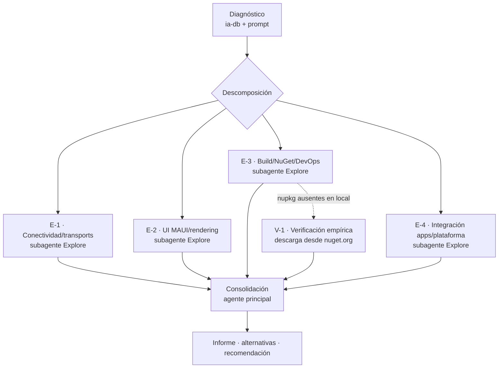
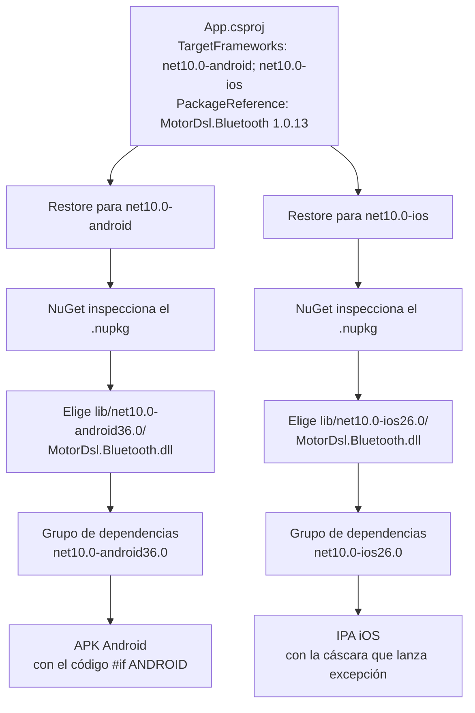
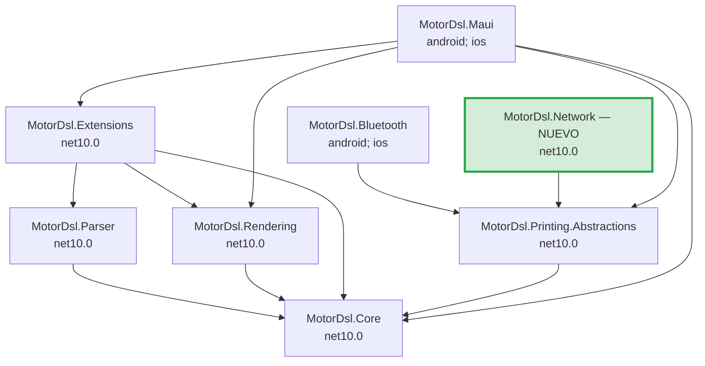
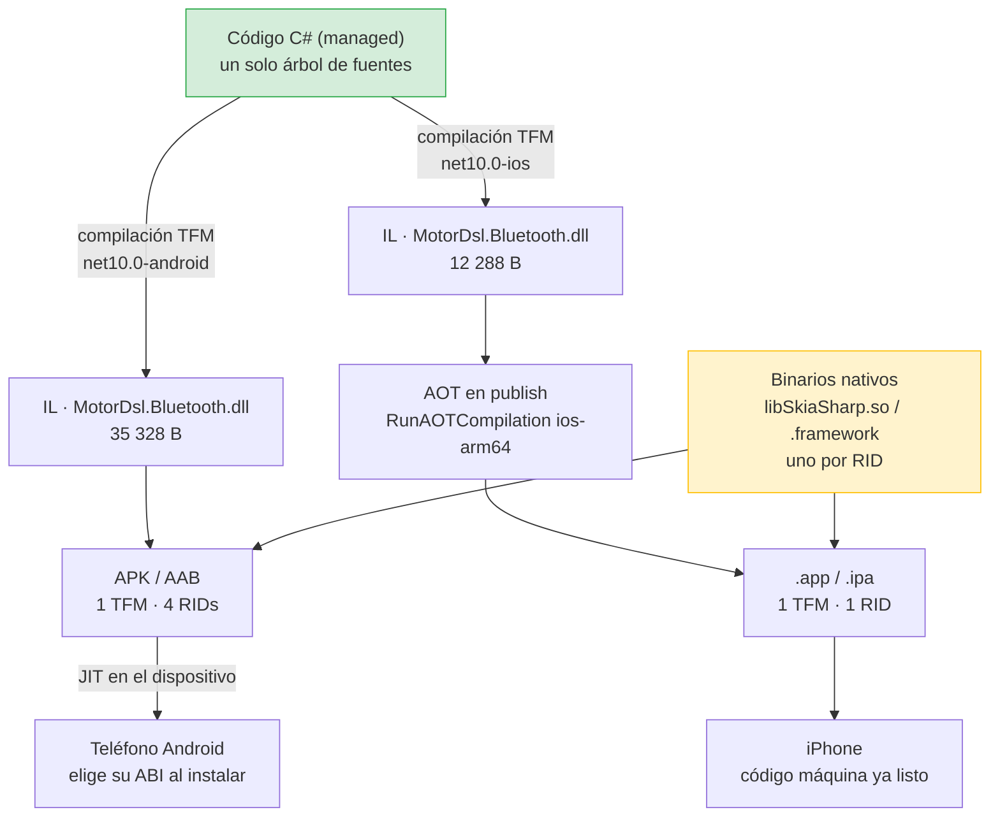
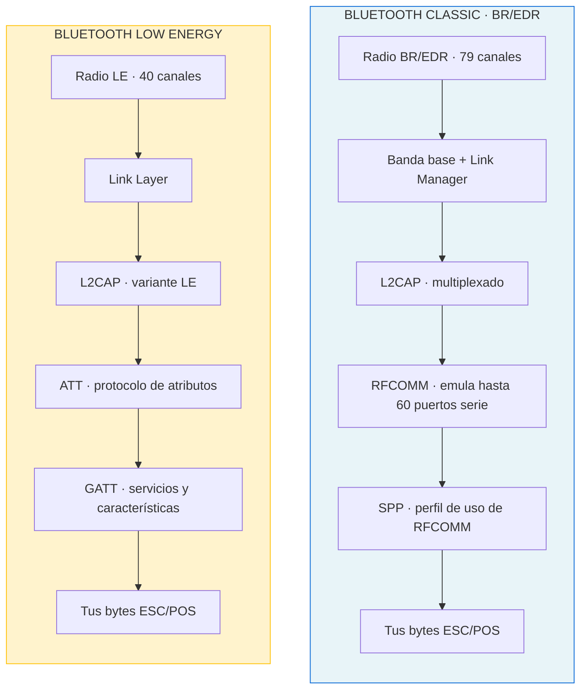

# Soporte iOS y resolución multiplataforma de los paquetes NuGet

> **Objetivo**: evaluar el desarrollo actual de MotorDsl frente al objetivo de dar soporte a dispositivos iOS, plantear las alternativas viables con su estructura de solución resultante, y responder con precisión mecánica cómo se resuelve un `PackageReference` cuando la misma app se compila para Android y para iOS.
>
> **Alcance**: arquitectura de paquetes, empaquetado NuGet y capa de transporte. No cubre el DSL, el layout ni los renderers salvo donde su portabilidad condiciona la decisión.
>
> **Fuentes**: código de `/DEV/ThermalPrint.MotorDsl.Core` (v1.0.13), los `.nupkg` **descargados de nuget.org** (`MotorDsl.* 1.0.13`), `docs/` del repositorio y la base `ia-db`.
>
> **Método**: relevamiento paralelo con cuatro subagentes especializados ([§3](#3-plan-de-evaluación-ejecutado)), consolidado y contrastado contra el código. Cada afirmación cita `ruta:línea` o el artefacto inspeccionado. Lo inferido de reglas de NuGet —no observado en este entorno— se marca como tal.
>
> **Restricción respetada**: no se modificó código, no se hizo commit, push ni PR.

---

## Tabla de contenidos

1. [Resumen ejecutivo](#1-resumen-ejecutivo)
2. [Marco de referencia](#2-marco-de-referencia)
3. [Plan de evaluación ejecutado](#3-plan-de-evaluación-ejecutado)
4. [Estado actual verificado](#4-estado-actual-verificado)
5. [Cómo resuelve NuGet el paquete por plataforma](#5-cómo-resuelve-nuget-el-paquete-por-plataforma)
6. [Alternativas para dar soporte a iOS](#6-alternativas-para-dar-soporte-a-ios)
7. [Comparativa y recomendación](#7-comparativa-y-recomendación)
8. [Plan de implementación de la alternativa recomendada](#8-plan-de-implementación-de-la-alternativa-recomendada)
9. [Hallazgos colaterales que condicionan el trabajo](#9-hallazgos-colaterales-que-condicionan-el-trabajo)
10. [Preguntas guía y criterios de calidad](#10-preguntas-guía-y-criterios-de-calidad)
11. [Glosario](#11-glosario)
    - 11.1 [Modelo de compilación y empaquetado](#111-modelo-de-compilación-y-empaquetado) — managed, nativo, IL, JIT, AOT, TFM, RID, APK, AAB, IPA
    - 11.2 [Bluetooth, BLE y acceso a accesorios](#112-bluetooth-ble-y-acceso-a-accesorios) — las dos pilas, Classic, SPP/RFCOMM, L2CAP, ATT/GATT, MTU, CoreBluetooth, MFi
    - 11.3 [Términos de NuGet y del dominio de impresión](#113-términos-de-nuget-y-del-dominio-de-impresión)
12. [Observaciones](#12-observaciones)
13. [Referencias y evidencias](#13-referencias-y-evidencias)

---

## 1. Resumen ejecutivo

La duda que motivó este análisis tiene una respuesta tranquilizadora y verificada: **NuGet ya hace lo correcto sin que haya que intervenir**. Se descargaron los paquetes publicados y se abrieron. `MotorDsl.Bluetooth 1.0.13` contiene dos carpetas de assets, `lib/net10.0-android36.0/` y `lib/net10.0-ios26.0/`, y su `.nuspec` declara dos grupos de dependencias, uno por TFM. Un único `<PackageReference>` sin condiciones alcanza: durante el restore de `net10.0-android` NuGet elige la carpeta Android, y durante el restore de `net10.0-ios` elige la de iOS. El detalle completo, con el contenido literal de los paquetes, está en [§5](#5-cómo-resuelve-nuget-el-paquete-por-plataforma).

El problema real está una capa más abajo. La app iOS compila, arranca y renderiza bien —DSL, ESC/POS, PDF y raster preview son código managed sin acoplamiento a plataforma—, pero **no puede imprimir**, porque el único transporte que existe en todo el repositorio muere en iOS por diseño. `BluetoothPrinterTransport` lanza `PlatformNotSupportedException` en sus cuatro métodos operativos (`BluetoothPrinterTransport.cs:93,138,173,253`), con el mensaje *«iOS no soporta Bluetooth Classic SPP. Usar BLE o impresion por red.»*. No es un defecto: Apple no expone el perfil SPP a apps de terceros, y la mayoría de las térmicas de 58 mm solo hablan SPP.

El diseño de la librería, sin embargo, anticipó esto bien. `MotorDsl.Printing.Abstractions` compila a `net10.0` puro, sin una sola directiva `#if`, y `IThermalPrinterTransport` tiene siete miembros abstractos más cuatro con implementación default. Agregar un transporte no obliga a tocar el motor. **La barrera es de implementación, no de arquitectura**, y eso reduce el problema a elegir por qué medio físico llegan los bytes a la impresora en iOS.

De las cinco alternativas evaluadas en [§6](#6-alternativas-para-dar-soporte-a-ios), la recomendada es un **paquete `MotorDsl.Network` con TFM `net10.0` puro** que implemente impresión por socket TCP al puerto 9100. Es la única que resuelve iOS **sin escribir una línea de código específico de plataforma**, sirve simultáneamente a Android, iOS y Windows, y reutiliza tal cual la lógica pura de *chunking* y de clasificación de estado que hoy está encerrada en el paquete Bluetooth. Su costo es de hardware: exige impresoras con red, no las Bluetooth económicas.

Como subproducto, el relevamiento destapó tres problemas de CI/CD que van a bloquear cualquier release de esta funcionalidad si no se corrigen antes ([§9](#9-hallazgos-colaterales-que-condicionan-el-trabajo)): el workflow de publicación empaqueta 4 de los 7 paquetes, ningún workflow compila `MotorDsl.Bluetooth` ni `MotorDsl.Maui`, y `cd-ios-multaapp.nuget.yml` apunta a una carpeta que no existe.

---

## 2. Marco de referencia

El perfil `Study-Guide-Documentation` pide fijar el vocabulario antes de desarrollar los temas. Estos tres ejes se usan de forma estable en el resto del documento.

### 2.1 Escenarios

| ID | Escenario | Descripción |
|---|---|---|
| `ESC-1` | Ticket térmico en campo | Un inspector imprime un acta desde el teléfono contra una térmica portátil. Es el caso que originó el proyecto |
| `ESC-2` | Ticket en mostrador fijo | La impresora está en una posición fija con alimentación y red disponibles |
| `ESC-3` | Comprobante sin impresora térmica | El documento se entrega como PDF: se comparte, se envía o se manda a una impresora de oficina |
| `ESC-4` | Vista previa sin hardware | El operador revisa en pantalla cómo saldrá el ticket antes de imprimir |

### 2.2 Contextos

| ID | Contexto | Qué cambia respecto de los demás |
|---|---|---|
| `CTX-AND` | Android + Bluetooth Classic SPP | Único camino hoy operativo de punta a punta |
| `CTX-IOS` | iOS | Render completo, impresión imposible por SPP: es la restricción que este documento aborda |
| `CTX-NET` | Cualquier OS + impresora en red | El transporte deja de depender del sistema operativo |
| `CTX-DEV` | Desarrollo y CI | Compilar `net10.0-ios` exige macOS con Xcode (`docs/00_contexto/compatibilidad-plataformas_v1.0.md:172`) |

### 2.3 Actores

| ID | Actor | Qué decide | Qué no le corresponde |
|---|---|---|---|
| `ACT-LIB` | Mantenedor de MotorDsl | Contratos, qué paquetes existen, qué TFM declara cada uno, política de versionado | Qué impresora compra el cliente |
| `ACT-APP` | Desarrollador de la app consumidora | Qué transportes registra en DI, cómo maneja el error en la UI, qué claves declara en `Info.plist` | El formato interno del `.nupkg` |
| `ACT-OPS` | Responsable de CI/CD y publicación | Que los 7 paquetes salgan con versión unificada y que exista un runner macOS | El diseño del transporte |
| `ACT-NEG` | Responsable funcional | Si el escenario iOS justifica comprar impresoras de red | La implementación |

La combinación `ESC-1 × CTX-IOS` es la que no tiene solución hoy y la que ordena todo el análisis: **un ticket térmico, en campo, desde un iPhone**.

---

## 3. Plan de evaluación ejecutado

La solicitud pedía ordenar la evaluación en subtareas con asignación de subagentes por especialidad. El trabajo se descompuso en cuatro unidades independientes —criterio de `Rule-Agents.md`: partes independientes, exploración amplia que devuelve poco contexto—, ejecutadas en paralelo, más dos tareas que quedaron en el agente principal por depender del contexto ya cargado.



| ID | Subtarea | Especialidad asignada | Alcance entregado | Resultado |
|---|---|---|---|---|
| `E-1` | Auditar el transporte y los contratos | Conectividad / transports | `src/MotorDsl.Bluetooth/`, `src/MotorDsl.Printing.Abstractions/`: directivas `#if`, sitios de excepción, APIs Android, lógica pura reutilizable | Completo — [§4.2](#42-el-transporte-es-el-único-obstáculo) |
| `E-2` | Auditar la capa MAUI | UI MAUI / rendering | `src/MotorDsl.Maui/`: portabilidad de controles, renderers, rasterizadores y diagnóstico | Completo — [§4.3](#43-la-capa-maui-ya-es-portable-con-tres-asperezas) |
| `E-3` | Auditar build y empaquetado | Build / NuGet / DevOps | 7 `.csproj`, 6 workflows, scripts de publicación, `NuGet.config`, ausencia de `Directory.Build.props` | Completo, con un límite: no había `.nupkg` en el entorno |
| `E-4` | Auditar integración y plataforma | Integración de apps | 5 samples, `Info.plist`, `AndroidManifest.xml`, `MauiProgram.cs`, doc existente sobre iOS | Completo — [§4.4](#44-lo-que-falta-del-lado-de-la-app-consumidora) |
| `V-1` | Verificar el empaquetado real | Agente principal | Descarga de `MotorDsl.{Bluetooth,Maui,Core} 1.0.13` desde nuget.org e inspección de `lib/` y `.nuspec` | Completo — cierra el hueco de `E-3` |
| `S-1` | Consolidación y redacción | Agente principal | Contraste cruzado, resolución de conflictos, alternativas y recomendación | Este documento |

`V-1` no estaba en el plan inicial. Se agregó porque `E-3` reportó que `nupkg/` solo contiene un `Readme.md` y que no existía ningún `.nupkg` en el sistema de archivos, lo que dejaba la pregunta central del usuario respondida solo por inferencia. Descargar los paquetes publicados convirtió esa inferencia en evidencia directa, y de paso refutó una hipótesis razonable pero falsa de `E-3`: que los tres paquetes ausentes del workflow de CI podían no estar publicados. Están, en 1.0.13.

---

## 4. Estado actual verificado

### 4.1 Qué funciona hoy en iOS

Conviene separar lo que no anda de lo que sí, porque la superficie rota es más chica de lo que sugiere el rótulo «no soporta iOS».

| Capacidad | Android | iOS | Evidencia |
|---|---|---|---|
| Parsear DSL, evaluar, calcular layout | ✅ | ✅ | Los 5 paquetes base son `net10.0` puro sin `#if` |
| Render `text` y `escpos` (`byte[]`) | ✅ | ✅ | `MotorDsl.Rendering`, TFM `net10.0` |
| Render `pdf`, `escpos-bitmap`, `raster-preview` | ✅ | ✅ | `MotorDsl.Maui` compila a `net10.0-ios`, sin `using Android.*` |
| Controles MAUI (`PrinterPickerView`, badge, preview) | ✅ | ✅ compila | Cero cadenas «bluetooth» hardcodeadas en `src/MotorDsl.Maui/` |
| Diagnóstico | ✅ | ⚠️ parcial | `PermissionsSnapshot` devuelve `null` (`MauiDiagnosticsReportProvider.cs:165-167`) |
| Descubrir, conectar y **enviar bytes a la impresora** | ✅ | ❌ | `PlatformNotSupportedException` |

La conclusión operativa: **en iOS falta exactamente la última etapa del pipeline**, la que va del `byte[]` al papel.


*Verde: funciona hoy en iOS. Rojo: no existe implementación para iOS.*

### 4.2 El transporte es el único obstáculo

`MotorDsl.Bluetooth` declara `net10.0-android;net10.0-ios` (`MotorDsl.Bluetooth.csproj:4`), pero el TFM de iOS es una cáscara. La distribución del código por archivo lo muestra con crudeza:

| Archivo | Líneas | Directiva | Qué queda compilado en `net10.0-ios` |
|---|---|---|---|
| `BluetoothPrinterTransport.cs` | 282 | `#if ANDROID` / `#elif IOS` en cada método | Los cuatro `throw` (`:93`, `:138`, `:173`, `:253`) |
| `BluetoothPrinterTransport.Detection.cs` | 261 | `#if ANDROID` en `:1`, `#endif` en `:261` | **Nada.** El archivo entero desaparece |
| `BluetoothPrinterTransport.Nv.cs` | 190 | `#if ANDROID` en `:1`, `#endif` en `:190` | **Nada.** El archivo entero desaparece |
| `BluetoothPrinterTransport.Capabilities.cs` | 102 | ninguna | Todo. Lógica pura |
| `BluetoothPrinterTransport.Chunking.cs` | 28 | ninguna | Todo. Lógica pura |
| `MotorDslBluetoothServiceCollectionExtensions.cs` | 13 | ninguna | Todo, **incluido el registro en DI** |

Tres consecuencias merecen atención.

La primera es que el acoplamiento a Android es **estrecho y localizado**. Se concentra en `BluetoothSocket`/`BluetoothAdapter` con el UUID SPP `00001101-0000-1000-8000-00805F9B34FB` (`BluetoothPrinterTransport.cs:110-111`) y en `Java.IO.InputStream.Available()/Read()` para leer el byte de estado (`Detection.cs:204,206,229,234`). Todo lo demás es aritmética de bytes. Un transporte nuevo reutiliza sin tocar `ChunkBuffer` —partición fija de 256 bytes que devuelve `ArraySegment` sin copiar— y las funciones puras `HasValidStatusFixedBits`, `ClassifyStatusResponse`, `ParseStatusByte`, `NextPacingDecision` y `ParseGsV0`. Que sean genuinamente puras no es una opinión: `MotorDsl.Tests` las enlaza por fuente y las compila bajo `net10.0` (`MotorDsl.Tests.csproj:29-32`), lo que sería imposible si arrastraran dependencias de plataforma.

La segunda es un **defecto latente en el registro de DI**. `MotorDslBluetoothServiceCollectionExtensions.cs:10` hace `services.AddSingleton<IThermalPrinterTransport, BluetoothPrinterTransport>()` sin ninguna guarda de plataforma, y los dos samples NuGet lo invocan igual de incondicionalmente (`MotorDsl.Nuget.MultaApp/MauiProgram.cs:45`, `MotorDsl.Nuget.Integrated.MultaApp/MauiProgram.cs:51`). La app iOS arranca con un transporte registrado que explota en la primera operación. La documentación del propio proyecto recomienda lo contrario —`#if IOS / #elif ANDROID` en `docs/00_contexto/compatibilidad-plataformas_v1.1.md:167-174`—, así que aquí hay una divergencia declarada entre lo que la guía indica y lo que los ejemplos hacen.

La tercera es más sutil: como `Nv.cs` desaparece por completo en iOS, la clase satisface `ProvisionLogoAsync`, `IsLogoProvisionedAsync` y `ClearLogoAsync` mediante las implementaciones default de la interfaz (`IThermalPrinterTransport.cs:21-28`). En iOS el aprovisionamiento del logo **no lanza excepción: falla en silencio** devolviendo `false`. Es un comportamiento distinto al del resto de la clase y conviene tenerlo presente al diseñar el transporte nuevo.

Contra esto, el contrato es impecablemente agnóstico. `MotorDsl.Printing.Abstractions` compila a `net10.0` (`csproj:4`), no tiene una sola directiva `#if`, y sus únicas menciones a plataforma son comentarios y el campo de datos `OsPlatform`. `deviceId` es `string`, lo que admite indistintamente una MAC, un `NSUUID` de CoreBluetooth o un `host:puerto`. `Kind` es un `string` libre. Los cuatro miembros con implementación default dan degradación limpia a un transporte que no soporte memoria NV.

### 4.3 La capa MAUI ya es portable, con tres asperezas

`MotorDsl.Maui` tiene 2168 líneas de C# repartidas en 14 archivos, y **una sola directiva de compilación condicional en todo el proyecto**: el bloque `#if ANDROID` de `MauiDiagnosticsReportProvider.cs:137-167`. No hay ningún `using Android.*` ni `Java.*`, ni uso de `Platform.CurrentActivity`. Los tres paquetes externos —SkiaSharp 3.119.2, PdfSharpCore 1.3.67, QRCoder 1.8.0— soportan iOS. Los renderers son managed puro: `PdfRenderer` resuelve la tipografía desde un `EmbeddedResource` (`DroidSans-Regular.ttf`, `MotorDsl.Maui.csproj:45`) en lugar de depender de las fuentes del sistema, que es justamente lo que lo hace portable.

Las asperezas que quedan no impiden compilar, pero degradan la experiencia:

- **Familias tipográficas no portables.** `RasterPreviewRenderer.cs:92` y `:130` caen a `SKTypeface.FromFamilyName("monospace")`; `MauiDiagnosticsView.cs:195` usa `FontFamily = "monospace"`; `MauiDocumentPreview.cs:71` usa `"Consolas"`. `"monospace"` es el alias de Android e iOS no lo resuelve —devolvería una proporcional y rompería la alineación de columnas del preview—; `"Consolas"` es de Windows y no existe en ninguna de las dos plataformas móviles.
- **Diagnóstico mutilado en iOS.** El `#if ANDROID` del provider es más restrictivo de lo necesario: `Permissions.Bluetooth` y `Permissions.LocationWhenInUse` también existen en MAUI Essentials para iOS. Se pierde diagnóstico precisamente donde más falta hace, porque en iOS el permiso de Bluetooth es de los que más fallan.
- **El picker asume descubrimiento activo.** `PrinterPickerView` no menciona Bluetooth en ningún texto ni hardcodea el `Kind` —lo recibe por `FilterKind` (`:19-24`) y lo reenvía al servicio (`:165`)—, pero su modelo de interacción es «Escanear → lista → conectar», con `AutoConnectIfSingle` en `true` por defecto (`:31`). En iOS ese modelo no aplica a accesorios emparejados fuera de la app, y el control no ofrece ningún camino alternativo.

### 4.4 Lo que falta del lado de la app consumidora

Los cinco samples tienen `Platforms/iOS/` con los cuatro archivos de la plantilla MAUI estándar, sin ninguna personalización. Los `Info.plist` tienen 36 líneas idénticas y **no declaran ninguna clave relacionada con impresión**: falta `NSBluetoothAlwaysUsageDescription`, falta `UISupportedExternalAccessoryProtocols`, falta `NSLocalNetworkUsageDescription` junto con `NSBonjourServices`. El `Entitlements.Development.plist` solo tiene `get-task-allow`.

Esto no es un defecto hoy —sin transporte iOS ninguna de esas claves haría falta— pero **se vuelve bloqueante en el momento en que se implemente cualquiera de las alternativas de [§6](#6-alternativas-para-dar-soporte-a-ios)**, y con un modo de falla desagradable: iOS 14 y posteriores rechazan el acceso a la red local sin `NSLocalNetworkUsageDescription`, y la app es terminada por el sistema sin mensaje útil.

Del lado Android el contraste es total: los cinco manifiestos declaran los siete permisos correspondientes, incluido `BLUETOOTH_SCAN` con `usesPermissionFlags="neverForLocation"` y el `<queries>` para `REQUEST_ENABLE`.

---

## 5. Cómo resuelve NuGet el paquete por plataforma

Esta sección responde la duda planteada en la solicitud. La respuesta corta es que **no hay que hacer nada**, y el mecanismo por el cual eso es cierto merece explicarse porque condiciona el diseño de los paquetes nuevos.

### 5.1 El mecanismo

Un paquete NuGet no contiene «un» ensamblado: contiene un árbol de carpetas `lib/<tfm>/`, una por cada framework objetivo para el que fue compilado. Durante el restore, NuGet conoce el TFM que está resolviendo en ese momento y elige la carpeta más específica que sea compatible con él. El `.nuspec` puede además declarar **grupos de dependencias por TFM**, de modo que cada plataforma arrastre transitivamente lo que le corresponde.

Cuando el `.csproj` de la app declara dos TFMs, MSBuild ejecuta el ciclo completo una vez por cada uno. Son dos resoluciones independientes que comparten un mismo `<PackageReference>`.



### 5.2 Evidencia empírica

No es teoría. Se descargó `MotorDsl.Bluetooth 1.0.13` de nuget.org y se listó su contenido:

```bash
curl -s -o motordsl.bluetooth.nupkg \
  "https://api.nuget.org/v3-flatcontainer/motordsl.bluetooth/1.0.13/motordsl.bluetooth.1.0.13.nupkg"
unzip -l motordsl.bluetooth.nupkg
```

```text
     1449  MotorDsl.Bluetooth.nuspec
    12083  README.md
    35328  lib/net10.0-android36.0/MotorDsl.Bluetooth.dll
    13628  lib/net10.0-android36.0/MotorDsl.Bluetooth.xml
    12288  lib/net10.0-ios26.0/MotorDsl.Bluetooth.dll
```

Los tamaños confirman por sí solos lo que dice el código: la DLL de Android pesa 35 KB y la de iOS 12 KB, porque en iOS los archivos `Detection.cs` y `Nv.cs` desaparecen enteros.

El `.nuspec` del mismo paquete declara los dos grupos de dependencias:

```xml
<dependencies>
  <group targetFramework="net10.0-android36.0">
    <dependency id="MotorDsl.Printing.Abstractions" version="1.0.13" />
    <dependency id="Microsoft.Extensions.DependencyInjection.Abstractions" version="10.0.8" />
  </group>
  <group targetFramework="net10.0-ios26.0">
    <dependency id="MotorDsl.Printing.Abstractions" version="1.0.13" />
    <dependency id="Microsoft.Extensions.DependencyInjection.Abstractions" version="10.0.8" />
  </group>
</dependencies>
```

`MotorDsl.Maui 1.0.13` tiene la misma forma, con siete dependencias en cada grupo. `MotorDsl.Core 1.0.13`, en cambio, trae una sola carpeta `lib/net10.0/`.

### 5.3 Por qué los cinco paquetes base funcionan en ambas plataformas

`MotorDsl.Core` no declara `lib/net10.0-android/` ni `lib/net10.0-ios/`, y sin embargo se consume desde las dos. La razón es que un TFM de plataforma **hereda la compatibilidad de su TFM base**: `net10.0-ios` es compatible con todo lo que apunte a `net10.0`. Por eso los cinco paquetes que compilan a `net10.0` puro sirven a las dos plataformas sin duplicar assets, y por eso el sample NuGet puede referenciar los siete paquetes en un único `<ItemGroup>` sin condiciones (`MotorDsl.Nuget.MultaApp.csproj:74-80`).

La relación no es simétrica. Un proyecto `net10.0` puro **no** puede consumir `MotorDsl.Bluetooth`, porque no existe ninguna carpeta `lib/net10.0/` en ese paquete: el restore falla con `NU1202`. Es exactamente el motivo por el cual `MotorDsl.Tests` enlaza los archivos puros por `<Compile Include>` en lugar de referenciar el proyecto, y el comentario de `MotorDsl.Tests.csproj:23-28` lo dice con todas las letras.

### 5.4 Regla de diseño que se desprende

| TFM del paquete | Consumible desde | Cuándo elegirlo |
|---|---|---|
| `net10.0` | `net10.0`, `net10.0-android`, `net10.0-ios`, `net10.0-windows`, … | Cuando el código no toca APIs de plataforma. **Es el caso del transporte de red** |
| `net10.0-android;net10.0-ios` | solo esas dos plataformas | Cuando hay APIs nativas de por medio. Impide referenciarlo desde tests `net10.0` |

Esta es la razón técnica por la que la alternativa recomendada en [§7](#7-comparativa-y-recomendación) propone un paquete `net10.0` puro: además de resolver iOS, queda **testeable directamente desde `MotorDsl.Tests` sin el rodeo del enlace por fuente**.

### 5.5 Advertencia sobre la versión de plataforma en el nombre de la carpeta

Un detalle que conviene registrar porque puede morder en el futuro. La carpeta no se llama `lib/net10.0-ios/` sino `lib/net10.0-ios26.0/`, y la de Android es `lib/net10.0-android36.0/`. Ese número no sale de `SupportedOSPlatformVersion` —que en el `.csproj` vale 15.0 para iOS (`MotorDsl.Bluetooth.csproj:10`)— sino del `TargetPlatformVersion` que el SDK resolvió al empaquetar, y que por defecto es el del workload instalado en la máquina que hizo el `pack`.

La regla de compatibilidad de NuGet es que un consumidor resuelve la carpeta si su propio `TargetPlatformVersion` es **igual o mayor**. Una app compilada con un workload de iOS anterior al 26.0 no resolvería este paquete. En la práctica esto raramente aparece, porque las plantillas MAUI toman por defecto el `TargetPlatformVersion` del workload instalado y los equipos suelen estar alineados, pero deja la publicación atada a la máquina que la ejecuta.

> **Estado de verificación**: el contenido de las carpetas y los grupos de dependencias son **hecho verificado** sobre los `.nupkg` descargados. La regla de compatibilidad por `TargetPlatformVersion` es **comportamiento documentado de NuGet**, no reproducido en este entorno: verificar en un macOS con workload iOS anterior a 26.0 antes de darla por cierta.

---

## 6. Alternativas para dar soporte a iOS

Las cinco alternativas se ordenan de menor a mayor acoplamiento con el hardware. Cada una se evalúa con el mismo esquema: en qué consiste, cómo queda la estructura de la solución, qué cambia, y qué implica.

### 6.1 Alternativa A — Transporte de red TCP al puerto 9100

**En qué consiste.** Un `IThermalPrinterTransport` que abre un `TcpClient` contra la impresora y escribe los mismos bytes ESC/POS que hoy viajan por el socket SPP. El puerto 9100 es el estándar de facto de impresión cruda —conocido como *RAW* o *JetDirect*— y lo implementan prácticamente todas las térmicas con Ethernet o WiFi. La propia documentación del proyecto ya lo señala como el camino recomendado para iOS (`docs/00_contexto/compatibilidad-plataformas_v1.1.md:119`).

**Estructura final de la solución.**



El paquete nuevo es el octavo, con TFM `net10.0` puro. La estructura de carpetas del repositorio queda:

```text
src/
├── MotorDsl.Core/                    (sin cambios)
├── MotorDsl.Parser/                  (sin cambios)
├── MotorDsl.Rendering/               (sin cambios)
├── MotorDsl.Extensions/              (sin cambios)
├── MotorDsl.Printing.Abstractions/   (sin cambios)
├── MotorDsl.Bluetooth/               (sin cambios funcionales)
├── MotorDsl.Network/                 ← NUEVO, net10.0
│   ├── NetworkPrinterTransport.cs        Kind = "network"
│   ├── NetworkPrinterTransport.Discovery.cs
│   ├── MotorDslNetworkServiceCollectionExtensions.cs
│   └── MotorDsl.Network.csproj
├── MotorDsl.Maui/                    (sin cambios)
└── MotorDsl.Tests/                   + NetworkTransportTests.cs
```

**Qué cambia.** En la librería, nada más que agregar el proyecto: los contratos ya están. En la app consumidora, un `PackageReference` adicional y una línea de DI. El registro sí conviene condicionarlo, porque el picker debe filtrar por el `Kind` correcto en cada plataforma:

```csharp
// MauiProgram.cs de la app consumidora
builder.Services.AddMotorDslEngine()
    .AddTemplates(t => t.Add("acta", MultaIntegratedDsl.Document))
    .AddProfiles(p => p.Add(new DeviceProfile("thermal_58mm", 32, "escpos-bitmap")))
    .AddMotorDslMaui();

#if ANDROID
builder.Services.AddBluetoothPrinterTransport();   // Kind = "bluetooth"
#endif
builder.Services.AddNetworkPrinterTransport();     // Kind = "network", ambas plataformas
```

Nada impide registrar los dos en Android: `ThermalPrinterService.DiscoverDevicesAsync` recorre todos los transportes registrados y combina resultados, y `ConnectAsync` rutea por `PrinterDevice.Kind`. Del lado de la UI, el `FilterKind` del picker pasa a decidirse por plataforma:

```xml
<muic:PrinterPickerView x:Name="DevicePicker"
                        FilterKind="{OnPlatform Android='bluetooth', iOS='network'}" />
```

El descubrimiento es el punto de diseño más delicado. Barrer la subred entera probando el puerto 9100 host por host es lento y agresivo; lo razonable es combinar tres caminos: entrada manual de `host:puerto` persistida, resolución mDNS/Bonjour del servicio `_pdl-datastream._tcp`, y opcionalmente el barrido acotado como último recurso. La entrada manual sola ya habilita el escenario completo y es lo mínimo que debe existir en la primera iteración.

**Implicancias.**

| Dimensión | Efecto |
|---|---|
| Código de plataforma | **Ninguno.** `System.Net.Sockets` es BCL |
| Reutilización | `ChunkBuffer` y las funciones de `Capabilities.cs` se usan tal cual. El *gating* por estado requiere leer del `NetworkStream`, que es más simple que el `Java.IO.InputStream` de Android |
| Testabilidad | **Mejora sustantiva**: `MotorDsl.Tests` es `net10.0` y puede referenciar el proyecto de verdad, no por enlace de fuente |
| Plataformas cubiertas | Android, iOS y cualquier otra que MAUI soporte, con un solo cuerpo de código |
| `Info.plist` | Requiere `NSLocalNetworkUsageDescription` y, si se implementa Bonjour, `NSBonjourServices` |
| Hardware | **Exige impresoras con red.** Descarta las térmicas Bluetooth económicas de `ESC-1` |
| Publicación | Un octavo paquete en la versión unificada; hay que tocar el script y el workflow |

**Límite honesto.** No resuelve `ESC-1` con el parque de impresoras actual. Resuelve `ESC-2` de forma impecable y `ESC-1` solo si el inspector lleva una térmica con WiFi, que existen pero cuestan más.

### 6.2 Alternativa B — Transporte BLE

**En qué consiste.** Usar Bluetooth Low Energy, que es lo único que iOS expone a apps de terceros. La escritura se hace sobre una característica GATT del periférico. En .NET MAUI hay dos caminos: implementar directamente contra `CoreBluetooth` con `#if IOS` y contra `Android.Bluetooth.LE` con `#if ANDROID`, o apoyarse en `Plugin.BLE`, que abstrae ambas.

**Estructura final.** Un paquete `MotorDsl.Ble` con TFM `net10.0-android;net10.0-ios`, hermano de `MotorDsl.Bluetooth` y con la misma forma de empaquetado que ya se verificó en [§5.2](#52-evidencia-empírica): dos carpetas `lib/`, dos grupos de dependencias. La diferencia con la alternativa A es que aquí sí hay dos implementaciones nativas que mantener.

```text
src/MotorDsl.Ble/
├── BlePrinterTransport.cs               Kind = "ble", partial + #if
├── BlePrinterTransport.Android.cs       #if ANDROID
├── BlePrinterTransport.iOS.cs           #if IOS — CoreBluetooth
├── BlePrinterTransport.Chunking.cs      puro, compartido
└── MotorDsl.Ble.csproj                  net10.0-android;net10.0-ios
```

**Implicancias.** El *chunking* deja de ser un detalle de rendimiento y pasa a ser una restricción dura del protocolo: el MTU de BLE ronda los 20 bytes útiles por escritura sin negociación, y aun negociado queda muy por debajo de los 256 bytes que usa hoy `ChunkBuffer`. Imprimir un ticket con logo rasterizado por BLE es lento de forma perceptible. `Info.plist` necesita `NSBluetoothAlwaysUsageDescription`. Y persiste el problema de fondo: **la mayoría de las térmicas económicas no exponen BLE**, tal como registra `docs/00_contexto/compatibilidad-plataformas_v1.1.md:81-83`. Es la alternativa con mejor encaje conceptual en `ESC-1` y peor encaje con el hardware realmente disponible.

### 6.3 Alternativa C — MFi / ExternalAccessory

**En qué consiste.** El programa MFi de Apple es el único camino legítimo para hablar por serie con un accesorio Bluetooth desde iOS. Requiere que **la impresora** esté certificada MFi y que la app declare el protocolo del fabricante en `UISupportedExternalAccessoryProtocols`.

**Implicancias.** Es la alternativa de mayor costo y menor control: obliga a comprar hardware certificado, a integrar el SDK propietario de cada fabricante y a gestionar el entitlement. No hay una API genérica que sirva para varias marcas. La estructura sería un paquete por fabricante o un paquete con abstracción propia, lo que multiplica el mantenimiento. Se documenta por completitud; no se recomienda salvo que el cliente ya tenga hardware MFi.

### 6.4 Alternativa D — AirPrint vía PDF

**En qué consiste.** No imprimir ESC/POS: generar el PDF con el `PdfRenderer` que ya existe y entregarlo al subsistema de impresión de iOS. La documentación lo registra como disponible hoy (`compatibilidad-plataformas_v1.1.md:202`).

**Implicancias.** No requiere ningún paquete nuevo ni ningún transporte: es composición de piezas existentes. Resuelve `ESC-3` sin costo. No resuelve `ESC-1` ni `ESC-2`, porque una térmica de 58 mm no es una impresora AirPrint y el resultado no es un ticket sino una hoja. Es complemento, no sustituto.

### 6.5 Alternativa E — Servidor de impresión intermedio

**En qué consiste.** La app envía el `byte[]` a un backend por HTTP y un agente del lado servidor lo entrega a la impresora. El transporte del lado de la app es un cliente REST.

**Implicancias.** Convierte un problema de plataforma en uno de infraestructura: hay que desplegar y operar el agente, y la impresión deja de funcionar sin conectividad, lo que choca frontalmente con `ESC-1` en campo. A cambio, unifica el comportamiento en todas las plataformas y centraliza la lógica de impresión. Tiene sentido cuando ya existe un backend en la arquitectura —los samples de multa consumen uno (`Resources/Raw/motordsl-config.json`)— y las impresoras están en ubicaciones fijas del lado servidor.

### 6.6 Decisión sobre el TFM de `MotorDsl.Bluetooth`

Independiente de la alternativa elegida, hay una decisión menor pendiente: si `MotorDsl.Bluetooth` debe seguir declarando `net10.0-ios`.

| Opción | Consecuencia |
|---|---|
| **Mantener el TFM iOS** (estado actual) | El consumidor usa un `PackageReference` sin condiciones. El error aparece en runtime, con un mensaje explícito |
| Quitar el TFM iOS | El error se adelanta a compilación, pero el consumidor debe condicionar el `PackageReference` por TFM, lo que complica el `.csproj` de toda app multiplataforma |

Mantenerlo es lo correcto y así debe quedar. El mensaje de la excepción es claro y el `<Description>` del paquete lo advierte (`MotorDsl.Bluetooth.csproj:15`). Lo que sí conviene corregir es que `DisconnectAsync` lance (`BluetoothPrinterTransport.cs:173`): el código de limpieza suele llamarlo sin `try/catch`, y un *no-op* silencioso sería mejor ciudadano que una excepción.

---

## 7. Comparativa y recomendación

| Criterio | A · Red TCP | B · BLE | C · MFi | D · AirPrint | E · Servidor |
|---|---|---|---|---|---|
| Resuelve `ESC-1` (campo) | Parcial | Sí | Sí | No | No |
| Resuelve `ESC-2` (mostrador) | **Sí** | Sí | Sí | No | Sí |
| Código específico de plataforma | **Ninguno** | Dos implementaciones | SDK propietario | Ninguno | Ninguno |
| TFM del paquete nuevo | **`net10.0`** | android + ios | android + ios | — | `net10.0` |
| Testeable desde `MotorDsl.Tests` | **Sí, directo** | No (enlace por fuente) | No | n/a | Sí |
| Reutiliza chunking y pacing actuales | **Sí** | Parcial (MTU) | Parcial | n/a | Sí |
| Requiere hardware nuevo | Sí (red) | Sí (BLE) | Sí (MFi) | No | No |
| Requiere infraestructura | No | No | No | No | **Sí** |
| Cobertura de plataformas del mismo código | **Todas** | Android + iOS | iOS | iOS | Todas |
| Esfuerzo estimado | Bajo | Alto | Muy alto | Muy bajo | Medio |

**Recomendación: implementar A, y agregar D como complemento inmediato.**

El argumento decisivo no es que A sea la que más escenarios cubre —no lo es, B cubre mejor `ESC-1`— sino que es **la única que aumenta la superficie de plataformas soportadas sin agregar superficie de código específico de plataforma**. Un paquete `net10.0` puro se compila en cualquier runner, se testea en el CI que ya existe, no necesita workloads de MAUI, y sirve a Android, iOS y Windows con un solo cuerpo de código. Con B, cada línea nueva hay que escribirla dos veces y probarla en dos dispositivos físicos.

D se agrega porque su costo es prácticamente nulo: el `PdfRenderer` ya produce el documento y solo falta el gesto de entregarlo al sistema. Cubre `ESC-3` de inmediato y le da a la app iOS una función de impresión real mientras se implementa A.

B queda como candidata legítima para una segunda etapa, condicionada a una decisión que no es técnica sino de negocio (`ACT-NEG`): si el parque de impresoras que efectivamente se va a usar en campo expone BLE. Sin esa respuesta, implementarla es apostar. C y E se descartan para este proyecto —la primera por costo y dependencia de fabricante, la segunda porque contradice el requisito de operar en campo—, sin perjuicio de que E sea razonable en una instalación con impresoras fijas y backend ya desplegado.

---

## 8. Plan de implementación de la alternativa recomendada

El orden respeta la prioridad de `Rule-Workflow.md`: primero lo bloqueante, después lo de mayor impacto.

| # | Tarea | Depende de | Resultado verificable |
|---|---|---|---|
| 1 | Corregir `cd-nuget.yml` para empaquetar los 7 paquetes con los workloads necesarios, o documentar formalmente que la publicación es el script local | — | Un tag `v*` produce los 7 `.nupkg` con la misma versión |
| 2 | Corregir la ruta de `cd-ios-multaapp.nuget.yml` y su paso de validación | — | El workflow se dispara y compila |
| 3 | Extraer a `MotorDsl.Printing.Abstractions` la construcción de comandos ESC/POS hoy atrapada en `Nv.cs` (`BuildGslDefine:135`, `BuildGslDelete:165`, `BuildFsqDefine:177`) | — | Los tests actuales siguen en verde; el código queda disponible para el transporte nuevo |
| 4 | Crear `src/MotorDsl.Network/` con TFM `net10.0` e implementar `NetworkPrinterTransport` (`Kind = "network"`) con conexión manual `host:puerto` | 3 | Conecta y escribe contra una térmica de red |
| 5 | Portar el *chunking* y el *pacing* reutilizando `ChunkBuffer` y `NextPacingDecision` | 4 | Tests de paridad byte a byte con el camino Bluetooth |
| 6 | Agregar `NetworkTransportTests` en `MotorDsl.Tests` con `TcpListener` como doble de prueba | 4 | Cobertura ≥ 70 % del proyecto nuevo, según el DoD del proyecto |
| 7 | Implementar descubrimiento por mDNS (`_pdl-datastream._tcp`) como segunda iteración | 4 | El picker lista impresoras sin entrada manual |
| 8 | Agregar `NSLocalNetworkUsageDescription` y `NSBonjourServices` a los `Info.plist` de los samples | 4, 7 | La app iOS accede a la red local sin ser terminada |
| 9 | Condicionar `AddBluetoothPrinterTransport()` con `#if ANDROID` en los dos samples NuGet y parametrizar `FilterKind` con `OnPlatform` | 4 | En iOS no queda registrado un transporte que lanza |
| 10 | Corregir las familias tipográficas no portables de [§4.3](#43-la-capa-maui-ya-es-portable-con-tres-asperezas) | — | El preview conserva la alineación de columnas en iOS |
| 11 | Habilitar `SnapshotPermissions` también en iOS | — | El reporte de diagnóstico deja de tener `Permissions: null` en iOS |
| 12 | Incorporar el octavo paquete al script de publicación y a la versión unificada | 1, 4 | `MotorDsl.Network` sale en la misma versión que los otros 7 |
| 13 | Actualizar `README.md`, `compatibilidad-plataformas_v1.1.md` y la `ia-db` | 4–12 | La documentación refleja el estado real |

Las tareas 1 y 2 son bloqueantes de la publicación, no del desarrollo: se pueden abordar en paralelo con 3 y 4.

---

## 9. Hallazgos colaterales que condicionan el trabajo

Estos seis puntos no formaban parte de la pregunta, pero impactan directamente en la viabilidad de publicar el soporte iOS. Se reportan como propuestas, sin ejecutarlos, conforme a `Rule-All.md`. Están ordenados por severidad.

**H-1 · Los paquetes publicados como 1.0.13 no contienen las correcciones que el CHANGELOG le atribuye a 1.0.13.** El `.nuspec` de los siete paquetes en nuget.org declara `commit="ebe03efcccef28df3d5d1b8fd1c07f6164b60426"`. Ese commit está **dos posiciones por debajo** de `main`:

```text
83677eb  (main)  Merge pull request #5 from Aplicada-Streaming/fix/bitmap-decode-zero-bytes
c3c8131          fix(rendering): decodificar imagenes con SKImage.FromEncodedData y propagar bold
ebe03ef          feat(printing): logo NV con recall…          ← el commit empaquetado
```

El commit ausente, `c3c8131`, es exactamente el que corrige los dos defectos que el CHANGELOG describe bajo 1.0.13. Tocó cuatro archivos, tres de ellos de producción:

| Archivo | Corrección |
|---|---|
| `src/MotorDsl.Maui/Renderers/SkiaSharpRasterizer.cs` | `SKBitmap.Decode` devolvía `null` en SkiaSharp 3.x y descartaba el ticket completo |
| `src/MotorDsl.Maui/Renderers/BitmapEscPosRenderer.cs` | Manejo de fallas de imagen por severidad |
| `src/MotorDsl.Core/Layout/LayoutEngine.cs` | El estilo `bold` no se propagaba al metadata |

La consecuencia es directa: **quien instale `MotorDsl.Maui 1.0.13` desde nuget.org sigue teniendo el bug del rasterizado.** Y como `samples/MotorDsl.Nuget.MultaApp` usa `Version="1.0.*"`, ese sample consume precisamente la versión sin la corrección. Encaja con la justificación que dejó escrita el autor en `samples/MotorDsl.Nuget.Integrated.MultaApp/MotorDsl.Nuget.Integrated.MultaApp.csproj:72-77` para volver a `ProjectReference`: los paquetes publicados no tienen la API que la app necesita.

Corresponde republicar como 1.0.14 desde `main`. Ninguna corrección de las que siguen tiene sentido sin resolver esta primero.

> Dato relacionado, de menor peso: en el clon local solo existen los tags hasta `v1.0.9`. Los de 1.0.10 a 1.0.13 no están, aunque puede deberse simplemente a que no se trajeron con `git fetch --tags`.

**H-2 · El workflow de publicación empaqueta 4 de 7 paquetes.** `cd-nuget.yml` itera literalmente sobre `for proj in Core Parser Rendering Extensions` en sus tres etapas (`:46`, `:52`, `:63`), y el propio paso se titula «Pack los 4 proyectos de la librería». Quedan fuera `Printing.Abstractions`, `Bluetooth` y `Maui`. El runner es `ubuntu-latest` sin ningún workload MAUI (`:26-29`).

**No es un descuido, o no del todo: en `ubuntu-latest` esos dos paquetes son imposibles de generar.** Se verificó ejecutando el SDK en un contenedor Linux `mcr.microsoft.com/dotnet/sdk:10.0` sobre este mismo repositorio:

```text
$ dotnet workload search            # Linux ofrece: android, macos, maui-android,
                                    # maui-tizen, maui-windows, wasm/wasi — NO ofrece ios
$ dotnet workload install ios
Workload installation failed: Workload ID ios isn't supported on this platform.

$ dotnet pack src/MotorDsl.Bluetooth/MotorDsl.Bluetooth.csproj
error NETSDK1178: The project depends on the following workload packs that do not exist
in any of the workloads available in this installation: Microsoft.iOS.Sdk.net10.0_26.0
error NETSDK1178: You may need to build the project on another operating system or architecture.
```

`dotnet pack` de un proyecto multi-TFM exige compilar **todos** sus TFMs, así que sin el workload de iOS no hay `.nupkg` posible para `MotorDsl.Bluetooth` ni para `MotorDsl.Maui` — ni siquiera pasando `-f net10.0-android`, porque el restore evalúa igual todos los TFMs declarados. De paso, el pack faltante que reporta el error, `Microsoft.iOS.Sdk.net10.0_26.0`, coincide con la carpeta `lib/net10.0-ios26.0/` observada en el paquete publicado ([§5.5](#55-advertencia-sobre-la-versión-de-plataforma-en-el-nombre-de-la-carpeta)).

Esto reordena el diagnóstico en dos partes:

| Paquete excluido | Causa | Corrección |
|---|---|---|
| `Printing.Abstractions` | **Descuido.** Es `net10.0` puro y se empaqueta en Linux sin problema — se verificó packeando los otros cuatro en el contenedor | Agregarlo al bucle |
| `Bluetooth`, `Maui` | **Estructural.** El runner Linux no puede compilar `net10.0-ios` | Mover el job a un runner **macOS** (o Windows) |

Agregar los tres al bucle sin cambiar de runner **no resuelve nada**: seguiría fallando en los mismos dos. La ruta de publicación completa hoy es el script local `publish-motordsl-nuget.bat`, y la comprobación contra nuget.org confirma que los 7 están publicados en 1.0.13, de modo que el script se ejecutó — desde una máquina cuyo sistema operativo sí admite el workload de iOS. Lo que no existe es una ruta reproducible en CI.

**H-3 · Dos sistemas de versionado que se pisan.** El script calcula la versión unificada como el máximo de los siguientes patches de los 7 paquetes y luego crea el tag `v<versión>`, lo que dispara `cd-nuget.yml`, que recalcula la versión desde el tag y empaqueta sus 4. Hoy el choque lo absorbe `--skip-duplicate`, pero los dos conjuntos quedan en trayectorias de versionado que pueden divergir.

**H-4 · Ningún workflow compila `MotorDsl.Bluetooth` ni `MotorDsl.Maui`.** `ci.yml` solo corre `MotorDsl.Tests`; `cd-android.yml` compila los dos samples que **no** referencian esos paquetes; los tres workflows de iOS tampoco los alcanzan. Los dos paquetes con TFM de plataforma no tienen ninguna validación automatizada.

**H-5 · `cd-ios-multaapp.nuget.yml` apunta a una carpeta inexistente.** Referencia `samples/MotorDsl.MultaApp.Nuget/` cuando la carpeta real es `samples/MotorDsl.Nuget.MultaApp/`. El filtro de rutas nunca coincide, así que el workflow no se dispara nunca por push, y su paso de validación (`:198`) valida además un `.csproj` distinto, copiado sin adaptar del workflow hermano.

**H-6 · `-p:MotorDslVersion` no lo lee ningún `.csproj`.** El script lo inyecta en build y en pack, y `scripts/nuget/notas.md:37-42` lo documenta como mecanismo para que los proyectos referencien la versión internamente. Ningún `.csproj` lo consume: hoy es un no-op. Tampoco existe `Directory.Build.props` ni gestión centralizada de paquetes, y el *drift* ya empezó — `Microsoft.Extensions.Logging.Debug` está en 10.0.3 en un sample y en 10.0.8 en los otros cuatro.

---

## 10. Preguntas guía y criterios de calidad

Las preguntas que un desarrollador debería poder responder después de leer este documento, con el puntero a dónde se responden:

1. Si mi app declara dos TFMs y un solo `PackageReference`, ¿cómo sabe NuGet qué DLL usar en cada compilación? → [§5.1](#51-el-mecanismo)
2. ¿Por qué `MotorDsl.Core` no necesita una carpeta por plataforma y `MotorDsl.Bluetooth` sí? → [§5.3](#53-por-qué-los-cinco-paquetes-base-funcionan-en-ambas-plataformas)
3. ¿Por qué `MotorDsl.Tests` enlaza archivos por fuente en lugar de referenciar el proyecto Bluetooth? → [§5.3](#53-por-qué-los-cinco-paquetes-base-funcionan-en-ambas-plataformas)
4. Si agrego un transporte nuevo, ¿qué TFM le corresponde y qué gano o pierdo con cada opción? → [§5.4](#54-regla-de-diseño-que-se-desprende)
5. ¿Qué parte del pipeline de MotorDsl falla realmente en iOS? → [§4.1](#41-qué-funciona-hoy-en-ios)
6. ¿Puedo registrar dos transportes a la vez y que convivan? → [§6.1](#61-alternativa-a--transporte-de-red-tcp-al-puerto-9100)
7. ¿Qué claves de `Info.plist` necesito según el transporte que elija? → [§4.4](#44-lo-que-falta-del-lado-de-la-app-consumidora) y [§6](#6-alternativas-para-dar-soporte-a-ios)

Criterios con los que evaluar la implementación resultante:

| Criterio | Qué distingue una implementación buena de una pobre |
|---|---|
| Ubicación del código de plataforma | Confinado a la implementación del transporte. Si aparece un `#if` en Core, Rendering o Extensions, algo se hizo mal |
| Paridad de bytes | El mismo documento produce el mismo `byte[]` en todos los transportes; solo cambia cómo se entrega |
| Degradación | Un transporte sin memoria NV usa las implementaciones default de la interfaz, no lanza |
| Errores en la UI | La app distingue «no hay impresoras» de «no tengo permiso» de «esta plataforma no lo soporta» |
| Cobertura | El transporte nuevo tiene tests reales, no solo compilación |

---

## 11. Glosario

### 11.1 Modelo de compilación y empaquetado

Los conceptos siguen un orden de dependencia conceptual, no alfabético: qué es el código, en qué se traduce, cuándo se traduce, contra qué se compila, para qué procesador, y en qué se distribuye. Los ejemplos salen del propio repositorio o de artefactos inspeccionados.

#### Código managed

**Qué es.** Código que el procesador no ejecuta directamente. Lo ejecuta el runtime de .NET, que además le administra la memoria con el recolector de basura, le verifica los tipos y le resuelve la carga de ensamblados. De ahí el nombre: es código *gestionado* por un runtime.

Todo lo que escribís en C# es managed. Lo importante no es cómo lo escribiste —con directivas de preprocesador o sin ellas— sino en qué se convierte: un ensamblado `.dll` con [IL](#il-intermediate-language) adentro.

**Ejemplo concreto.** Los ocho proyectos de `src/` son managed sin excepción, incluido `MotorDsl.Bluetooth`, que está lleno de `#if ANDROID` y llama a `Android.Bluetooth.BluetoothSocket`. Llamar a una API nativa no vuelve nativo a tu código: el `.dll` publicado pesa 35 328 bytes de IL puro.

**Por qué importa acá.** Un ensamblado managed es **neutral respecto del procesador**. No necesita una copia para 32 bits y otra para 64. Esa es la razón de fondo por la cual `MotorDsl.Ble` no necesitaría partirse en paquetes por plataforma.

#### Código nativo

**Qué es.** Código máquina ya traducido para una combinación concreta de sistema operativo y arquitectura de CPU. Se distribuye como `.so` en Android y Linux, `.dylib` o `.framework` en Apple, `.dll` nativa en Windows. Típicamente proviene de C o C++, compilado con un toolchain que nada tiene que ver con .NET.

**Ejemplo concreto.** `SkiaSharp.NativeAssets.iOS 3.119.2`, que tu `MotorDsl.Maui` arrastra transitivamente:

```text
lib/net8.0-ios17.0/_._                                     ← archivo VACÍO, 0 bytes
runtimes/ios/native/libSkiaSharp.framework/libSkiaSharp    ← 12 743 152 bytes
runtimes/iossimulator/native/libSkiaSharp.framework/…      ← 12 676 960 bytes
```

Ese `_._` de cero bytes es deliberado: el paquete **no aporta una sola línea de código managed**. Existe únicamente para transportar 12,7 MB de binario de Skia compilado para ARM de iOS, más otro tanto para el simulador.

**Por qué importa acá.** El código nativo se multiplica por arquitectura y pesa. Es el motivo real por el cual algunas librerías se publican en paquetes separados por plataforma — no el `#if`, sino el tamaño y la multiplicidad de los binarios.

#### IL (*Intermediate Language*)

**Qué es.** También llamado CIL o MSIL. Es el bytecode intermedio al que compila C#: un juego de instrucciones abstracto que ningún procesador real entiende, pero que el runtime sabe traducir. Es lo que hay dentro de un `.dll` managed.

**La analogía.** El IL es la partitura; el runtime es el músico. La misma partitura la toca un pianista o un guitarrista sin reescribirla. Lo que hay que distribuir por duplicado es el músico, no la partitura.

**Ejemplo concreto.** Dentro de un APK va **un solo** `MotorDsl.Bluetooth.dll`, y ese archivo sirve tanto a un teléfono ARM de 32 bits como a uno ARM64. En cambio `libSkiaSharp.so` viaja en cuatro copias, una por ABI.

**Por qué importa acá.** Es la explicación de por qué el eje del TFM y el eje del RID no se cruzan: el IL no tiene arquitectura.

#### JIT (*Just-In-Time*)

**Qué es.** La estrategia por defecto de .NET: el IL se traduce a código máquina **en el dispositivo, en el momento de ejecutar** cada método por primera vez. El resultado queda cacheado en memoria mientras la app vive.

**Ejemplo concreto.** Es lo que ocurre cuando corrés un sample en Android con `dotnet build -t:Run -f net10.0-android`. El APK lleva IL y el dispositivo lo traduce sobre la marcha.

**El límite que define todo lo demás.** iOS **prohíbe el JIT**. Apple no permite que una app de App Store marque memoria como ejecutable en tiempo de ejecución, lo cual deja al JIT sin el mecanismo que necesita. No es una limitación de .NET: es una restricción del sistema operativo, del mismo tipo que la de Bluetooth Classic SPP que motiva este documento.

**Por qué importa acá.** Toda app iOS necesita otra estrategia. De ahí las dos que siguen.

#### AOT (*Ahead-Of-Time*)

**Qué es.** La traducción de IL a código máquina se hace **antes de distribuir**, durante el publish. La app se entrega con el código ya compilado y el runtime no tiene que traducir nada.

**Ejemplo concreto.** En tu propio `.csproj`, condicionado por RID:

```xml
<!-- MotorDsl.Nuget.MultaApp.csproj:58-59 -->
<RunAOTCompilation Condition="'$(RuntimeIdentifier)' == 'ios-arm64'">true</RunAOTCompilation>
<RunAOTCompilation Condition="'$(RuntimeIdentifier)' != 'ios-arm64'">false</RunAOTCompilation>
```

Que esté condicionado por RID no es casualidad: **AOT es exactamente el punto donde el código managed deja de ser neutral** y pasa a depender de la arquitectura. Se activa para el dispositivo real (`ios-arm64`) y se desactiva para el simulador.

**Lo que se gana y lo que se paga.** Arranque más rápido y ausencia de pausas de compilación en runtime, a cambio de un artefacto más grande y builds notoriamente más lentos.

**El tercer camino.** Tu app usa además el intérprete:

```xml
<!-- MotorDsl.Nuget.MultaApp.csproj:51 -->
<UseInterpreter>true</UseInterpreter>
```

Un intérprete de IL no genera código máquina en runtime, así que no viola la prohibición de Apple, pero tampoco necesita compilar todo por adelantado. Es más lento que AOT y habilita escenarios dinámicos que AOT puro rompería. La configuración iOS de Release combina los dos.

**Por qué importa acá.** AOT es una decisión de empaquetado **de la app**, no del paquete NuGet. El `.nupkg` de `MotorDsl.Bluetooth` sigue llevando IL neutro en `lib/net10.0-android36.0/`; la traducción a código máquina, si ocurre, pasa después y es responsabilidad del consumidor.

#### TFM (*Target Framework Moniker*)

**Qué es.** La cadena que identifica **contra qué conjunto de APIs se compiló** un ensamblado. Formato `net<versión>[-<plataforma><versión>]`.

| TFM | Qué APIs incluye |
|---|---|
| `net10.0` | Solo la BCL: `System.*` |
| `net10.0-android` | BCL + `Android.Bluetooth`, `Java.*`, `Android.Content` |
| `net10.0-ios` | BCL + `CoreBluetooth`, `UIKit`, `Foundation` |

**Ejemplo concreto.** La diferencia entre singular y plural en el `.csproj` es la instrucción que dispara todo:

```xml
<!-- MotorDsl.Core.csproj:4 — singular: compilame una vez -->
<TargetFramework>net10.0</TargetFramework>

<!-- MotorDsl.Bluetooth.csproj:4 — plural: compilame una vez por cada uno -->
<TargetFrameworks>net10.0-android;net10.0-ios</TargetFrameworks>
```

Con el plural, MSBuild corre el ciclo dos veces definiendo `ANDROID` en una pasada e `IOS` en la otra, y produce dos ensamblados distintos del mismo código fuente. La prueba está en los tamaños del paquete publicado: 35 328 bytes para Android contra 12 288 para iOS, y esos 23 KB de diferencia son `Detection.cs` y `Nv.cs` completos, excluidos por el `#if`.

**Regla de compatibilidad.** Un TFM de plataforma **hereda** de su base: `net10.0-ios` consume paquetes `net10.0`. Al revés no: un proyecto `net10.0` puro no puede consumir un paquete que solo publique TFMs de plataforma, y falla con [NU1202](#113-términos-de-nuget-y-del-dominio-de-impresión).

**Cuándo se decide.** En el restore y la compilación. **Un artefacto distribuible tiene exactamente un TFM.**

#### RID (*Runtime Identifier*)

**Qué es.** La cadena que identifica la combinación de sistema operativo y arquitectura de CPU **para la que se compiló un binario nativo**. Formato `<os>-<arquitectura>`: `android-arm64`, `ios-arm64`, `iossimulator-arm64`, `win-x64`.

**Ejemplo concreto.** En el mismo `.csproj`, ambos ejes conviven:

```xml
<!-- MotorDsl.Nuget.MultaApp.csproj:31 — cuatro RIDs en un solo APK -->
<RuntimeIdentifiers>android-arm;android-arm64;android-x86;android-x64</RuntimeIdentifiers>
```

**La diferencia con el TFM, que es donde más se confunde:**

| | TFM | RID |
|---|---|---|
| Pregunta que responde | ¿Qué APIs puedo llamar? | ¿Para qué CPU es este binario? |
| Ejemplo | `net10.0-android` | `android-arm64` |
| Carpeta en el `.nupkg` | `lib/<tfm>/` | `runtimes/<rid>/native/` |
| Cuántos por artefacto | **Uno** | **Varios** |
| Cuándo se decide | Restore / compilación | El conjunto en el publish; el concreto, al instalar |

No son alternativas y no compiten. Un APK tiene **un TFM y cuatro RIDs al mismo tiempo**: sale de la compilación `net10.0-android` y lleva adentro los binarios nativos de las cuatro arquitecturas.

**Por qué importa acá.** `MotorDsl.Ble` no tendría binarios nativos propios —`CoreBluetooth` viene con el SDK de iOS y `Android.Bluetooth.LE` con el de Android—, así que el eje RID no lo afecta y le alcanza con ser un paquete multi-TFM.

#### APK (*Android Package*)

**Qué es.** El artefacto instalable de Android. Por dentro es un ZIP con el manifiesto, los recursos, los ensamblados managed y los binarios nativos separados por ABI en `lib/arm64-v8a/`, `lib/armeabi-v7a/`, `lib/x86/`, `lib/x86_64/`.

**Ejemplo concreto.** Tus samples lo fuerzan explícitamente, porque no es el formato por defecto:

```xml
<!-- MotorDsl.Nuget.MultaApp.csproj:35 y :43 -->
<AndroidPackageFormat>apk</AndroidPackageFormat>
<!-- :45 -->
<EmbedAssembliesIntoApk>True</EmbedAssembliesIntoApk>
```

`EmbedAssembliesIntoApk` es obligatorio para los APK de `scripts/mobile/`: sin eso el paquete no se instala manualmente por ADB y solo funciona con `dotnet build -t:Run` (fuente: `scripts/mobile/Readme.md`).

**Un APK universal lleva todas las ABIs**, así que pesa lo que pesan todas juntas aunque el dispositivo use una sola. Es el precio de poder distribuirlo por fuera de una tienda.

#### AAB (*Android App Bundle*)

**Qué es.** Un formato de **publicación**, no de instalación: no se puede instalar un `.aab` en un teléfono. Se sube a Google Play, y Play genera y firma un APK a medida de cada dispositivo, con solo su ABI, su densidad de pantalla y su idioma.

**Ejemplo concreto.** Es el formato por defecto del SDK de .NET para Android — exactamente por eso tus `.csproj` lo sobrescriben a `apk` en las dos configuraciones. Los scripts de `scripts/mobile/` producen APK firmados para instalación manual, que es un escenario de distribución directa, no de tienda.

**Por qué importa acá.** Con AAB el usuario descarga solo los binarios nativos de su arquitectura, lo que reduce el tamaño de descarga de forma significativa cuando hay assets nativos pesados de por medio — el caso de SkiaSharp.

#### IPA (*iOS App Store Package*)

**Qué es.** El equivalente del APK en iOS: un ZIP que contiene el bundle `.app` firmado, listo para distribuir por App Store, TestFlight o distribución empresarial. Su generación requiere macOS con Xcode y un certificado de firma válido.

**Ejemplo concreto, con una salvedad honesta.** **El repositorio no produce ningún `.ipa` hoy.** Los tres workflows `cd-ios-*.yml` compilan con `-p:RuntimeIdentifier=iossimulator-arm64` y `-p:EnableCodeSigning=false`, y suben el `.app` del simulador comprimido como artefacto. Eso valida que el código compila para iOS; no genera nada instalable en un dispositivo real ni distribuible.

**Por qué importa acá.** Si se avanza con el soporte iOS, la cadena de firma y distribución es trabajo que todavía no existe en el proyecto y no debería subestimarse al planificar.

#### Cómo encaja todo



El resumen en una línea: **el TFM decide qué APIs, el RID decide qué procesador, y entre medio JIT o AOT deciden cuándo el IL se vuelve código máquina.**

### 11.2 Bluetooth, BLE y acceso a accesorios

Bajo la palabra «Bluetooth» conviven dos tecnologías que comparten marca y banda de radio pero **no son compatibles entre sí**. Confundirlas es lo que hace parecer arbitraria la restricción de Apple, así que conviene separarlas antes de definir nada más.

#### Las dos pilas, y por qué no son capas de lo mismo

Hay dos malentendidos frecuentes que conviene desarmar antes de los términos sueltos, porque ordenan todo lo que sigue.

**El puerto serie está arriba, no abajo.** La intuición habitual es que Bluetooth ofrece un canal serie elemental y que encima se le agregan capas. Es exactamente al revés: abajo hay un radio haciendo saltos de frecuencia sobre 79 canales, que no se parece en nada a un cable. La pila entera existe para que, al final del recorrido, tu código crea que escribe en un RS-232. **SPP es la abstracción más alta, no el cimiento.**

**BLE no es una capa más de Bluetooth Classic.** Es una pila hermana, incompatible desde el radio. Comparten la banda de 2,4 GHz y la marca comercial; no comparten modulación ni canalización. Un chip que solo habla Classic y otro que solo habla BLE no se entienden.



Ninguna capa de la izquierda tiene equivalente funcional en la derecha. **RFCOMM entrega un flujo; GATT entrega una base de datos** de la que se leen y escriben atributos. No es la misma idea con otro nombre: es otro modelo de comunicación, y por eso un transporte BLE no se obtiene adaptando el actual — se escribe de cero.

Dos capas intermedias que aparecen en ambos diagramas y conviene nombrar:

| Capa | Qué hace |
|---|---|
| **L2CAP** | Multiplexa varios canales lógicos sobre un mismo enlace de radio y fragmenta los paquetes. Existe en las dos pilas, con implementaciones distintas |
| **ATT** (*Attribute Protocol*) | Solo en BLE. Define las operaciones elementales sobre atributos —leer, escribir, notificar—; GATT es la convención que les da estructura de servicios y características |

De acá se sigue el punto que cierra [§6.2](#62-alternativa-b--transporte-ble): Apple no cerró *una capa* de Bluetooth que se pueda sortear con software. **Dejó abierta una pila entera y cerrada la otra.** Como las térmicas ESC/POS viven en la pila cerrada, no hay atajo posible: hay que cambiar de pila —BLE— o cambiar de medio —red—.

#### Bluetooth Classic (BR/EDR)

**Qué es.** La familia original de Bluetooth, pensada para flujos continuos de datos: audio de auriculares, transferencia de archivos, puertos serie. Sostiene una conexión abierta con throughput alto y consumo alto.

**Ejemplo concreto.** Es lo que usa toda impresora térmica ESC/POS económica de 58 mm, y lo que implementa hoy `BluetoothPrinterTransport` en Android.

**Por qué importa acá.** Es el punto exacto donde iOS bloquea el camino: Apple no expone Bluetooth Classic a apps de terceros salvo por la vía certificada de [MFi](#mfi-y-externalaccessory).

#### SPP (*Serial Port Profile*) y RFCOMM

**Qué es.** SPP es el perfil de Bluetooth Classic que **emula un cable serie**. Los dos extremos abren un canal y se escriben bytes crudos, sin protocolo, exactamente como si hubiera un RS-232 en el medio. RFCOMM es la capa de transporte que implementa esa emulación.

**Ejemplo concreto.** La conexión completa son tres líneas de tu transporte:

```csharp
// BluetoothPrinterTransport.cs:110-113
var uuid   = UUID.FromString("00001101-0000-1000-8000-00805F9B34FB");
var socket = device.CreateRfcommSocketToServiceRecord(uuid);
socket.Connect();
```

Ese UUID no es arbitrario ni del fabricante: `00001101-…` es el identificador **estándar y universal de SPP**, idéntico en toda impresora que lo soporte. Por eso el transporte funciona con cualquier térmica sin conocer la marca.

**Por qué importa acá.** «Serie» significa que los bytes ESC/POS que produce el renderer se escriben tal cual, sin encapsular. El transporte no interpreta nada: por eso su única responsabilidad declarada es escribir bytes en el medio físico.

#### Dónde se rompe la analogía con el RS-232

La comparación con un puerto serie sirve para entender qué *siente* el código, pero se cae en un punto concreto — y ahí está la explicación de una peculiaridad del transporte actual que de otro modo parece arbitraria.

Un RS-232 real tiene líneas físicas de control de flujo: RTS y CTS. El receptor baja una línea y el emisor **se frena por hardware**, sin que el software intervenga. SPP emula el canal de datos, no el cableado de control: **esas líneas no existen**. Tampoco existe el concepto de baudios, ni bits de start y stop.

Sin control de flujo por hardware, la única forma de no desbordar el buffer de la impresora es frenar a mano. De ahí los retardos del perfil de impresión:

```csharp
// PrinterProfile.cs:6-7 — control de flujo artificial
public int LineDelayMs { get; set; } = 150;
public int ByteDelayMs { get; set; } = 5;
```

Sobre eso el transporte agrega un sondeo `DLE EOT` como refuerzo, con una limitación que el propio código declara sin adornos:

> `LIMITE HONESTO: DLE EOT da liveness/papel/error, NO una cuenta de bytes libres del buffer.`
> — `BluetoothPrinterTransport.Capabilities.cs:7`

Es decir: informa si la impresora está viva, sin papel o con la tapa abierta, pero no cuánto espacio le queda. **No es control de flujo de verdad**, y por eso el transporte degrada al pacing fijo cuando el status se vuelve ilegible. Con un RS-232 auténtico nada de esto haría falta.

**Dónde sí hay un puerto serie físico.** La emulación no llega hasta la impresora. En el hardware típico de estas térmicas el módulo Bluetooth es un integrado aparte, conectado al microcontrolador de la impresora por un UART real:

```text
app → SPP → RFCOMM → radio  )))  módulo BT → UART físico → MCU impresora
     └────── emulación ──────┘              └─ serie de verdad ─┘
```

La intuición del puerto serie no es incorrecta: está ubicada en el extremo equivocado del enlace.

> **No verificado**: la arquitectura interna del módulo corresponde al patrón habitual de este tipo de impresoras; no se contrastó contra el esquemático de la 58HB6-6101 que usa el proyecto.

#### Emparejamiento (*pairing* / *bonding*)

**Qué es.** El intercambio de claves entre teléfono e impresora que se hace una sola vez, normalmente desde los ajustes del sistema operativo y no desde la app. Una vez emparejado, el dispositivo queda en la lista de *bonded* y la app puede conectarse sin volver a pedir PIN.

**Ejemplo concreto.** Tu descubrimiento no escanea el aire: lee la lista de emparejados del sistema.

```csharp
// BluetoothPrinterTransport.cs:76
foreach (var d in _bluetoothAdapter.BondedDevices) { … }
```

**Por qué importa acá.** Explica un detalle de UX que reportó la auditoría de la capa MAUI: el botón «Escanear» del `PrinterPickerView` no descubre impresoras nuevas, lista las ya emparejadas. Si el usuario no emparejó la impresora en los ajustes de Android, la lista sale vacía y el mensaje «Sin dispositivos encontrados» no le dice qué hacer.

#### BLE (*Bluetooth Low Energy*)

**Qué es.** Una tecnología **distinta**, introducida con Bluetooth 4.0 y diseñada para el problema opuesto: enviar poca información con consumo mínimo, en dispositivos que viven años con una pila de botón. Sensores, pulseras, balizas, cerraduras.

No es «Bluetooth más nuevo» ni una versión mejorada de Classic: es otra pila de protocolos. Un dispositivo que solo habla Classic y otro que solo habla BLE **no pueden comunicarse**, aunque ambos digan «Bluetooth» en la caja.

**Ejemplo concreto.** Es lo único que iOS expone a apps de terceros, vía [CoreBluetooth](#corebluetooth). Y es el motivo por el cual la alternativa B de [§6.2](#62-alternativa-b--transporte-ble) es viable en iOS mientras SPP no lo es.

**Por qué importa acá.** La restricción de Apple no es caprichosa ni específica de la impresión: es que **iOS solo abrió BLE**, y las térmicas baratas solo hablan Classic. El proyecto ya lo tiene documentado: *«La mayoría de impresoras térmicas económicas (58 mm y 80 mm) no soportan BLE»* (`docs/00_contexto/compatibilidad-plataformas_v1.1.md:81-83`).

#### GATT, servicios y características

**Qué es.** BLE no ofrece un canal serie. Ofrece una **base de datos jerárquica** expuesta por el periférico, llamada GATT (*Generic Attribute Profile*): el dispositivo publica **servicios**, cada servicio contiene **características**, y cada característica es un valor que se puede leer, escribir o suscribir para recibir notificaciones.

**El cambio de modelo mental.** Con SPP escribís en un flujo. Con BLE **escribís en una característica**, de a paquetes discretos, y si querés recibir respuesta te suscribís a otra. La impresora define qué característica acepta los bytes de impresión, y ese identificador **lo fija cada fabricante**: no hay un equivalente al UUID universal de SPP.

**Por qué importa acá.** Esto tiene una consecuencia práctica incómoda para la alternativa B: mientras el transporte SPP funciona con cualquier impresora sin saber su marca, un transporte BLE necesita conocer el UUID de la característica de escritura de cada modelo, o descubrirlo con heurísticas. La portabilidad entre impresoras baja.

#### MTU (*Maximum Transmission Unit*)

**Qué es.** El tamaño máximo de un paquete BLE. Por defecto son 23 bytes, de los cuales **20 son útiles** una vez descontada la cabecera del protocolo. Se puede negociar hacia arriba —hasta 517 bytes en implementaciones modernas—, pero la negociación depende de que ambos extremos la soporten.

**Ejemplo concreto.** Tu transporte actual parte el buffer en bloques de **256 bytes** y agrega un retardo por bloque. Con BLE, ese mismo ticket se parte en bloques de 20 bytes: **más de doce veces más operaciones de escritura** para el mismo contenido.

**Por qué importa acá.** Es la razón por la cual [§6.2](#62-alternativa-b--transporte-ble) advierte que imprimir un ticket con logo rasterizado por BLE es lento de forma perceptible. El *chunking* deja de ser una optimización de pacing y pasa a ser una restricción dura del protocolo.

#### CoreBluetooth

**Qué es.** El framework de Apple que expone BLE a las apps. Es la única API pública de iOS para hablar con un accesorio Bluetooth sin certificación. Sus tipos centrales son `CBCentralManager`, que descubre y conecta, y `CBPeripheral`, que representa al dispositivo remoto y da acceso a sus servicios y características.

**Ejemplo concreto.** No existe en el repositorio: la búsqueda de `CoreBluetooth`, `CBCentral`, `EAAccessory` y `ExternalAccessory` sobre todo el código fuente **no devuelve una sola coincidencia**. Todas las menciones están en documentación, como trabajo futuro.

**Un detalle que cambia el diseño de la UI.** El identificador que CoreBluetooth entrega de un periférico es un `NSUUID` **local al dispositivo**, no una dirección MAC: distinto en cada teléfono y no estable entre reinstalaciones de la app. Guardar «la impresora predeterminada» por ese identificador funciona, pero no se puede compartir ni migrar entre equipos, a diferencia de la MAC que usa hoy el camino Android.

#### MFi y ExternalAccessory

**Qué es.** MFi (*Made for iPhone/iPad*) es el programa de certificación de hardware de Apple. Un accesorio certificado puede comunicarse por Bluetooth Classic con una app mediante el framework `ExternalAccessory`, declarando el protocolo propietario del fabricante en la clave `UISupportedExternalAccessoryProtocols` del `Info.plist`.

**Ejemplo concreto.** Esa clave **no está declarada en ninguno de los cinco `Info.plist`** de los samples, que tienen 36 líneas idénticas de plantilla MAUI sin personalizar. Tampoco está el entitlement correspondiente.

**Por qué importa acá.** Es la única vía legítima para hablar SPP desde iOS, y su costo no es de programación sino de cadena de suministro: exige comprar impresoras certificadas e integrar el SDK propietario de cada fabricante, sin una API genérica que sirva para varias marcas. De ahí que [§6.3](#63-alternativa-c--mfi--externalaccessory) la descarte para este proyecto.

#### Comparación de las dos tecnologías

| | Bluetooth Classic + SPP | BLE |
|---|---|---|
| Modelo de comunicación | Flujo continuo, como un cable serie | Escritura en características de una base GATT |
| Tamaño de escritura | 256 bytes por bloque en tu transporte | 20 bytes útiles sin negociar MTU |
| Identificación del servicio | UUID **universal** `00001101-…` | UUID **propio de cada fabricante** |
| Consumo | Alto | Muy bajo |
| Acceso desde Android | `Android.Bluetooth` — implementado hoy | `Android.Bluetooth.LE` — a implementar |
| Acceso desde iOS | **Solo con hardware MFi** | `CoreBluetooth`, sin restricciones |
| Soporte en térmicas económicas | Prácticamente universal | Minoritario |

Las dos últimas filas resumen el dilema del proyecto: **la tecnología que iOS permite es la que las impresoras no traen, y la que las impresoras traen es la que iOS no permite.** Esa tensión, y no una carencia de la librería, es lo que empuja la recomendación de [§7](#7-comparativa-y-recomendación) hacia un transporte de red, donde el sistema operativo deja de ser parte del problema.

### 11.3 Términos de NuGet y del dominio de impresión

| Término | Definición |
|---|---|
| **`TargetPlatformVersion`** | Versión del SDK de plataforma con la que se compiló. Determina el sufijo numérico de la carpeta `lib/net10.0-ios26.0/` |
| **`SupportedOSPlatformVersion`** | Versión mínima del sistema operativo en la que la app puede correr. Es independiente de la anterior |
| **`lib/<tfm>/`** | Carpeta dentro del `.nupkg` que contiene los ensamblados de un TFM. NuGet elige una durante el restore |
| **Grupo de dependencias** | Bloque `<group targetFramework="…">` del `.nuspec` que declara qué dependencias transitivas aplican a ese TFM |
| **NU1202** | Error de restore que indica que el paquete no tiene ningún asset compatible con el TFM del proyecto |
| **NU1605** | Error de *downgrade* de dependencia. Es el motivo por el cual los paquetes de MotorDsl comparten versión unificada |
| **Puerto 9100 / RAW / JetDirect** | Convención de impresión cruda por TCP: los bytes se escriben en el socket sin protocolo intermedio |
| **mDNS / Bonjour** | Descubrimiento de servicios en la red local. Las impresoras publican `_pdl-datastream._tcp` |
| **Transport** | En MotorDsl, implementación de `IThermalPrinterTransport` que solo escribe bytes en un medio físico. No reintenta ni reconecta: eso vive en `ThermalPrinterService` |
| **`Kind`** | Discriminador `string` del transporte (`"bluetooth"`, `"network"`, …). El servicio rutea por él |
| **Chunking** | Partición del buffer en bloques de tamaño fijo (256 B en el transporte Bluetooth) antes de escribir |
| **Pacing** | Retardo deliberado entre bloques para no desbordar el buffer de la impresora |
| **Memoria NV** | Memoria no volátil de la impresora donde se aprovisiona un logo, que después se invoca con pocos bytes |

---

## 12. Observaciones

Separando lo verificado de lo interpretado, según `Rule-Evidences.md`.

### 12.1 Hechos verificados

1. Los 7 paquetes `MotorDsl.*` están publicados en nuget.org en la versión 1.0.13 — consultado el flat container el 2026-08-07.
2. `MotorDsl.Bluetooth 1.0.13` y `MotorDsl.Maui 1.0.13` contienen `lib/net10.0-android36.0/` y `lib/net10.0-ios26.0/`, con grupos de dependencias por TFM — verificado sobre los `.nupkg` descargados.
3. `MotorDsl.Core 1.0.13` contiene únicamente `lib/net10.0/`.
4. El `.nuspec` de los paquetes publicados declara `commit="ebe03ef…"`, mientras que la `ia-db` indexó `83677eb` para la misma versión 1.0.13. El `git log` resuelve la relación entre ambos: **`ebe03ef` es dos commits anterior a `83677eb`**, de modo que los paquetes publicados no incluyen `c3c8131`, el fix de rasterizado y de `bold` que el CHANGELOG atribuye a 1.0.13. Desarrollado en [H-1](#9-hallazgos-colaterales-que-condicionan-el-trabajo).
5. `MotorDsl.Printing.Abstractions` no contiene ninguna directiva `#if` ni ningún `using` de plataforma.
6. `src/MotorDsl.Maui/` contiene exactamente una directiva de compilación condicional, en `MauiDiagnosticsReportProvider.cs:137`.
7. Ninguno de los 5 `Info.plist` declara claves de Bluetooth, accesorios externos o red local.
8. `cd-nuget.yml` empaqueta 4 proyectos; el script local publica 7.
9. `cd-ios-multaapp.nuget.yml` referencia `samples/MotorDsl.MultaApp.Nuget/`, carpeta que no existe.
10. `samples/MotorDsl.Nuget.Integrated.MultaApp` usa `ProjectReference` pese a su nombre, con la justificación documentada en su `.csproj:72-77`: la fase 4 usa API todavía no publicada.
11. No existe ningún `Directory.Build.props`, `Directory.Build.targets` ni `Directory.Packages.props` en el repositorio.
12. No existe un ADR formal sobre la imposibilidad de Bluetooth Classic en iOS; la justificación canónica vive en `docs/00_contexto/compatibilidad-plataformas_v1.1.md:73-103`.

### 12.2 Interpretaciones y supuestos

1. **Recomendar el transporte de red** es un juicio de este análisis, apoyado en que es la única alternativa sin código de plataforma. Si el parque de impresoras no admite red, la recomendación cambia a BLE.
2. **El impacto del MTU de BLE sobre el tiempo de impresión** se deriva de la especificación del protocolo, no de una medición sobre este proyecto.
3. **Que `"monospace"` no resuelva en iOS** se sigue de que es un alias de familia de Android; no se verificó ejecutando en un dispositivo iOS.
4. **La regla de compatibilidad por `TargetPlatformVersion`** de [§5.5](#55-advertencia-sobre-la-versión-de-plataforma-en-el-nombre-de-la-carpeta) es comportamiento documentado de NuGet, no reproducido en este entorno.
5. **Supuesto refutado.** Una versión previa de este análisis conjeturó que la discrepancia de commits del punto 12.1.4 era benigna, suponiendo que el pack se había hecho desde un commit *posterior* al indexado. El `git log` mostró lo contrario: `ebe03ef` es **anterior**, y la diferencia contiene correcciones de producción. La conjetura se descarta y el hecho pasa a [H-1](#9-hallazgos-colaterales-que-condicionan-el-trabajo).
6. **Que el `pack` de `MotorDsl.Bluetooth` y `MotorDsl.Maui` se haya hecho desde Windows** es la explicación coherente de por qué el script local publica los 7 paquetes y el workflow de CI solo 4 ([§12.3](#123-limitaciones-del-relevamiento)). No se verificó: no hay acceso a una máquina Windows en este entorno.

### 12.3 Limitaciones del relevamiento

- No se compiló para `net10.0-ios`, y se comprobó que **no es posible** en este entorno: el workload `ios` no existe para Linux (`Workload ID ios isn't supported on this platform`) y el build falla con `NETSDK1178`. Coincide con lo que ya registraba `docs/00_contexto/compatibilidad-plataformas_v1.0.md:172`.
- Sí se compiló y probó todo lo `net10.0` en un contenedor `mcr.microsoft.com/dotnet/sdk:10.0`, con el repositorio montado en solo lectura: los 5 proyectos base compilan, `MotorDsl.Tests` pasa **259 de 259** en 368 ms, y los 4 paquetes puros se empaquetan sin error. Ningún archivo del repositorio fue modificado.
- El TFM `net10.0-android` es alcanzable en Linux —el workload `android` sí se instala— pero requiere además el SDK de Android, que no se instaló: el build se detiene en `XA5300`. No se validó, por lo tanto, la compilación Android de `MotorDsl.Bluetooth` ni de `MotorDsl.Maui`.
- No se ejecutó ningún restore real de una app consumidora, de modo que la resolución de assets se verificó sobre el contenido de los paquetes, no observando a NuGet resolverlos.
- No se probó ninguna impresora física de red: la viabilidad de la alternativa A está fundada en el estándar y en el contrato, no en una prueba de campo.

### 12.4 Nota sobre el alcance del prompt

La solicitud pedía que el análisis estuviera orientado «al maquetado de la solución tanto web como de datos». MotorDsl no tiene componente web: es una librería de clases distribuida por NuGet más apps MAUI. Se interpretó ese requisito como **maquetado de la estructura de la solución** —la organización de proyectos y paquetes, en [§6](#6-alternativas-para-dar-soporte-a-ios)— y **maquetado de datos** —la estructura interna del `.nupkg` y los grupos de dependencias, en [§5](#5-cómo-resuelve-nuget-el-paquete-por-plataforma)—. Si la intención era otra, corresponde reformular el prompt.

---

## 13. Referencias y evidencias

### 13.1 Código fuente inspeccionado

Todas las rutas son relativas a `/DEV/ThermalPrint.MotorDsl.Core`.

| Tema | Archivo y líneas |
|---|---|
| TFMs de los paquetes de plataforma | `src/MotorDsl.Bluetooth/MotorDsl.Bluetooth.csproj:4,10-11,15`; `src/MotorDsl.Maui/MotorDsl.Maui.csproj:4,11-12` |
| Excepciones de iOS | `src/MotorDsl.Bluetooth/BluetoothPrinterTransport.cs:93,138,173,253` |
| Archivos Android-only completos | `src/MotorDsl.Bluetooth/BluetoothPrinterTransport.Detection.cs:1,261`; `…Nv.cs:1,190` |
| Lógica pura reutilizable | `src/MotorDsl.Bluetooth/BluetoothPrinterTransport.Capabilities.cs:28,36,50,67,85`; `…Chunking.cs:17` |
| Constructores ESC/POS atrapados en `#if` | `src/MotorDsl.Bluetooth/BluetoothPrinterTransport.Nv.cs:135,165,177` |
| Registro DI sin guarda de plataforma | `src/MotorDsl.Bluetooth/MotorDslBluetoothServiceCollectionExtensions.cs:10` |
| Contrato del transporte | `src/MotorDsl.Printing.Abstractions/Contracts/IThermalPrinterTransport.cs:7-28` |
| Enlace por fuente en tests | `src/MotorDsl.Tests/MotorDsl.Tests.csproj:23-32` |
| Única directiva condicional de MAUI | `src/MotorDsl.Maui/Diagnostics/MauiDiagnosticsReportProvider.cs:137,165-167` |
| Familias tipográficas no portables | `src/MotorDsl.Maui/Renderers/RasterPreviewRenderer.cs:92,130`; `Controls/MauiDiagnosticsView.cs:195`; `Controls/MauiDocumentPreview.cs:71` |
| Registro DI de MAUI | `src/MotorDsl.Maui/MotorDslMauiServiceCollectionExtensions.cs:24-31` |
| `PackageReference` del sample NuGet | `samples/MotorDsl.Nuget.MultaApp/MotorDsl.Nuget.MultaApp.csproj:74-80` |
| Registro incondicional del transporte | `samples/MotorDsl.Nuget.MultaApp/MauiProgram.cs:45`; `samples/MotorDsl.Nuget.Integrated.MultaApp/MauiProgram.cs:51` |
| Publicación en CI (4 proyectos) | `.github/workflows/cd-nuget.yml:46,52,61,63` |
| Publicación local (7 proyectos) | `scripts/nuget/publish-motordsl-nuget.bat:32-52,79,92,117,136` |
| Workflow iOS con ruta rota | `.github/workflows/cd-ios-multaapp.nuget.yml:8,24-26,198` |
| Fuentes de restore | `NuGet.config:4-6` |

### 13.2 Artefactos publicados inspeccionados

| Artefacto | Verificación |
|---|---|
| `MotorDsl.Bluetooth 1.0.13` | `lib/net10.0-android36.0/` (35 328 B) + `lib/net10.0-ios26.0/` (12 288 B); 2 grupos de dependencias |
| `MotorDsl.Maui 1.0.13` | `lib/net10.0-android36.0/` (368 640 B) + `lib/net10.0-ios26.0/` (676 864 B); 2 grupos de 7 dependencias |
| `MotorDsl.Core 1.0.13` | `lib/net10.0/` únicamente |
| Índice de versiones | `https://api.nuget.org/v3-flatcontainer/<paquete>/index.json` — 7 paquetes, hasta 1.0.13 |

### 13.3 Documentación del proyecto

| Tema | Documento |
|---|---|
| Explicación canónica de la restricción de iOS | `docs/00_contexto/compatibilidad-plataformas_v1.1.md:73-103` |
| Alternativas ya identificadas por el proyecto | `docs/00_contexto/compatibilidad-plataformas_v1.1.md:107-143` |
| Guía de portado y registro condicional | `docs/00_contexto/compatibilidad-plataformas_v1.1.md:147-177` |
| Estado de transports y roadmap | `docs/00_contexto/compatibilidad-plataformas_v1.1.md:193-202` |
| Exclusión de alcance | `docs/00_contexto/alcance-proyecto_v1.0.md:99,121` |
| Guía de transports personalizados | `docs/10_developer_guide/transports-y-extensibilidad.md:243-253` |
| Notas de empaquetado y TFM duales | `scripts/nuget/notas.md:9-20,30-32,98-101` |

### 13.4 Documentos relacionados

- [`../Analisis-UX-UI.md`](../Analisis-UX-UI.md) — hallazgos de UX del flujo de impresión, complementarios a [§4.3](#43-la-capa-maui-ya-es-portable-con-tres-asperezas)
- [`../Plan-Correcciones-UX-Impresion.md`](../Plan-Correcciones-UX-Impresion.md) — plan ejecutado sobre los PoC
- `ia-db/indexes/00_MASTER-INDEX.md`, `04_impresion-transports.md`, `05_maui-ui-renderers.md`, `08_build-devops.md`
