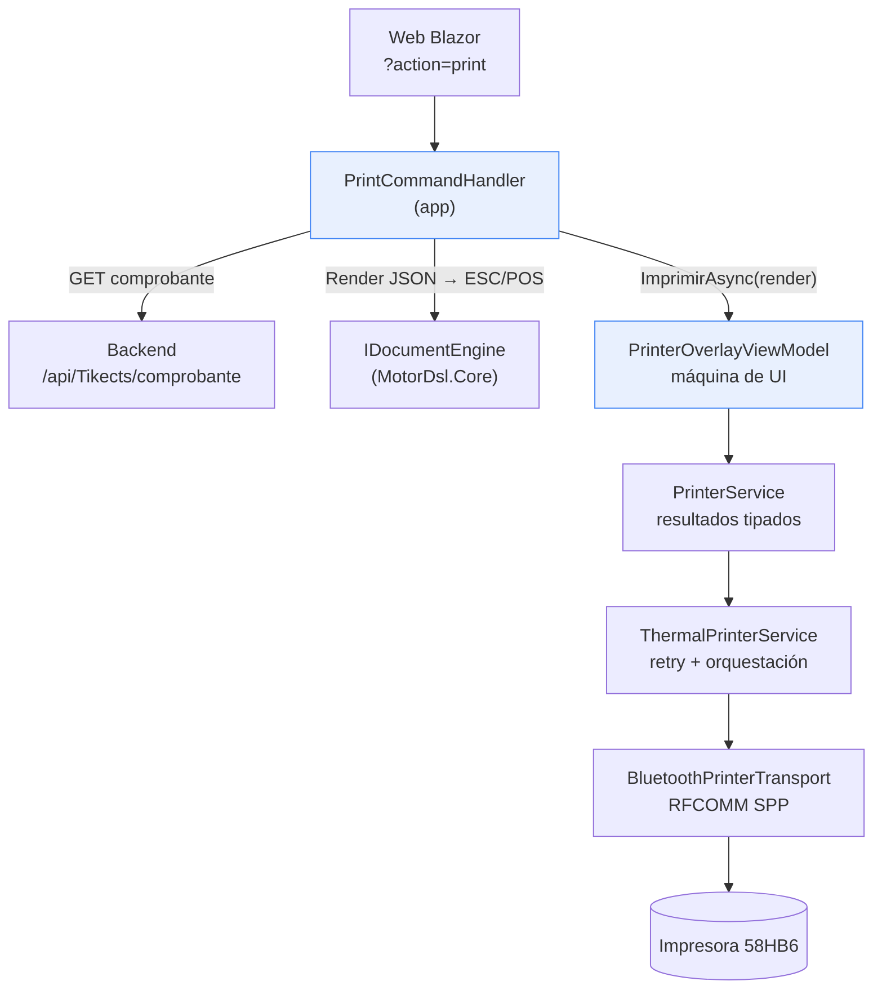
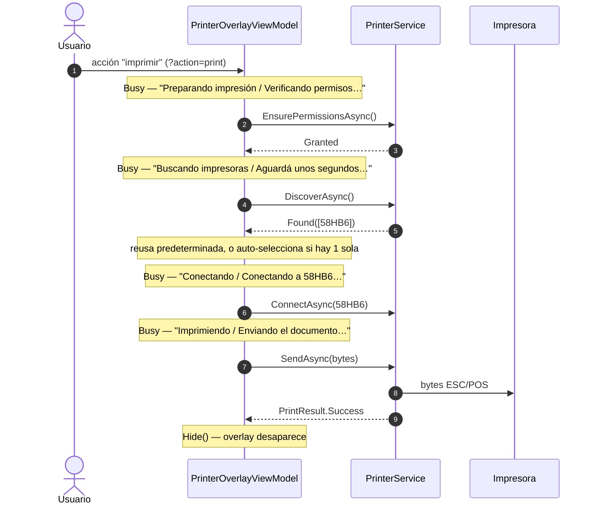
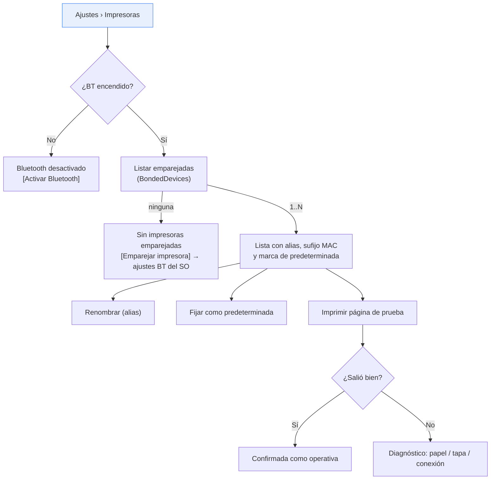
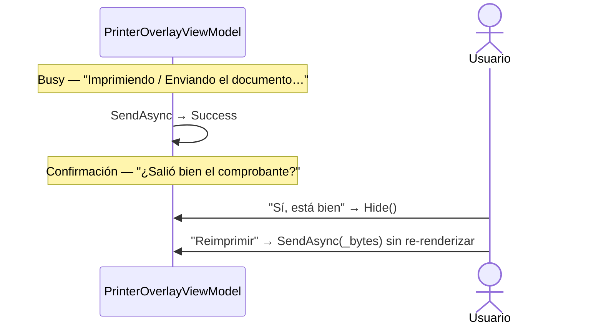
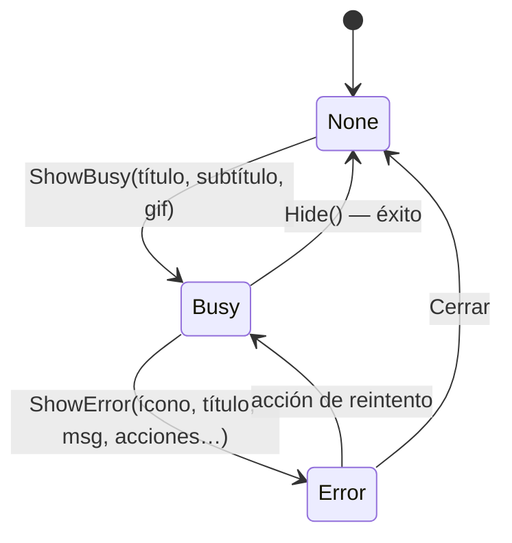

# Análisis UX/UI del flujo de impresión térmica Bluetooth

> **Objetivo**: relevar los flujos de usuario actuales de impresión en los PoC `Ejemplo_Maui_Hibrida` y `Ejemplo_MotorDSL_Dialog`, contrastar los comportamientos contemplados contra los que el stack puede producir realmente, y proponer mejoras sobre el patrón de diálogos overlay.
>
> **Alcance**: la capa de experiencia de usuario del overlay de impresión y su acoplamiento con el stack `MotorDsl.*`. No cubre el renderizado del documento (DSL → ESC/POS) salvo donde impacta en lo que el usuario ve.
>
> **Fuentes**: código fuente de `Ejemplos_Maui_Devices` (`@fd6a1ed`) y `PrintThermal_Motor_Maui` (v1.0.13 `@83677eb`), más el relevamiento manual aportado por el equipo.
>
> **Método**: cada afirmación de este documento se verificó contra el código fuente, no contra la documentación indexada. Las rutas citadas incluyen línea. Lo no verificable se marca explícitamente.

---

## Tabla de contenidos

1. [Resumen ejecutivo](#1-resumen-ejecutivo)
2. [Arquitectura del flujo de impresión](#2-arquitectura-del-flujo-de-impresión)
3. [Flujo de usuario actual](#3-flujo-de-usuario-actual)
4. [Hallazgos](#4-hallazgos)
5. [Respuestas a las preguntas planteadas](#5-respuestas-a-las-preguntas-planteadas)
6. [Propuestas de mejora](#6-propuestas-de-mejora)
7. [Flujos de usuario alternativos propuestos](#7-flujos-de-usuario-alternativos-propuestos)
8. [Patrones utilizados — guía para el desarrollador](#8-patrones-utilizados--guía-para-el-desarrollador)
9. [Observaciones](#9-observaciones)
10. [Referencias](#10-referencias)

---

## 1. Resumen ejecutivo

El patrón de overlay implementado es **sólido en su diseño**: separa render de hardware, modela los resultados con tipos en lugar de excepciones, y mapea cada situación a una capa de UI con botonera contextual. La arquitectura no es el problema.

El problema es que **tres de los estados que el overlay sabe mostrar nunca se alcanzan**, y uno de los caminos de error deja al usuario sin ninguna respuesta. La causa es la misma en todos los casos: la información de por qué falló algo se pierde en el camino entre la librería y la UI. El overlay tiene la pantalla correcta preparada, pero no recibe el dato que la dispararía.

Esto explica con precisión lo que el equipo relevó manualmente. El relevamiento anotó que con el Bluetooth apagado la app dice *«No se encontraron impresoras — Encendé la impresora y volvé a intentar»* y sugirió agregar un botón «Activar bluetooth». La sugerencia es correcta, pero el diagnóstico se queda corto: **ese botón ya existe en el código y nunca se muestra**. `PrinterOverlayViewModel` tiene un caso `BluetoothOff` completo, con el mensaje «Bluetooth desactivado» y su botón «Abrir configuración». Es código inalcanzable.

Los cinco hallazgos, ordenados por impacto en el usuario:

| # | Hallazgo | Severidad | Efecto para el usuario |
|---|----------|-----------|------------------------|
| [H-1](#h-1-el-botón-imprimir-no-hace-nada-si-falla-la-red) | El botón «Imprimir» no hace nada si falla la red | **Alta** | Toca imprimir y no ocurre absolutamente nada |
| [H-2](#h-2-bluetoothoff-es-código-inalcanzable) | `BluetoothOff` es código inalcanzable | **Alta** | Bluetooth apagado se reporta como «no hay impresoras» |
| [H-3](#h-3-los-errores-de-impresión-se-muestran-crudos-en-inglés) | Los errores de impresión se muestran crudos, en inglés | **Alta** | Lee `Print failed after 1 attempt(s): paper out` |
| [H-4](#h-4-dos-impresoras-del-mismo-modelo-son-indistinguibles) | Dos impresoras del mismo modelo son indistinguibles | **Media** | Ve dos botones idénticos y elige a ciegas |
| [H-5](#h-5-la-impresora-predeterminada-se-fija-sola-y-no-se-puede-cambiar) | La predeterminada se fija sola y no se puede cambiar | **Media** | Queda atado a la primera impresora que usó |
| [H-6](#h-6--elegir-otra-no-elige-otra) | «Elegir otra» no elige otra | **Alta** | Bucle sin salida cuando la impresora cambió |
| [H-7](#h-7--sustitución-silenciosa-de-impresora) | Sustitución silenciosa de impresora | Baja | El ticket sale en otra impresora sin aviso |

H-1, H-2 y H-3 comparten raíz: **pérdida de información diagnóstica entre capas**. Se resuelven propagando el dato que ya existe, sin rediseñar el patrón. La [§6](#6-propuestas-de-mejora) detalla cada corrección con su snippet.

> **Estado (2026-07-16).** Los siete hallazgos fueron corregidos en `Ejemplo_Maui_Hibrida` y
> `Ejemplo_MotorDSL_Dialog`. H-6 y H-7 se identificaron durante la planificación de la corrección
> y se agregaron a este documento; H-5 se resolvió con un criterio **distinto** al de la
> [§6.5](#65-h-5--dar-control-sobre-la-impresora-predeterminada), que quedó descartada. El plan
> ejecutado, con el catálogo de códigos de error, está en
> [`Plan-Correcciones-UX-Impresion.md`](Plan-Correcciones-UX-Impresion.md).

---

## 2. Arquitectura del flujo de impresión

### 2.1 Capas involucradas

El flujo atraviesa cinco capas, desde la web hasta el hardware. Entender dónde vive cada responsabilidad es necesario para leer los hallazgos.

| Capa | Componente | Responsabilidad | Fuente |
|---|---|---|---|
| Disparo | `PrintCommandHandler` | Intercepta `?action=print`, trae el documento, renderiza | `LibApp/UrlCommands/Handlers/PrintCommandHandler.cs` |
| Presentación | `PrinterOverlayViewModel` | Máquina de estados de UI: permisos → descubrir → seleccionar → conectar → imprimir | `LibApp/Devices/MotorDSL/ViewModels/PrinterOverlayViewModel.cs` |
| Dominio de app | `PrinterService` | Normaliza permisos/descubrimiento/conexión a resultados tipados | `LibApp/Devices/MotorDSL/Services/PrinterService.cs` |
| Orquestación (librería) | `ThermalPrinterService` | Retry, backoff, reconexión, historial de fallos | `src/MotorDsl.Printing.Abstractions/Services/ThermalPrinterService.cs` |
| Transporte (librería) | `BluetoothPrinterTransport` | Bytes sobre RFCOMM SPP, detección de capacidades, fast-fail de hardware | `src/MotorDsl.Bluetooth/BluetoothPrinterTransport.cs` |



Las dos cajas resaltadas son las que concentran los hallazgos. Ambas viven en la app, no en la librería: **las correcciones de este análisis no requieren publicar una versión nueva de `MotorDsl.*`**, con la salvedad de H-3 (ver [§6.3](#63-h-3--traducir-los-errores-de-impresión-a-lenguaje-de-usuario)).

### 2.2 Nota sobre las dos copias del PoC

`Ejemplo_Maui_Hibrida` y `Ejemplo_MotorDSL_Dialog` mantienen copias **byte a byte idénticas** de `PrinterOverlayViewModel` y `PrinterService`; sólo difieren en el namespace (`LibApp.Devices.MotorDSL.*` vs. `Ejemplo_MotorDSL_Dialog.*`). Se verificó comparando ambos archivos completos.

Consecuencia práctica: **todos los hallazgos de este documento aplican a los dos proyectos por igual**, y toda corrección debe aplicarse dos veces. Esto es en sí una observación de mantenibilidad ([O-1](#9-observaciones)).

---

## 3. Flujo de usuario actual

### 3.1 Camino feliz

El caso de uso #3 del relevamiento («Imprimir») se comporta como el equipo lo describió. El overlay encadena estados de espera y se oculta al terminar:



Este encadenamiento es correcto y coincide con el relevamiento manual. Fuente: `PrinterOverlayViewModel.cs:51-56,60,104-120`.

### 3.2 Mapa de estados implementado vs. alcanzable

Aquí aparece la brecha central del análisis. La columna «¿Se alcanza?» es el resultado de trazar cada estado hasta su disparador real en el código.

| Situación | Capa de UI implementada | Botonera | ¿Se alcanza? | Evidencia |
|---|---|---|---|---|
| Render inválido | «No se pudo generar el documento» | Cerrar | **No** ([H-1](#h-1-el-botón-imprimir-no-hace-nada-si-falla-la-red)) | `PrintCommandHandler.cs:50-55` |
| No soportado (no-Android) | «Impresión no disponible» | Cerrar | Sí | `PrinterOverlayViewModel.cs:43-49` |
| Permiso `DeniedCanRetry` | «Permiso Bluetooth necesario» | Pedir permiso · Cerrar | Sí | `PrinterOverlayViewModel.cs:132-137` |
| Permiso `Denied` | «Acceso Bluetooth denegado» | Abrir configuración · Cerrar | Sí | `PrinterOverlayViewModel.cs:139-144` |
| Permiso `Restricted` | «Acceso restringido» | Cerrar | Sí | `PrinterOverlayViewModel.cs:146-150` |
| Sin impresoras | «No se encontraron impresoras» | Reintentar · Cerrar | Sí — **y de más** ([H-2](#h-2-bluetoothoff-es-código-inalcanzable)) | `PrinterOverlayViewModel.cs:70-75` |
| Bluetooth apagado | «Bluetooth desactivado» | Reintentar · Abrir configuración · Cerrar | **No** ([H-2](#h-2-bluetoothoff-es-código-inalcanzable)) | `PrinterOverlayViewModel.cs:77-83` |
| Varias impresoras | «Elegí una impresora» | 1 botón por device · Cerrar | Sí — ambiguo ([H-4](#h-4-dos-impresoras-del-mismo-modelo-son-indistinguibles)) | `PrinterOverlayViewModel.cs:93-102` |
| Conexión falló | «No se pudo conectar» | Reintentar · Elegir otra · Cerrar | Sí | `PrinterOverlayViewModel.cs:110-114` |
| Envío falló | «Falló la impresión» | Reintentar · Cerrar | Sí — mensaje crudo ([H-3](#h-3-los-errores-de-impresión-se-muestran-crudos-en-inglés)) | `PrinterOverlayViewModel.cs:123-125` |
| Éxito | overlay oculto | — | Sí | `PrinterOverlayViewModel.cs:120` |

**Lectura del cuadro**: de 11 estados diseñados, 2 son inalcanzables y 3 se alcanzan pero comunican mal. El diseño de UX contempló los casos correctos; el cableado no los conecta.

---

## 4. Hallazgos

Cada hallazgo indica el problema, su evidencia, por qué importa desde la experiencia de usuario, y su causa raíz. Las correcciones propuestas están en la [§6](#6-propuestas-de-mejora).

### H-1 · El botón «Imprimir» no hace nada si falla la red

**Severidad: Alta.** Es el único hallazgo donde el usuario no recibe *ninguna* respuesta del sistema.

**Hecho verificado.** `PrintCommandHandler.HandleAsync` retorna sin mostrar el overlay cuando el render falla:

```csharp
// PrintCommandHandler.cs:48-55
var render = _engine.Render(document, profile);

if (render.Errors.Count > 0)
{
    // El overlay ya cubre este caso (ver ImprimirAsync → "No se pudo generar el documento"),
    // por eso alcanza con cerrar el comando sin cancelar navegación ni redirigir.
    return new BridgeOutcome(true, null);
}

await _printer.ImprimirAsync(render);   // ← nunca se llega acá si hubo errores
```

**El comentario del código describe una intención que el código no cumple.** El overlay efectivamente cubre el caso — `ImprimirAsync` abre con exactamente ese guard (`PrinterOverlayViewModel.cs:34-40`) — pero como el `return` ocurre *antes* de la llamada, el overlay nunca se entera. El guard del ViewModel es, en el flujo de la app híbrida, tan inalcanzable como el caso `BluetoothOff`.

**Por qué importa.** `ObtenerDocumentoAsync` devuelve string vacío ante *cualquier* fallo: timeout de 30 s, caída de red, backend no disponible, o contrato inválido (`PrintCommandHandler.cs:89-98`). Todos esos caminos terminan en un render con errores. El escenario real es cotidiano: el operador está en la calle, con señal intermitente, toca «imprimir», espera hasta 30 segundos y **la pantalla no cambia**. No hay overlay, no hay error, no hay spinner. La interpretación natural del usuario es que el botón está roto, y el reintento típico —volver a tocarlo— reproduce la misma nada.

Agrava el cuadro que el fallo de red es silencioso también para el diagnóstico: sólo queda un `Debug.WriteLine` que no existe en release.

**Causa raíz.** Un `return` temprano que contradice su propio comentario. Corrección en [§6.1](#61-h-1--mostrar-el-error-de-render-en-el-overlay).

### H-2 · `BluetoothOff` es código inalcanzable

**Severidad: Alta.** Este hallazgo explica directamente el punto que el equipo anotó en el relevamiento manual.

**Hecho verificado.** El transport **sí** distingue el Bluetooth apagado y lanza una excepción específica:

```csharp
// BluetoothPrinterTransport.cs:60-61
if (!_bluetoothAdapter.IsEnabled)
    throw new Exception("Bluetooth esta desactivado. Por favor activalo.");
```

Pero el orquestador de la librería **captura esa excepción y no la propaga** — por diseño, para que el fallo de un transport no aborte el barrido de los demás:

```csharp
// ThermalPrinterService.cs:106-118
try
{
    var devices = await transport.DiscoverAsync(ct);
    if (devices != null) combined.AddRange(devices);
}
catch (Exception ex)
{
    LastError = ex.Message;          // ← el dato se guarda…
    var error = PrintError.FromException(ex, 1, 1);
    ErrorOccurred?.Invoke(this, new PrintErrorEventArgs(error));   // …y se emite
}
// …y el método devuelve la lista vacía como si simplemente no hubiera nada
```

Y `PrinterService` sólo clasifica como `BluetoothOff` si ve una excepción — que nunca llega:

```csharp
// PrinterService.cs:55-65
try
{
    var devices = await _printer.DiscoverDevicesAsync(kind: "bluetooth");
    return devices.Count == 0
        ? new DiscoverResult.Empty()      // ← siempre cae acá
        : new DiscoverResult.Found(devices);
}
catch (Exception ex)
{
    return new DiscoverResult.BluetoothOff(ex.Message);   // ← inalcanzable
}
```

**Cadena completa**: BT apagado → transport lanza → `ThermalPrinterService` traga → lista vacía → `Empty` → *«No se encontraron impresoras — Encendé la impresora y volvé a intentar»*.

Esto reproduce **exactamente** el síntoma relevado. La nota del equipo («debería informar que no está encendido bluetooth, debería mostrar un botón adicional [Activar bluetooth]») identificó el síntoma correcto; el hallazgo es que **esa pantalla ya está escrita** en `PrinterOverlayViewModel.cs:77-83`, con su botón «Abrir configuración», y sólo le falta el dato para dispararse.

**Alcance real del problema.** El mismo tragado afecta a un segundo caso, no anotado en el relevamiento pero peor: el permiso `BLUETOOTH_CONNECT` revocado desde Ajustes mientras la app corre.

```csharp
// BluetoothPrinterTransport.cs:66-71
var permStatus = ctx.CheckSelfPermission(Android.Manifest.Permission.BluetoothConnect);
if (permStatus != Android.Content.PM.Permission.Granted)
    throw new Exception("Permiso BLUETOOTH_CONNECT no otorgado. Reinicia la app y acepta los permisos.");
```

También se traga, también termina en «Encendé la impresora». El usuario recibe una instrucción que no puede funcionar: la impresora ya está encendida, y por más veces que toque «Reintentar» el resultado no cambiará, porque el problema es un permiso.

**Por qué importa.** Tres causas distintas (BT apagado, permiso revocado, impresora sin emparejar) colapsan en un solo mensaje que sólo es correcto para una cuarta causa (impresora apagada). El mensaje no sólo es impreciso: **es accionable en la dirección equivocada**. El usuario que apagó el Bluetooth sin darse cuenta va a revisar la impresora, no el teléfono.

**Causa raíz.** El contrato de `DiscoverDevicesAsync` no puede expresar «no hay dispositivos» y «no pude buscar» por separado: ambos son lista vacía. La información existe (`LastError`, evento `ErrorOccurred`) pero la app no la consume. Corrección en [§6.2](#62-h-2--distinguir-no-hay-impresoras-de-no-pude-buscar).

### H-3 · Los errores de impresión se muestran crudos, en inglés

**Severidad: Alta.** Afecta el caso que el relevamiento identificó como más frecuente: la falta de papel.

**Hecho verificado.** El mensaje que llega a la pantalla es la concatenación literal de la excepción de la librería:

```csharp
// ThermalPrinterService.cs:227
throw new Exception($"Print failed after {attempt} attempt(s): {error.Message}", ex);
```

```csharp
// PrinterService.cs:96-97
catch (Exception ex) { return new PrintResult.Failure(ex.Message); }
```

```csharp
// PrinterOverlayViewModel.cs:122-123
var msg = res is PrintResult.Failure f ? f.Message : "Error desconocido";
ShowError("error", "Falló la impresión", msg, ...);   // ← msg va crudo a la UI
```

Y el mensaje de origen para falta de papel es literalmente `"paper out"` (`BluetoothPrinterTransport.Detection.cs:164,173`), o `"cover open"` para la tapa abierta (`:172`).

**Lo que el usuario lee, textualmente:**

```
# Falló la impresión

Print failed after 1 attempt(s): paper out

       [Reintentar]
       [Cerrar]
```

**Por qué importa.** El mensaje está en inglés, expone el conteo interno de reintentos, y entierra el único dato útil —que se acabó el papel— al final de una cadena técnica. El usuario tiene delante una acción concreta y trivial (cargar papel) y la UI no se la nombra. Peor: le ofrece «Reintentar», que fallará idénticamente hasta que cargue el rollo, sin decirle que cargue el rollo.

El relevamiento manual concluyó sobre este punto: *«La inspección es visual, el usuario debe verificar cuál fue el problema y volver a iniciar la impresión. Esto está bien»*. **Coincido parcialmente, y vale precisar por qué.** Es correcto que la verificación final sea visual: ESC/POS sobre SPP no confirma que el papel salió impreso, y pretender lo contrario sería vender una garantía que el protocolo no da. Pero eso vale para el resultado *después* de un envío exitoso. Cuando la impresora **sí reportó** la causa por `DLE EOT` —y en falta de papel y tapa abierta la reporta, con fast-fail explícito antes de enviar— dejar esa causa sin traducir es descartar información que ya se pagó por obtener. La inspección visual debería cubrir lo que el hardware no sabe, no lo que sí dijo.

**Causa raíz.** No existe mapeo de `PrintErrorType` (`Connection` · `Timeout` · `Hardware` · `Protocol` · `Unknown`) a mensajes de usuario. La clasificación **ya existe y es correcta** en `PrintError.FromException` (`MotorDsl.Core/Models/PrintError.cs:40-53`), pero se pierde al envolver todo en un `Exception` genérico del que la app sólo rescata el `.Message`. Corrección en [§6.3](#63-h-3--traducir-los-errores-de-impresión-a-lenguaje-de-usuario).

### H-4 · Dos impresoras del mismo modelo son indistinguibles

**Severidad: Media.** Responde directamente la segunda pregunta del relevamiento.

**Hecho verificado.** El selector rotula cada botón con el nombre del dispositivo:

```csharp
// PrinterOverlayViewModel.cs:96-97
.Select(d => new OverlayAction(d.Name ?? d.Id,
    new RelayCommand(() => _ = ConectarEImprimirAsync(d))))
```

Y el nombre viene del nombre Bluetooth publicado por el hardware, que en las térmicas genéricas **es el modelo, no una identidad única**:

```csharp
// BluetoothPrinterTransport.cs:82-84
var name = device.Name ?? "Dispositivo desconocido";
var addr = device.Address ?? "";
devices.Add(new PrinterDevice(addr, name, "bluetooth", IsPaired: true));
```

**Escenario real.** Una oficina con dos 58HB6 emparejadas —el caso que motiva la pregunta— produce:

```
# Elegí una impresora

  Se detectaron varias impresoras disponibles.

       [58HB6]      ← ¿cuál?
       [58HB6]      ← ¿cuál?
       [Cerrar]
```

Dos botones idénticos, sin ningún atributo que los diferencie. El usuario elige al azar; si acierta, es coincidencia. Si falla, el ticket sale en la impresora del escritorio de al lado y probablemente nunca se entere de por qué.

**Nota sobre el ejemplo del relevamiento.** El caso documentado por el equipo muestra `[MTP-II]` y `[58HB6]` — dos modelos distintos, donde el nombre alcanza para desambiguar. Ese es el caso benigno. El problema aparece cuando los modelos coinciden, que es precisamente lo que la pregunta anticipa.

**Causa raíz.** El modelo de datos **sí tiene** identidad única: `PrinterDevice.Id` es la MAC (`BluetoothPrinterTransport.cs:84`, `device.Address`). La UI simplemente no la usa, y sólo cae al `Id` cuando `Name` es null — que casi nunca ocurre, porque el transport ya sustituye el null por `"Dispositivo desconocido"` antes de construir el record. En la práctica **el fallback `d.Name ?? d.Id` es código muerto**. Corrección en [§6.4](#64-h-4--desambiguar-impresoras-homónimas).

### H-5 · La impresora predeterminada se fija sola y no se puede cambiar

**Severidad: Media.**

**Hecho verificado.** Conectar equivale a fijar como predeterminada, sin preguntar:

```csharp
// PrinterService.cs:80-85
public async Task<bool> ConnectAsync(PrinterDevice device)
{
    var ok = await _printer.ConnectAsync(device);
    if (ok) SaveDefault(device);   // C: auto-guardar al conectar
    return ok;
}
```

Y desde entonces el selector se saltea siempre que esa impresora esté presente:

```csharp
// PrinterOverlayViewModel.cs:64-65
var def = _service.GetDefaultIfPresent(f.Devices);
if (def is not null) { await ConectarEImprimirAsync(def); return; }
```

**Por qué importa.** El comportamiento es deseable en el caso común —un solo dispositivo habitual, cero fricción— y por eso la decisión de auto-guardar es razonable. El problema es que **no hay salida**. Una vez fijada, la única forma de imprimir en otra impresora es que la predeterminada desaparezca del descubrimiento: apagarla, desemparejarla, o alejarse. `SaveDefault` es público (`PrinterService.cs:101`) pero **ningún ViewModel lo invoca**; se verificó que no hay UI que lo alcance.

El caso de uso #2 del relevamiento («Configurar impresora: usa el caso de uso #1 para mostrar las impresoras disponibles, el usuario elige una») **describe un flujo que no existe como tal en el código**: no hay pantalla de configuración; la selección sólo ocurre incidentalmente, dentro de un intento de impresión, y sólo mientras no haya predeterminada. Es una divergencia entre el relevamiento y la implementación, no un error del relevamiento.

Se agrava con [H-4](#h-4-dos-impresoras-del-mismo-modelo-son-indistinguibles): si el usuario eligió mal entre dos homónimas, esa elección equivocada **queda persistida en `Preferences`** y se repite en cada impresión siguiente, sin que la UI vuelva a preguntar. Un error de un toque se vuelve permanente y silencioso.

**Causa raíz.** No hay caso de uso de gestión de la predeterminada, ni indicación visible de cuál está activa. Corrección en [§6.5](#65-h-5--dar-control-sobre-la-impresora-predeterminada).

> **Corregido con otro criterio.** La [§6.5](#65-h-5--dar-control-sobre-la-impresora-predeterminada) proponía un escape permanente en la capa «Conectando». Se descartó: agrega fricción al camino feliz (el 95% de los casos) para servir al caso raro, y obligaba a tocar la clase base del overlay. El criterio adoptado conserva la reutilización de la predeterminada sin interrupción y da la salida **sólo cuando falla** — que es cuando el usuario la necesita. Ver [`Plan-Correcciones-UX-Impresion.md` §2](Plan-Correcciones-UX-Impresion.md#2-divergencia-sobre-h-5-el-flujo-que-se-adopta).

### H-6 · «Elegir otra» no elige otra

**Severidad: Alta.** Es la manifestación concreta de [H-5](#h-5-la-impresora-predeterminada-se-fija-sola-y-no-se-puede-cambiar) y, en la práctica, un callejón sin salida. Se identificó al trazar el escenario que planteó el equipo: el usuario se llevó una impresora que no está emparejada con ese móvil.

**Hecho verificado.** El descubrimiento sólo lista **dispositivos emparejados** (`BluetoothPrinterTransport.cs:76`, `BondedDevices`), y estar emparejado no implica estar presente ni encendido:

1. La predeterminada `A` sigue emparejada, así que **aparece en la lista aunque no esté físicamente** — `GetDefaultIfPresent` la encuentra (`PrinterService.cs:72-77`).
2. `BuscarYImprimirAsync` la reusa y saltea el selector (`PrinterOverlayViewModel.cs:64-65`).
3. `ConnectAsync` falla y se muestra «No se pudo conectar» con **Reintentar · Elegir otra · Cerrar** (`:110-114`).
4. **«Elegir otra» invoca `ReintentarBuscarCommand`** (`:113`) → `BuscarYImprimirAsync` → vuelve al paso 1 y **reconecta a la misma `A`**.

**Por qué importa.** El botón que promete cambiar de impresora vuelve a intentar con la misma. La única forma de romper el bucle es desemparejar `A` desde los ajustes de Android — precisamente lo que la app debería sugerir y no sugiere. Esto explica el caso relevado: el usuario ve la impresora encendida, el Bluetooth encendido y un dispositivo emparejado, y el sistema nunca le propone reemparejar.

**Causa raíz.** `GetDefaultIfPresent` confunde *emparejada* con *presente*, y no hay forma de pedir el selector salteando la predeterminada.

### H-7 · Sustitución silenciosa de impresora

**Severidad: Baja.**

**Hecho verificado.** Si la predeterminada **no** está en la lista y hay exactamente un dispositivo emparejado, la app conecta a ese otro sin avisar (`PrinterOverlayViewModel.cs:66`).

**Por qué importa.** El resultado suele ser el deseado, pero contradice el modelo mental de «trabajo siempre con la mía»: el ticket puede salir en otra impresora sin ninguna señal. Se mitiga nombrando la impresora en la capa «Conectando».

---

## 5. Respuestas a las preguntas planteadas

### 5.1 ¿Situaciones de fallo posibles?

Inventario de lo que el stack puede producir, cruzado contra lo que la UI comunica hoy. Ordenado por dónde se origina.

| # | Situación | ¿Detectada? | ¿Comunicada correctamente? | Evidencia |
|---|---|---|---|---|
| 1 | Backend caído / sin red / timeout 30 s | Sí | **No** — silencio total ([H-1](#h-1-el-botón-imprimir-no-hace-nada-si-falla-la-red)) | `PrintCommandHandler.cs:71-98` |
| 2 | Documento con contrato inválido | Sí | **No** — silencio total ([H-1](#h-1-el-botón-imprimir-no-hace-nada-si-falla-la-red)) | `PrintCommandHandler.cs:81-85` |
| 3 | Render falla (DSL mal formado) | Sí | **No** — silencio total ([H-1](#h-1-el-botón-imprimir-no-hace-nada-si-falla-la-red)) | `PrintCommandHandler.cs:50-55` |
| 4 | Plataforma no soportada (iOS) | Sí | Sí | `PrinterService.cs:21-26` |
| 5 | Permiso BT nunca pedido | Sí | Sí — diálogo nativo de Android | `PrinterService.cs:38` |
| 6 | Permiso denegado, reintentable | Sí | Sí | `PrinterOverlayViewModel.cs:132-137` |
| 7 | Permiso denegado permanente | Sí | Sí | `PrinterOverlayViewModel.cs:139-144` |
| 8 | Permiso restringido (MDM) | Sí | Sí | `PrinterOverlayViewModel.cs:146-150` |
| 9 | **Bluetooth apagado** | Sí, en el transport | **No** — dice «no hay impresoras» ([H-2](#h-2-bluetoothoff-es-código-inalcanzable)) | `BluetoothPrinterTransport.cs:60-61` |
| 10 | **Permiso revocado en caliente** | Sí, en el transport | **No** — dice «no hay impresoras» ([H-2](#h-2-bluetoothoff-es-código-inalcanzable)) | `BluetoothPrinterTransport.cs:66-71` |
| 11 | Sin impresoras emparejadas | Sí | Parcial — no sugiere emparejar | `PrinterOverlayViewModel.cs:70-75` |
| 12 | Impresora emparejada pero apagada | Sí, al conectar | Sí | `PrinterOverlayViewModel.cs:110-114` |
| 13 | Varias impresoras homónimas | No | **No** — botones idénticos ([H-4](#h-4-dos-impresoras-del-mismo-modelo-son-indistinguibles)) | `PrinterOverlayViewModel.cs:96` |
| 14 | **Falta de papel** | Sí — fast-fail `DLE EOT n=4` | **No** — `paper out` en inglés ([H-3](#h-3-los-errores-de-impresión-se-muestran-crudos-en-inglés)) | `…Detection.cs:163-164` |
| 15 | **Tapa abierta** | Sí — fast-fail `DLE EOT n=2` | **No** — `cover open` en inglés ([H-3](#h-3-los-errores-de-impresión-se-muestran-crudos-en-inglés)) | `…Detection.cs:172` |
| 16 | Socket roto durante el envío | Sí — reintenta 3× con backoff | Sí, tras agotar reintentos | `ThermalPrinterService.cs:209-234` |
| 17 | Impresora ocupada / buffer lleno | Sí — status gating + pacing | Sí — transparente, no molesta al usuario | `…Detection.cs:138-148` |
| 18 | **Atasco de papel** | **No** | No — imposible | ver abajo |
| 19 | **Impresión incompleta / desvanecida** | **No** | No — imposible | ver abajo |
| 20 | Impresora sin feedback de status | Sí — degrada a pacing fijo | Sí — transparente | `…Capabilities.cs` (`NextPacingDecision`) |

**Sobre los casos 18 y 19 — los límites reales del hardware.** El atasco y la impresión desvanecida **no son detectables** y no debe intentarse detectarlos. `DLE EOT` reporta liveness, papel y tapa; no reporta atasco ni calidad de impresión, y la propia librería documenta que no da bytes libres del buffer. Además, en la 58HB6 el feedback de status es `NotDetected` o `Unknown` en buena parte de los casos, con degradación deliberada a pacing fijo.

Aquí la conclusión del relevamiento manual es **correcta y debe conservarse**: la verificación final es visual y la reimpresión la decide el usuario. Cualquier intento de inferir «salió bien» desde la app sería una garantía falsa. La mejora posible no es detectar más, sino **preguntar mejor** — ver [§7.2](#72-confirmación-post-impresión-opcional).

**Sobre el caso 17 — un acierto que conviene no tocar.** El buffer lleno se resuelve enteramente en el transport, con status gating por bloque de 256 bytes, `MAX_READY_POLLS=10` y degradación con latch a pacing fijo. Nunca deadlockea: tras 10 polls escribe igual. El usuario no ve nada y no debe ver nada. Es el manejo correcto y no requiere UI.

### 5.2 ¿Cómo se identifica el dispositivo? ¿Modelo o MAC?

**Por MAC.** Verificado en tres puntos de la cadena:

| Aspecto | Valor | Fuente |
|---|---|---|
| Identidad (`PrinterDevice.Id`) | **MAC** (`device.Address`) | `BluetoothPrinterTransport.cs:84` |
| Etiqueta (`PrinterDevice.Name`) | Nombre BT publicado ≈ **modelo** | `BluetoothPrinterTransport.cs:82` |
| Persistencia | `Preferences["default_printer_id"]` = **MAC** | `PrinterService.cs:103` |
| Reconexión | Por `CurrentDevice.Id` = **MAC** | `ThermalPrinterService.cs:242` |
| Enrutamiento a transport | Por `device.Kind` (`"bluetooth"`) | `ThermalPrinterService.cs:135-136` |

Existe además un `ModelId` best-effort obtenido por `GS I 67` al conectar (`…Detection.cs:98-113`), pero es **informativo y posterior a la conexión**: no participa de la identificación ni de la selección. No sirve para desambiguar antes de conectar.

**Conclusión.** El modelo de datos identifica correctamente por MAC. La debilidad es exclusivamente de presentación: la UI muestra `Name` y descarta el `Id` que la haría única.

### 5.3 ¿Cómo se resuelve la selección con varias impresoras del mismo modelo?

**Hoy: no se resuelve.** Es [H-4](#h-4-dos-impresoras-del-mismo-modelo-son-indistinguibles). El selector produce N botones con el mismo texto y el usuario elige a ciegas.

El agravante está en la interacción con [H-5](#h-5-la-impresora-predeterminada-se-fija-sola-y-no-se-puede-cambiar): la elección a ciegas se persiste como predeterminada y **no vuelve a preguntarse**. Un acierto por azar se vuelve permanente; un error por azar, también.

La corrección propuesta ([§6.4](#64-h-4--desambiguar-impresoras-homónimas)) resuelve el problema en dos planos: sufijo de MAC para desambiguar de inmediato, y alias editable por el usuario para que la desambiguación sea *significativa* («Mostrador», «Depósito») en lugar de meramente técnica (`…:3F:A2`).

---

## 6. Propuestas de mejora

Cada propuesta indica el problema, la alternativa elegida y las descartadas con su criterio. Los snippets son ilustrativos y están alineados al estilo del código existente; **no fueron compilados** ([O-4](#9-observaciones)).

Todas las correcciones viven en la capa de app salvo la opción B de [§6.3](#63-h-3--traducir-los-errores-de-impresión-a-lenguaje-de-usuario).

### 6.1 H-1 · Mostrar el error de render en el overlay

**Corrección mínima**: eliminar el `return` temprano y dejar que el overlay haga lo que ya sabe hacer.

```csharp
// PrintCommandHandler.cs — reemplaza el bloque :50-61
var render = _engine.Render(document, profile);

// El overlay distingue render fallido (guard de ImprimirAsync) de fallo de impresora.
// Se delega SIEMPRE: es el único componente que puede comunicarle algo al usuario.
await _printer.ImprimirAsync(render);

return new BridgeOutcome(true, null);
```

`ImprimirAsync` ya abre con `if (!render.IsSuccessful || render.Output is not byte[] bytes)` (`PrinterOverlayViewModel.cs:34-40`), así que el caso queda cubierto sin tocar el ViewModel.

**Mejora complementaria — distinguir «no llegó el documento» de «el documento está mal».** Hoy ambos colapsan en el mismo render vacío, y son problemas distintos para el usuario: uno se reintenta, el otro se reporta a soporte. Conviene que `ObtenerDocumentoAsync` devuelva un resultado tipado, en línea con el patrón que el proyecto ya usa (`DiscoverResult`, `PrintResult`):

```csharp
// Nuevo, en LibApp/Devices/MotorDSL/Models/
public abstract record DocumentResult
{
    public sealed record Ok(string Json) : DocumentResult;
    public sealed record NetworkError(string Message) : DocumentResult;  // reintentable
    public sealed record InvalidContract() : DocumentResult;             // no reintentable
}
```

Mapeo a UI, consistente con el resto de la botonera:

| Caso | Título | Mensaje | Botonera |
|---|---|---|---|
| `NetworkError` | «Sin conexión» | «No pudimos obtener el comprobante. Revisá tu conexión.» | Reintentar · Cerrar |
| `InvalidContract` | «No se pudo generar el documento» | «El comprobante recibido no es válido.» | Cerrar |

«Reintentar» en `NetworkError` debe rehacer el GET, no reusar `_lastRender` — es el único reintento del flujo que vuelve a la red.

### 6.2 H-2 · Distinguir «no hay impresoras» de «no pude buscar»

El dato existe (`LastError`, evento `ErrorOccurred`); falta consumirlo. Tres alternativas evaluadas:

| Alternativa | Ventajas | Desventajas | Veredicto |
|---|---|---|---|
| **A. Chequear el adaptador BT en la app antes de descubrir** | Sin tocar la librería; determinista; distingue la causa antes de intentar | Código `#if ANDROID` en la app; duplica un chequeo que el transport ya hace | **Elegida** |
| B. Suscribirse a `ErrorOccurred` de `IThermalPrinterService` | Usa lo que la librería ya expone; cubre cualquier causa | El evento es global y asíncrono: hay que correlacionarlo con *este* discover; propenso a race | Descartada |
| C. Que `DiscoverDevicesAsync` propague la excepción si **todos** los transports fallan | Corrige la raíz para todos los consumidores | Cambio semántico rompiente en la librería; requiere versión nueva; contradice el diseño deliberado de no abortar el barrido | Descartada por alcance |

> **Nota**: el `catch` de `ThermalPrinterService.cs:112-118` **no es un bug de la librería**. Es una decisión de diseño correcta y documentada: con varios transports registrados, que uno falle no debe impedir descubrir en los demás. El problema es que la app no consume la señal que la librería sí emite. Por eso la corrección va en la app.

**Implementación de A** — un chequeo previo en `PrinterService`, que además cubre el caso 10 (permiso revocado en caliente):

```csharp
// PrinterService.cs — reemplaza DiscoverAsync :52-66
public async Task<DiscoverResult> DiscoverAsync()
{
    if (!IsSupported) return new DiscoverResult.NotSupported();

#if ANDROID
    // El transport distingue estas causas y lanza, pero ThermalPrinterService las traga
    // (por diseño: un transport caído no debe abortar el barrido de los demás). Se chequea
    // acá para poder mostrarle al usuario la acción correcta en lugar de "no hay impresoras".
    var adapter = Android.Bluetooth.BluetoothAdapter.DefaultAdapter;
    if (adapter is null) return new DiscoverResult.NotSupported();
    if (!adapter.IsEnabled) return new DiscoverResult.BluetoothOff("El Bluetooth está desactivado.");
#endif

    try
    {
        var devices = await _printer.DiscoverDevicesAsync(kind: "bluetooth");
        return devices.Count == 0
            ? new DiscoverResult.Empty()
            : new DiscoverResult.Found(devices);
    }
    catch (Exception ex)
    {
        return new DiscoverResult.BluetoothOff(ex.Message);
    }
}
```

El `catch` se conserva como red de seguridad: hoy es inalcanzable, pero deja de serlo si la librería cambia.

**Mejora de la botonera de `BluetoothOff`.** El caso ya existe (`PrinterOverlayViewModel.cs:77-83`) pero su botón «Abrir configuración» invoca `AbrirAjustes` → `AppInfo.Current.ShowSettingsUI()` (`PrinterService.cs:107`), que abre los ajustes **de la aplicación** — donde no se puede encender el Bluetooth. Es la pantalla correcta para el caso `Denied` (permisos) y la equivocada para `BluetoothOff`.

Lo que el relevamiento pidió como «[Activar bluetooth] → abrir ajustes del SO en la parte de dispositivos bluetooth» requiere un intent distinto:

```csharp
// PrinterService.cs — nuevo, junto a OpenAppSettings()
/// <summary>Abre los ajustes de Bluetooth del SO (distinto de los ajustes de la app).</summary>
public void OpenBluetoothSettings()
{
#if ANDROID
    var intent = new Android.Content.Intent(Android.Provider.Settings.ActionBluetoothSettings);
    intent.SetFlags(Android.Content.ActivityFlags.NewTask);
    Android.App.Application.Context.StartActivity(intent);
#endif
}
```

Y el caso pasa a usarlo:

```csharp
// PrinterOverlayViewModel.cs — caso BluetoothOff
case DiscoverResult.BluetoothOff:
    ShowError("bluetooth_disabled", "Bluetooth desactivado",
        "Activá el Bluetooth para buscar impresoras.",
        new OverlayAction("Activar Bluetooth", AbrirAjustesBluetoothCommand),
        new OverlayAction("Reintentar", ReintentarBuscarCommand, OverlayActionStyle.Secondary),
        new OverlayAction("Cerrar", CerrarOverlayCommand, OverlayActionStyle.Secondary));
    break;
```

> **No verificado**: `ActionBluetoothSettings` abre el panel de Bluetooth pero **no** enciende el adaptador. Encenderlo mediante `BluetoothAdapter.Enable()` está deprecado desde Android 13 (API 33) y falla silenciosamente; la alternativa (`ActionRequestEnable`) exige una `Activity` para el resultado, lo que no encaja con el patrón overlay actual. **Requiere verificación manual en dispositivo** antes de adoptarse.

**Mejora del caso `Empty`.** El relevamiento anotó que el mensaje es idéntico al de «no encontró impresoras» y que «eso está bien, pero podría sugerir que no encuentra sincronizadas impresoras». Coincido: con el BT encendido y sin emparejadas, la causa más probable es que nunca se emparejó — y el descubrimiento **sólo mira `BondedDevices`** (`BluetoothPrinterTransport.cs:76`), así que una impresora encendida pero sin emparejar es invisible para la app. El mensaje actual («Encendé la impresora») apunta a la causa equivocada:

```csharp
case DiscoverResult.Empty:
    ShowError("print_disabled", "No se encontraron impresoras",
        "Verificá que la impresora esté encendida y emparejada con este dispositivo.",
        new OverlayAction("Reintentar", ReintentarBuscarCommand),
        new OverlayAction("Emparejar impresora", AbrirAjustesBluetoothCommand, OverlayActionStyle.Secondary),
        new OverlayAction("Cerrar", CerrarOverlayCommand, OverlayActionStyle.Secondary));
    break;
```

### 6.3 H-3 · Traducir los errores de impresión a lenguaje de usuario

La clasificación correcta ya existe en `PrintError.FromException`; se pierde al envolver en `Exception` genérica. Dos alternativas:

| Alternativa | Ventajas | Desventajas | Veredicto |
|---|---|---|---|
| **A. Mapear en la app por inspección de `InnerException`** | Sin tocar la librería; aplicable ya | Frágil: depende de tipos de excepción y de strings de mensaje | **Elegida para el PoC** |
| B. Que la librería exponga un `PrintException` tipado con su `PrintErrorType` | Contrato explícito; robusto; sirve a todos los consumidores | Requiere versión nueva de `MotorDsl.Printing.Abstractions` | **Recomendada a futuro** |

**Implementación de A** — `PrinterService.SendAsync` clasifica en lugar de reenviar el `.Message` crudo:

```csharp
// PrinterService.cs — reemplaza SendAsync :88-99
public async Task<PrintResult> SendAsync(byte[] bytes)
{
    try
    {
        await _printer.SendBytesAsync(bytes);
        return new PrintResult.Success();
    }
    catch (Exception ex)
    {
        // ThermalPrinterService envuelve el error real: "Print failed after N attempt(s): …".
        // La causa clasificable está en InnerException (ver PrintError.FromException).
        return new PrintResult.Failure(DescribirFallo(ex.InnerException ?? ex));
    }
}

private static string DescribirFallo(Exception ex) => ex switch
{
    PrinterHardwareException h when h.Message.Contains("paper", StringComparison.OrdinalIgnoreCase)
        => "La impresora se quedó sin papel. Cargá un rollo nuevo y reintentá.",
    PrinterHardwareException h when h.Message.Contains("cover", StringComparison.OrdinalIgnoreCase)
        => "La tapa de la impresora está abierta. Cerrala y reintentá.",
    PrinterHardwareException => "La impresora reportó un problema físico. Revisala y reintentá.",
    System.IO.IOException or System.Net.Sockets.SocketException
        => "Se perdió la conexión con la impresora. Verificá que esté encendida y cerca.",
    TimeoutException or TaskCanceledException
        => "La impresora no respondió a tiempo. Reintentá.",
    _ => "No se pudo completar la impresión. Reintentá."
};
```

> **Deuda técnica asumida**: el `switch` depende de los literales `"paper out"` / `"cover open"` (`…Detection.cs:164,172-173`). Un cambio de esos strings en la librería degrada silenciosamente al mensaje genérico — sin romper la app, pero perdiendo precisión. Es aceptable en un PoC y es exactamente lo que la opción B elimina. Registrado como [O-3](#9-observaciones).

**Botonera contextual.** Con la causa identificada, la botonera puede dejar de ofrecer «Reintentar» donde no sirve. En falta de papel, reintentar antes de cargar el rollo falla idéntico; el botón primario debería ser el que refleja la acción física:

| Causa | Título | Botón primario | Secundarios |
|---|---|---|---|
| Falta de papel | «Sin papel» | «Ya cargué papel — Reintentar» | Cerrar |
| Tapa abierta | «Tapa abierta» | «Ya la cerré — Reintentar» | Cerrar |
| Conexión perdida | «Se perdió la conexión» | Reintentar | Elegir otra · Cerrar |
| Timeout | «La impresora no responde» | Reintentar | Elegir otra · Cerrar |
| Desconocida | «Falló la impresión» | Reintentar | Cerrar |

El fraseo «Ya cargué papel» no es cosmético: convierte el botón en la confirmación de una acción física, en lugar de una repetición ciega. El usuario entiende qué se espera de él antes de tocarlo.

### 6.4 H-4 · Desambiguar impresoras homónimas

**Corrección inmediata** — sufijo de MAC sólo cuando hace falta, para no ensuciar el caso común:

```csharp
// PrinterOverlayViewModel.cs — reemplaza MostrarSelector :93-102
private void MostrarSelector(IReadOnlyList<PrinterDevice> devices)
{
    // Los nombres BT de las térmicas genéricas son el modelo, no una identidad: dos 58HB6
    // producen dos botones idénticos. Sólo cuando el nombre se repite se agrega el sufijo
    // de MAC, para no ensuciar el caso habitual de impresoras con nombres distintos.
    var repetidos = devices.GroupBy(d => d.Name)
                           .Where(g => g.Count() > 1)
                           .Select(g => g.Key)
                           .ToHashSet();

    var actions = devices
        .Select(d => new OverlayAction(Etiqueta(d, repetidos.Contains(d.Name)),
            new RelayCommand(() => _ = ConectarEImprimirAsync(d))))
        .Append(new OverlayAction("Cerrar", CerrarOverlayCommand, OverlayActionStyle.Secondary))
        .ToArray();

    ShowError("print", "Elegí una impresora",
        "Se detectaron varias impresoras disponibles.", actions);
}

/// <summary>Alias del usuario si existe; si no, nombre + sufijo de MAC ante homónimos.</summary>
private string Etiqueta(PrinterDevice d, bool ambiguo)
{
    var alias = _service.GetAlias(d.Id);
    if (!string.IsNullOrEmpty(alias)) return alias;
    return ambiguo ? $"{d.Name} ({SufijoMac(d.Id)})" : d.Name ?? d.Id;
}

/// <summary>Últimos 2 octetos de la MAC: suficiente para desambiguar, corto para un botón.</summary>
private static string SufijoMac(string id)
{
    var partes = id.Split(':');
    return partes.Length >= 2 ? string.Join(":", partes[^2..]) : id;
}
```

Resultado:

```
# Elegí una impresora

  Se detectaron varias impresoras disponibles.

       [58HB6 (3F:A2)]
       [58HB6 (7B:14)]
       [Cerrar]
```

**Corrección de fondo — alias por el usuario.** El sufijo de MAC desambigua pero no *significa* nada: `3F:A2` no le dice al operador cuál es la del mostrador. Un alias persistido en `Preferences`, indexado por MAC, resuelve el problema de verdad:

```csharp
// PrinterService.cs — nuevo
private static string AliasKey(string deviceId) => $"printer_alias_{deviceId}";

/// <summary>Alias legible que el usuario le puso a esta impresora ("Mostrador"). Vacío si no tiene.</summary>
public string GetAlias(string deviceId) => Preferences.Default.Get(AliasKey(deviceId), string.Empty);

public void SetAlias(string deviceId, string alias) => Preferences.Default.Set(AliasKey(deviceId), alias);
```

Con alias, el selector muestra `[Mostrador]` y `[Depósito]`, y la ambigüedad desaparece por completo. Requiere un punto de entrada para asignarlo — ver [§7.1](#71-gestión-de-impresoras-caso-de-uso-nuevo).

> **Consideración de privacidad**: mostrar la MAC completa en la UI expone un identificador de hardware. El sufijo de 2 octetos alcanza para desambiguar sin exponerla entera, y es coherente con el enmascarado que la librería ya aplica en sus reportes de diagnóstico (`DiagnosticsBuilder.MaskMac`, que conserva 3 octetos y enmascara el resto).

### 6.5 H-5 · Dar control sobre la impresora predeterminada

**Mínimo indispensable — una salida.** Cuando se usa la predeterminada, el usuario debe poder cambiarla sin desemparejar hardware. El punto natural es el overlay de «Conectando», que hoy no ofrece ninguna acción:

```csharp
// PrinterOverlayViewModel.cs — ConectarEImprimirAsync :107
// Hoy: ShowBusy("Conectando", $"Conectando a {device.Name}…", "timer.gif");
// La capa Busy no admite botonera (ShowBusy hace Actions.Clear()), así que dar una salida
// acá requiere extender StatusOverlayViewModel con una acción opcional de escape.
ShowBusy("Conectando", $"Conectando a {Etiqueta(device)}…", "timer.gif",
    new OverlayAction("Usar otra impresora", ReintentarBuscarCommand, OverlayActionStyle.Secondary));
```

Esto exige una sobrecarga en la base `StatusOverlayViewModel.ShowBusy` que acepte acciones opcionales — hoy `ShowBusy` limpia la botonera incondicionalmente (`StatusOverlayViewModel.cs:54-61`). El cambio es aditivo y beneficia a todos los overlays que heredan de la base (GPS, Red, Llamada).

**Nombrar la predeterminada al conectar.** Cerrar el bucle de la elección a ciegas: si la conexión salió de una predeterminada guardada, decirlo. El usuario que ve *«Conectando a Mostrador…»* cuando esperaba el depósito detecta el error antes de que salga el ticket.

**Completar el caso de uso #2 del relevamiento.** El caso «Configurar impresora» debería existir de verdad, no como efecto secundario de imprimir — ver [§7.1](#71-gestión-de-impresoras-caso-de-uso-nuevo).

---

## 7. Flujos de usuario alternativos propuestos

### 7.1 Gestión de impresoras (caso de uso nuevo)

Hoy la selección de impresora sólo ocurre **dentro** de un intento de impresión, y sólo si no hay predeterminada. El caso de uso #2 del relevamiento («Configurar impresora») describe un flujo que la implementación no tiene.

Propuesta: una pantalla accesible fuera del flujo de impresión, que reúna las tres capacidades que hoy faltan o están escondidas.



Beneficios, en orden de impacto:

1. **Resuelve [H-5](#h-5-la-impresora-predeterminada-se-fija-sola-y-no-se-puede-cambiar)**: la predeterminada se vuelve gestionable y visible.
2. **Resuelve [H-4](#h-4-dos-impresoras-del-mismo-modelo-son-indistinguibles) de fondo**: da el lugar donde asignar alias significativos.
3. **Saca la configuración del camino crítico**: el operador configura antes, no mientras un contribuyente espera el ticket.
4. **Habilita la página de prueba**: verificar la impresora sin gastar un comprobante real ni depender del backend.

> La página de prueba puede reusar `IDiagnosticsReportProvider.ToDslJson(report, paperWidthChars: 32)`, que la librería ya expone y que genera un DSL «integrated» imprimible con el snapshot de diagnóstico (`IDiagnosticsReportProvider.cs:7-26`). Es un documento que existe, se renderiza con el mismo pipeline y no requiere red — buen candidato, aunque su contenido es técnico y probablemente convenga uno más simple para el usuario final.

### 7.2 Confirmación post-impresión (opcional)

El relevamiento acierta en que la verificación es visual y en que la decisión de reimprimir es del usuario. Lo que hoy falta no es detección, sino **un momento para preguntar**: al terminar el envío el overlay hace `Hide()` (`PrinterOverlayViewModel.cs:120`) y desaparece. Si el ticket salió cortado, desvanecido o a medias, el usuario ya no tiene camino de vuelta: debe rehacer el flujo entero desde la web.



Aplica al hueco exacto que el relevamiento identificó: *«la causa de reimprimir puede ser la falta de papel o que la impresión quedó incompleta, fallos en la comunicación»*. El estado necesario ya está en memoria — `_bytes` se conserva justamente para reintentos — así que reimprimir cuesta un envío, sin re-render ni GET al backend.

**Contrapeso honesto.** Este paso agrega fricción a cada impresión exitosa, que es el 95% de los casos. La confirmación explícita se justifica sólo si la tasa de impresiones defectuosas lo amerita, y ese dato no está medido. **Alternativa de menor fricción**: mantener el `Hide()` inmediato y ofrecer la reimpresión desde fuera del overlay (por ejemplo, un «Reimprimir el último» en la pantalla de impresoras de [§7.1](#71-gestión-de-impresoras-caso-de-uso-nuevo)), que da la misma salida sin costo en el camino feliz. **Recomiendo esta segunda** salvo que se releve evidencia de que las impresiones defectuosas son frecuentes.

### 7.3 Prioridad de implementación

| Prioridad | Cambio | Esfuerzo | Impacto |
|---|---|---|---|
| 1 | [H-1](#h-1-el-botón-imprimir-no-hace-nada-si-falla-la-red) — quitar el `return` temprano | Trivial (1 línea) | Elimina el silencio total |
| 2 | [H-2](#h-2-bluetoothoff-es-código-inalcanzable) — chequeo de adaptador + intent de ajustes BT | Bajo | Habilita 2 estados muertos; resuelve lo relevado |
| 3 | [H-3](#h-3-los-errores-de-impresión-se-muestran-crudos-en-inglés) — mapeo de errores (opción A) | Bajo | Papel/tapa dejan de ser crípticos |
| 4 | [H-4](#h-4-dos-impresoras-del-mismo-modelo-son-indistinguibles) — sufijo de MAC en el selector | Bajo | Desambigua homónimas |
| 5 | [H-1](#h-1-el-botón-imprimir-no-hace-nada-si-falla-la-red) — `DocumentResult` tipado | Medio | Distingue red de contrato |
| 6 | [H-5](#h-5-la-impresora-predeterminada-se-fija-sola-y-no-se-puede-cambiar) — escape en «Conectando» | Medio (toca la base) | Da salida a la predeterminada |
| 7 | [§7.1](#71-gestión-de-impresoras-caso-de-uso-nuevo) — pantalla de gestión + alias | Alto | Resuelve H-4 y H-5 de fondo |
| 8 | [§7.2](#72-confirmación-post-impresión-opcional) — reimpresión accesible | Medio | Cierra el hueco post-envío |

Los primeros cuatro son de esfuerzo bajo y resuelven los tres hallazgos de severidad alta. **Recomiendo tratarlos como un solo lote**: comparten la causa raíz —información diagnóstica que se pierde entre capas— y corregirlos juntos hace que el patrón overlay entregue lo que ya estaba diseñado para entregar.

---

## 8. Patrones utilizados — guía para el desarrollador

Esta sección documenta los patrones que sostienen el flujo, para que un desarrollador pueda tomar la experiencia sin releer el código. Los tres primeros son aciertos de diseño a conservar y replicar.

### 8.1 Render primero, hardware después

**Qué es.** El documento se renderiza a bytes ESC/POS **antes** de tocar permisos, Bluetooth o impresora. `PrinterOverlayViewModel.ImprimirAsync` recibe un `RenderResult` ya producido, no un documento.

**Por qué.** Separa dos fallos que el usuario vive distinto: «el comprobante está mal» (problema de datos, no lo resuelve el usuario) vs. «la impresora no responde» (problema físico, sí lo resuelve). Además permite reintentar la impresión sin re-renderizar: `PedirPermiso` reusa `_lastRender` (`PrinterOverlayViewModel.cs:159`) y `ReintentarImprimir` reusa `_bytes` (`:169`).

**Cómo replicarlo.** El ViewModel del overlay nunca debe recibir un documento crudo. Si necesita renderizar, el patrón se rompe.

### 8.2 Resultados tipados en lugar de excepciones

**Qué es.** `PrinterService` traduce todo a records cerrados y el ViewModel hace `switch` sin un solo `try/catch`.

```csharp
public abstract record DiscoverResult
{
    public sealed record Found(IReadOnlyList<PrinterDevice> Devices) : DiscoverResult;
    public sealed record Empty : DiscoverResult;
    public sealed record BluetoothOff(string Message) : DiscoverResult;
    public sealed record NotSupported : DiscoverResult;
}
```

**Por qué.** Cada caso es un estado de UI con su botonera. Un `catch (Exception)` colapsaría causas distintas en un mensaje único — exactamente el problema de [H-3](#h-3-los-errores-de-impresión-se-muestran-crudos-en-inglés), que ocurre porque `SendAsync` **sí** hace `catch (Exception ex) => Failure(ex.Message)` (`PrinterService.cs:96-97`) en lugar de clasificar.

**La lección de este análisis.** El patrón sólo paga si cada variante del tipo **es alcanzable**. `DiscoverResult.BluetoothOff` existe, está bien modelado, tiene su UI escrita… y nunca se construye. Un tipo cerrado da la ilusión de exhaustividad: el `switch` cubre los cuatro casos y el compilador no se queja. **Modelar el caso no es lo mismo que producirlo.** Al agregar una variante, trazar hasta el punto donde se construye y verificar que ese punto se alcanza.

### 8.3 Overlay con máquina de tres estados y botonera dinámica

**Qué es.** `StatusOverlayViewModel` modela `None` / `Busy` / `Error` y expone `Actions` como `ObservableCollection<OverlayAction>`, donde cada `OverlayAction` es `(Texto, ICommand, Estilo)`.



**Por qué.** La botonera se arma por caso: el mismo overlay muestra «Reintentar / Elegir otra / Cerrar» ante un fallo de conexión y un botón por impresora en el selector, sin XAML condicional ni páginas nuevas.

**Cómo replicarlo.** Todos los overlays de dispositivo (GPS, Red, Llamada, Impresora) heredan de la misma base. Un dispositivo nuevo hereda `StatusOverlayViewModel`, define su `Service` con resultados tipados y mapea cada caso a `ShowBusy`/`ShowError`.

**Limitación conocida.** `ShowBusy` hace `Actions.Clear()` incondicional (`StatusOverlayViewModel.cs:56`): **la capa Busy no puede tener botones**. Es lo que bloquea el escape de [§6.5](#65-h-5--dar-control-sobre-la-impresora-predeterminada) y lo que impide un «Cancelar» durante una conexión lenta. Es la extensión más valiosa pendiente de la base.

### 8.4 Anti-patrón a evitar: el comentario que documenta la intención, no el código

Los dos hallazgos de severidad alta que involucran código inalcanzable están **acompañados de un comentario que afirma que el caso está cubierto**:

```csharp
// PrintCommandHandler.cs:52-53
// El overlay ya cubre este caso (ver ImprimirAsync → "No se pudo generar el documento"),
// por eso alcanza con cerrar el comando sin cancelar navegación ni redirigir.
return new BridgeOutcome(true, null);   // ← y por eso el overlay nunca se entera
```

El comentario es *casi* cierto: el overlay cubre el caso. Lo que no dice es que este camino no lo llama. Un lector que audite el flujo leyendo comentarios concluye que H-1 no existe.

**La lección.** Un comentario que afirma que otro componente maneja algo es una **aserción sobre el flujo**, y el compilador no la verifica. Cuando aparezca uno, trazar la llamada. Si el comentario hubiera dicho «el overlay cubre este caso *cuando se lo invoca*», el bug habría saltado a la vista al escribirlo.

---

## 9. Observaciones

Situaciones detectadas fuera del alcance de las propuestas, separando hechos de interpretaciones.

| # | Tipo | Observación |
|---|---|---|
| **O-1** | Hecho | `PrinterOverlayViewModel` y `PrinterService` están duplicados byte a byte entre `Ejemplo_Maui_Hibrida` y `Ejemplo_MotorDSL_Dialog` (sólo difiere el namespace). Verificado leyendo ambos archivos completos. **Toda corrección debe aplicarse dos veces**, con el riesgo de que diverjan. |
| **O-2** | Hecho | ~~Existe una segunda copia completa del proyecto híbrido…~~ **Cerrada (2026-07-16).** Verificado: hay **tres** copias de la tríada `PrinterOverlayViewModel`/`PrinterService`/`PrintCommandHandler`, y al momento del análisis estaban byte a byte idénticas. La **viva** es la indexada (`Ejemplos_Maui_Devices @fd6a1ed`, 2026-07-15); la standalone `Ejemplos_Maui/Ejemplo_Maui_Hibrida/` es un repositorio aparte con un único *Initial commit* (2026-07-13). Por decisión del equipo, la standalone **quedó fuera del alcance** de las correcciones y por lo tanto diverge. Detalle en [`Plan-Correcciones-UX-Impresion.md` §1.2](Plan-Correcciones-UX-Impresion.md#12-estado-de-las-copias-resuelve-o-2). |
| **O-3** | Interpretación | El mapeo de [§6.3](#63-h-3--traducir-los-errores-de-impresión-a-lenguaje-de-usuario) depende de los literales `"paper out"` / `"cover open"`. **Reducida (2026-07-16):** `PrintError.FromException` es público en `MotorDsl.Core.Models` y el `Exception` genérico de `ThermalPrinterService.cs:227` conserva la causa en `InnerException`, así que la app **reusa la clasificación de la librería** en vez de reimplementarla; el string-matching quedó acotado a distinguir papel de tapa dentro de `Hardware`, y degrada a `PRN-HW-OTHER` si esos literales cambian. La solución estable sigue siendo la opción B (librería con causa tipada), propuesta y **no aplicada**. |
| **O-4** | Hecho | Los snippets de la [§6](#6-propuestas-de-mejora) son ilustrativos y **no fueron compilados**. Requieren verificación al integrarse, en particular los que usan APIs de Android (`ActionBluetoothSettings`). |
| **O-5** | Hecho | El caso de uso #2 del relevamiento («Configurar impresora») **no existe como flujo independiente** en el código: la selección sólo ocurre dentro de un intento de impresión y sólo si no hay predeterminada. Divergencia entre el relevamiento y la implementación. |
| **O-6** | Hecho | `PedirPermiso` (`:159`), `ReintentarConectar` (`:163`) y `ReintentarImprimir` (`:169`) usan el operador null-forgiving (`_lastRender!`, `_lastDevice!`, `_bytes!`). Los comandos sólo se alcanzan desde botoneras donde el estado ya fue seteado, así que **no se identificó un camino real que produzca un `NullReferenceException`**; queda como fragilidad ante refactors futuros, no como bug actual. |
| **O-7** | Interpretación | El evento `ErrorOccurred` de `IThermalPrinterService` y el historial `RecentFailures` (ring buffer de 20 entradas) **no son consumidos por ninguna de las dos apps**. Se verificó que no hay suscripción. Es una fuente de diagnóstico ya disponible y sin costo: útil para telemetría o para una pantalla de soporte. |
| **O-8** | Hecho | El perfil registrado en DI (`thermal_58mm`) **no es el que se usa** al imprimir: `PrintCommandHandler` construye `new DeviceProfile("58HB6", 32, "escpos-bitmap")` en línea (`:39`). El perfil de `AddProfiles` queda sin uso en el camino de impresión. Sin impacto en UX; relevante si se intenta configurar el perfil desde DI y no surte efecto. |
| **O-9** | Interpretación | El descubrimiento sólo lista **dispositivos emparejados** (`BondedDevices`, `BluetoothPrinterTransport.cs:76`). Una impresora encendida y en rango pero no emparejada es invisible para la app, sin ninguna pista para el usuario. La mejora del caso `Empty` en [§6.2](#62-h-2--distinguir-no-hay-impresoras-de-no-pude-buscar) mitiga el síntoma; el emparejamiento in-app sería la solución completa, con un costo bastante mayor. |

---

## 10. Referencias

### Fuentes primarias verificadas

**App híbrida** — `Ejemplos_Maui/Ejemplos_Maui_Devices/Ejemplos_Devices/Integrada/Ejemplo_Maui_Hibrida/`

| Archivo | Rol en este análisis |
|---|---|
| `LibApp/UrlCommands/Handlers/PrintCommandHandler.cs` | H-1 |
| `LibApp/Devices/MotorDSL/ViewModels/PrinterOverlayViewModel.cs` | H-2, H-3, H-4, H-5 |
| `LibApp/Devices/MotorDSL/Services/PrinterService.cs` | H-2, H-3, H-5 |
| `LibApp/Devices/MotorDSL/Services/BluetoothPermissions.cs` | §5.1 (permisos) |
| `LibApp/Devices/Common/ViewModels/StatusOverlayViewModel.cs` | §8.3 (base del overlay) |

**PoC de diálogo** — `Ejemplos_Maui/Ejemplos_Maui_Devices/Ejemplos_Devices/Printer/Ejemplo_MotorDSL_Dialog/`: `ViewModels/PrinterOverlayViewModel.cs`, `ViewModels/StatusOverlayViewModel.cs` (idénticos a los de la híbrida — ver [O-1](#9-observaciones)).

**Librería** — `Librerias/PrintThermal_Motor_Maui/src/` (v1.0.13 `@83677eb`)

| Archivo | Rol en este análisis |
|---|---|
| `MotorDsl.Printing.Abstractions/Services/ThermalPrinterService.cs` | H-2 (catch `:112-118`), H-3 (wrap `:227`) |
| `MotorDsl.Bluetooth/BluetoothPrinterTransport.cs` | H-2 (throw `:60-61`, `:66-71`), H-4 (MAC `:84`) |
| `MotorDsl.Bluetooth/BluetoothPrinterTransport.Detection.cs` | H-3 (`paper out` `:164`, `cover open` `:172`), §5.1 (fast-fail, gating) |
| `MotorDsl.Core/Models/PrintError.cs` | H-3 (clasificación `:40-53`) |
| `MotorDsl.Core/Printing/DefaultPrintErrorHandler.cs` | §5.1 (política de retry) |

### Bases de conocimiento

- [`PrintThermal_Motor_Maui.Documentacion/ia-db/README.md`](../ia-db/README.md) — stack de la librería; índice [`04_impresion-transports.md`](../ia-db/indexes/04_impresion-transports.md).
- `Ejemplos_Maui/Ejemplos_Maui_Devices.Documentos/ia-db/README.md` — apps de ejemplo; índices `03_Impresion-Termica.md` y `08_App-Hibrida-Integrada.md`.

### Marco de generación

- Tool-Prompt: `/IA.Prompting.Templates/PromptFramework/Examples/Ejemplos_Maui_Device/Analizar-Fundanalidad-Comportamiento-Libreria-Nuget-PrintTermal.md`
- Profile: `/IA.Prompting.Templates/PromptFramework/Profiles/Code-Review.md` → RuleSet `Development`
- Generado: 2026-07-16 · Versión: 1.0
- Origen analizado: `Ejemplos_Maui_Devices @fd6a1ed` · `PrintThermal_Motor_Maui v1.0.13 @83677eb`
</content>
</invoke>
