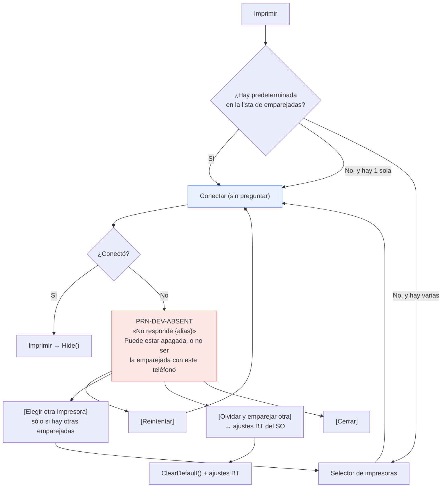

# Plan de correcciones — UX de impresión térmica

> **Objetivo**: aplicar los hallazgos de [`Analisis-UX-UI.md`](Analisis-UX-UI.md) sobre `Ejemplo_Maui_Hibrida` y `Ejemplo_MotorDSL_Dialog`, incorporando las consideraciones del equipo sobre H-5 y sobre el manejo de códigos de error.
>
> **Estado (2026-07-16)**: **ejecutado** sobre `Ejemplo_Maui_Hibrida` (copia `Integrada`) y
> `Ejemplo_MotorDSL_Dialog`. Ambos proyectos compilan sin errores (`dotnet build -t:CoreCompile`,
> `net10.0-android`). **La librería `MotorDsl.*` no se tocó**: sigue en v1.0.13 y no requiere
> republicación. Pendiente: la verificación en dispositivo Android real (T-14), que no puede
> hacerse desde el repositorio. Ver [§8](#8-resultado-de-la-ejecución).
>
> **Método**: cada hallazgo del análisis se reverificó contra el código actual antes de planificar. Las rutas citadas incluyen línea y corresponden a `Ejemplos_Maui_Devices @fd6a1ed` y `PrintThermal_Motor_Maui v1.0.13 @83677eb`.

---

## Tabla de contenidos

1. [Diagnóstico](#1-diagnóstico)
2. [Divergencia sobre H-5: el flujo que se adopta](#2-divergencia-sobre-h-5-el-flujo-que-se-adopta)
3. [Modelo de errores con código](#3-modelo-de-errores-con-código)
4. [Plan de cambios](#4-plan-de-cambios)
5. [Impacto en la librería](#5-impacto-en-la-librería)
6. [Documentación a actualizar](#6-documentación-a-actualizar)
7. [Observaciones y decisiones pendientes](#7-observaciones-y-decisiones-pendientes)

---

## 1. Diagnóstico

### 1.1 Reverificación del análisis

Los cinco hallazgos de `Analisis-UX-UI.md` **siguen vigentes y sin corregir** en el código actual. Se verificó cada uno leyendo la fuente, no la documentación:

| Hallazgo | Estado | Evidencia reverificada |
|---|---|---|
| H-1 · `return` temprano ante render fallido | Vigente | `PrintCommandHandler.cs:50-55` |
| H-2 · `BluetoothOff` inalcanzable | Vigente | `PrinterService.cs:55-65` + `ThermalPrinterService.cs:106-118` |
| H-3 · error crudo en inglés a la UI | Vigente | `PrinterService.cs:97` + `PrinterOverlayViewModel.cs:122` |
| H-4 · homónimas indistinguibles | Vigente | `PrinterOverlayViewModel.cs:96` |
| H-5 · predeterminada sin salida | Vigente | `PrinterService.cs:83` + `PrinterOverlayViewModel.cs:64-65` |

### 1.2 Estado de las copias (resuelve O-2)

El análisis dejó abierto cuál de las copias del PoC híbrido es la viva. **Resuelto por verificación directa**: existen **tres** copias de la tríada de archivos y hoy están sincronizadas.

| Copia | Repositorio | Último commit | Rol |
|---|---|---|---|
| `Ejemplos_Maui_Devices/Ejemplos_Devices/Integrada/Ejemplo_Maui_Hibrida/` | `Ejemplos_Maui_Devices` | `fd6a1ed` · 2026-07-15 | **Viva** — es la que avanza |
| `Ejemplos_Maui/Ejemplo_Maui_Hibrida/…/Ejemplo_Maui_Hibrida/` | `Ejemplo_Maui_Hibrida` | `2eb6f8c` · 2026-07-13 · *Initial commit* | Snapshot; sin actividad posterior |
| `Ejemplos_Maui_Devices/Ejemplos_Devices/Printer/Ejemplo_MotorDSL_Dialog/` | `Ejemplos_Maui_Devices` | `fd6a1ed` | PoC de diálogo |

**Hecho verificado.** `PrinterOverlayViewModel.cs`, `PrinterService.cs` y `PrintCommandHandler.cs` son **byte a byte idénticos** entre la copia `Integrada` y la standalone (`diff -q` sin diferencias). Frente a `Ejemplo_MotorDSL_Dialog` la diferencia se limita al `namespace` y a líneas en blanco, lo que confirma [O-1](Analisis-UX-UI.md#9-observaciones).

**Consecuencia para el plan.** El alcance quedó definido por el equipo: **sólo el repositorio `Ejemplos_Maui_Devices`**, es decir las dos aplicaciones `Ejemplo_Maui_Hibrida` (copia `Integrada`) y `Ejemplo_MotorDSL_Dialog`. Cada corrección se aplica **dos veces**. La copia standalone queda **fuera de alcance** y, por lo tanto, divergirá — ver [§7.1](#71-alcance-definido).

### 1.3 Hallazgo nuevo — H-6: «Elegir otra» no elige otra

Este hallazgo **no está en el análisis previo** y aparece al trazar exactamente el escenario que planteó el equipo (impresora emparejada ausente). Es la manifestación concreta de H-5 y, en la práctica, un callejón sin salida.

**Hecho verificado.** El descubrimiento sólo lista **dispositivos emparejados** (`BluetoothPrinterTransport.cs:76`, `BondedDevices`), y estar emparejado no implica estar presente ni encendido. La secuencia es:

1. La predeterminada `A` sigue emparejada, así que **aparece en la lista aunque no esté físicamente** — `GetDefaultIfPresent` la encuentra (`PrinterService.cs:72-77`).
2. `BuscarYImprimirAsync` la reusa y saltea el selector (`PrinterOverlayViewModel.cs:64-65`).
3. `ConnectAsync` falla y se muestra «No se pudo conectar» con la botonera **Reintentar · Elegir otra · Cerrar** (`:110-114`).
4. **«Elegir otra» invoca `ReintentarBuscarCommand`** (`:113`) → `BuscarYImprimirAsync` → vuelve al paso 1 y **reconecta a la misma `A`**.

**Por qué importa.** El botón que promete cambiar de impresora vuelve a intentar con la misma. El usuario queda en un bucle del que no hay salida por UI: la única forma de romperlo es desemparejar `A` desde los ajustes de Android, que es precisamente lo que la app debería sugerirle y no sugiere. Esto reproduce el caso descripto por el equipo —el usuario ve la impresora encendida, el Bluetooth encendido y un dispositivo emparejado, pero el sistema no le sugiere reemparejar— y explica por qué.

**Causa raíz.** `GetDefaultIfPresent` confunde *emparejada* con *presente*, y no hay forma de pedir el selector salteando la predeterminada.

### 1.4 Hallazgo nuevo — H-7: sustitución silenciosa de impresora

**Hecho verificado.** Si la predeterminada **no** está en la lista y hay exactamente un dispositivo emparejado, la app conecta a ese otro sin avisar (`PrinterOverlayViewModel.cs:66`). Severidad baja: el resultado suele ser el deseado, pero contradice el modelo mental de «trabajo siempre con la mía» y el ticket puede salir en otra impresora sin ninguna señal. Se corrige nombrando la impresora en la capa «Conectando» ([§4](#4-plan-de-cambios), T-9).

---

## 2. Divergencia sobre H-5: el flujo que se adopta

El análisis proponía en [§6.5](Analisis-UX-UI.md#65-h-5--dar-control-sobre-la-impresora-predeterminada) una vía de escape permanente en la capa «Conectando». **Esa propuesta se descarta** a favor del criterio del equipo, que es más simple y no toca la clase base del overlay.

| Aspecto | Propuesta del análisis (§6.5) | **Criterio adoptado** |
|---|---|---|
| Camino feliz | Escape «Usar otra impresora» visible en cada conexión | **Sin interrupción**: se reusa la predeterminada y se imprime |
| Base `StatusOverlayViewModel` | Requiere sobrecarga de `ShowBusy` con acciones | **No se toca** |
| Cambio de impresora | Siempre disponible | **Sólo cuando falla**, que es cuando el usuario lo necesita |
| Predeterminada | Gestionable desde una pantalla nueva | Se corrige donde duele; la pantalla de gestión queda fuera de este lote |

**Fundamento.** El flujo normal supone un usuario que no cambia de impresora; ofrecerle un escape en cada impresión agrega fricción al 95% de los casos para servir al 5%. El problema real no es la falta de escape permanente, sino que **cuando falla, el escape que existe no funciona** (H-6). Corrigiendo H-6 el usuario obtiene la salida exactamente en el momento en que la necesita, sin costo en el camino feliz.

### 2.1 Las dos causas que el mensaje debe cubrir

Ante un fallo de conexión con la predeterminada, el equipo identificó dos situaciones que el usuario no puede distinguir por sí mismo:

| Caso | Situación | Acción que el usuario debe entender |
|---|---|---|
| a | La impresora coincide con el modelo, pero **no es la que se emparejó** | Olvidar el emparejamiento anterior y emparejar la nueva |
| b | La impresora es la correcta, pero **está apagada o no comunica** | Encenderla / acercarla y reintentar |

**El stack no puede distinguirlas.** Ambas producen el mismo fallo de socket RFCOMM: en el caso (a) la MAC guardada simplemente no responde porque ese hardware no está en el rango. No hay señal que las separe antes de conectar, y no debe inventarse una.

**Consecuencia de diseño.** El mensaje debe **nombrar las dos causas** y ofrecer la acción de cada una, dejando que el usuario —que sí ve el hardware— decida. Es el mismo criterio que el análisis aplica a la inspección visual: cuando el hardware no puede decirlo, se pregunta en lugar de adivinar.

### 2.2 Flujo objetivo



Las tres diferencias contra el flujo actual: el selector es **forzable** (rompe el bucle de H-6), el mensaje nombra **ambas causas**, y existe la acción **«olvidar el emparejamiento»** que hoy no tiene ningún punto de entrada por UI.

---

## 3. Modelo de errores con código

Responde al requisito del equipo: **conservar el mensaje original**, mostrar uno entendible, asociar un **código**, y dejar el original **accesible programáticamente** para log o reporte automático.

### 3.1 Tipo propuesto

Reemplaza `PrintResult.Failure(string Message)` (`Models/PrintResult.cs`), que hoy colapsa todo en un string.

```csharp
// LibApp/Devices/MotorDSL/Models/PrintFailure.cs — nuevo
/// <summary>
/// Fallo clasificado. <see cref="UserMessage"/> es lo único que va a la UI;
/// <see cref="TechnicalMessage"/> y <see cref="Exception"/> se conservan íntegros
/// para log y reporte automático, y nunca se muestran al usuario.
/// </summary>
public sealed record PrintFailure(
    string Code,                 // "PRN-HW-PAPER" — estable, mostrable, buscable
    string Title,                // "Sin papel"
    string UserMessage,          // "La impresora se quedó sin papel…"
    string TechnicalMessage,     // "Print failed after 1 attempt(s): paper out"
    Exception? Exception = null);
```

**Por qué un record y no una excepción**: mantiene el patrón de resultados tipados que el análisis identifica como acierto ([§8.2](Analisis-UX-UI.md#82-resultados-tipados-en-lugar-de-excepciones)) y evita reintroducir `try/catch` en el ViewModel.

**Lección de [§8.2](Analisis-UX-UI.md#82-resultados-tipados-en-lugar-de-excepciones) aplicada**: al agregar cada variante hay que trazar hasta el punto donde se construye y verificar que se alcanza. La tarea T-12 de verificación cubre exactamente esto — es lo que faltó en su momento con `BluetoothOff`.

### 3.2 Catálogo de códigos

Un código por causa accionable. La columna «Detectable» distingue lo que el stack **sabe** de lo que sólo puede sugerir.

| Código | Origen | Detectable | Título | Acción primaria |
|---|---|---|---|---|
| `PRN-DOC-NET` | GET del comprobante falla / timeout | Sí | Sin conexión | Reintentar (rehace el GET) |
| `PRN-DOC-CONTRACT` | Respuesta no es un `PrintDocument` | Sí | Comprobante inválido | Cerrar (es para soporte) |
| `PRN-DOC-RENDER` | `render.Errors.Count > 0` | Sí | No se pudo generar el documento | Cerrar |
| `PRN-BT-OFF` | Adaptador deshabilitado | Sí | Bluetooth desactivado | Activar Bluetooth |
| `PRN-BT-PERM` | `BLUETOOTH_CONNECT` revocado en caliente | Sí | Permiso Bluetooth revocado | Abrir ajustes de la app |
| `PRN-DEV-NONE` | Sin emparejadas | Sí | No se encontraron impresoras | Emparejar impresora |
| `PRN-DEV-ABSENT` | Falla al conectar con la **predeterminada** | Sí | No responde la impresora | Reintentar · Olvidar y emparejar otra |
| `PRN-CONN-FAIL` | Falla al conectar con una **elegida** | Sí | No se pudo conectar | Reintentar · Elegir otra |
| `PRN-HW-PAPER` | `PrinterHardwareException` · `DLE EOT n=4` | Sí | Sin papel | «Ya cargué papel — Reintentar» |
| `PRN-HW-COVER` | `PrinterHardwareException` · `DLE EOT n=2` | Sí | Tapa abierta | «Ya la cerré — Reintentar» |
| `PRN-HW-OTHER` | `PrinterHardwareException` sin causa reconocida | Parcial | Problema en la impresora | Reintentar |
| `PRN-LINK-LOST` | `IOException` / `SocketException` | Sí | Se perdió la conexión | Reintentar · Elegir otra |
| `PRN-TIMEOUT` | `TimeoutException` / `TaskCanceledException` | Sí | La impresora no responde | Reintentar · Elegir otra |
| `PRN-UNKNOWN` | Cualquier otra | No | Falló la impresión | Reintentar |

**Atasco de papel e impresión desvanecida no tienen código, y es deliberado.** `DLE EOT` no los reporta; asignarles un código sugeriría una detección que no existe. Se mantiene la conclusión del análisis ([§5.1](Analisis-UX-UI.md#51-situaciones-de-fallo-posibles), casos 18-19): la verificación es visual.

### 3.3 Clasificación sin depender de strings

El análisis proponía ([§6.3](Analisis-UX-UI.md#63-h-3--traducir-los-errores-de-impresión-a-lenguaje-de-usuario), opción A) hacer `switch` sobre tipos de excepción y `Contains("paper")`, asumiendo la deuda [O-3](Analisis-UX-UI.md#9-observaciones). **Se puede hacer bastante mejor sin tocar la librería**, y esto es un hallazgo de este plan:

`PrintError.FromException(ex, attempt, maxAttempts)` es **público** en `MotorDsl.Core.Models` (`PrintError.cs:40-53`) y clasifica exactamente igual que lo haría el `switch` de la app. Y el `Exception` genérico de `ThermalPrinterService.cs:227` **conserva la excepción original en `InnerException`**. Entonces la app puede reusar la clasificación de la librería en lugar de duplicarla:

```csharp
// PrinterService.cs — SendAsync
catch (Exception ex)
{
    // ThermalPrinterService envuelve el fallo real: "Print failed after N attempt(s): …",
    // pero conserva la causa en InnerException. PrintError.FromException es la misma
    // clasificación que usa la librería: se reusa en vez de reimplementarla acá.
    var inner = ex.InnerException ?? ex;
    var error = PrintError.FromException(inner, 1, 1);
    return new PrintResult.Failure(PrinterErrorCatalog.Describe(error, technical: ex.Message, inner));
}
```

`PrintErrorType` (`Connection` · `Timeout` · `Hardware` · `Protocol` · `Unknown`) cubre todo el catálogo salvo **distinguir papel de tapa dentro de `Hardware`**, que sigue exigiendo mirar los literales `"paper out"` / `"cover open"` (`…Detection.cs:164,172-173`).

| | Propuesta §6.3-A del análisis | **Este plan (T-6)** | Con cambio de librería (T-L1) |
|---|---|---|---|
| Superficie de string-matching | Todo el `switch` | Sólo papel vs. tapa | **Ninguna** |
| Duplica la clasificación de la librería | Sí | No | No |
| Requiere versión nueva | No | No | Sí (v1.0.14) |

La deuda [O-3](Analisis-UX-UI.md#9-observaciones) se **reduce** a dos literales sin tocar la librería, y **desaparece** con T-L1 ([§5](#5-impacto-en-la-librería)). Si esos literales cambian, la degradación es a `PRN-HW-OTHER` («Problema en la impresora · Reintentar»), que sigue siendo correcto y accionable — no rompe nada, sólo pierde precisión.

---

## 4. Plan de cambios

Ordenado por dependencia. Los lotes 1 y 2 son independientes entre sí y podrían encararse en paralelo; el 3 depende de ambos.

### Lote 1 — Cortar los silencios (H-1, H-2)

| # | Tarea | Archivo | Esfuerzo |
|---|---|---|---|
| T-1 | Quitar el `return` temprano y delegar siempre en el overlay | `PrintCommandHandler.cs:50-55` | Trivial |
| T-2 | `DocumentResult` tipado (`Ok` · `NetworkError` · `InvalidContract`) y `ObtenerDocumentoAsync` devolviéndolo | `Handlers/`, `Models/` | Medio |
| T-3 | Chequeo del adaptador BT antes de descubrir (opción A del análisis) | `PrinterService.cs:52-66` | Bajo |
| T-4 | `OpenBluetoothSettings()` con `ActionBluetoothSettings` | `PrinterService.cs` | Bajo |
| T-5 | Rehacer botoneras de `BluetoothOff` y `Empty` con la acción correcta | `PrinterOverlayViewModel.cs:70-83` | Bajo |

> **T-4 requiere verificación manual en dispositivo.** `ActionBluetoothSettings` abre el panel de Bluetooth pero **no enciende el adaptador**; `BluetoothAdapter.Enable()` está deprecado desde Android 13 (API 33). El análisis marcó esto como no verificado y sigue sin verificarse.

**Nota sobre T-3.** Se conserva el `catch` existente como red de seguridad aunque hoy sea inalcanzable: deja de serlo si la librería cambia su política de tragado.

### Lote 2 — Errores con código (H-3)

| # | Tarea | Archivo | Esfuerzo |
|---|---|---|---|
| T-6 | `PrintFailure` + `PrinterErrorCatalog` con el catálogo de [§3.2](#32-catálogo-de-códigos) | `Models/` (nuevo) | Medio |
| T-7 | `SendAsync` clasifica vía `PrintError.FromException(InnerException)` | `PrinterService.cs:88-99` | Bajo |
| T-8 | Botonera contextual por código; mostrar el código junto al mensaje | `PrinterOverlayViewModel.cs:122-125,172-175` | Bajo |

**Sobre mostrar el código al usuario.** Va discreto bajo el mensaje (`PRN-HW-PAPER`), no en el título. Su valor es que el usuario pueda nombrarlo al llamar a soporte; no debe competir con la acción que tiene que ejecutar.

**Deduplicar el bloque de fallo.** `ConectarEImprimirAsync:122-125` y `ReintentarImprimir:172-175` son **el mismo código repetido**. T-8 los unifica en un método privado en lugar de tocar los dos.

### Lote 3 — Identidad y control de la impresora (H-4, H-6, H-7)

Depende del Lote 2: el mensaje de `PRN-DEV-ABSENT` necesita el catálogo.

| # | Tarea | Archivo | Esfuerzo |
|---|---|---|---|
| T-9 | `Etiqueta()`: alias del usuario → nombre + sufijo MAC ante homónimos; usarla también en «Conectando» (cubre H-7) | `PrinterOverlayViewModel.cs:93-102,107` | Bajo |
| T-10 | `GetAlias`/`SetAlias`/`ClearDefault` en `Preferences` | `PrinterService.cs` | Bajo |
| T-11 | **Romper el bucle de H-6**: `BuscarYImprimirAsync(bool forzarSelector = false)` + fallo de la predeterminada → `PRN-DEV-ABSENT` con las dos causas y las tres salidas de [§2.2](#22-flujo-objetivo) | `PrinterOverlayViewModel.cs:58-68,104-116` | Medio |

**T-11 es el corazón del criterio del equipo** y la única tarea del plan que cambia la máquina de estados. El resto son mensajes y clasificación.

Se mantiene el **sufijo de 2 octetos** en lugar de la MAC completa, por coherencia con el enmascarado que la librería ya aplica (`DiagnosticsBuilder.MaskMac`) y para no exponer un identificador de hardware entero en pantalla.

### Lote 4 — Verificación y propagación

| # | Tarea | Esfuerzo |
|---|---|---|
| T-12 | **Trazar cada variante nueva hasta su punto de construcción** y confirmar que se alcanza | Bajo |
| T-13 | Replicar todo en `Ejemplo_MotorDSL_Dialog` (sólo esta copia — ver [§7.1](#71-alcance-definido)) | Bajo |
| T-14 | Compilar los dos proyectos y probar en dispositivo Android | Medio |

**T-12 no es burocracia**: es la contramedida directa a la causa de H-2, donde una variante bien modelada nunca se construyó y nadie lo notó durante toda la vida del PoC. Todo código nuevo de este plan es inalcanzable hasta que se demuestre lo contrario.

### 4.1 Qué queda fuera de alcance

| Propuesta del análisis | Motivo |
|---|---|
| [§6.5](Analisis-UX-UI.md#65-h-5--dar-control-sobre-la-impresora-predeterminada) — escape en la capa «Conectando» | **Descartada** por el criterio de [§2](#2-divergencia-sobre-h-5-el-flujo-que-se-adopta): fricción en el camino feliz |
| [§7.1](Analisis-UX-UI.md#71-gestión-de-impresoras-caso-de-uso-nuevo) — pantalla de gestión de impresoras | Alto esfuerzo; T-10 deja el servicio listo para cuando se encare |
| [§7.2](Analisis-UX-UI.md#72-confirmación-post-impresión-opcional) — confirmación post-impresión | El propio análisis la desaconseja sin evidencia de impresiones defectuosas frecuentes |
| Emparejamiento in-app ([O-9](Analisis-UX-UI.md#9-observaciones)) | Costo alto; T-4 mitiga derivando a los ajustes del SO |

---

## 5. Impacto en la librería

**Ninguna tarea de los lotes 1 a 4 requiere publicar una versión nueva de `MotorDsl.*`.** Todo el plan vive en la capa de app.

Dicho eso, dos cambios **aditivos y no rompientes** eliminarían de raíz la deuda que la app asume. Se **proponen**, no se incluyen en este lote:

| # | Cambio | Elimina | Riesgo |
|---|---|---|---|
| T-L1 | `PrinterHardwareException.Fault` (enum `PaperOut` · `CoverOpen` · `Unknown`), asignado en los throw de `…Detection.cs:164,172-173` | El string-matching residual de [§3.3](#33-clasificación-sin-depender-de-strings) y la deuda [O-3](Analisis-UX-UI.md#9-observaciones) | Bajo — propiedad nueva, constructor actual intacto |
| T-L2 | `PrintFailedException : Exception { PrintError Error }` en `ThermalPrinterService.cs:227`, en lugar del `Exception` genérico | El `unwrap` de `InnerException` en la app; expone `Type`, `Attempt`, `MaxAttempts` | Bajo — sigue siendo `Exception`; los `catch (Exception)` existentes no cambian |

Ambos son la **opción B** que el análisis recomienda a futuro ([§6.3](Analisis-UX-UI.md#63-h-3--traducir-los-errores-de-impresión-a-lenguaje-de-usuario)). Con T-L1 + T-L2 el `PrinterErrorCatalog` de la app pasa a ser un mapeo puro de enums a texto, sin una sola comparación de string.

> **Restricción a considerar.** La ia-db de la librería declara: *«esta base documenta; no habilita a modificar `PrintThermal_Motor_Maui`»* ([`ia-db/README.md`](../ia-db/README.md)). Tocar la librería excede el marco de este análisis y debería tratarse como trabajo propio de ese repositorio, con su versionado y su CHANGELOG. Por eso T-L1/T-L2 se proponen y no se planifican.

### 5.1 Diagnóstico ya disponible y sin usar

Para el requisito de **log y reporte automático**, `IThermalPrinterService` ya expone dos fuentes que ninguna de las dos apps consume ([O-7](Analisis-UX-UI.md#9-observaciones), reverificado: no hay suscripción):

| Fuente | Qué da | Costo de adoptar |
|---|---|---|
| Evento `ErrorOccurred` | Todo `PrintError` clasificado, **incluidos los que el discover se traga** | Bajo — una suscripción |
| `RecentFailures` (ring buffer, 20 entradas) | Historial de fallos sin payload | Nulo — sólo leerlo |

`ErrorOccurred` es lo que hace **auditable** el tragado de `ThermalPrinterService.cs:112-118` sin cambiar su semántica: la señal que se pierde para la UI queda registrada para el log. El análisis lo descartó como fuente para **la UI** (es global y asíncrono, propenso a race al correlacionarlo con *este* discover — [§6.2](Analisis-UX-UI.md#62-h-2--distinguir-no-hay-impresoras-de-no-pude-buscar), opción B), y ese razonamiento sigue siendo válido. **Para logging no aplica**: no hay nada que correlacionar. Es la pieza que cierra el requisito de reporte automático a costo casi nulo, y merece una tarea propia cuando se defina el destino del log.

---

## 6. Documentación a actualizar

| Documento | Cambio |
|---|---|
| [`Analisis-UX-UI.md`](Analisis-UX-UI.md) | Agregar H-6 y H-7; anotar en [§6.5](Analisis-UX-UI.md#65-h-5--dar-control-sobre-la-impresora-predeterminada) que la propuesta se descartó y por qué; cerrar [O-2](Analisis-UX-UI.md#9-observaciones) con [§1.2](#12-estado-de-las-copias-resuelve-o-2); actualizar [O-3](Analisis-UX-UI.md#9-observaciones) con la reducción de [§3.3](#33-clasificación-sin-depender-de-strings) |
| `Ejemplos_Maui_Devices.Documentos/ia-db/indexes/03_Impresion-Termica.md` | Reflejar el catálogo de códigos y el flujo de [§2.2](#22-flujo-objetivo) |
| `Ejemplos_Maui_Devices.Documentos/ia-db/indexes/08_App-Hibrida-Integrada.md` | Reflejar el `DocumentResult` tipado (T-2) |
| `Ejemplos_Maui_Devices-docs/` | Verificar derivas tras los cambios; anotar en `GAP-REPORT.md` |
| `CHANGELOG.md` de `Ejemplos_Maui_Devices` | Entrada por lote |

La ia-db exige que toda afirmación sea trazable a una ruta del origen. Los índices se actualizan **después** de T-14, no antes: documentar código no compilado repetiría [O-4](Analisis-UX-UI.md#9-observaciones).

---

## 7. Observaciones y decisiones

### 7.1 Alcance definido

**Decisión del equipo (2026-07-16): sólo el repositorio `Ejemplos_Maui_Devices`.**

| Proyecto | Ruta | Alcance |
|---|---|---|
| `Ejemplo_Maui_Hibrida` | `Ejemplos_Maui_Devices/Ejemplos_Devices/Integrada/` | **Incluido** |
| `Ejemplo_MotorDSL_Dialog` | `Ejemplos_Maui_Devices/Ejemplos_Devices/Printer/` | **Incluido** |
| `Ejemplo_Maui_Hibrida` (standalone) | `Ejemplos_Maui/Ejemplo_Maui_Hibrida/` | **Excluido** |

**Consecuencia asumida.** La copia standalone es hoy byte a byte idéntica a la viva ([§1.2](#12-estado-de-las-copias-resuelve-o-2)) y **dejará de serlo** al aplicar este plan. Es una divergencia deliberada, no un descuido: su historial de un único *Initial commit* (2026-07-13) indica que es un export/snapshot y no una copia mantenida. Si en algún momento se la retoma como proyecto vivo, deberá resincronizarse desde la copia `Integrada`.

### 7.2 Observaciones

| # | Tipo | Observación |
|---|---|---|
| **P-1** | Hecho | La triplicación de `PrinterOverlayViewModel`/`PrinterService` obliga a aplicar cada cambio 2-3 veces. Este plan la asume; extraer la tríada a un proyecto compartido es la solución de fondo y **no está en alcance**. Cuanto más crezcan estos archivos —y este plan los hace crecer— más caro sale. |
| **P-2** | Hecho | T-4 (`ActionBluetoothSettings`) y T-14 **requieren verificación manual en dispositivo Android**. No hay forma de verificarlos desde el repositorio. |
| **P-3** | Hecho | El perfil `thermal_58mm` registrado en DI no se usa: `PrintCommandHandler.cs:39` construye el `DeviceProfile` en línea ([O-8](Analisis-UX-UI.md#9-observaciones), reverificado). Sin impacto en UX; fuera de alcance. |
| **P-4** | Interpretación | El catálogo de [§3.2](#32-catálogo-de-códigos) tiene 14 códigos para un PoC. Se sostiene porque cada código mapea a una **acción distinta del usuario**, no a una causa técnica distinta. Si al implementar dos códigos terminan con la misma botonera y el mismo texto, deberían fusionarse. |
| **P-5** | Interpretación | Los códigos son un contrato de cara a soporte: una vez que un usuario reporta `PRN-HW-PAPER`, renombrarlo rompe el historial. Conviene fijarlos ahora y tratarlos como estables. |
| **P-6** | Hecho | El null-forgiving de `PedirPermiso`/`ReintentarConectar`/`ReintentarImprimir` ([O-6](Analisis-UX-UI.md#9-observaciones)) sigue presente. T-11 cambia el flujo de comandos, así que conviene revalidar que no aparezca un camino con `_lastDevice` nulo. |

---

## 8. Resultado de la ejecución

### 8.1 Archivos tocados

Ningún archivo de `Librerias/PrintThermal_Motor_Maui/`.

| Archivo | Proyecto | Cambio |
|---|---|---|
| `Models/PrintFailure.cs` | ambos | **Nuevo** — fallo con código, mensaje de usuario y original preservado |
| `Models/PrinterErrorCatalog.cs` | ambos | **Nuevo** — catálogo de 14 códigos |
| `Models/PrintResult.cs` | ambos | `Failure(string)` → `Failure(PrintFailure)` |
| `Models/DiscoverResult.cs` | ambos | `BluetoothOff(PrintFailure)`; nueva variante `PermissionRevoked` |
| `Models/DocumentResult.cs` | híbrida | **Nuevo** — T-2 |
| `Services/PrinterService.cs` | ambos | T-3, T-4, T-7, T-10 |
| `ViewModels/PrinterOverlayViewModel.cs` | ambos | T-5, T-8, T-9, T-11 |
| `UrlCommands/Handlers/PrintCommandHandler.cs` | híbrida | T-1, T-2 |

**Ajuste de alcance detectado en ejecución.** T-1 y T-2 aplican **sólo a la híbrida**: `Ejemplo_MotorDSL_Dialog` renderiza una muestra local (`MultaIntegratedDsl`) y no tiene `PrintCommandHandler` ni GET. Por eso su `PrinterOverlayViewModel` **omite** `MostrarObteniendoDocumento`/`MostrarFalloDocumento`/`ReintentarDocumento`: replicarlos habría sido código inalcanzable, exactamente el defecto que originó H-2.

### 8.2 Lo que T-12 encontró

La tarea de trazar cada variante hasta su punto de construcción **encontró dos defectos en el código nuevo**, antes de que llegaran a un dispositivo. Es la justificación empírica de la tarea:

| # | Defecto | Efecto | Corrección |
|---|---|---|---|
| 1 | «Reintentar» en `PRN-DEV-ABSENT` llamaba a `ConectarEImprimirAsync(..., esPredeterminada: false)` | Al segundo fallo el usuario veía `PRN-CONN-FAIL` y **perdía «Olvidar y emparejar otra»** — la salida del caso que motivó el cambio | Campo `_lastEraPredeterminada`, que conserva el rol del device entre reintentos |
| 2 | El arm `PrintErrorType.Hardware` del `switch` de `Describe` era inalcanzable | `PrintError.FromException` sólo devuelve `Hardware` para `PrinterHardwareException`, que ya se trataba antes del `switch` | `Describe` clasifica todo por `PrintErrorType` y delega papel/tapa a un helper `Hardware()`; se eliminó la duplicación |

### 8.3 Verificación de alcanzabilidad

Cada variante nueva tiene punto de construcción confirmado por traza. Los dos estados que el análisis marcó como muertos **reviven**: `BluetoothOff` y `PermissionRevoked` se construyen en `PrinterService.cs:82` y `:91`, **antes** de la llamada a `DiscoverDevicesAsync` (`:98`), así que el tragado de excepciones de la librería ya no puede enmascararlos.

El bucle de [H-6](#13-hallazgo-nuevo--h-6-elegir-otra-no-elige-otra) está roto: `ElegirOtraCommand` → `BuscarYImprimirAsync(forzarSelector: true)`, que saltea `GetDefaultIfPresent`.

**Única inalcanzabilidad conocida y deliberada**: de las dos construcciones de `BluetoothOff`, la del `catch` de `DiscoverAsync` sigue sin poder alcanzarse (la librería no propaga). Se conserva como red de seguridad y está documentada en el código.

### 8.4 Limitaciones

| # | Tipo | Limitación |
|---|---|---|
| **L-1** | Hecho | **T-14 no se completó.** `OpenBluetoothSettings` (`ActionBluetoothSettings`), los mensajes en pantalla y el flujo `PRN-DEV-ABSENT` **requieren verificación manual en un dispositivo Android real**. La compilación no prueba comportamiento. |
| **L-2** | Hecho | La compilación se verificó con `-t:CoreCompile`. El empaquetado APK completo falló por archivos bloqueados por Visual Studio (`MSB3027`, `XALNS7024`), no por el código: cerrando VS, el build completo debería pasar. |
| **L-3** | Interpretación | El `catch` de `DiscoverAsync` etiqueta cualquier excepción como `BluetoothOff`. Hoy es inalcanzable, pero si dejara de serlo por una causa distinta (BT apagado ya se chequea antes) el mensaje sería **incorrecto**. Resolverlo pide una variante genérica de fallo en `DiscoverResult`; no se agregó para no crear una variante sin punto de construcción. |

---

## 9. Referencias

- [`Analisis-UX-UI.md`](Analisis-UX-UI.md) — análisis de origen (hallazgos H-1 a H-7, observaciones O-1 a O-9)
- [`../ia-db/README.md`](../ia-db/README.md) — base de conocimiento de la librería
- `Ejemplos_Maui/Ejemplos_Maui_Devices.Documentos/ia-db/README.md` — base de conocimiento de las apps

### Marco de generación

- Tool-Prompt: `/IA.Prompting.Templates/PromptFramework/Examples/Ejemplos_Maui_Device/Analizar-Fundanalidad-Comportamiento-Libreria-Nuget-PrintTermal-Aplicacion.md`
- Profile: `/IA.Prompting.Templates/PromptFramework/Profiles/Code-Review.md` → RuleSet `Development`
- Generado: 2026-07-16 · Versión: 1.0
- Origen analizado: `Ejemplos_Maui_Devices @fd6a1ed` · `PrintThermal_Motor_Maui v1.0.13 @83677eb`
