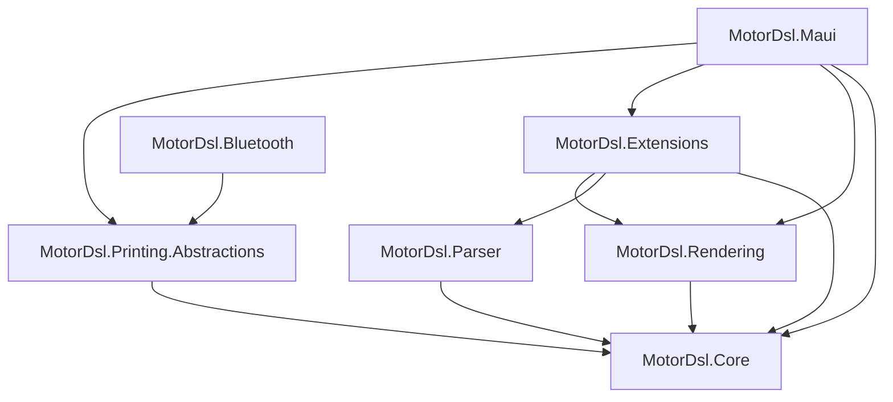

# Mapa de piezas — MotorDsl

## Resumen ejecutivo

**MotorDsl** (repositorio `PrintThermal_Motor_Maui`) es una solución de **librerías .NET 10**
que genera documentos a partir de un **DSL JSON** y los renderiza a **texto, ESC/POS, PDF y
preview raster**, con foco en **impresión térmica Bluetooth SPP** desde aplicaciones **.NET MAUI**.
Se distribuye como **7 paquetes NuGet** versionados en conjunto, acompañados de **5 aplicaciones
de ejemplo** MAUI y una suite de **tests xUnit**.

Este documento inventaría cada pieza con su `type` (Marco §7.1), tecnología, dependencias y
criticidad. Es el índice del que humanos y agentes derivan qué documentar; el detalle técnico de
cada pieza vive en su índice de la [ia-db](../../../ia-db/README.md) y en su carpeta
[`pieces/`](../../pieces/).

> Documento reconstruido por ingeniería inversa (`origin: reverse-engineered`) sobre el código en
> **v1.0.13 @83677eb**. Estado `draft` — pendiente de revisión humana.

---

## Inventario de piezas

### Librerías publicadas (paquetes NuGet)

| Pieza | `type` | TFM | Rol | Criticidad |
|---|---|---|---|---|
| `MotorDsl.Core` | `library` | `net10.0` | Núcleo: contratos (15 interfaces), modelo de documento (AST), `DocumentEngine`, `Evaluator`, `LayoutEngine`, `RendererRegistry`, validadores, providers in-memory | **Alta** |
| `MotorDsl.Parser` | `library` | `net10.0` | Parser DSL JSON → `DocumentTemplate` (System.Text.Json); distingue *classic* / *integrated* | **Alta** |
| `MotorDsl.Rendering` | `library` | `net10.0` | Renderers base: `TextRenderer` (target `text`), `EscPosRenderer` (target `escpos`), catálogo `EscPosCommands` | **Alta** |
| `MotorDsl.Extensions` | `library` | `net10.0` | DI fluent: `AddMotorDslEngine`, `MotorDslBuilder` (`AddTemplates`/`AddProfiles`/`AddRenderer`) | Media |
| `MotorDsl.Printing.Abstractions` | `library` | `net10.0` | Contratos transport-agnostic (`IThermalPrinterTransport`, `IThermalPrinterService`, `IDiagnosticsReportProvider`) + orquestador `ThermalPrinterService` (retry, estados, capacidades, diagnóstico) | **Alta** |
| `MotorDsl.Bluetooth` | `library` | `net10.0-android` ; `net10.0-ios` | Transport Bluetooth Classic SPP (Android). iOS lanza `PlatformNotSupportedException` | **Alta** |
| `MotorDsl.Maui` | `component-library` | `net10.0-android` ; `net10.0-ios` | Controles MAUI (badge, picker, previews, diagnóstico) + renderers PDF/ESC-POS-bitmap/raster-preview + rasterizadores + `MauiPrintErrorHandler` + provider de diagnóstico | **Alta** |

### Piezas de apoyo (no publicadas)

| Pieza | `type` | TFM | Rol | Criticidad |
|---|---|---|---|---|
| `MotorDsl.Tests` | `test-suite` ⚠️ | `net10.0` | Suite xUnit (~31 clases) del núcleo, renderers, printing y formato integrated | Media |
| `samples/MotorDsl.SampleApp` | `sample-app` ⚠️ | `net10.0-android/ios` | Demo mínimo del pipeline DSL (classic), preview e impresión BT | Baja |
| `samples/MotorDsl.MultaApp` | `sample-app` ⚠️ | `net10.0-android/ios` | Sample completo de acta de multa con servicios locales (classic, pre-refactor NuGet) | Baja |
| `samples/MotorDsl.Integrated.MultaApp` | `sample-app` ⚠️ | `net10.0-android/ios` | Sample del formato *integrated* con renderers locales | Baja |
| `samples/MotorDsl.Nuget.MultaApp` | `sample-app` ⚠️ | `net10.0-android/ios` | Igual a MultaApp pero consumiendo los 7 paquetes NuGet (classic) | Baja |
| `samples/MotorDsl.Nuget.Integrated.MultaApp` | `sample-app` ⚠️ | `net10.0-android/ios` | Patrón canónico recomendado: *integrated* + paquetes + controles MAUI + logo NV | Baja |

> ⚠️ `test-suite` y `sample-app` **no son tipos del Marco §7.1**: son extensiones declaradas para
> esta solución (el Marco es extensible, §7 preguntas guía). Los `sample-app` son además la fuente
> de los **snippets de integración** (Marco §13, Profile «guía de implementación de librerías»).

---

## Grafo de dependencias entre piezas

Dependencias verificadas en los `.csproj` de cada pieza (ver
[`ia-db/indexes/01`](../../../ia-db/indexes/01_nucleo-pipeline.md),
[`04`](../../../ia-db/indexes/04_impresion-transports.md),
[`05`](../../../ia-db/indexes/05_maui-ui-renderers.md)). `MotorDsl.Core` no depende de ningún
paquete de la solución (solo BCL de .NET 10).

> **Observación (deriva).** El script `scripts/nuget/publish-motordsl-nuget.bat` declara el orden de
> push `Printing.Abstractions → Core → …`, que **antecede** `Abstractions` a `Core` pese a que
> `Abstractions` depende de `Core`. Ver
> [`reporte-derivas.md`](../04-decisions/reporte-derivas.md).

---

## Correspondencia pieza → documentación

| Pieza | Índice ia-db | Doc de pieza |
|---|---|---|
| `MotorDsl.Core` | `01_nucleo-pipeline`, `02_dsl-y-modelos` | [`pieces/MotorDsl.Core/`](../../pieces/MotorDsl.Core/) |
| `MotorDsl.Parser` | `02_dsl-y-modelos` | [`pieces/MotorDsl.Parser/`](../../pieces/MotorDsl.Parser/) |
| `MotorDsl.Rendering` | `03_renderizado-base` | [`pieces/MotorDsl.Rendering/`](../../pieces/MotorDsl.Rendering/) |
| `MotorDsl.Extensions` | `03_renderizado-base` | [`pieces/MotorDsl.Extensions/`](../../pieces/MotorDsl.Extensions/) |
| `MotorDsl.Printing.Abstractions` | `04_impresion-transports` | [`pieces/MotorDsl.Printing.Abstractions/`](../../pieces/MotorDsl.Printing.Abstractions/) |
| `MotorDsl.Bluetooth` | `04_impresion-transports` | [`pieces/MotorDsl.Bluetooth/`](../../pieces/MotorDsl.Bluetooth/) |
| `MotorDsl.Maui` | `05_maui-ui-renderers` | [`pieces/MotorDsl.Maui/`](../../pieces/MotorDsl.Maui/) |
| `MotorDsl.Tests` | `07_tests` | — (cubierto por el índice) |
| samples (5) | `06_samples` | [`pieces/samples/`](../../pieces/samples/) |

---

## Preguntas guía

- ¿Puedo adoptar el stack completo con solo dos `PackageReference` (`MotorDsl.Maui` +
  `MotorDsl.Bluetooth`)? → Sí; las demás librerías entran como dependencias transitivas
  (ver [catálogo de APIs](../05-apis/catalog.md)).
- ¿Qué pieza es el punto de extensión para un transport nuevo (USB/BLE/red)? →
  `MotorDsl.Printing.Abstractions` (`IThermalPrinterTransport`), sin tocar el orquestador.
- ¿Qué pieza es el punto de extensión para un formato de salida nuevo? → un `IRenderer` con `Target`
  propio, registrado por DI (`MotorDsl.Extensions`).
