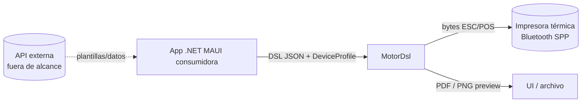

# Visión y alcance — MotorDsl

## Resumen ejecutivo

**MotorDsl** es un motor de generación y renderizado de documentos para el ecosistema **.NET 10 /
.NET MAUI**, orientado a la **impresión térmica ESC/POS por Bluetooth**. Describe un documento una
sola vez, en un **DSL JSON** independiente del dispositivo, y lo materializa en múltiples salidas
—texto plano, comandos ESC/POS, PDF y vista previa raster— eligiendo el formato por un **perfil de
dispositivo** en tiempo de ejecución. Se distribuye como un conjunto de **librerías NuGet**
modulares, extensibles vía *renderers* y *transports* sin tocar el núcleo.

> Documento reconstruido por ingeniería inversa sobre el código en **v1.0.13 @83677eb** y la
> documentación previa del proyecto (`docs/00_contexto`, `docs/01_necesidades_negocio`). Estado
> `draft`. Las necesidades de negocio citadas provienen de los documentos `NB-01..06` del origen.

## Problema que resuelve

Las aplicaciones que imprimen tickets, actas o comprobantes en impresoras térmicas suelen acoplar
la lógica de armado del documento al modelo específico de impresora y al canal físico. Cambiar el
formato del documento exige recompilar; soportar otra impresora exige reescribir la generación de
bytes. MotorDsl **desacopla** tres decisiones que normalmente se mezclan:

1. **Qué dice el documento** → un DSL JSON (plantilla o formato integrado).
2. **Cómo se ve en un dispositivo concreto** → un `DeviceProfile` que elige el `Target` de render.
3. **Por dónde se envía** → un `Transport` seleccionado por su `Kind`.

## Objetivos (derivados de las necesidades de negocio del origen)

| Objetivo | Necesidad de negocio (origen) |
|---|---|
| Desacoplar la definición del documento del dispositivo y del canal | `NB-01-Desacople` |
| Estandarizar la generación de documentos térmicos | `NB-02-Estandarización` |
| Permitir cambios de documento sin recompilar la app (DSL como dato) | `NB-03-Cambios-sin-codigo` |
| Soportar múltiples dispositivos/impresoras | `NB-04-Multi-dispositivo` |
| Reducir costos de mantenimiento e integración | `NB-05-Reduccion-de-costos` |
| Reutilizar el motor entre aplicaciones | `NB-06-Reutilizacion` |

> Trazabilidad: los `NB-*` están mapeados en
> [`ia-db/indexes/09_docs-existentes.md`](../../../ia-db/indexes/09_docs-existentes.md). Este
> pipeline **no** re-derivó los requisitos formales a `02-requirements/`; se declara como gap en
> [`gap-documental.md`](../gap-documental.md).

## Alcance

**Dentro del alcance de la solución:**

- Parseo de un DSL JSON en dos formatos: *classic* (plantilla con datos externos) e *integrated*
  (datos embebidos y pre-resueltos).
- Evaluación, layout y renderizado a `text`, `escpos`, `escpos-bitmap`, `pdf` y `raster-preview`.
- Orquestación de impresión con reintentos, detección de capacidades y diagnóstico.
- Transport **Bluetooth Classic SPP para Android**; controles de UI listos para .NET MAUI.

**Fuera del alcance (hoy):**

- Transports USB, BLE y red TCP (declarados en el *roadmap* del `README.md` del origen, no
  implementados).
- Impresión Bluetooth en **iOS** (el transport lanza `PlatformNotSupportedException`).
- La **API REST** que alimenta a los *samples* con plantillas/datos: es un backend externo, no
  forma parte de estas librerías.
- Persistencia en base de datos: la solución no tiene BD propia; su "modelo de datos" es el AST del
  DSL (ver [`02_dsl-y-modelos`](../../../ia-db/indexes/02_dsl-y-modelos.md)).

## Stakeholders

| Rol | Interés en MotorDsl |
|---|---|
| Desarrollador integrador | Adoptar el stack en una app MAUI con dos `PackageReference` |
| Autor de plantillas | Definir documentos en DSL JSON sin tocar el código de la app |
| QA | Verificar salidas (texto/preview) sin hardware físico |
| Mantenedor de la librería | Evolucionar renderers/transports respetando SemVer |

## Actores y contexto

## Principios de diseño (observados en el código)

- **Extensibilidad sin modificar el núcleo:** un `IRenderer` nuevo (por `Target`) o un
  `IThermalPrinterTransport` nuevo (por `Kind`) se enchufan por DI.
- **Degradar antes que fallar en silencio… salvo cuando importa:** el layout degrada QR/bitmap a
  texto si el dispositivo no los soporta; pero el renderer `escpos-bitmap` es *fail-loud* ante una
  imagen irrecuperable (aborta el ticket con error preciso).
- **Honestidad sobre las capacidades:** las capacidades de impresora son tri-estado
  (`Unknown`/`NotDetected`/`Supported`), nunca un `bool` optimista.
- **Nunca datos sensibles en los registros:** el historial de fallos guarda la longitud del
  payload, no el payload; las MAC se enmascaran al construir el diagnóstico.

## Preguntas guía

- ¿Puede un integrador nuevo imprimir un ticket leyendo solo esta documentación? → Ruta:
  [catálogo de APIs](../05-apis/catalog.md) → [guía de uso MAUI](../../pieces/MotorDsl.Maui/usage-guide.md).
- ¿Qué necesito para soportar una impresora por USB? → un transport nuevo; ver
  [guía de extensión](../../pieces/MotorDsl.Printing.Abstractions/extension-guide.md).
