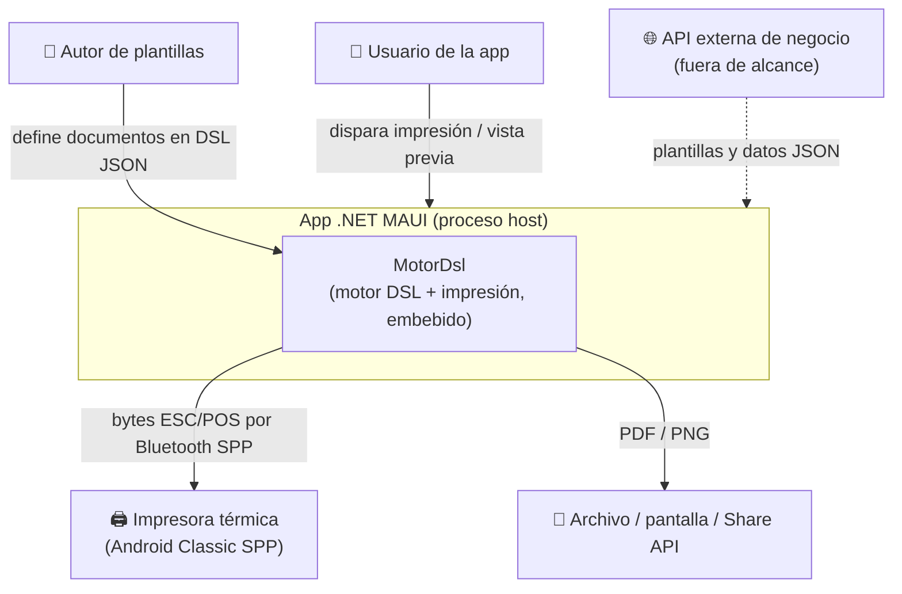

# C4 Nivel 1 — Contexto del sistema

## Resumen ejecutivo

MotorDsl es una **librería embebida**, no un servicio en ejecución: vive dentro del proceso de la
aplicación .NET MAUI que la consume. Este documento sitúa a MotorDsl frente a sus actores y sistemas
externos. El detalle interno (paquetes y sus relaciones) está en
[C4 Nivel 2 — Contenedores](02-containers.md).

## Diagrama de contexto (C4-L1)

## Actores

| Actor | Descripción | Interacción |
|---|---|---|
| Autor de plantillas | Define el contenido del documento en DSL JSON (plantilla *classic* o *integrated*). | Provee el DSL que consume el motor. |
| Usuario de la app | Persona que opera la aplicación MAUI (p. ej. imprime un acta o un ticket). | Dispara render/impresión desde la UI. |
| Desarrollador integrador | Incorpora las librerías a su app y configura el DI. | Consume la API pública (ver [catálogo](../05-apis/catalog.md)). |

## Sistemas externos

| Sistema | Relación | Estado |
|---|---|---|
| Impresora térmica Bluetooth | Recibe bytes ESC/POS vía RFCOMM/SPP. Solo **Android**. | En alcance (transport `MotorDsl.Bluetooth`). |
| API de negocio (backend) | Provee plantillas y datos a los *samples* (los *samples* apuntan a una IP configurable). | **Fuera de alcance**; es un consumidor/proveedor externo. |
| Almacenamiento / Share | Destino de PDFs y PNGs de preview (sistema de archivos, Share API de MAUI). | En alcance parcial (capa MAUI produce los bytes). |

## Límites del sistema

- MotorDsl **no** expone una API de red ni corre como proceso propio: se enlaza como paquetes NuGet.
- MotorDsl **no** gestiona la obtención de datos desde el backend: recibe el DSL ya formado.
- La única salida física que MotorDsl controla de punta a punta es la **impresión Bluetooth en
  Android**; el resto de salidas (PDF/PNG) las entrega como bytes al host.

## Preguntas guía

- ¿Qué pasa si la app corre en iOS? → El pipeline de render funciona; la **impresión Bluetooth no**
  (ver [platform-notes](../../pieces/MotorDsl.Bluetooth/platform-notes.md)).
- ¿De dónde salen los datos del documento? → De la app host (que puede traerlos del backend); MotorDsl
  solo consume el DSL. Ver [runtime views](04-runtime-views.md).
