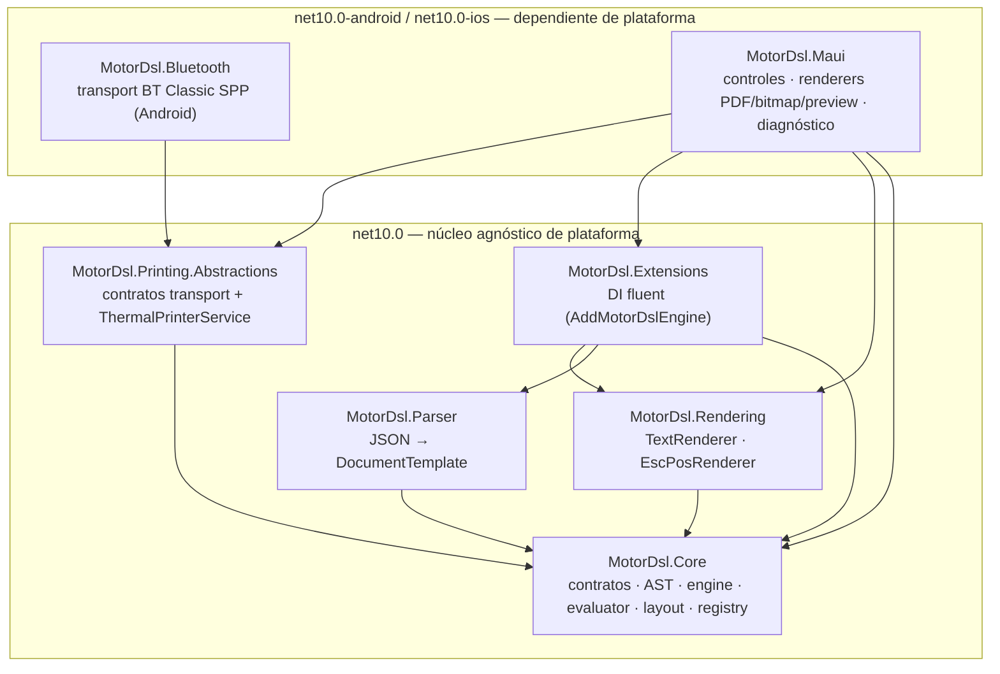

# C4 Nivel 2 — Contenedores (paquetes)

## Resumen ejecutivo

En una librería embebida, los "contenedores" del modelo C4 son los **paquetes/ensamblados** y sus
límites de dependencia. MotorDsl separa el **núcleo agnóstico de plataforma** (net10.0 puro:
`Core`, `Parser`, `Rendering`, `Extensions`, `Printing.Abstractions`) de la **capa dependiente de
plataforma** (net10.0-android/ios: `Bluetooth`, `Maui`). Esta frontera es la que permite testear el
grueso del motor sin un dispositivo y reutilizarlo fuera de MAUI.

## Diagrama de contenedores (C4-L2)

## Contenedores

| Paquete | TFM | Responsabilidad | Depende de | Detalle |
|---|---|---|---|---|
| `MotorDsl.Core` | net10.0 | Contratos, AST, `DocumentEngine`, `Evaluator`, `LayoutEngine`, `RendererRegistry`, validadores, providers | — (solo BCL) | [pieza](../../pieces/MotorDsl.Core/README.md) · [ia-db 01](../../../ia-db/indexes/01_nucleo-pipeline.md) |
| `MotorDsl.Parser` | net10.0 | Parseo JSON → `DocumentTemplate` (classic/integrated) | Core | [pieza](../../pieces/MotorDsl.Parser/README.md) · [ia-db 02](../../../ia-db/indexes/02_dsl-y-modelos.md) |
| `MotorDsl.Rendering` | net10.0 | Renderers base: texto y ESC/POS; `EscPosCommands` | Core | [pieza](../../pieces/MotorDsl.Rendering/README.md) · [ia-db 03](../../../ia-db/indexes/03_renderizado-base.md) |
| `MotorDsl.Extensions` | net10.0 | Registro DI del pipeline + API fluent | Core, Parser, Rendering | [pieza](../../pieces/MotorDsl.Extensions/README.md) |
| `MotorDsl.Printing.Abstractions` | net10.0 | Contratos de transport + orquestador `ThermalPrinterService` | Core | [pieza](../../pieces/MotorDsl.Printing.Abstractions/README.md) · [ia-db 04](../../../ia-db/indexes/04_impresion-transports.md) |
| `MotorDsl.Bluetooth` | net10.0-android/ios | Transport Bluetooth Classic SPP (Android) | Printing.Abstractions | [pieza](../../pieces/MotorDsl.Bluetooth/README.md) |
| `MotorDsl.Maui` | net10.0-android/ios | Controles MAUI + renderers PDF/bitmap/preview + diagnóstico | Core, Rendering, Extensions, Printing.Abstractions | [pieza](../../pieces/MotorDsl.Maui/README.md) · [ia-db 05](../../../ia-db/indexes/05_maui-ui-renderers.md) |

## Frontera agnóstico ↔ plataforma

La separación no es cosmética: es lo que hace que `MotorDsl.Tests` (net10.0) pueda ejercitar el
motor completo sin un emulador. Incluso las partes **puras** del transport Bluetooth (chunking,
parseo de status) viven fuera de los bloques `#if ANDROID` para poder testearse; el proyecto de
tests las enlaza por fuente (ver [ia-db 04](../../../ia-db/indexes/04_impresion-transports.md) §4 y
[ia-db 07](../../../ia-db/indexes/07_tests.md)).

## Puntos de extensión (contenedores futuros)

| Extensión | Cómo encaja | Contrato |
|---|---|---|
| Transport USB / BLE / red | Nuevo paquete que implementa `IThermalPrinterTransport` con un `Kind` propio; se registra por DI junto a Bluetooth | [extension-guide](../../pieces/MotorDsl.Printing.Abstractions/extension-guide.md) |
| Renderer nuevo (p. ej. HTML) | Nuevo `IRenderer` con un `Target`; se registra con `AddRenderer<T>()` | [ia-db 03](../../../ia-db/indexes/03_renderizado-base.md) |

## Preguntas guía

- ¿Puedo usar el motor de render sin MAUI? → Sí: `Core` + `Parser` + `Rendering` + `Extensions` son
  net10.0 puro. La capa MAUI solo agrega PDF/preview/controles.
- ¿Por qué `MotorDsl.Maui` es `component-library` y no `library`? → Porque su valor principal son los
  **controles reutilizables** (con contrato de props), además de los renderers. Ver
  [component-catalog](../../pieces/MotorDsl.Maui/component-catalog.md).
