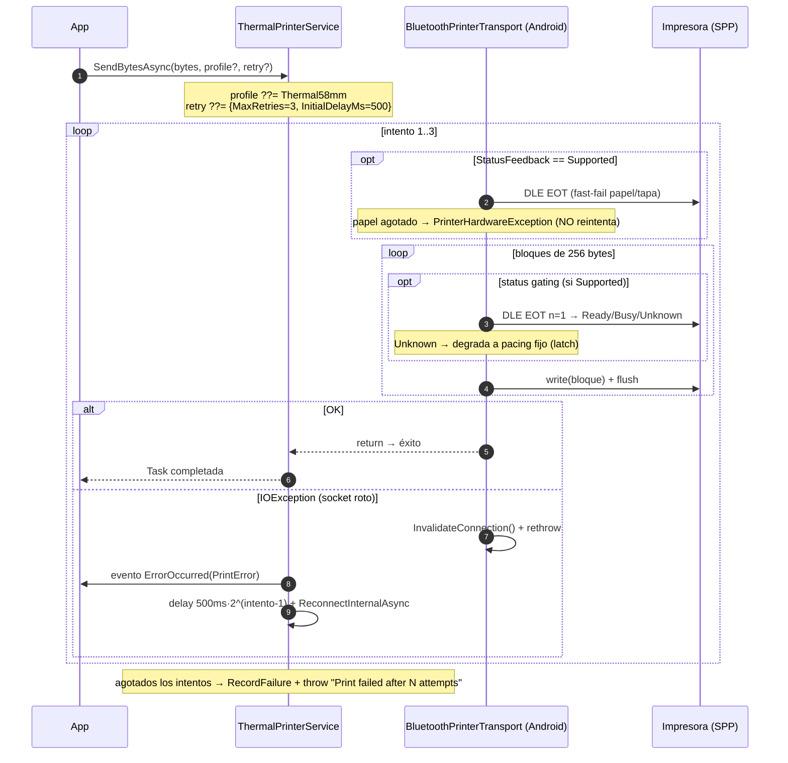
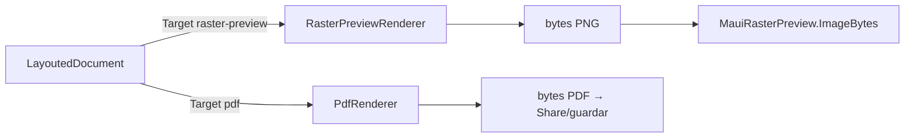

# Vistas de runtime — flujos clave

## Resumen ejecutivo

Este documento narra los flujos de ciclo de vida más importantes de MotorDsl **de punta a punta,
con datos sintéticos**, para que un desarrollador o QA entienda qué ocurre entre "hay un DSL" y
"salió un ticket". Los datos de ejemplo son inventados pero con formato válido; **no** son datos
reales. Cada paso referencia la fuente en la ia-db.

> `confidence: medium`: la narrativa integra el comportamiento descrito en los índices 01–05; los
> valores concretos (delays, bytes) valen para **v1.0.13 @83677eb** y deberían reverificarse tras
> cambios en el pipeline.

## Datos sintéticos de trabajo

```json
// DeviceProfile de destino (sintético)
{ "name": "thermal_58mm", "width": 32, "renderTarget": "escpos-bitmap" }
```

```text
Documento de ejemplo (acta de infracción, datos sintéticos):
  acta      = "AImagen001"
  patente   = "AB123CD"
  fecha     = "2026-07-14 10:30"
  importe   = "$ 15.000,00"
```

---

## Flujo 1 — De DSL a bytes ESC/POS (pipeline de render)

Camino *classic* (plantilla + datos externos). En *integrated* se omite el paso 2 (Evaluate).

```mermaid
sequenceDiagram
    autonumber
    participant App
    participant Eng as DocumentEngine
    participant Par as DslParser
    participant Ev as Evaluator
    participant Lay as LayoutEngine
    participant Reg as RendererRegistry
    participant Ren as IRenderer (Target=escpos-bitmap)

    App->>Eng: Render(dslJson, datos, profile)
    Eng->>Par: Parse(dslJson) → DocumentTemplate
    Note over Par: detecta format: template|integrated
    Eng->>Ev: Evaluate(template, datos) → EvaluatedDocument
    Note over Ev: resuelve {{patente}}, loop, conditional<br/>no resueltos → {{UNRESOLVED:path}}
    Eng->>Lay: Layout(evaluated, profile) → LayoutedDocument
    Note over Lay: word-wrap al ancho (32);<br/>degrada QR/bitmap a texto si capability=false
    Eng->>Reg: Resolve("escpos-bitmap")
    Reg-->>Eng: renderer (o fallback "text" si Target desconocido)
    Eng->>Ren: Render(layouted, profile) → RenderResult
    Ren-->>App: RenderResult { Output: byte[], IsSuccessful, Errors, Warnings }
```

**Narrativa.** La app pide `Render` con el DSL del acta, los datos sintéticos y el perfil
`thermal_58mm`. El **parser** reconoce el `format` y produce el AST (`DocumentTemplate`). El
**evaluator** sustituye `{{patente}}` por `AB123CD`; si un dato faltara, insertaría
`{{UNRESOLVED:patente}}` en el texto (no aborta). El **layout** ajusta cada línea a 32 columnas y,
si el perfil declarara `supports_bitmap:false`, degradaría la imagen a un placeholder de texto con
*warning*. El **registry** resuelve el `Target` `escpos-bitmap`; **si el Target estuviera mal
escrito, cae en silencio a `text`** (deriva conocida, ver
[reporte-derivas](../04-decisions/reporte-derivas.md)). El **renderer** emite los bytes ESC/POS.

Fuentes: [`ia-db 01`](../../../ia-db/indexes/01_nucleo-pipeline.md),
[`ia-db 02`](../../../ia-db/indexes/02_dsl-y-modelos.md),
[`ia-db 05`](../../../ia-db/indexes/05_maui-ui-renderers.md).

**Advertencia de fidelidad (deriva).** En el camino *classic*, el `Evaluator` recrea los nodos sin
copiar el `Style`, por lo que `align`/`bold` del DSL pueden perderse antes del layout; en
*integrated* sobreviven. Ver [reporte-derivas](../04-decisions/reporte-derivas.md).

---

## Flujo 2 — De bytes a papel (impresión Bluetooth con retry)



**Narrativa.** La app envía los bytes del acta. El **servicio** aplica el perfil por defecto
`Thermal58mm` y hasta 3 intentos. Antes de escribir, si la impresora soporta *status feedback*,
hace un *fast-fail* de hardware (papel/tapa) que, ante papel agotado, lanza
`PrinterHardwareException` y **no reintenta**. Escribe en **bloques de 256 bytes**, gateando por
`Ready/Busy`; si el status se vuelve ilegible, degrada a *pacing* fijo por el resto del envío. Ante
un socket roto (`IOException`), invalida la conexión y reintenta con *backoff* exponencial,
reconectando en silencio. Si agota los intentos, registra **una** entrada de fallo (sin el payload,
solo su longitud) y lanza. Fuente: [`ia-db 04`](../../../ia-db/indexes/04_impresion-transports.md) §3–§5.

---

## Flujo 3 — Vista previa sin hardware (QA)

Para verificar el documento sin impresora, la app usa un perfil con `renderTarget:"raster-preview"`
(o `"pdf"`): el mismo `LayoutedDocument` se enruta a `RasterPreviewRenderer`, que produce un **PNG**
mostrado por el control `MauiRasterPreview`. Esto permite a QA validar el layout de un acta antes de
imprimir. Fuente: [`ia-db 05`](../../../ia-db/indexes/05_maui-ui-renderers.md) §3.1.



## Preguntas guía

- ¿Dónde se pierde el `bold` de un texto *classic*? → En el `Evaluator` (deriva documentada); usar
  *integrated* si el estilo es crítico.
- ¿Qué garantiza que un ticket a medias no se imprima? → El renderer `escpos-bitmap` es *fail-loud*:
  aborta con error preciso si una imagen no rasteriza.
- ¿Cómo verifico un documento sin impresora? → Perfil `raster-preview` o `pdf` (Flujo 3).
