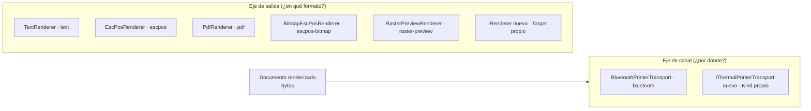

# Conceptos transversales y extensibilidad

## Resumen ejecutivo

Los conceptos que atraviesan a todas las piezas —extensibilidad, manejo de errores, diagnóstico,
threading, privacidad— y que un mantenedor necesita entender para evolucionar el motor sin romper
sus garantías. El detalle por pieza vive en la [ia-db](../../../ia-db/README.md); aquí se explica el
**criterio de diseño** transversal.

## 1. Extensibilidad: dos ejes ortogonales

MotorDsl se extiende por **dos dimensiones independientes**, ambas sin tocar el núcleo:

- **Salida** → un `IRenderer` con un `Target` string, resuelto por `RendererRegistry` y elegido por
  el `DeviceProfile`. Guía: [ia-db 03](../../../ia-db/indexes/03_renderizado-base.md).
- **Canal** → un `IThermalPrinterTransport` con un `Kind` string, enrutado por
  `ThermalPrinterService`. Guía: [extension-guide](../../pieces/MotorDsl.Printing.Abstractions/extension-guide.md).

Los dos ejes no se cruzan: un renderer no sabe por dónde se envía, un transport no sabe qué generó
los bytes. Esa separación es la que sostiene el roadmap (USB/BLE/red) sin reescribir el motor.

## 2. Manejo de errores: degradar vs. abortar

MotorDsl distingue deliberadamente **cuándo degradar** (seguir con menos) de **cuándo abortar**
(fallar fuerte):

| Situación | Política | Dónde |
|---|---|---|
| Capability no soportada (QR/bitmap) | **Degrada** a texto placeholder + warning | `LayoutEngine` |
| Dato *classic* no resuelto | **Degrada**: inserta `{{UNRESOLVED:path}}` en el texto | `Evaluator` |
| `Target` desconocido en el registry | **Degrada en silencio** a `text` ⚠️ (deriva T4) | `RendererRegistry` |
| Imagen que no rasteriza (`escpos-bitmap`) | **Aborta** el ticket, error preciso (*fail-loud*) | `BitmapEscPosRenderer` |
| `IOException` en el transport | **Aborta el intento**, invalida conexión y deja reintentar | `BluetoothPrinterTransport` |
| Papel agotado / tapa abierta | **Aborta sin reintentar** (`PrinterHardwareException`) | transport + `DefaultPrintErrorHandler` |

> El fallback silencioso a `text` ante un `Target` mal escrito (T4) es la excepción incómoda a la
> regla "no degradar en silencio lo que importa"; queda reportado en
> [reporte-derivas](../04-decisions/reporte-derivas.md).

## 3. Reintentos e idempotencia de impresión

`ThermalPrinterService.SendBytesAsync` aplica hasta `MaxRetries` (default 3) con **backoff
exponencial** (`InitialDelayMs · 2^(intento-1)`), reconectando en silencio entre intentos. El
`IPrintErrorHandler` clasifica cada error: `Connection`/`Timeout`/`Unknown` → reintenta;
`Hardware`/`Protocol` → aborta. **No hay idempotencia a nivel de bytes**: un reintento reenvía el
ticket completo; si el fallo ocurrió tras imprimir parte, puede duplicarse contenido. Es una
característica a considerar al integrar. Fuente:
[ia-db 04](../../../ia-db/indexes/04_impresion-transports.md) §3, §5.

## 4. Detección de capacidades: honestidad tri-estado

Las capacidades de impresora nunca son `bool`: son `CapabilitySupport` (`Unknown` / `NotDetected` /
`Supported`). La diferencia importa: un "no contestó" (`NotDetected`) puede significar "no lo
soporta" **o** "estaba ocupada". La detección es *best-effort* y **jamás hace fallar la conexión**.
Ver GLOSSARY (*CapabilitySupport*) y [ia-db 04](../../../ia-db/indexes/04_impresion-transports.md) §3.2.

## 5. Diagnóstico y observabilidad

`IDiagnosticsReportProvider` captura un snapshot (librería/app/dispositivo/impresora/permisos) que
puede verse en pantalla (`MauiDiagnosticsView`), imprimirse como ticket (DSL *integrated* con QR de
correlación) o compartirse. El historial de fallos es un **ring buffer de 20 entradas en memoria**
(sin persistencia). Fuente: [ia-db 05](../../../ia-db/indexes/05_maui-ui-renderers.md) §4.

## 6. Threading

- La UI se actualiza en el hilo principal: `PrinterStatusBadge` marshalla los `PropertyChanged` del
  servicio con `MainThread.BeginInvokeOnMainThread` (pueden llegar de un hilo de fondo).
- ⚠️ El diagnóstico usa *sync-over-async* al sondear permisos (`GetAwaiter().GetResult()` dentro de
  `Build`, deriva T15). Ver [reporte-derivas](../04-decisions/reporte-derivas.md).

## 7. Privacidad y seguridad de datos

- El historial de fallos guarda la **longitud** del payload, nunca el payload.
- Las **MAC** se enmascaran (`xx:xx:xx:**:**:**`) al construir el reporte, no al registrar.
- ⚠️ Los samples traen una **IP de backend hardcodeada** en `motordsl-config.json` (deriva D15): no
  es parte de las librerías, pero conviene sanearlo. Ver
  [reporte-derivas](../04-decisions/reporte-derivas.md).

## 8. Internacionalización / codificación

`EscPosRenderer` fija **CP437** para texto e **ignora** la capability `codepage` y las propiedades
`DeviceProfile.CodePage`/`CodePageCommand` (solo QR/barcode respetan `codepage`, deriva T5). Impacto:
caracteres fuera de CP437 pueden salir mal en el renderer base. Ver
[reporte-derivas](../04-decisions/reporte-derivas.md).

## Preguntas guía

- ¿Agregar un transport rompe algo del motor? → No: el orquestador enruta por `Kind`; el motor de
  render no se entera.
- ¿Qué garantías de "no imprimir a medias" hay? → El renderer `escpos-bitmap` es *fail-loud*; pero
  el retry no es idempotente a nivel bytes (§3).
- ¿Puedo confiar en que "capability ausente" = "no soportado"? → No: es `Unknown`, no `NotDetected`
  (§4).
