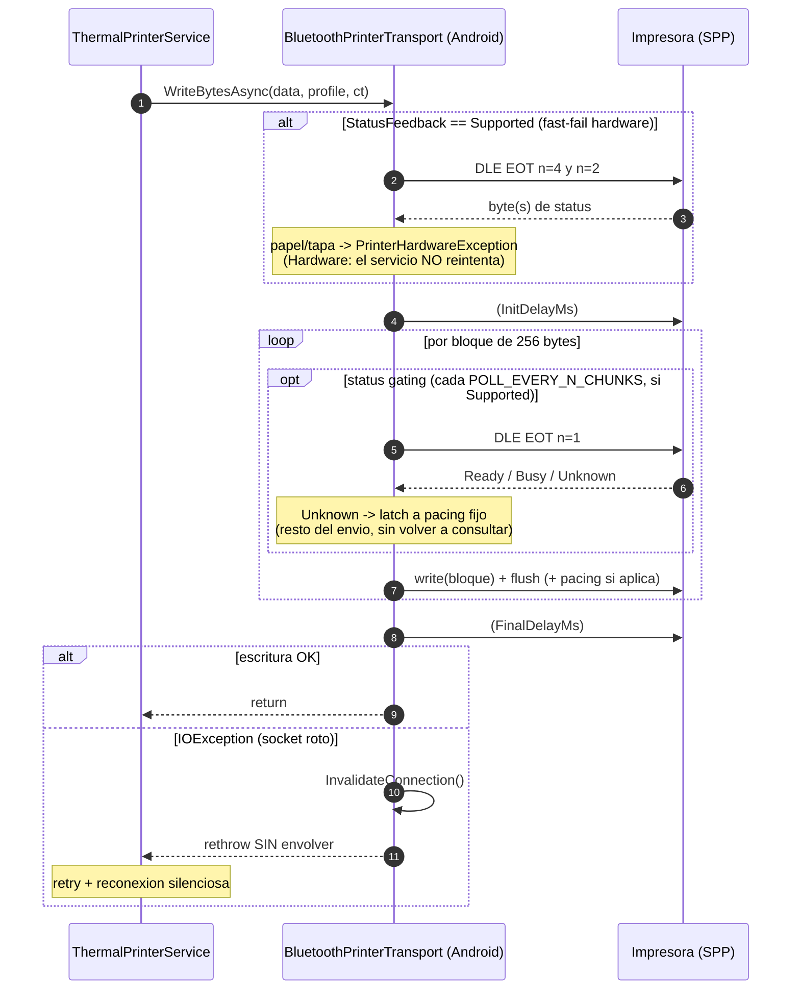

# MotorDsl.Bluetooth

> Pieza `library` (transport concreto) del stack de impresión de MotorDsl. Documento reconstruido
> por ingeniería inversa sobre **v1.0.13 @83677eb**; estado `draft`.

## Resumen ejecutivo

`MotorDsl.Bluetooth` implementa `IThermalPrinterTransport` para **Bluetooth Classic SPP (RFCOMM)**
sobre **Android**. Es un transport puro: descubre impresoras emparejadas, abre el socket RFCOMM al
UUID de Serial Port Profile, escribe bytes con **chunking de tamaño fijo + pacing**, detecta
capacidades best-effort, hace **flow control por status** (`DLE EOT`) y aprovisiona **logo NV**.
Todo el retry, la reconexión y la orquestación quedan en `ThermalPrinterService` (pieza
[`MotorDsl.Printing.Abstractions`](../MotorDsl.Printing.Abstractions/README.md)).

**iOS no está soportado**: los métodos de I/O lanzan `PlatformNotSupportedException`. Ver la
sección [Notas de plataforma](#notas-de-plataforma) y el detalle en
[platform-notes.md](./platform-notes.md).

## Rol en el sistema

| Aspecto | Detalle |
|---|---|
| `type` (Marco §7.1) | `library` (transport concreto, con notas de plataforma) |
| Rol | Transport Bluetooth Classic SPP para Android (`Kind = "bluetooth"`) |
| Implementa | `IThermalPrinterTransport` (de `MotorDsl.Printing.Abstractions`) |
| Plataformas | Android soportado · iOS lanza `PlatformNotSupportedException` · resto no-op |
| Índice ia-db | [`04_impresion-transports`](../../../ia-db/indexes/04_impresion-transports.md) |

## TFMs y dependencias

| Ítem | Valor | Fuente |
|---|---|---|
| TFMs | `net10.0-android` ; `net10.0-ios` | `src/MotorDsl.Bluetooth/MotorDsl.Bluetooth.csproj#L4` |
| Min OS | Android **24.0** · iOS **15.0** | `…csproj#L10-L11` |
| `AndroidLdFlags` | `-Wl,-z,max-page-size=16384` (páginas de 16 KB) | `…csproj#L28-L30` |
| ProjectReference | `MotorDsl.Printing.Abstractions` | `…csproj#L37` |
| PackageReference | `Microsoft.Extensions.DependencyInjection.Abstractions` `10.0.8` | `…csproj#L41` |

> `BluetoothPrinterTransport` es una **partial class en 5 archivos**. Las partes puras
> (`…Chunking.cs`, `…Capabilities.cs`) viven **fuera** de los `#if` para poder testearse en
> `net10.0` desde `MotorDsl.Tests`. Fuente: `BluetoothPrinterTransport.Chunking.cs#L3-L8`.

## Las 4 fases del transport

Nomenclatura tomada de los comentarios del código (`ia-db 04 §9`).

| Fase | Qué agrega | Dónde vive |
|---|---|---|
| **1 — Chunking + pacing** | Chunking fijo (`CHUNK_SIZE = 256`, por tamaño, **no** por contenido) + pacing por bloque; ante `IOException` → `InvalidateConnection()` + rethrow **sin envolver** (la reconexión la hace el servicio). | `BluetoothPrinterTransport.cs#L179-L281`, `…Chunking.cs` |
| **2 — Detección de capacidades** | Al conectar, best-effort: feedback (`DLE EOT` ×3), NV vía query **no intrusiva** `GS ( L` fn=48, `ModelId` vía `GS I`. Nunca hace fallar la conexión. | `…Detection.cs#L26-L113`, `…Capabilities.cs#L28-L44` |
| **3 — Flow control por status** | Gating de bloques por `Ready`/`Busy` (`DLE EOT n=1`), fast-fail de hardware (papel/tapa), **degradación con latch** a pacing fijo tras un status ilegible. | `…Detection.cs#L115-L175`, `…Capabilities.cs#L46-L78` |
| **4 — NV logo** | `GS ( L` verificado por query de keycodes / fallback `FS q` con confirmación limitada; tras éxito actualiza `Capabilities.NvGraphics`. | `…Nv.cs#L21-L102` |

## Diagrama — secuencia de envío de bytes


Fuentes: `BluetoothPrinterTransport.cs#L179-L257`, `…Detection.cs#L119-L175`.

## Alta rápida (DI)

```csharp
services.AddMotorDslPrinting();          // orquestador (Abstractions)
services.AddBluetoothPrinterTransport(); // este transport (AddSingleton, NO TryAdd)
```
Procedencia: `src/MotorDsl.Bluetooth/MotorDslBluetoothServiceCollectionExtensions.cs#L8-L12`.

`AddBluetoothPrinterTransport` usa `AddSingleton` **a propósito**: el servicio acepta varios
transports (`IEnumerable<IThermalPrinterTransport>`).

## Notas de plataforma

> Resumen. El detalle (matriz completa, permisos, piso efectivo de OS) está en
> [platform-notes.md](./platform-notes.md).

| Plataforma | Comportamiento | Fuente |
|---|---|---|
| **Android** | Soportado. Discover solo dispositivos **emparejados** (`BondedDevices`); exige BT habilitado y permiso `BLUETOOTH_CONNECT` en API 31+. | `BluetoothPrinterTransport.cs#L56-L96` |
| **iOS** | `DiscoverAsync`/`ConnectAsync`/`DisconnectAsync`/`WriteBytesAsync` lanzan `PlatformNotSupportedException("iOS no soporta Bluetooth Classic SPP. Usar BLE o impresion por red.")`; `Capabilities` → `null`. | `BluetoothPrinterTransport.cs#L92-L93,#L136-L138,#L171-L173,#L251-L253,#L42` |
| **Otras** (`#else`) | `ConnectAsync` → `false`; `WriteBytesAsync` no-op. | `BluetoothPrinterTransport.cs#L139-L141,#L254-L256` |

- **Min OS efectivo**: la pieza declara Android `24.0`, pero al consumirla junto con
  `MotorDsl.Maui` (que declara `25.0`), el piso efectivo de una app MAUI es **25.0**. Ver
  [platform-notes.md](./platform-notes.md#piso-efectivo-de-os).
- **Permisos Android**: `BLUETOOTH_SCAN`, `BLUETOOTH_CONNECT`, `ACCESS_FINE_LOCATION`.

## Enlaces

- [Referencia de API](./api-reference.md) — superficie pública, constantes y comandos ESC/POS.
- [Notas de plataforma](./platform-notes.md) — matriz de soporte, permisos, min OS.
- Contrato que implementa: [`MotorDsl.Printing.Abstractions`](../MotorDsl.Printing.Abstractions/README.md) · [guía de extensión](../MotorDsl.Printing.Abstractions/extension-guide.md).
- [Índice ia-db 04](../../../ia-db/indexes/04_impresion-transports.md) · [Glosario](../../GLOSSARY.md).
