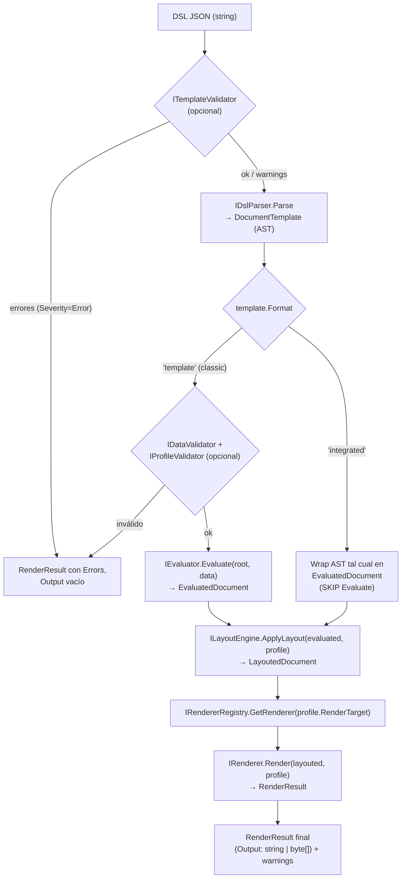

# MotorDsl.Core — Núcleo del motor de documentos

> Pieza `library`, criticidad **alta**. Contiene los contratos, el modelo (AST) y el
> orquestador del pipeline de documentos de MotorDsl. Documentación de la API pública en
> [`api-reference.md`](./api-reference.md).

## 1. Resumen ejecutivo

| Pregunta | Respuesta |
|---|---|
| **¿Qué es?** | La librería núcleo de MotorDsl: define el pipeline que transforma un **DSL JSON** que describe un documento (texto, contenedores, tablas, imágenes, loops, condicionales) en una salida imprimible (`string` o `byte[]`). |
| **¿Para qué sirve?** | Convertir plantillas + datos en tickets/actas renderizados para impresoras térmicas u otros targets, de forma determinista y sin dependencias externas. Aloja los **contratos** (interfaces) que el resto de la solución implementa (parser, renderers, transportes). |
| **¿A quién le sirve?** | **Devs** que integran el motor o implementan un contrato; **arquitectura** que razona sobre el flujo y sus fronteras; **agentes IA** que generan/validan DSL o invocan `Render`. |
| **¿Qué NO hace?** | No parsea JSON (eso es `MotorDsl.Parser`), no emite ESC/POS ni PDF (eso es `MotorDsl.Rendering` / `MotorDsl.Maui`), no habla con hardware (eso son los transportes). Solo define contratos, modelo y orquestación. |

`MotorDsl.Core` es el **centro de dependencias**: todas las demás piezas dependen de sus
contratos y modelos, no al revés.

## 2. Rol en la solución y el pipeline

El motor es un pipeline de 4 etapas orquestado por `DocumentEngine`
(`src/MotorDsl.Core/Engine/DocumentEngine.cs#L8-L11`), con validaciones opcionales intercaladas:

**JSON → Parser → Evaluator → LayoutEngine → Renderer → `RenderResult`**

| Etapa | Contrato | Salida | Notas |
|---|---|---|---|
| Parse | `IDslParser` | `DocumentTemplate` (AST) | Vive en `MotorDsl.Parser`; lanza `ArgumentException` si el DSL es inválido. |
| Evaluate | `IEvaluator` | `EvaluatedDocument` | Resuelve `{{...}}`, condiciones y loops contra `data`. **Se salta** en formato *integrated*. |
| Layout | `ILayoutEngine` | `LayoutedDocument` | Aplica `DeviceProfile` (ancho, wrap, align) y llena `DeviceMetadata` por nodo. |
| Render | `IRenderer` (vía `IRendererRegistry`) | `RenderResult` | El registry selecciona el renderer por `DeviceProfile.RenderTarget`. |

Trazabilidad del flujo: camino classic en `DocumentEngine.cs#L32-L137`; camino integrated en
`#L139-L216` (salta Evaluate porque el AST llega pre-resuelto, `#L189-L195`). Detalle completo
del pipeline en el índice [`01_nucleo-pipeline.md`](../../../ia-db/indexes/01_nucleo-pipeline.md).

## 3. Dependencias y TFM

| Aspecto | Valor |
|---|---|
| Dependencias externas | **Ninguna** salvo la BCL. Todo el núcleo es POCO + interfaces. |
| TFM | `net10.0`. |
| Acoplamiento | Las piezas satélite (`MotorDsl.Parser`, `MotorDsl.Rendering`, `MotorDsl.Maui`, transportes) dependen de los contratos de `Core`; `Core` no depende de ninguna de ellas. |

## 4. Conceptos clave del núcleo

| Concepto | Qué aporta | Referencia |
|---|---|---|
| **Contratos** (`Contracts/`) | 15 interfaces que definen todas las fronteras del motor (orquestación, parseo, evaluación, layout, render, providers, validadores, manejo de error de impresión, rasterizado). | [api-reference §1](./api-reference.md#1-contratos-contracts) |
| **Modelo / AST** (`Models/`) | Jerarquía `DocumentNode` (abstracta) → `TextNode`, `ContainerNode`, `ConditionalNode`, `LoopNode`, `TableNode`, `ImageNode`; más `DocumentTemplate` (raíz + `Format`). | [api-reference §3](./api-reference.md#3-modelos-públicos) |
| **`DocumentEngine`** (`Engine/`) | Orquestador que implementa `IDocumentEngine`: 3 sobrecargas `Render` + `RenderLayout`. Nunca propaga excepciones desde `Render`: las captura y devuelve en `RenderResult.Errors`. | `Engine/DocumentEngine.cs` |
| **`Evaluator`** (`Evaluators/`) | Resuelve placeholders `{{path}}`, condiciones (`==, !=, >, <, &&, ||`) y expande loops contra los datos. No resuelto → marcador `{{UNRESOLVED:path}}`. | `Evaluators/Evaluator.cs` |
| **`LayoutEngine`** (`Layout/`) | Aplica el `DeviceProfile` (ancho en columnas, wrap, alineación, degradación por *capabilities*) y produce `LayoutInfo` + `DeviceMetadata` por nodo. Los renderers **no** recorren el AST: iteran ese layout. | `Layout/LayoutEngine.cs` |
| **`RendererRegistry`** (`Engine/`) | Diccionario `target → IRenderer`. `GetRenderer` hace **fallback silencioso a `"text"`** si el target no está registrado. | `Engine/RendererRegistry.cs` |
| **Validators** (`Validation/`) | `TemplateValidator` (JSON/schema, CU-14), `DataValidator` (bindings vs datos, CU-19), `ProfileValidator` (perfil, CU-22). Opcionales para el engine; devuelven `ValidationResult`. | `Validation/*.cs` |
| **Providers in-memory** (`Providers/`) | `InMemoryTemplateProvider`, `InMemoryDeviceProfileProvider`, `InMemoryDataProvider`: implementaciones triviales de provisión (solo lectura + `Add(...)`) para DI/tests. | `Providers/*.cs` |
| **Manejo de error de impresión** (`Printing/`) | `PrintError` + `DefaultPrintErrorHandler`: clasifican excepciones de **envío** (`Connection`/`Timeout`/`Hardware`/`Protocol`/`Unknown`) y deciden retry/abort. Subsistema separado del pipeline de render. | `Printing/DefaultPrintErrorHandler.cs` |

### 4.1 Dos formatos del DSL

| Formato | `format` | Datos | Etapa Evaluate | Invocación |
|---|---|---|---|---|
| **Classic** | `"template"` (default) | Externos (`object data`) | Se ejecuta | `Render(dsl, data, profile)` |
| **Integrated** | `"integrated"` | Embebidos (AST pre-resuelto) | Se salta | `Render(json, profile)` |

En *integrated* se prohíben `loop`/`conditional` y placeholders residuales. Detalle en el índice
[`02_dsl-y-modelos.md`](../../../ia-db/indexes/02_dsl-y-modelos.md).

## 5. Enlaces

| Recurso | Ruta |
|---|---|
| API pública de la pieza | [`api-reference.md`](./api-reference.md) |
| Índice — núcleo y pipeline | [`01_nucleo-pipeline.md`](../../../ia-db/indexes/01_nucleo-pipeline.md) |
| Índice — DSL y modelos | [`02_dsl-y-modelos.md`](../../../ia-db/indexes/02_dsl-y-modelos.md) |
| Glosario de la solución | [`GLOSSARY.md`](../../GLOSSARY.md) |

> **Nota de trazabilidad**: el enlace al glosario usa `../../GLOSSARY.md` (ruta que resuelve
> realmente desde `pieces/MotorDsl.Core/`); el `../../../GLOSSARY.md` indicado en el encargo
> quedaría roto dado el árbol actual. Ver *hallazgos* del entregable.
