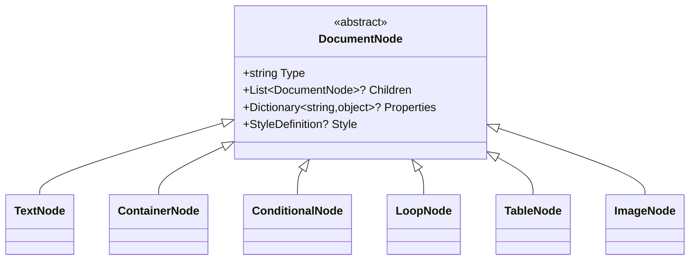

# MotorDsl.Core — Referencia de API pública

> Superficie pública del núcleo: contratos, entrada del pipeline (`IDocumentEngine`) y modelo
> (AST + resultados). Contexto y rol en [`README.md`](./README.md). Toda cita de código apunta a
> `v1.0.13 @83677eb`.

## 1. Contratos (`Contracts/`)

Los **15 contratos** del núcleo. "Implementaciones conocidas" = dentro de los proyectos
indexados de la solución.

| Interfaz | Responsabilidad | Miembros clave | Archivo |
|---|---|---|---|
| `IDocumentEngine` | Orquestar el pipeline completo | 3× `Render(...)`, `RenderLayout(...)` | `Contracts/IDocumentEngine.cs` |
| `IDslParser` | Parsear DSL JSON → `DocumentTemplate`; `ArgumentException` si inválido | `Parse(string)` | `Contracts/IDslParser.cs` |
| `IEvaluator` | Resolver AST contra datos: variables, condiciones, loops | `Evaluate`, `ResolveVariable`, `EvaluateCondition`, `ResolveCollection` | `Contracts/IEvaluator.cs` |
| `ILayoutEngine` | Aplicar restricciones del `DeviceProfile` (ancho, wrap, align) | `ApplyLayout(evaluated, profile)` | `Contracts/ILayoutEngine.cs` |
| `IRenderer` | Renderizar `LayoutedDocument` a un formato target | `Target` (string), `Render(layouted, profile)` | `Contracts/IRenderer.cs` |
| `IRendererRegistry` | Registro/lookup de renderers por target | `Register`, `GetRenderer`, `GetAvailableTargets` | `Contracts/IRendererRegistry.cs` |
| `IDataResolver` | Resolver paths (`"cliente.nombre"`, `"items[0]"`) y colecciones | resolución de path / colección | `Contracts/IDataResolver.cs` |
| `IDataProvider` | Proveer diccionarios de datos por clave (solo lectura, CU-25) | lookup por clave | `Contracts/IDataProvider.cs` |
| `ITemplateProvider` | Proveer DSL (string) por id de template (solo lectura, CU-24) | lookup por id | `Contracts/ITemplateProvider.cs` |
| `IDeviceProfileProvider` | Proveer `DeviceProfile` por nombre + listado (solo lectura, CU-21) | lookup + listado | `Contracts/IDeviceProfileProvider.cs` |
| `IDataValidator` | Validar datos contra el AST antes de evaluar (CU-19) | `Validate` → `ValidationResult` | `Contracts/IDataValidator.cs` |
| `ITemplateValidator` | Validar el JSON del DSL: sintaxis, schema, tipos de nodo (CU-14) | `Validate` → `ValidationResult` | `Contracts/ITemplateValidator.cs` |
| `IProfileValidator` | Validar `DeviceProfile` (`Name`, `Width > 0`, `RenderTarget`) (CU-22) | `Validate` → `ValidationResult` | `Contracts/IProfileValidator.cs` |
| `IPrintErrorHandler` | Decidir retry/abort ante `PrintError` (CU-32) | `OnRetryAttempt`, `OnPrintSuccess` | `Contracts/IPrintErrorHandler.cs` |
| `IBitmapRasterizer` | Rasterizar imagen → `RasterizedImage` para ESC/POS `GS v 0` (TK-61) | rasterización | `Contracts/IBitmapRasterizer.cs` |

> `IBitmapRasterizer` no tiene implementación en los proyectos núcleo indexados; fuera de alcance
> existe `SkiaSharpRasterizer` en `MotorDsl.Maui` (`src/MotorDsl.Maui/Renderers/SkiaSharpRasterizer.cs`).

## 2. `IDocumentEngine` — entrada del pipeline

Contrato en `src/MotorDsl.Core/Contracts/IDocumentEngine.cs#L11-L48`; implementación
`DocumentEngine` en `src/MotorDsl.Core/Engine/DocumentEngine.cs`. Dependencias por constructor:
`IDslParser`, `IEvaluator`, `ILayoutEngine`, `IRendererRegistry` (obligatorias) +
`IDataValidator?`, `ITemplateValidator?`, `IProfileValidator?` (opcionales; `null` = etapa de
validación omitida) — `DocumentEngine.cs#L21-L30`.

### 2.1 Sobrecargas de `Render` y `RenderLayout`

| Firma | Entrada | Etapas ejecutadas | Retorno | Fuente |
|---|---|---|---|---|
| `RenderResult Render(string templateDsl, object data, DeviceProfile profile)` | DSL crudo (classic) | ValidateTemplate → Parse → delega en la sobrecarga de `DocumentTemplate` | `RenderResult` | `DocumentEngine.cs#L32-L72` |
| `RenderResult Render(DocumentTemplate template, object data, DeviceProfile profile)` | AST ya parseado | ValidateData → ValidateProfile → Evaluate → Layout → Render | `RenderResult` | `DocumentEngine.cs#L74-L137` |
| `RenderResult Render(string integratedJson, DeviceProfile profile)` | JSON `"format":"integrated"` | ValidateTemplate → Parse → guard de formato → ValidateProfile → (skip Evaluate) → Layout → Render | `RenderResult` | `DocumentEngine.cs#L139-L216` |
| `LayoutedDocument RenderLayout(string templateDsl, object data, DeviceProfile profile)` | DSL crudo | Parse → Evaluate → Layout (**sin** Render); para preview de UI | `LayoutedDocument` | `DocumentEngine.cs#L218-L250` |

### 2.2 Parámetros

| Parámetro | Tipo | Rol |
|---|---|---|
| `templateDsl` / `integratedJson` | `string` | DSL JSON crudo. En *integrated* el `format` debe ser `"integrated"`. |
| `template` | `DocumentTemplate` | AST ya parseado (evita reparsear). |
| `data` | `object` | Datos para resolver `{{...}}`, condiciones y loops (POCO anónimo, dict, etc.). No usado por el overload integrated. |
| `profile` | `DeviceProfile` | Perfil de salida: ancho, `RenderTarget` y capabilities. Selecciona el renderer. |

### 2.3 Manejo de errores

| Situación | Comportamiento de `Render(...)` | Comportamiento de `RenderLayout(...)` | Fuente |
|---|---|---|---|
| Excepción en cualquier etapa | Capturada → `RenderResult` con `AddError("Parse failed: ..."` / `"Render failed: ...")` y `Output = ""`; **nunca** propaga | Propaga (no captura) | `DocumentEngine.cs#L65-L71`, `#L130-L136`, `#L209-L215` |
| Validación con `Severity == Error` | Corta el pipeline; vuelca a `RenderResult.Errors` con prefijo `TemplateValidation:` / `Validation:` / `ProfileValidation:` | Lanza `InvalidOperationException` | `DocumentEngine.cs#L38-L54`, `#L80-L108` |
| Validación con `Severity == Warning` | Se acumula → `RenderResult` (`AddWarning`) | — | `DocumentEngine.cs#L59-L61`, `#L124-L126` |
| Warnings de layout (degradación por capability) | Propagados al `RenderResult` | Presentes en `LayoutedDocument.Warnings` | `DocumentEngine.cs#L120-L122` |
| Integrated con `Format != "integrated"` | Error explícito (usar `Render(json, data, profile)`) | — | `DocumentEngine.cs#L164-L173` |
| Target sin renderer ni fallback `"text"` | `InvalidOperationException` "No renderer found for target" (capturada → error en resultado) | idem, propagada | `DocumentEngine.cs#L252-L256` |

> **Contraste clave**: `Render` **nunca lanza** (todo error va en `RenderResult`); `RenderLayout`
> **sí lanza** ante fallo de validación. Un agente que use `RenderLayout` debe envolver en
> `try/catch`; con `Render` basta con inspeccionar `RenderResult.IsSuccessful`.

## 3. Modelos públicos

### 3.1 Nodos del AST (`Models/`)

Jerarquía: `DocumentNode` (abstracta) con `Type`, `Children`, `Properties`, `Style`, helpers
`AddChild` / `SetProperty` / `GetProperty` (`Models/DocumentNode.cs#L11-L85`).



| Nodo | `type` JSON | Miembros propios | Semántica | Fuente |
|---|---|---|---|---|
| `DocumentNode` (abstracta) | — | `Type`, `Children`, `Properties`, `Style` | Base del AST | `Models/DocumentNode.cs#L11-L85` |
| `TextNode` | `text` | `Text`, `BindPath?` | Texto plano o con `{{path}}` (integrated usa `value`) | `Models/TextNode.cs#L9-L34` |
| `ContainerNode` | `container` | `Layout?` (`"vertical"`\|`"horizontal"`) | Agrupador estructural | `Models/ContainerNode.cs#L9-L36` |
| `ConditionalNode` | `conditional` | `Expression`, `TrueBranch?`, `FalseBranch?` | Inclusión condicional en runtime | `Models/ConditionalNode.cs#L9-L40` |
| `LoopNode` | `loop` | `Source`, `ItemAlias`, `Body?` | Repite `Body` por cada ítem de la colección | `Models/LoopNode.cs#L9-L43` |
| `TableNode` | `table` | `Headers`, `Rows`, `AddRow(cells)` | Tabla (header + separador + filas) | `Models/TableNode.cs#L10-L41` |
| `ImageNode` | `image` | `Source`, `Width?`, `Height?`, `ImageType?`, `Role?` | Imagen, QR o código de barras | `Models/ImageNode.cs#L9-L54` |

> `loop` y `conditional` están **prohibidos** en formato integrated (parser lanza
> `ArgumentException`; `TemplateValidator` emite `UnsupportedInIntegratedFormat`).

### 3.2 Template, documentos intermedios y perfil

| Modelo | Rol | Miembros clave | Fuente |
|---|---|---|---|
| `DocumentTemplate` | Raíz del AST + metadatos | `Id`, `Version`, `Root`, `Metadata?`, `Format` (`FormatTemplate="template"` / `FormatIntegrated="integrated"`) | `Models/DocumentTemplate.cs#L9-L60` |
| `EvaluatedDocument` | Salida del Evaluator (o wrapper en integrated) | `Id`, `Version`, `Root`, `Warnings`, `Errors`, `EvaluatedAt`, `IsSuccessful` | `Models/EvaluatedDocument.cs#L12-L49` |
| `LayoutedDocument` | Salida del LayoutEngine; entrada de todo `IRenderer` | `Root`, `NodeLayoutInfo` (`node_N` → `LayoutInfo`), `TotalWidth`, `TotalHeight`, `DeviceProfile`, `LayoutMetadata`, `Warnings` | `Models/LayoutedDocument.cs#L7-L16` |
| `LayoutInfo` | Layout calculado por nodo | `LineNumber`, `ColumnNumber`, `Width`, `Height`, `Alignment` (default `"left"`), `IsWrapped`, `WrappedText`, `IsTruncated`, `DeviceMetadata` | `Models/LayoutInfo.cs#L7-L18` |
| `DeviceProfile` | Perfil de salida | `Name`, `Width` (columnas), `RenderTarget` (getters) + `SetCapability`/`GetCapability`/`HasCapability` + `CodePage?`, `CodePageCommand?`, `BaudRate?`, `SupportedBarcodes?` | `Models/DeviceProfile.cs#L3-L31` |

### 3.3 Resultados y errores

| Modelo | Miembros clave | Fuente |
|---|---|---|
| `RenderResult` | `Target`, `Output` (`string` para text / `byte[]` para escpos), `Warnings`, `Errors`, `IsSuccessful` (= sin errores), `AddWarning`/`AddError`, `ToHexString()`, `ToBase64()` (los dos últimos solo si `Output is byte[]`, si no `null`) | `Models/RenderResult.cs#L10-L95` |
| `ValidationResult` | `IsValid` (= sin errores `Severity == Error`), `Errors` (lista completa, incluye warnings) | `Models/ValidationResult.cs#L79-L88` |
| `ValidationError` | `Field`, `Type` (`ValidationErrorType`), `Message`, `NodeType`, `Severity` (default `Error`), `Location` (path del nodo) | `Models/ValidationResult.cs#L52-L72` |
| `PrintError` | `Type` (`Connection`\|`Timeout`\|`Hardware`\|`Protocol`\|`Unknown`), `Message`, `InnerException`, `Attempt`, `MaxAttempts`; factory `FromException` | `Models/PrintError.cs#L20-L54` |

`ValidationErrorType` (8 valores): `MissingField`, `TypeMismatch`, `InvalidStructure`,
`InvalidSyntax`, `MissingRequiredField`, `UnknownNodeType`, `UnsupportedInIntegratedFormat`,
`UnresolvedPlaceholder` (`Models/ValidationResult.cs#L20-L45`).

## 4. Snippets canónicos (código real)

### 4.1 Render classic con data binding

Uso de `Render(string, object, DeviceProfile)` resolviendo placeholders `{{...}}` contra un POCO.
Procedencia: `src/MotorDsl.Tests/DocumentEngineTests.cs#L91-L107 @83677eb` (perfil en `#L31`).

```csharp
// DeviceProfile: src/MotorDsl.Tests/DocumentEngineTests.cs#L31 @83677eb
// private DeviceProfile DefaultProfile() => new("thermal-58mm", 32, "text");

var dsl = """
{
    "id": "test-003",
    "version": "1.0",
    "root": {
        "type": "container",
        "layout": "vertical",
        "children": [
            { "type": "text", "text": "Cliente: {{nombre}}" },
            { "type": "text", "text": "Total: {{total}}" }
        ]
    }
}
""";
var data = new { nombre = "María", total = "1500" };

var result = engine.Render(dsl, data, DefaultProfile());
var output = result.Output?.ToString() ?? "";
// output contiene "María" y "1500"
```

### 4.2 Render integrated (sin datos externos, sin Evaluate)

Uso de `Render(string, DeviceProfile)` con AST pre-resuelto (`format: "integrated"`, texto en
`value`). Procedencia: `src/MotorDsl.Tests/IntegratedFormatEngineTests.cs#L40-L56 @83677eb`
(perfil en `#L34`).

```csharp
// DeviceProfile: src/MotorDsl.Tests/IntegratedFormatEngineTests.cs#L34 @83677eb
// private static DeviceProfile TextProfile() => new("thermal-58mm", 32, "text");

var json = """
{
    "id": "acta-001",
    "version": "1.0",
    "format": "integrated",
    "root": {
        "type": "container",
        "layout": "vertical",
        "children": [
            { "type": "text", "value": "MUNICIPALIDAD DE EJEMPLO" },
            { "type": "text", "value": "ACTA N° 2026-00123" }
        ]
    }
}
""";

var result = engine.Render(json, TextProfile());
// result.IsSuccessful == true; el Evaluator no se invoca
```

## 5. 🤖 Para agentes

Contrato operativo de la superficie pública, pensado para invocación automática.

### 5.1 Elegir la sobrecarga

| Si tienes... | Llama | No pases |
|---|---|---|
| DSL classic + datos externos | `Render(string dsl, object data, DeviceProfile profile)` | — |
| Un `DocumentTemplate` ya parseado | `Render(DocumentTemplate template, object data, DeviceProfile profile)` | el string DSL |
| JSON con `"format":"integrated"` (ya resuelto) | `Render(string json, DeviceProfile profile)` | `data` (se ignora el concepto) |
| Solo preview de layout (UI), sin bytes finales | `RenderLayout(string dsl, object data, DeviceProfile profile)` | — |

### 5.2 Entradas — precondiciones

- `dsl`/`json`: JSON con `id`, `version`, `root` obligatorios; `format` opcional (`"template"`
  default). Nodo raíz con `type` ∈ `{text, container, conditional, loop, table, image}`.
- Integrated: usar `value` (no `text`) en nodos texto; **sin** `loop`/`conditional` ni
  placeholders `{{...}}` residuales.
- `profile`: `Name` no vacío, `Width > 0`, `RenderTarget` no vacío (si hay `IProfileValidator`).
- `data`: cualquier `object`; los paths `{{a.b.c}}` / `{{items[0]}}` resuelven sobre dicts y
  luego reflexión.

### 5.3 Salidas — postcondiciones

| Método | Éxito | Fallo |
|---|---|---|
| `Render(...)` | `RenderResult` con `IsSuccessful == true` y `Output` no vacío (`string` o `byte[]` según `RenderTarget`) | `RenderResult` con `IsSuccessful == false`, `Errors` poblado, `Output = ""`. **No lanza.** |
| `RenderLayout(...)` | `LayoutedDocument` | **Lanza** `InvalidOperationException` si falla validación; propaga excepciones de etapa. |

### 5.4 Validaciones que puede disparar el pipeline

| Chequeo | Momento | Efecto en `Render` |
|---|---|---|
| `TemplateValidator` (JSON/schema/tipos de nodo) | antes de parsear | Error → corta, prefijo `TemplateValidation:` |
| `DataValidator` (bindings vs datos) | tras parsear (classic) | `MissingField` (Error) corta; campo `null` = Warning (no corta) |
| `ProfileValidator` (`Name`/`Width`/`RenderTarget`) | antes de Layout | Error → corta, prefijo `ProfileValidation:` |

> **Trampa conocida**: un `RenderTarget` mal escrito **no** produce error — `RendererRegistry`
> hace fallback silencioso a `"text"` (`RendererRegistry.cs#L19-L29`). Verificar
> `RenderResult.Target` si la salida esperada era `byte[]` y llegó `string`.

### 5.5 No verificado / gaps

- Los **warnings del Evaluator** (variables no resueltas) **no** se propagan a `RenderResult`;
  solo queda el marcador `{{UNRESOLVED:path}}` en el texto (`DocumentEngine.cs#L110-L128`).
- En classic, `Id`/`Version` reales del template se pierden (`EvaluatedDocument` fija
  `"evaluated-doc"` / `"1.0"`); en integrated se preservan (`Evaluator.cs#L30-L53`).
- Quién ejecuta el loop de retry de `PrintError` **no está** en los proyectos indexados —
  «No verificado» (presumiblemente el transporte, fuera de alcance).
