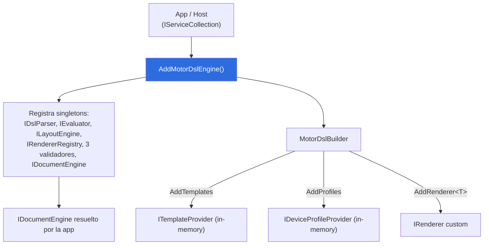

# MotorDsl.Extensions

> Pieza `library` (Marco §7.1) · TFM `net10.0` · Paquete NuGet `MotorDsl.Extensions`.
> Documento reconstruido por ingeniería inversa sobre **v1.0.13 @83677eb**. Estado `draft`.

## Resumen ejecutivo

`MotorDsl.Extensions` es el **punto de arranque en DI** del motor. Con una sola llamada,
`services.AddMotorDslEngine()`, registra el **pipeline completo** (parser, evaluator, layout,
registry de renderers, validadores y `DocumentEngine`) como singletons y devuelve un
`MotorDslBuilder` fluent para encadenar templates, perfiles y renderers custom.

| Aspecto | Valor | Fuente |
|---|---|---|
| Tipo de pieza | `library` | `docs-manifest.yaml#L54-L62` |
| TFM | `net10.0` | `src/MotorDsl.Extensions/MotorDsl.Extensions.csproj#L4 @83677eb` |
| API de arranque | `IServiceCollection.AddMotorDslEngine()` | `MotorDslServiceCollectionExtensions.cs#L14 @83677eb` |
| Builder fluent | `MotorDslBuilder` (`AddTemplates`/`AddProfiles`/`AddRenderer<T>`) | `MotorDslBuilder.cs#L11-L41 @83677eb` |
| Criticidad | Media | `docs-manifest.yaml#L58` |

## Rol en el pipeline

`MotorDsl.Extensions` no ejecuta el pipeline: lo **cablea**. Es la capa de composición que une
`MotorDsl.Core` + `MotorDsl.Parser` + `MotorDsl.Rendering` en el contenedor de DI, de modo que el
consumidor resuelva `IDocumentEngine` y llame `Render(...)` sin instanciar nada a mano.



## Dependencias + TFM

| Dependencia | Tipo | Notas | Fuente |
|---|---|---|---|
| `net10.0` | TFM | Framework objetivo único | `MotorDsl.Extensions.csproj#L4 @83677eb` |
| `MotorDsl.Core` | ProjectReference | Contratos + implementaciones del pipeline y providers in-memory | `MotorDsl.Extensions.csproj#L23 @83677eb` |
| `MotorDsl.Rendering` | ProjectReference | `TextRenderer`, `EscPosRenderer` pre-registrados | `MotorDsl.Extensions.csproj#L24 @83677eb` |
| `MotorDsl.Parser` | ProjectReference | `DslParser` | `MotorDsl.Extensions.csproj#L25 @83677eb` |
| `Microsoft.Extensions.DependencyInjection.Abstractions` | PackageReference `10.0.8` | `IServiceCollection`, `AddSingleton` | `MotorDsl.Extensions.csproj#L29 @83677eb` |

## Conceptos clave

### `AddMotorDslEngine` — registro del pipeline (todo singleton)

`MotorDslServiceCollectionExtensions.cs#L12-L34 @83677eb`:

| Servicio | Implementación | Nota | Fuente |
|---|---|---|---|
| `IDslParser` | `DslParser` | | `#L16` |
| `IEvaluator` | `Evaluator` | Usa `DataResolver` interno por defecto | `#L17` |
| `ILayoutEngine` | `LayoutEngine` | | `#L18` |
| `IRendererRegistry` | factory: `RendererRegistry` con `TextRenderer` + `EscPosRenderer` pre-registrados, más todos los `IRenderer` del contenedor | Los `IRenderer` de DI pueden **sobrescribir** los base si comparten `Target` | `#L19-L27` |
| `IDataValidator` | `DataValidator` | | `#L28` |
| `ITemplateValidator` | `TemplateValidator` | | `#L29` |
| `IProfileValidator` | `ProfileValidator` | | `#L30` |
| `IDocumentEngine` | `DocumentEngine` | Recibe los 3 validadores | `#L31` |

**No registrados por defecto**: `ITemplateProvider`, `IDeviceProfileProvider`, `IDataProvider`,
`IPrintErrorHandler`, `IBitmapRasterizer`. Los dos primeros se agregan con el builder; el resto queda
a cargo del consumidor. El `EscPosRenderer` de la factory se instancia **sin** rasterizador
(`MotorDslServiceCollectionExtensions.cs#L23 @83677eb`).

### `MotorDslBuilder` — API fluent

`MotorDslBuilder.cs#L11-L41 @83677eb` (Sprint 05, TK-30). Constructor `internal`; expone `Services`
para registros manuales.

| Método | Firma | Propósito |
|---|---|---|
| `AddTemplates` | `AddTemplates(Action<InMemoryTemplateProvider> configure)` | Crea y puebla un `InMemoryTemplateProvider`, registra singleton `ITemplateProvider` |
| `AddProfiles` | `AddProfiles(Action<InMemoryDeviceProfileProvider> configure)` | Ídem como `IDeviceProfileProvider` |
| `AddRenderer<T>` | `AddRenderer<TRenderer>() where TRenderer : class, IRenderer` | Registra un renderer custom singleton `IRenderer`; la factory del registry lo incorpora (reemplaza al base si el `Target` coincide) |
| `Services` | `IServiceCollection Services { get; }` | Escape hatch para registros manuales (`IBitmapRasterizer`, `IPrintErrorHandler`, `IDataProvider`, …) |

## Bootstrap DI — snippet real (verificado en tests)

Registro real del pipeline y de un renderer custom, tal como corre el test TK-60-01:

```csharp
var services = new ServiceCollection();
var builder = services.AddMotorDslEngine();

builder.AddRenderer<FakeRenderer>();

var sp = services.BuildServiceProvider();
var registry = sp.GetRequiredService<IRendererRegistry>();
Assert.NotNull(registry.GetRenderer("fake"));
Assert.Contains("fake", registry.GetAvailableTargets());
```

Procedencia: `src/MotorDsl.Tests/Sprint08CoreTests.cs#L76-L84 @83677eb` (test
`AddRenderer_CustomRenderer_IsAvailableInRegistry`).

### Composición fluent completa (derivada de las firmas)

```csharp
services.AddMotorDslEngine()                       // pipeline completo (singletons)
    .AddTemplates(t => t.Add("ticket", dslJson))   // ITemplateProvider in-memory
    .AddProfiles(p => p.Add(new DeviceProfile("thermal-58mm", 32, "escpos")))
    .AddRenderer<MiRendererCustom>();              // IRenderer adicional
```

Los nombres de template/perfil son ilustrativos; la composición se deriva de las firmas de
`MotorDslBuilder.cs#L20-L40 @83677eb` (ver [ia-db 03 §5.3](../../../ia-db/indexes/03_renderizado-base.md)).
Luego el consumidor resuelve `IDocumentEngine` y combina `GetTemplate(id)` →
`Render(dsl, data, GetProfile(name))`.

## Enlaces

- [`api-reference.md`](./api-reference.md) — firmas públicas, snippets y bloque para agentes.
- [ia-db · 03 — Renderers base y registro DI](../../../ia-db/indexes/03_renderizado-base.md).
- [`GLOSSARY.md`](../../GLOSSARY.md) — `Pipeline`, `Renderer`, `Target`, `DeviceProfile`.

> Nota de ruta: `GLOSSARY.md` está en `PrintThermal_Motor_Maui-docs/GLOSSARY.md`; el enlace correcto
> desde `pieces/<id>/` es `../../GLOSSARY.md` (la especificación pedía `../../../GLOSSARY.md`).
