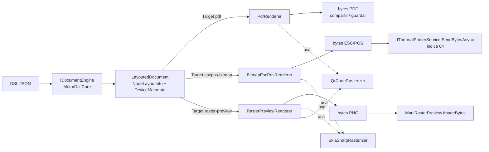

# MotorDsl.Maui

> Pieza `component-library` (Marco §7.1), criticidad **alta**. Capa .NET MAUI de MotorDsl:
> controles de UI listos para usar, renderers registrables por `Target` y utilidades de
> diagnóstico. Documento reconstruido por ingeniería inversa sobre **v1.0.13 @83677eb**
> (`status: draft`, pendiente de revisión humana).

## Resumen ejecutivo

`MotorDsl.Maui` es la única pieza de la solución que depende de .NET MAUI. Aporta tres cosas
sobre el núcleo (`MotorDsl.Core` + `MotorDsl.Rendering` + `MotorDsl.Extensions` +
`MotorDsl.Printing.Abstractions`):

1. **6 controles MAUI** (construidos por código, sin XAML, todos con `BindableProperty` para
   bindear desde el XAML del consumer): badge de estado, picker de impresoras (vista y página
   modal), previews (raster y textual) y vista de diagnóstico.
2. **3 renderers** que implementan `IRenderer` y se seleccionan por su string `Target`
   (`pdf`, `escpos-bitmap`, `raster-preview`), más **2 rasterizadores** auxiliares
   (`SkiaSharpRasterizer` para base64→raster 1-bit y `QrCodeRasterizer` para QR→`SKBitmap`).
3. **Observabilidad de impresión**: `MauiPrintErrorHandler` (retry/abort + eventos para
   snackbar) y `MauiDiagnosticsReportProvider` (snapshot librería/app/dispositivo/impresora/
   permisos, exportable a JSON, texto plano y DSL imprimible).

El detalle técnico completo (constantes, semántica de errores por renderer, contrato de
`DeviceMetadata`) vive en el índice
[`05_maui-ui-renderers`](../../../ia-db/indexes/05_maui-ui-renderers.md).

## Rol dentro de la solución

| Capa | Qué aporta `MotorDsl.Maui` |
|---|---|
| UI | Controles bindeables: `PrinterStatusBadge`, `PrinterPickerView`, `PrinterPickerPage`, `MauiRasterPreview`, `MauiDocumentPreview`, `MauiDiagnosticsView`. |
| Render | Renderers por `Target`: PDF (`PdfRenderer`), ESC/POS bitmap (`BitmapEscPosRenderer`), preview raster (`RasterPreviewRenderer`). Rasterizadores: `SkiaSharpRasterizer`, `QrCodeRasterizer`. |
| Diagnóstico / errores | `MauiPrintErrorHandler` (`IPrintErrorHandler`), `MauiDiagnosticsReportProvider` (`IDiagnosticsReportProvider`). |
| DI | Punto de entrada `AddMotorDslMaui` (extiende `MotorDslBuilder`). |

El orquestador de impresión (`ThermalPrinterService`) y los transports (Bluetooth) **no** viven
aquí: se cubren en [`04_impresion-transports`](../../../ia-db/indexes/04_impresion-transports.md).
`AddMotorDslMaui` invoca `AddMotorDslPrinting()` (registra el servicio) pero **no** registra
ningún transport — ver la sección de DI.

## TFMs y dependencias NuGet

| Aspecto | Valor | Fuente |
|---|---|---|
| TFMs | `net10.0-android` ; `net10.0-ios` | `MotorDsl.Maui.csproj#L4` |
| Min OS | iOS 15.0 ; Android **25.0** (ver Hallazgo H3) | `MotorDsl.Maui.csproj#L11-L12` |
| MAUI | `UseMaui=true`, `ImplicitUsings`, `Nullable` | `MotorDsl.Maui.csproj#L7-L9` |
| Android nativo | `AndroidLdFlags -Wl,-z,max-page-size=16384` (páginas de 16 KB) | `MotorDsl.Maui.csproj#L33-L35` |
| ProjectReferences | `MotorDsl.Core`, `MotorDsl.Rendering`, `MotorDsl.Extensions`, `MotorDsl.Printing.Abstractions` | `MotorDsl.Maui.csproj#L37-L42` |
| Recurso embebido | `Resources/Fonts/DroidSans-Regular.ttf` (`EmbeddedResource`) — única fuente del PDF y del raster preview | `MotorDsl.Maui.csproj#L44-L46` |
| Paquete | `PackageId MotorDsl.Maui`, licencia MIT, repo `Aplicada-Streaming/PrintThermal_Motor_Maui` | `MotorDsl.Maui.csproj#L14-L20` |

**Dependencias NuGet directas** (`MotorDsl.Maui.csproj#L48-L52`):

| Paquete | Versión | Consumidores en la pieza |
|---|---|---|
| `SkiaSharp.Views.Maui.Controls` | 3.119.2 | `SkiaSharpRasterizer`, `QrCodeRasterizer`, `RasterPreviewRenderer`, medición de PNG en `MauiRasterPreview` |
| `PdfSharpCore` | 1.3.67 | `PdfRenderer` (+ `MotorDslFontResolver`) |
| `QRCoder` | 1.8.0 | `QrCodeRasterizer` (QR → PNG → `SKBitmap`) |

## DI — `AddMotorDslMaui`

Método de extensión sobre `MotorDslBuilder` (de `MotorDsl.Extensions`). Firma real
(`MotorDsl.Maui/MotorDslMauiServiceCollectionExtensions.cs#L22-L33 @83677eb`):

```csharp
public static MotorDslBuilder AddMotorDslMaui(this MotorDslBuilder builder)
{
    builder.Services.AddSingleton<IBitmapRasterizer, SkiaSharpRasterizer>();
    builder.Services.AddSingleton<QrCodeRasterizer>();
    builder.Services.AddMotorDslPrinting();
    builder.Services.Replace(ServiceDescriptor.Singleton<IPrintErrorHandler, MauiPrintErrorHandler>());
    builder.Services.TryAddSingleton<IDiagnosticsReportProvider, MauiDiagnosticsReportProvider>();
    builder.AddRenderer<PdfRenderer>();
    builder.AddRenderer<BitmapEscPosRenderer>();
    builder.AddRenderer<RasterPreviewRenderer>();
    return builder;
}
```

Qué registra y con qué semántica:

| Servicio | Implementación | Método | Semántica |
|---|---|---|---|
| `IBitmapRasterizer` | `SkiaSharpRasterizer` | `AddSingleton` | Registro directo. |
| `QrCodeRasterizer` (concreto, sin interfaz) | — | `AddSingleton` | Registro directo del tipo concreto. |
| `IThermalPrinterService`, `IPrintErrorHandler` (default) | — | `AddMotorDslPrinting()` | Delegado a Abstractions vía `TryAdd` (ver índice 04). |
| `IPrintErrorHandler` | `MauiPrintErrorHandler` | **`Replace`** | **Pisa** el `DefaultPrintErrorHandler` que dejó `AddMotorDslPrinting` (y cualquier registro previo). |
| `IDiagnosticsReportProvider` | `MauiDiagnosticsReportProvider` | **`TryAddSingleton`** | El consumer puede registrar su propio provider **antes** de llamar `AddMotorDslMaui` y ese prevalece. |
| Renderers `pdf` / `escpos-bitmap` / `raster-preview` | `PdfRenderer`, `BitmapEscPosRenderer`, `RasterPreviewRenderer` | `AddRenderer<T>` | Se suman al `RendererRegistry` del motor. |

> ⚠️ El transport **no** se registra aquí. La app debe llamar además
> `AddBluetoothPrinterTransport()` (`MotorDsl.Bluetooth`, índice 04) u otro transport; sin
> ninguno, `ThermalPrinterService` lanza `InvalidOperationException` al construirse
> (`ThermalPrinterService.cs#L86-L88`). Ver [usage-guide](./usage-guide.md).

## Pipeline de render (Target → renderer)



El renderer se elige por el string `Target` del `DeviceProfile` (o por la recomendación de
`PrintStrategySelector.RecommendTarget`, índice 04). Los tres renderers leen los nodos desde
`LayoutedDocument.NodeLayoutInfo`, ordenados por `LineNumber`/`ColumnNumber`, y discriminan por
metadata (`is_qr`, `is_bitmap`, `is_barcode`, `bold`). Contrato de metadata: índice 05 §8.

## Documentación relacionada

- [Catálogo de componentes](./component-catalog.md) — los 6 controles, sus bindables/eventos y ejemplos.
- [Guía de uso](./usage-guide.md) — integración paso a paso en una app MAUI.
- [Índice 05 — Capa MAUI (ia-db)](../../../ia-db/indexes/05_maui-ui-renderers.md) — fuente destilada primaria.
- [Índice 04 — Impresión y transports (ia-db)](../../../ia-db/indexes/04_impresion-transports.md) — `ThermalPrinterService`, Bluetooth.
- [Glosario](../../GLOSSARY.md) — vocabulario controlado de la solución.

## Hallazgos destacados (con fuente)

- **H2 — Workaround SkiaSharp 3.x**: `SKBitmap.Decode(byte[])` devuelve `null` para PNGs válidos;
  `SkiaSharpRasterizer` usa `SKImage.FromEncodedData` → `SKBitmap.FromImage`
  (`SkiaSharpRasterizer.cs#L82-L89`).
- **H3 — Piso Android inconsistente**: `MotorDsl.Maui` exige Android 25.0 y `MotorDsl.Bluetooth`
  24.0; el piso efectivo de una app que use ambos es **25.0** (`MotorDsl.Maui.csproj#L12`,
  `MotorDsl.Bluetooth.csproj#L11`).
- **H7 — PDF con una sola fuente**: `MotorDslFontResolver` resuelve cualquier familia/estilo a
  `DroidSans` regular embebida; el bold sale de `XFontStyle.Bold` sobre esa misma cara
  (`PdfRenderer.cs#L38-L41`, `#L150-L151`).

Lista completa (H1–H7) en el índice 05 §7.
