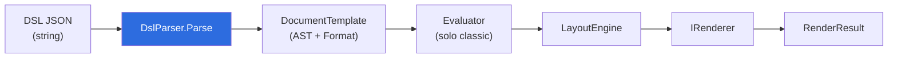

# MotorDsl.Parser

> Pieza `library` (Marco §7.1) · TFM `net10.0` · Paquete NuGet `MotorDsl.Parser`.
> Documento reconstruido por ingeniería inversa sobre **v1.0.13 @83677eb**. Estado `draft`.

## Resumen ejecutivo

`MotorDsl.Parser` es la **primera etapa** del pipeline de MotorDsl: convierte el **DSL JSON**
crudo (un `string`) en un `DocumentTemplate` tipado (el AST del documento) usando
`System.Text.Json`. Expone una sola clase pública, `DslParser`, que implementa el contrato
`IDslParser` del núcleo con un único método `Parse(string) : DocumentTemplate`.

El parser no evalúa datos ni calcula layout: solo **valida la estructura** del JSON, materializa
los nodos del AST y distingue los dos formatos del DSL (**classic** e **integrated**). Cualquier
entrada malformada se rechaza de forma temprana con `ArgumentException`.

| Aspecto | Valor | Fuente |
|---|---|---|
| Tipo de pieza | `library` | `docs-manifest.yaml#L34-L42` |
| TFM | `net10.0` | `src/MotorDsl.Parser/MotorDsl.Parser.csproj#L4 @83677eb` |
| Clase pública | `DslParser : IDslParser` | `src/MotorDsl.Parser/DslParser.cs#L15 @83677eb` |
| API pública | `DocumentTemplate Parse(string dsl)` | `src/MotorDsl.Parser/DslParser.cs#L33 @83677eb` |
| Serializador | `System.Text.Json` (`JsonDocument`) | `src/MotorDsl.Parser/DslParser.cs#L1,L42 @83677eb` |
| Criticidad | Alta | `docs-manifest.yaml#L38` |

## Rol en el pipeline

`DslParser` es el borde de entrada del motor. Produce el `DocumentTemplate` que consumen las etapas
siguientes; en formato **integrated** el `Format` que fija el parser hace que `DocumentEngine`
**salte** la etapa `Evaluator` (ver [ia-db 02 §2.2](../../../ia-db/indexes/02_dsl-y-modelos.md)).
El pipeline completo se documenta en la pieza `MotorDsl.Core`.

## Dependencias + TFM

| Dependencia | Tipo | Notas | Fuente |
|---|---|---|---|
| `net10.0` | TFM | Framework objetivo único | `MotorDsl.Parser.csproj#L4 @83677eb` |
| `MotorDsl.Core` | ProjectReference | Aporta `IDslParser`, `DocumentTemplate` y todos los nodos del AST (`DocumentNode`, `TextNode`, …) | `MotorDsl.Parser.csproj#L23 @83677eb` |
| `System.Text.Json` | BCL (.NET 10) | Parseo JSON vía `JsonDocument` | `DslParser.cs#L1 @83677eb` |

No hay `PackageReference` externos: el parser solo depende de `MotorDsl.Core` y de la BCL.

## Conceptos clave

### `DslParser.Parse` — contrato de entrada

`Parse(string dsl)` valida y materializa el JSON en este orden (`DslParser.cs#L33-L111 @83677eb`):

1. `dsl` no nulo/ni vacío → si no, `ArgumentException`.
2. `id` obligatorio (string no vacío).
3. `version` obligatorio (string no vacío).
4. `format` opcional: `"template"` (default) o `"integrated"`; otro valor → `ArgumentException`.
5. `root` obligatorio: nodo raíz del AST, parseado recursivamente.
6. `metadata` opcional: objeto k/v (string/number/bool).

Todo error de JSON malformado se re-empaqueta como `ArgumentException("Invalid JSON format: …")`
(`DslParser.cs#L107-L110 @83677eb`).

### Tipos de nodo soportados

Exactamente seis `type`: `text, container, conditional, loop, table, image`
(`DslParser.cs#L17-L25 @83677eb`). Cualquier otro `type` lanza `ArgumentException`
(`DslParser.cs#L125-L126 @83677eb`). El detalle campo-a-campo de cada nodo está en
[ia-db 02 §1](../../../ia-db/indexes/02_dsl-y-modelos.md).

### Distinción classic vs integrated

El discriminador `format` cambia cómo se parsea el árbol:

| Aspecto | Classic (`"template"`, default) | Integrated (`"integrated"`) |
|---|---|---|
| Texto | Lee `"text"` (con placeholders `{{path}}`) | Lee `"value"` (string ya resuelto) |
| `loop` / `conditional` | Permitidos | **Prohibidos** → `ArgumentException` |
| Datos | Externos (se resuelven después) | Embebidos en el JSON |
| Fuente | `DslParser.cs#L155-L160 @83677eb` | `DslParser.cs#L128-L130,L149-L153 @83677eb` |

La bandera interna `isIntegrated` se propaga a todo el parseo recursivo
(`DslParser.cs#L80-L81 @83677eb`), garantizando que un `loop`/`conditional` anidado también se
rechace en integrated.

### `style` solo en `text`

El parser solo materializa `style` (a `StyleDefinition`) para nodos `text`
(`DslParser.cs#L168-L183 @83677eb`). Un `style` en un nodo `table` del JSON **no se parsea** por
esta vía. «No verificado» que exista otra vía distinta de código para asignarlo a tablas.

## Enlaces

- [`api-reference.md`](./api-reference.md) — firmas públicas, snippets y bloque para agentes.
- [ia-db · 02 — El DSL JSON y el modelo de documento](../../../ia-db/indexes/02_dsl-y-modelos.md) — índice destilado del DSL y los nodos del AST.
- [`GLOSSARY.md`](../../GLOSSARY.md) — vocabulario controlado (DSL, formato classic/integrated, `DocumentTemplate`).

> Nota de ruta: el `GLOSSARY.md` vive en `PrintThermal_Motor_Maui-docs/GLOSSARY.md`; el enlace
> relativo correcto desde `pieces/<id>/` es `../../GLOSSARY.md` (ver hallazgo en el informe del
> orquestador — la especificación pedía `../../../GLOSSARY.md`, que apuntaría fuera de `-docs/`).
