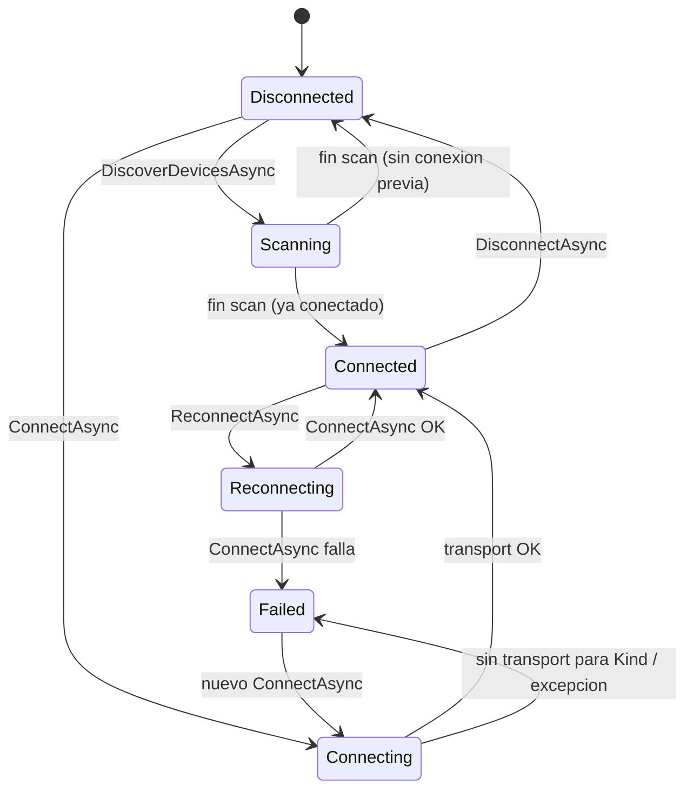

# MotorDsl.Printing.Abstractions

> Pieza `library` del stack de impresión de MotorDsl. Documento reconstruido por ingeniería
> inversa sobre **v1.0.13 @83677eb**; estado `draft` (pendiente de revisión humana).

## Resumen ejecutivo

`MotorDsl.Printing.Abstractions` define **el contrato de transporte térmico agnóstico de
plataforma** (`IThermalPrinterTransport`) y **el orquestador que lo consume**
(`ThermalPrinterService`, detrás de `IThermalPrinterService`). El transport solo mueve bytes y
detecta capacidades; el servicio aporta ciclo de vida de conexión, **retry con backoff
exponencial**, enrutamiento por `Kind`, eventos bindeables, **historial acotado de fallos** y
snapshot de **diagnóstico**. Es el punto de extensión canónico para agregar medios de transporte
nuevos (USB, BLE, red) sin tocar el orquestador.

Vive en un proyecto **`net10.0` puro** (sin MAUI ni referencias de plataforma), lo que lo hace
testeable en escritorio y reutilizable desde cualquier host .NET.

## Rol en el sistema

| Aspecto | Detalle |
|---|---|
| `type` (Marco §7.1) | `library` (con guía de extensión de transports) |
| Rol | Contratos transport-agnostic + orquestador `ThermalPrinterService` |
| Punto de extensión | `IThermalPrinterTransport` (ver [extension-guide](./extension-guide.md)) |
| Consumidores | `MotorDsl.Bluetooth` (transport concreto), `MotorDsl.Maui` (UI/diagnóstico), la app |
| Índice ia-db | [`04_impresion-transports`](../../../ia-db/indexes/04_impresion-transports.md) |

## Dependencias y TFM

| Ítem | Valor | Fuente |
|---|---|---|
| TFM | `net10.0` (puro, sin plataforma) | `src/MotorDsl.Printing.Abstractions/MotorDsl.Printing.Abstractions.csproj#L4` |
| ProjectReference | `MotorDsl.Core` (aporta `PrintError`, `PrintRetryOptions`, `IPrintErrorHandler`) | `…csproj#L23` |
| PackageReference | `Microsoft.Extensions.DependencyInjection.Abstractions` `10.0.8` | `…csproj#L32` |
| InternalsVisibleTo | `MotorDsl.Tests` (expone `RecordFailure` al test del ring buffer) | `…csproj#L28` |

> Tipos que **NO** viven en esta pieza (son de `MotorDsl.Core`, fuera de alcance): `PrintError`,
> `PrintErrorType`, `PrintRetryOptions` (`src/MotorDsl.Core/Models/PrintError.cs`),
> `PrinterHardwareException`, `IPrintErrorHandler` + `DefaultPrintErrorHandler`
> (`src/MotorDsl.Core/Printing/DefaultPrintErrorHandler.cs`).

## Conceptos clave

| Concepto | Qué es | Detalle | Fuente |
|---|---|---|---|
| `IThermalPrinterTransport` | Capa física de UN medio; solo bytes + detección de capacidades. | Miembros de default para transports no aplicables (iOS/fakes): `Capabilities => null`, NV no-op. Identificado por `Kind` (string). | `Contracts/IThermalPrinterTransport.cs#L5-L29` |
| `Kind` | String del medio de transporte (`"bluetooth"`, `"usb"`…) | Clave del enrutamiento del servicio; comparación `OrdinalIgnoreCase`. | `Contracts/IThermalPrinterTransport.cs#L7`, `Services/ThermalPrinterService.cs#L135-L136` |
| `IThermalPrinterService` | Fachada/orquestador para la app. | Implementa `INotifyPropertyChanged` (bindeable desde UI MVVM). | `Contracts/IThermalPrinterService.cs#L6-L37` |
| `ThermalPrinterService` | Implementación del orquestador. | Retry, estados, capacidades, diagnóstico indirecto, NV logo, ring buffer de fallos. | `Services/ThermalPrinterService.cs` |
| `CapabilitySupport` | Tri-estado **deliberado, nunca bool**. | `Unknown` (no se sondeó / excepción) · `NotDetected` (se sondeó, sin respuesta) · `Supported` (respondió confirmando). | `Models/CapabilitySupport.cs#L7-L17` |
| `PrintStrategySelector` | Helper puro estático; solo **recomienda** el render target. | `escpos` si `NvGraphics == Supported`, si no `escpos-bitmap`. La decisión final es de la app. | `Models/PrintStrategySelector.cs#L14-L20` |
| Ring buffer de fallos | Historial acotado en memoria de `PrintFailureEntry`. | `MAX_FAILURES = 20`, thread-safe (lock), **sin payload** (solo longitud) y **sin persistencia**. | `Services/ThermalPrinterService.cs#L24-L27`, `#L246-L256` |
| PII masking | Enmascarado de MAC. | Se aplica al **construir** el reporte de diagnóstico (`DiagnosticsBuilder.MaskMac`), **no** al registrar el fallo (que guarda identidad cruda). | `Models/PrintFailureEntry.cs#L4-L7` |
| NV logo | Aprovisionamiento de logo en memoria no volátil. | El servicio delega en el transport activo; sin conexión → `NvLogoResult(false, null, "no conectado")`. Input = mismo `GS v 0` inline de la app. | `Services/ThermalPrinterService.cs#L65-L71` |
| Diagnóstico | `IDiagnosticsReportProvider` + `DiagnosticsReport` + `DiagnosticsBuilder`. | Snapshot serializable (JSON / texto plano / DSL integrated imprimible). Helpers puros testeables sin MAUI. | `Contracts/IDiagnosticsReportProvider.cs#L7-L26` |

### Orquestación: retry y reconexión

`SendBytesAsync` aplica un loop de intentos (`retry.MaxRetries`, default 3): por cada excepción emite
`ErrorOccurred`, consulta al `IPrintErrorHandler` (`Connection`/`Timeout`/`Unknown` → reintenta;
`Hardware`/`Protocol` → aborta), aplica backoff exponencial `InitialDelayMs * 2^(intento-1)` e
intenta una **reconexión silenciosa** entre intentos (solo si el transport quedó desconectado). Al
agotar los intentos registra **una** `PrintFailureEntry` (sin payload) y relanza
`Exception("Print failed after N attempt(s)…")`.
Fuente: `Services/ThermalPrinterService.cs#L201-L244`.

## Diagrama de estados de conexión

`PrinterConnectionState`: `Disconnected · Scanning · Connecting · Connected · Reconnecting · Failed`
(`Models/PrinterConnectionState.cs#L3-L11`).



## Alta rápida (DI)

```csharp
// Registra el orquestador y el error handler por defecto (TryAdd → el consumer puede sobreescribir).
services.AddMotorDslPrinting();
// Sumá al menos un transport (AddSingleton, NO TryAdd: el servicio acepta varios).
services.AddBluetoothPrinterTransport();
```
Procedencia: `src/MotorDsl.Printing.Abstractions/MotorDslPrintingServiceCollectionExtensions.cs#L10-L15`
y `src/MotorDsl.Bluetooth/MotorDslBluetoothServiceCollectionExtensions.cs#L8-L12`.

## Enlaces

- [Referencia de API](./api-reference.md) — contratos, modelos, eventos y DI.
- [Guía de extensión](./extension-guide.md) — cómo implementar un `IThermalPrinterTransport` nuevo.
- [Índice ia-db 04 — Impresión / transports](../../../ia-db/indexes/04_impresion-transports.md).
- [Glosario del proyecto](../../GLOSSARY.md).
- Transport de referencia: [`MotorDsl.Bluetooth`](../MotorDsl.Bluetooth/README.md).
