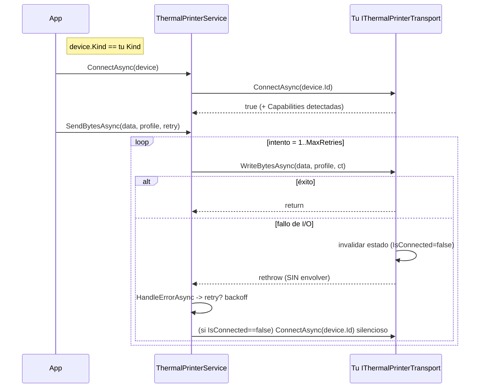

# Guía de extensión — implementar un transport nuevo

> Cómo agregar un medio de transporte térmico (USB, BLE, red, fake de test) implementando
> `IThermalPrinterTransport`, **sin tocar** el orquestador `ThermalPrinterService`. Referencia:
> **v1.0.13 @83677eb**. El transport de referencia es
> [`MotorDsl.Bluetooth`](../MotorDsl.Bluetooth/README.md).

## 1. Modelo de responsabilidades

El servicio y el transport tienen fronteras estrictas. Respetarlas es la condición para que el
retry, la reconexión y el diagnóstico del orquestador funcionen.

| Responsabilidad | ¿Transport? | ¿Servicio? | Fuente |
|---|---|---|---|
| Descubrir dispositivos del medio | ✅ `DiscoverAsync` | — | `Contracts/IThermalPrinterTransport.cs#L14` |
| Abrir/cerrar la conexión física | ✅ `ConnectAsync`/`DisconnectAsync` | orquesta el ciclo | `IThermalPrinterTransport.cs#L15-L16` |
| Escribir bytes en el medio | ✅ `WriteBytesAsync` | — | `IThermalPrinterTransport.cs#L17` |
| Detectar capacidades | ✅ (al conectar, best-effort) | expone vía `CurrentCapabilities` | `IThermalPrinterTransport.cs#L13` |
| **Retry / backoff** | ❌ **nunca** | ✅ `SendBytesAsync` | `Services/ThermalPrinterService.cs#L201-L244` |
| **Reconexión** | ❌ (solo invalida y relanza) | ✅ `ReconnectInternalAsync` | `ThermalPrinterService.cs#L238-L244` |
| Enrutamiento por `Kind` | — | ✅ | `ThermalPrinterService.cs#L133-L145` |
| Historial de fallos / eventos / estados | — | ✅ | `ThermalPrinterService.cs#L246-L256` |

> **Regla de oro**: el transport **solo escribe bytes**. No reintenta, no hace backoff, no
> reconecta por su cuenta. Ante un fallo de I/O **invalida su estado y relanza** para que el
> servicio decida (`MotorDsl.Bluetooth/BluetoothPrinterTransport.cs#L12-L16`, `#L238-L249`).

## 2. Contrato a cumplir

Implementá `IThermalPrinterTransport` (namespace `MotorDsl.Printing`):

```csharp
public interface IThermalPrinterTransport
{
    string Kind { get; }                    // identidad del medio: "usb", "ble", "net", ...
    bool IsConnected { get; }
    PrinterDevice? CurrentDevice { get; }
    PrinterCapabilities? Capabilities => null;   // default: no aplicable

    Task<IReadOnlyList<PrinterDevice>> DiscoverAsync(CancellationToken ct = default);
    Task<bool> ConnectAsync(string deviceId, CancellationToken ct = default);
    Task DisconnectAsync();
    Task WriteBytesAsync(byte[] data, PrinterProfile profile, CancellationToken ct = default);

    // Opcionales (defaults no-op): implementalos solo si el medio soporta NV logo.
    Task<NvLogoResult> ProvisionLogoAsync(byte[] gsV0Bytes, int keycode, CancellationToken ct = default) => …;
    Task<bool> IsLogoProvisionedAsync(int keycode, CancellationToken ct = default) => …;
    Task ClearLogoAsync(int keycode, CancellationToken ct = default) => …;
}
```
Procedencia: `src/MotorDsl.Printing.Abstractions/Contracts/IThermalPrinterTransport.cs#L5-L29`.

## 3. `Kind` — la clave del enrutamiento

`Kind` es un string estable que identifica el medio. El servicio conecta buscando el transport cuyo
`Kind` coincide con `device.Kind` (comparación `OrdinalIgnoreCase`); si no hay ninguno, cae a
`ConnectionState.Failed` con un `PrintError` de tipo `Protocol`.

| Regla | Detalle | Fuente |
|---|---|---|
| Valor estable | Ej.: `"bluetooth"`, `"usb"`, `"ble"`, `"net"`. Documentalo. | `Contracts/IThermalPrinterTransport.cs#L7` |
| Coherencia con `PrinterDevice.Kind` | Los `PrinterDevice` que devuelve `DiscoverAsync` deben llevar el **mismo** `Kind`. | `BluetoothPrinterTransport.cs#L84` |
| Comparación | `OrdinalIgnoreCase` — no dependas de mayúsculas. | `ThermalPrinterService.cs#L135-L136` |
| Unicidad | Dos transports con el mismo `Kind` compiten: `FirstOrDefault` gana el primero registrado. Usá `Kind` distintos. | `ThermalPrinterService.cs#L135` |

## 4. Qué devolver en `Capabilities`

`Capabilities` es `null` hasta conectar. Detectá al conectar, **best-effort**, y **nunca** hagas
fallar la conexión por la detección (Bluetooth: `catch → PrinterCapabilities.Unknown()`).

| Campo | Tipo | Qué poner | Regla |
|---|---|---|---|
| `StatusFeedback` | `CapabilitySupport` | `Supported` si el medio confirma liveness/estado; `NotDetected` si sondeaste sin respuesta; `Unknown` si no pudiste sondear. | Nunca bool. `Unknown` ≠ `NotDetected`. |
| `NvGraphics` | `CapabilitySupport` | `Supported` solo si confirmaste soporte de logo NV. | Idem tri-estado. |
| `NvGraphicsKind` | `string?` | `"gsl"` \| `"fs"` \| `null` según la familia que respondió. | `null` si no aplica. |
| `ModelId` | `string?` | Identificador best-effort del modelo, o `null`. | Opcional. |

Procedencia del contrato: `Models/PrinterCapabilities.cs#L7-L16`, `Models/CapabilitySupport.cs#L7-L17`.
Si el medio no tiene capacidades detectables (fake/iOS), dejá `Capabilities => null` (default de la
interfaz) — el servicio lo tolera (`CurrentCapabilities` propaga `null`).

## 5. Cómo enruta el servicio (qué esperar del orquestador)



Contrato de comportamiento que tu transport debe honrar:

| Situación | Qué debe hacer tu transport | Por qué |
|---|---|---|
| Fallo transitorio de escritura (socket/pipe roto) | Invalidar (`IsConnected=false`, liberar recursos) y **relanzar sin envolver** el `IOException`. | El servicio reconecta entre intentos **solo si** `IsConnected==false` (`ThermalPrinterService.cs#L238-L244`). |
| Fallo de hardware (papel/tapa) | Lanzar una excepción que el `IPrintErrorHandler` clasifique como `Hardware` (`PrinterHardwareException`) — **no** un `IOException`. | `Hardware` aborta sin reintentar; reintentar sería inútil (`DefaultPrintErrorHandler.cs#L16-L28`). |
| Kind desconocido | (no aplica al transport) el servicio ya lo maneja con `Protocol`. | `ThermalPrinterService.cs#L138-L145`. |
| Sin conexión al escribir | Lanzar (`InvalidOperationException`/similar). | El servicio lo captura en el loop de retry. |

## 6. Registrarlo en DI — usá `AddSingleton`, NO `TryAdd`

```csharp
public static class MotorDslUsbServiceCollectionExtensions
{
    public static IServiceCollection AddUsbPrinterTransport(this IServiceCollection services)
    {
        // AddSingleton (NO TryAdd): el servicio acepta VARIOS transports y los inyecta
        // como IEnumerable<IThermalPrinterTransport>. Con TryAdd colapsarías a uno solo.
        services.AddSingleton<IThermalPrinterTransport, UsbPrinterTransport>();
        return services;
    }
}
```

Patrón de referencia (Bluetooth):
`src/MotorDsl.Bluetooth/MotorDslBluetoothServiceCollectionExtensions.cs#L8-L12`.

| Regla DI | Motivo | Fuente |
|---|---|---|
| `AddSingleton<IThermalPrinterTransport, …>` | El ctor del servicio recibe `IEnumerable<IThermalPrinterTransport>`; con `TryAdd` solo sobreviviría uno. | `ThermalPrinterService.cs#L83-L91` |
| El servicio en sí va con `AddMotorDslPrinting()` (`TryAdd`) | Sobrescribible por el consumer. | `MotorDslPrintingServiceCollectionExtensions.cs#L10-L15` |
| Registro combinado | La app hace `AddMotorDslPrinting()` + un `Add…PrinterTransport()` por cada medio. | — |

## 7. Checklist de implementación

- [ ] `Kind` estable, único y coherente con el `Kind` de los `PrinterDevice` que devolvés.
- [ ] `DiscoverAsync` no aborta el scan global si falla (el servicio ya aísla por transport, pero devolvé lista vacía en errores de permisos, como hace Bluetooth con `SecurityException`).
- [ ] `Capabilities` detectadas al conectar, best-effort, **sin** hacer fallar la conexión.
- [ ] `WriteBytesAsync` **sin** retry propio; ante I/O roto: invalidar + relanzar sin envolver.
- [ ] Fallo de hardware → excepción clasificable como `Hardware` (no `IOException`).
- [ ] NV logo: implementá `ProvisionLogoAsync`/`IsLogoProvisionedAsync`/`ClearLogoAsync` **solo** si el medio lo soporta; si no, dejá los defaults no-op.
- [ ] Registro DI con `AddSingleton` en un método de extensión propio.
- [ ] (Recomendado) partes puras de parseo/chunking **fuera** de bloques `#if PLATFORM` para poder testearlas en `net10.0`, como hace `MotorDsl.Bluetooth` (`BluetoothPrinterTransport.Chunking.cs`, `…Capabilities.cs`).

## Enlaces

- [Referencia de API](./api-reference.md) — firmas exactas de la interfaz y del servicio.
- [README de la pieza](./README.md).
- Transport de referencia: [`MotorDsl.Bluetooth`](../MotorDsl.Bluetooth/README.md) · [su API](../MotorDsl.Bluetooth/api-reference.md).
- [Índice ia-db 04](../../../ia-db/indexes/04_impresion-transports.md) · [Glosario](../../GLOSSARY.md).
