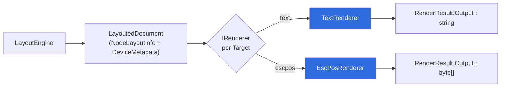
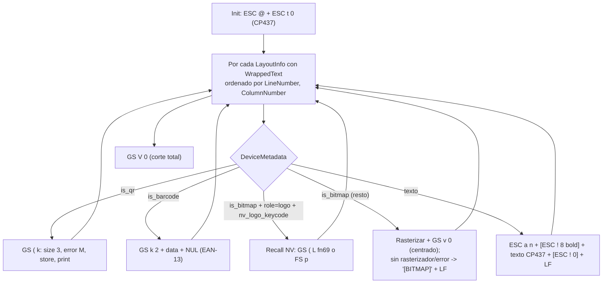

# MotorDsl.Rendering

> Pieza `library` (Marco §7.1) · TFM `net10.0` · Paquete NuGet `MotorDsl.Rendering`.
> Documento reconstruido por ingeniería inversa sobre **v1.0.13 @83677eb**. Estado `draft`.

## Resumen ejecutivo

`MotorDsl.Rendering` aporta los **dos renderers base** del motor y el catálogo de comandos que
usan. Un `IRenderer` transforma un `LayoutedDocument` + `DeviceProfile` en la salida final
(`RenderResult.Output`):

| Renderer | `Target` | Tipo de `Output` | Rol |
|---|---|---|---|
| `TextRenderer` | `"text"` | `string` | Texto plano legible, cada línea padeada al ancho del perfil |
| `EscPosRenderer` | `"escpos"` | `byte[]` | Comandos ESC/POS para impresora térmica, sin dependencias externas |

Además expone `EscPosCommands`, una clase estática con el **catálogo de secuencias ESC/POS** (init,
alineación, estilo, corte, QR, barcode, raster, recall de logo NV). Los renderers **no recorren el
AST**: iteran el diccionario `NodeLayoutInfo` que produjo el `LayoutEngine`, ordenado por
`LineNumber`/`ColumnNumber`, y consumen `WrappedText` + `DeviceMetadata`.

| Aspecto | Valor | Fuente |
|---|---|---|
| Tipo de pieza | `library` | `docs-manifest.yaml#L44-L52` |
| TFM | `net10.0` | `src/MotorDsl.Rendering/MotorDsl.Rendering.csproj#L4 @83677eb` |
| Clases públicas | `TextRenderer`, `EscPosRenderer`, `EscPosCommands` | `TextRenderer.cs#L12`, `EscPosRenderer.cs#L13`, `EscPosCommands.cs#L8 @83677eb` |
| Dependencias externas | Ninguna (no usa ESCPOS_NET) | `EscPosRenderer.cs#L9 @83677eb` |
| Criticidad | Alta | `docs-manifest.yaml#L48` |

## Rol en el pipeline

El `RendererRegistry` selecciona el renderer por el `Target` que pide el `DeviceProfile.RenderTarget`.
Ambos renderers son la etapa final del pipeline documentado en `MotorDsl.Core`.

## Dependencias + TFM

| Dependencia | Tipo | Notas | Fuente |
|---|---|---|---|
| `net10.0` | TFM | Framework objetivo único | `MotorDsl.Rendering.csproj#L4 @83677eb` |
| `MotorDsl.Core` | ProjectReference | `IRenderer`, `LayoutedDocument`, `DeviceProfile`, `RenderResult`, `IBitmapRasterizer` | `MotorDsl.Rendering.csproj#L23 @83677eb` |
| `System.Text` / `CodePagesEncodingProvider` | BCL (.NET 10) | Encoding CP437/CP850 | `EscPosRenderer.cs#L3,L124 @83677eb` |

Sin `PackageReference` externos.

## Conceptos clave

### `TextRenderer` — target `"text"`

Convierte `LayoutedDocument` a texto plano (`TextRenderer.cs#L16-L53 @83677eb`). `document` o
`document.Root` nulos → `Output = ""` sin error. Cada línea se **ajusta al `profile.Width`**:

| Alignment | Comportamiento | Fuente |
|---|---|---|
| `left` (default) | `PadRight(width)`; si excede, trunca a `width` | `TextRenderer.cs#L74-L78 @83677eb` |
| `right` | `PadLeft(width)`; si excede, conserva los últimos `width` chars | `TextRenderer.cs#L80-L84 @83677eb` |
| `center` | Padding repartido; si excede, trunca a `width` | `TextRenderer.cs#L86-L92 @83677eb` |

Toda línea sale con ancho exacto `profile.Width`.

### `EscPosRenderer` — target `"escpos"`

Genera `byte[]` de comandos ESC/POS (`EscPosRenderer.cs#L24-L119 @83677eb`). Constructor opcional
`EscPosRenderer(IBitmapRasterizer? rasterizer = null)`: sin rasterizador, los bitmaps degradan al
placeholder textual `"[BITMAP]"`. Secuencia de emisión:

Trazabilidad: init `#L31-L34`; loop y ramas `#L36-L104`; corte `#L106-L107`; error global →
`RenderResult` con `"ESC/POS rendering failed: …"` y `Output = byte[0]` (`#L112-L118`), todo en
`EscPosRenderer.cs @83677eb`.

**Encoding**: el texto va **siempre en CP437** (`EncodeText`, ignora la capability `codepage`);
solo QR/barcode respetan `codepage` del perfil (`GetEncoding`, `#L136-L145 @83677eb`).

### `EscPosCommands` — comandos ESC/POS principales que emite el motor

`EscPosCommands.cs#L8-L96 @83677eb` (estático):

| Miembro | Bytes | Comando ESC/POS | Uso | Fuente |
|---|---|---|---|---|
| `Init` | `1B 40` | ESC @ — inicializar | Inicio de cada render | `#L11` |
| `AlignLeft` / `AlignCenter` / `AlignRight` | `1B 61 00/01/02` | ESC a n — alineación | Por línea; imágenes centradas | `#L14-L20` |
| `StyleNormal` / `StyleBold` | `1B 21 00` / `1B 21 08` | ESC ! n — estilo | Bold on/off por línea | `#L23-L26` |
| `CutFull` / `CutPartial` | `1D 56 00` / `1D 56 01` | GS V n — corte | `CutFull` al final; `CutPartial` sin uso | `#L29-L32` |
| `LineFeed` | `0A` | LF | Tras cada línea/imagen | `#L35` |
| `FeedLines(byte n)` | `1B 64 n` | ESC d n — alimentar n líneas | Sin uso en Rendering | `#L38` |
| `BarcodeEan13` | `1D 6B 02` | GS k 2 — EAN-13 (modo 2, NUL-term.) | Prefijo; renderer agrega data + `00` | `#L43` |
| `QrSetSize3` | `1D 28 6B 03 00 31 43 03` | GS ( k — módulo tamaño 3 | Secuencia QR | `#L51` |
| `QrSetErrorM` | `1D 28 6B 03 00 31 45 33` | GS ( k — corrección nivel M | Secuencia QR | `#L54` |
| `QrStoreData` | `1D 28 6B 03 00 31 50 30` | GS ( k — store (header fijo) | Constante; el renderer arma el store con longitud real (no la usa) | `#L48` |
| `QrPrint` | `1D 28 6B 03 00 31 51 30` | GS ( k — imprimir QR | Cierre de secuencia QR | `#L57` |
| `BuildRasterImageGsV0(bits, widthBytes, heightDots)` | `1D 76 30 00 xL xH yL yH` + bits | GS v 0 m=0 — raster bit image | Bitmaps inline | `#L66-L76` |
| `RecallNvGraphicsGsL(keycode)` | `1D 28 4C 06 00 30 45 kc1 kc2 01 01` | GS ( L fn 69 — imprimir NV graphics por keycode | Recall de logo (familia "gsl") | `#L84-L89` |
| `RecallNvBitImageFsP(n, mode=0)` | `1C 70 n m` | FS p n m — NV bit image clásica | Recall de logo (familia "fs") | `#L94-L95` |

### Ruteo de imágenes (Sprint 08, TK-64)

- `role == "logo"` **y** `profile.GetCapability("nv_logo_keycode") != null` → `EmitNvLogoRecall`:
  centra, emite `FS p` si `nv_logo_kind == "fs"`, si no `GS ( L`; no rasteriza
  (`EscPosRenderer.cs#L76-L80,L232-L243 @83677eb`).
- Cualquier otra imagen (firmas incluidas) → `EmitBitmap`: extrae base64 del data-URI, rasteriza
  vía `IBitmapRasterizer` y emite `GS v 0`; sin rasterizador o error → `"[BITMAP]"` + LF
  (`EscPosRenderer.cs#L185-L224 @83677eb`).

## Enlaces

- [`api-reference.md`](./api-reference.md) — firmas públicas, snippets y bloque para agentes.
- [ia-db · 03 — Renderers base y registro DI](../../../ia-db/indexes/03_renderizado-base.md).
- [`GLOSSARY.md`](../../GLOSSARY.md) — `Renderer`, `Target`, `ESC/POS`, `GS v 0`, `Rasterizer`.

> Nota de ruta: `GLOSSARY.md` está en `PrintThermal_Motor_Maui-docs/GLOSSARY.md`; el enlace correcto
> desde `pieces/<id>/` es `../../GLOSSARY.md` (la especificación pedía `../../../GLOSSARY.md`).
