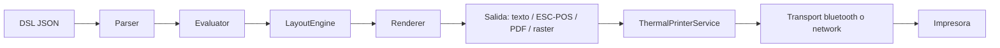

# ia-db — PrintThermal_Motor_Maui (MotorDsl)

> **Instrucción para IA**
>
> Este archivo es el **punto de entrada único** a la base de conocimiento del proyecto
> `PrintThermal_Motor_Maui`. Antes de leer código o documentación completa:
>
> 1. leé el resumen ejecutivo de abajo para ubicarte;
> 2. buscá tu necesidad en la tabla de navegación;
> 3. cargá **solo** el índice o los dos índices que te indique;
> 4. abrí las fuentes citadas únicamente si el índice resulta insuficiente.
>
> Nunca recorras el repositorio entero cuando la respuesta está indexada. Cada índice
> referencia sus fuentes con rutas relativas al repositorio indexado.

---

## Navegación — «Necesitás saber… → leé este índice»

| Necesitás saber… | Leé este índice |
|---|---|
| Qué es el proyecto, qué stack usa, cómo se dividen los 8 paquetes, qué decisiones lo condicionan | [`00_MASTER-INDEX.md`](indexes/00_MASTER-INDEX.md) |
| Cómo funciona el pipeline (parse → evaluar → layout → render), qué contratos existen, cómo se arma el motor por DI | [`01_nucleo-pipeline.md`](indexes/01_nucleo-pipeline.md) |
| Cómo se escribe una plantilla DSL, qué nodos existen, diferencia `template` vs `integrated`, cómo se evalúan bindings y condiciones | [`02_dsl-y-modelos.md`](indexes/02_dsl-y-modelos.md) |
| Qué renderers hay, qué `Target` usa cada uno, qué bytes ESC/POS se emiten, cómo agregar un renderer propio | [`03_renderizado-base.md`](indexes/03_renderizado-base.md) |
| Cómo se imprime: transports, orquestador, retry, capacidades, red TCP, Bluetooth, logos NV | [`04_impresion-transports.md`](indexes/04_impresion-transports.md) |
| Qué controles MAUI provee la librería, qué renderers gráficos hay, cómo funciona el diagnóstico | [`05_maui-ui-renderers.md`](indexes/05_maui-ui-renderers.md) |
| Qué sample mirar como referencia, qué demuestra cada uno, cómo correrlos | [`06_samples.md`](indexes/06_samples.md) |
| Qué cubre la suite de tests, cómo está organizada, dónde está el borde no cubierto | [`07_tests.md`](indexes/07_tests.md) |
| Cómo compila y publica el proyecto, qué hace cada workflow, cómo se versiona, cómo desarrollar en Linux | [`08_build-devops.md`](indexes/08_build-devops.md) |
| Dónde está la documentación funcional previa (casos de uso, reglas, sprints, guías de developer) | [`09_docs-existentes.md`](indexes/09_docs-existentes.md) |

---

## Resumen ejecutivo

| Dato | Valor |
|---|---|
| Proyecto | **MotorDsl** — repositorio `PrintThermal_Motor_Maui` |
| Tipo | Librería .NET distribuida como **8 paquetes NuGet** (no es una app ni un servicio) |
| Stack | .NET 10 · C# · .NET MAUI (android/ios) · SkiaSharp · PdfSharpCore · QRCoder · xUnit |
| Repositorio | `https://github.com/Aplicada-Streaming/PrintThermal_Motor_Maui` |
| Ruta local | `/Libs/NugetOrg/PrintThermal_Motor_Maui` |
| Última versión publicada | `1.0.13` (2026-07-13). Hay un `[Unreleased]` con `MotorDsl.Network` |
| Licencia | MIT |
| Autor | Fernando Rafael Filipuzzi — Aplicada Streaming |

**Función principal.** Convierte una plantilla JSON (el DSL) más un juego de datos en la
salida que espera un dispositivo concreto: texto plano, bytes ESC/POS, ESC/POS rasterizado,
PDF o una vista previa. Después entrega esos bytes a una impresora térmica a través de un
transport intercambiable (Bluetooth Classic SPP en Android, TCP 9100 en Android e iOS).

**Arquitectura en una línea.** Pipeline de cuatro etapas
(`Parser → Evaluator → LayoutEngine → Renderer`) con dos puntos de extensión por interfaz:
`IRenderer` (elegido por el `RenderTarget` del perfil) e `IThermalPrinterTransport`
(elegido por el `Kind` del dispositivo).



---

## Estructura del repositorio indexado

```text
PrintThermal_Motor_Maui/
├── src/                                  Los 8 paquetes + el proyecto de tests
│   ├── MotorDsl.Core/                    Contratos, modelos/AST, motor, layout, validación
│   ├── MotorDsl.Parser/                  JSON del DSL → AST tipado
│   ├── MotorDsl.Rendering/               Renderers text y escpos, tabla de comandos ESC/POS
│   ├── MotorDsl.Extensions/              DI fluent: AddMotorDslEngine + builder
│   ├── MotorDsl.Printing.Abstractions/   Contratos de transport y orquestador de impresión
│   ├── MotorDsl.Network/                 Transport TCP 9100 (net10.0 puro → Android + iOS)
│   ├── MotorDsl.Bluetooth/               Transport BT Classic SPP (código real solo en Android)
│   ├── MotorDsl.Maui/                    Controles, renderers gráficos y diagnóstico MAUI
│   └── MotorDsl.Tests/                   Suite xUnit
├── samples/                              5 apps MAUI de demostración
├── docs/                                 Documentación funcional y técnica previa (12 carpetas)
├── scripts/                              Corridas locales, publicación APK y publicación NuGet
├── .github/workflows/                    1 workflow de CI + 5 de CD
├── .devcontainer/                        Entorno Linux para los TFM net10.0
└── nupkg/                                Salida de empaquetado (gitignored)
```

---

## Restricciones para un agente que consuma esta base

- **No tratar los índices como fuente de verdad por encima del código.** Si la evidencia del
  repositorio contradice un índice, prevalece la evidencia: corregí el índice
  (ver `Actualizar-Indexado.md`) y no propagues el dato obsoleto.
- **No duplicar contenido entre índices.** Cada dominio vive en un único índice; el resto
  referencia.
- **No inferir lo que no está indexado.** Lo marcado como «no verificado» requiere abrir la
  fuente.
- **No confundir el repositorio indexado con el de documentación.** Esta base vive en
  `PrintThermal_Motor_Maui.Documentacion`; el código indexado vive en
  `PrintThermal_Motor_Maui`. Los índices citan rutas del **segundo**.
- **Vigencia**: esta base refleja el estado del commit `e688f3c` de la rama `main`. Los
  commits posteriores no están reflejados. Al momento de generarla había tres archivos
  modificados sin commitear en `samples/MotorDsl.MultaApp/`, cuyos cambios **no** se indexaron.

---

## Manifiesto de generación

- Generado por : `/IA/PROMPTs/IA.Prompts/Tool-Prompts/Indexado-Documentado/Iniciar-Indexado.md`
- Profile      : `/IA/PROMPTs/IA.Prompts/PromptFramework/Profiles/Knowledge-Indexing.md`
- Invocado por : `/Libs/NugetOrg/PrintThermal_Motor_Maui.Documentacion/PROMPTs/Indexado/Crear-Indexado.md`
- Alcance      : `/Libs/NugetOrg/PrintThermal_Motor_Maui` (modo proyecto único)
- Destino      : `/Libs/NugetOrg/PrintThermal_Motor_Maui.Documentacion/ia-db` (indicado en la invocación)
- Fuentes      : `src/`, `samples/`, `docs/`, `scripts/`, `.github/workflows/`, `.devcontainer/`, `README.md`, `CHANGELOG.md`, `PrintThermalDriver.slnx`
- Exclusiones  : `.git`, `.vs`, `.vscode`, `bin`, `obj`, `nupkg`, binarios (`.ttf`, `.bmp`, `.svg`, `.base64`), y lo ignorado por el `.gitignore` del proyecto
- Estado fuente: rama `main` · commit `e688f3c` · última versión publicada `1.0.13`
- Generado     : 2026-08-31 · Versión: 1.0
- Actualizar   : `/IA/PROMPTs/IA.Prompts/Tool-Prompts/Indexado-Documentado/Actualizar-Indexado.md`

**Nomenclatura de índices**: los nombres `01_nucleo-pipeline` … `09_docs-existentes` provienen
del campo `ia_db_index` de `PrintThermal_Motor_Maui-docs/docs-manifest.yaml`, en el repositorio
de documentación. Se respetan para mantener la trazabilidad manifiesto ↔ ia-db.
