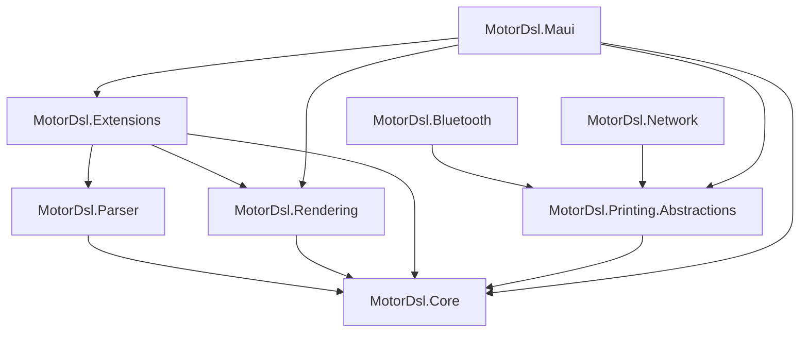

# 00 — Índice maestro

> **Propósito**: visión general del sistema, mapa de paquetes y dependencias, decisiones
> arquitectónicas clave y puntos de extensión. Punto de partida cuando no se sabe qué índice leer.
> **Fuentes primarias**: `README.md`, `PrintThermalDriver.slnx`, `src/*/*.csproj`, `CHANGELOG.md`,
> `docs/05_arquitectura_tecnica/arquitectura-solucion_v1.1.md`.

---

## 1. Qué resuelve el proyecto

MotorDsl desacopla **qué se imprime** (una plantilla JSON versionable) de **cómo se imprime**
(renderer + transport elegidos en tiempo de ejecución). Una app MAUI describe el documento en
DSL, el motor lo convierte a bytes ESC/POS y un transport lo envía a la impresora térmica. El
mismo documento puede salir además como PDF o como PNG de vista previa sin tocar la plantilla.

Necesidades de negocio que lo originan (fuente: `docs/01_necesidades_negocio/`): desacople del
código de impresión (NB-01), estandarización (NB-02), cambios de documento sin recompilar
(NB-03), soporte multi-dispositivo (NB-04), reducción de costos (NB-05) y reutilización (NB-06).

---

## 2. Los 8 paquetes NuGet

| Paquete | TFM | Rol | Depende de |
|---|---|---|---|
| `MotorDsl.Core` | `net10.0` | Contratos, modelos/AST, `Evaluator`, `LayoutEngine`, validadores, `DocumentEngine` | — |
| `MotorDsl.Parser` | `net10.0` | `DslParser`: JSON → `DocumentTemplate` | Core |
| `MotorDsl.Rendering` | `net10.0` | `TextRenderer`, `EscPosRenderer`, `EscPosCommands` | Core |
| `MotorDsl.Extensions` | `net10.0` | DI fluent: `AddMotorDslEngine`, `AddTemplates`, `AddProfiles`, `AddRenderer<T>` | Core, Parser, Rendering |
| `MotorDsl.Printing.Abstractions` | `net10.0` | `IThermalPrinterTransport`, `IThermalPrinterService`, `ThermalPrinterService`, diagnóstico | Core |
| `MotorDsl.Network` | `net10.0` | Transport de red TCP 9100 (RAW/JetDirect). Multiplataforma: **único camino de impresión en iOS** | Printing.Abstractions |
| `MotorDsl.Bluetooth` | `net10.0-android;net10.0-ios` | Transport BT Classic SPP (Android). iOS lanza `PlatformNotSupportedException` | Printing.Abstractions |
| `MotorDsl.Maui` | `net10.0-android;net10.0-ios` | Controles MAUI, renderers PDF / bitmap ESC/POS / raster preview, error handler, diagnóstico | Core, Rendering, Extensions, Printing.Abstractions |

`MotorDsl.Tests` (`net10.0`, `IsPackable=false`) no se publica.

**Instalación mínima para una app MAUI con impresión Bluetooth**: `MotorDsl.Maui` +
`MotorDsl.Bluetooth`; los demás llegan como dependencias transitivas
(fuente: `README.md`, sección «TL;DR»). Para imprimir en **iOS** hay que agregar
`MotorDsl.Network`: es el único transport que funciona ahí.

### Grafo de dependencias



---

## 3. El pipeline en una vista

```mermaid
flowchart LR
    DSL[DSL JSON] --> V1[TemplateValidator]
    V1 --> P[DslParser]
    P --> V2[DataValidator]
    V2 --> V3[ProfileValidator]
    V3 --> E[Evaluator]
    E --> L[LayoutEngine]
    L --> R[IRenderer por Target]
    R --> OUT[RenderResult: string | byte&#91;&#93; | PDF | PNG]
```

En formato `integrated` la etapa **Evaluate se omite**: el AST ya viene resuelto.
Detalle completo en [01_nucleo-pipeline](01_nucleo-pipeline.md).

---

## 4. Decisiones arquitectónicas clave

| # | Decisión | Consecuencia | Fuente |
|---|---|---|---|
| ADR-0001 | Pipeline en etapas discretas con contratos por interfaz | Cada etapa es sustituible y testeable en aislamiento | `docs/04-decisions/ADR-0001-pipeline-en-etapas.md`¹ |
| ADR-0002 | Extensibilidad por `Target`/`Kind` string, no por herencia | Agregar renderer o transport no toca el orquestador | `ADR-0002-extensibilidad-target-kind.md`¹ |
| ADR-0003 | Dos formatos de DSL: `template` (con placeholders) e `integrated` (pre-resuelto) | El backend puede resolver los datos y enviar un documento listo | `ADR-0003-dos-formatos-dsl.md`¹ |
| ADR-0004 | Capacidades de impresora en **tri-estado** (`Unknown` / `NotDetected` / `Supported`) | «No contestó» nunca se confunde con «no lo soporta» | `ADR-0004-capacidades-tri-estado.md`¹ |
| — | La versión **no** vive en los `.csproj`: se inyecta en build/pack | Los 8 paquetes comparten una versión unificada | `CHANGELOG.md`, `docs/09_devops/estrategia-versionado_v1.0.md` |
| — | Sin dependencia de librerías ESC/POS externas | `EscPosRenderer` emite los bytes directamente | `src/MotorDsl.Rendering/EscPosRenderer.cs:9` |

¹ Los ADR viven en el repositorio de documentación hermano
(`PrintThermal_Motor_Maui-docs/docs/04-decisions/`), no en el repositorio indexado.
Ver [09_docs-existentes](09_docs-existentes.md).

---

## 5. Puntos de extensión

| Punto | Contrato | Discriminador | Registro | Detalle |
|---|---|---|---|---|
| Salida de render | `IRenderer` | `string Target` | `AddRenderer<T>()` | [03_renderizado-base](03_renderizado-base.md) |
| Transporte físico | `IThermalPrinterTransport` | `string Kind` | `AddSingleton<IThermalPrinterTransport, T>()` | [04_impresion-transports](04_impresion-transports.md) |
| Origen de plantillas | `ITemplateProvider` | — | `AddTemplates(...)` | [01_nucleo-pipeline](01_nucleo-pipeline.md) |
| Origen de datos | `IDataProvider` | — | registro manual en DI | [01_nucleo-pipeline](01_nucleo-pipeline.md) |
| Perfiles de dispositivo | `IDeviceProfileProvider` | — | `AddProfiles(...)` | [02_dsl-y-modelos](02_dsl-y-modelos.md) |
| Manejo de error de impresión | `IPrintErrorHandler` | — | `Replace(...)` / `TryAdd` | [04_impresion-transports](04_impresion-transports.md) |
| Rasterizado de imágenes | `IBitmapRasterizer` | — | `AddSingleton` | [05_maui-ui-renderers](05_maui-ui-renderers.md) |
| Reporte de diagnóstico | `IDiagnosticsReportProvider` | — | `TryAddSingleton` | [04_impresion-transports](04_impresion-transports.md) |

---

## 6. Targets de render registrados

| `Target` | Renderer | Paquete | Tipo de `Output` |
|---|---|---|---|
| `text` | `TextRenderer` | Rendering | `string` |
| `escpos` | `EscPosRenderer` | Rendering | `byte[]` |
| `escpos-bitmap` | `BitmapEscPosRenderer` | Maui | `byte[]` |
| `pdf` | `PdfRenderer` | Maui | `byte[]` |
| `raster-preview` | `RasterPreviewRenderer` | Maui | `byte[]` (PNG) |

`text` y `escpos` se registran siempre en `AddMotorDslEngine()`; los tres restantes los agrega
`AddMotorDslMaui()` (fuente: `src/MotorDsl.Extensions/MotorDslServiceCollectionExtensions.cs`,
`src/MotorDsl.Maui/MotorDslMauiServiceCollectionExtensions.cs`).

---

## 7. Estado y roadmap declarado

Completado: transport Bluetooth Classic SPP (Android). Pendiente según `README.md` §Roadmap:
transport USB, transport BLE / TCP de red, renderer raster con *nearest-neighbor* real
(`SKCanvasView`) y EAN-13 nativo en raster preview y PDF (hoy cae a texto).

Último cambio registrado (v1.0.13, 2026-07-13): corrección del rasterizado de bitmaps
(`SKBitmap.Decode` devolvía `null` en SkiaSharp 3.x y descartaba el ticket completo) y del estilo
`bold`, que `LayoutEngine` no propagaba al metadata. Fuente: `CHANGELOG.md`.

---

## 8. Arranque rápido para un agente

1. **¿Duda funcional del documento/DSL?** → [02_dsl-y-modelos](02_dsl-y-modelos.md).
2. **¿Duda de por qué el motor devolvió errores/warnings?** → [01_nucleo-pipeline](01_nucleo-pipeline.md) (§validaciones).
3. **¿Duda de bytes ESC/POS o de qué renderer se usó?** → [03_renderizado-base](03_renderizado-base.md) / [05_maui-ui-renderers](05_maui-ui-renderers.md).
4. **¿Duda de conexión, retry o capacidades de impresora?** → [04_impresion-transports](04_impresion-transports.md).
5. **¿Duda de cómo se integra en una app?** → [06_samples](06_samples.md).
6. **¿Duda de versión, publicación o CI?** → [08_build-devops](08_build-devops.md).
