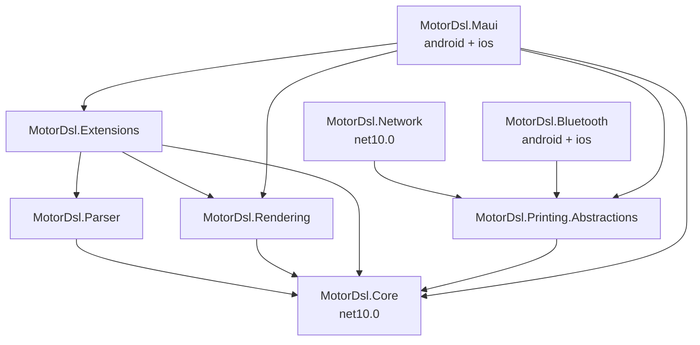

# 00 — Índice maestro

> **Propósito**: dar la visión general del sistema — qué resuelve, cómo se divide en paquetes,
> qué decisiones lo condicionan y dónde seguir leyendo.
> **Fuentes primarias**: `README.md`, `docs/README.md`, `PrintThermalDriver.slnx`, `CHANGELOG.md`,
> `docs/00_contexto/compatibilidad-plataformas_v1.2.md`, los nueve `src/*/*.csproj`.

---

## 1. Qué resuelve

Una app móvil que tiene que imprimir un ticket térmico enfrenta dos problemas mezclados: armar
el contenido del documento y hablar el protocolo de la impresora. MotorDsl los separa.

El contenido se declara en un **DSL JSON** —una plantilla con nodos de texto, contenedores,
tablas, imágenes, bucles y condicionales— que la app puede cambiar sin recompilar. El motor
toma esa plantilla, le aplica los datos, calcula el layout para el ancho del papel y produce
la salida en el formato que el dispositivo entiende. La entrega física la resuelve un
**transport** intercambiable.

La consecuencia práctica: cambiar el diseño de un ticket es editar un JSON; cambiar de medio de
impresión —Bluetooth, red, y mañana USB o BLE— es registrar otro transport, sin tocar el motor.

---

## 2. Stack

| Capa | Tecnología |
|---|---|
| Lenguaje / runtime | C# sobre **.NET 10** |
| Paquetes portables | TFM `net10.0` puro — sin API de plataforma |
| Paquetes de plataforma | TFM `net10.0-android;net10.0-ios` (MAUI) |
| Inyección de dependencias | `Microsoft.Extensions.DependencyInjection.Abstractions` 10.0.8 |
| Serialización | `System.Text.Json` (BCL) |
| Gráficos y raster | `SkiaSharp.Views.Maui.Controls` 3.119.2 |
| PDF | `PdfSharpCore` 1.3.67 |
| Códigos QR | `QRCoder` 1.8.0 |
| Pruebas | xUnit 2.9.3 · `Microsoft.NET.Test.Sdk` 17.14.1 · coverlet 6.0.4 |
| SDK fijado en CI | `10.0.102` |

---

## 3. Los 8 paquetes

| Paquete | TFM | Rol | Índice que lo cubre |
|---|---|---|---|
| `MotorDsl.Core` | `net10.0` | Contratos, modelos/AST, motor, layout, validación, providers en memoria | [01](01_nucleo-pipeline.md), [02](02_dsl-y-modelos.md) |
| `MotorDsl.Parser` | `net10.0` | JSON del DSL → `DocumentTemplate` + AST | [02](02_dsl-y-modelos.md) |
| `MotorDsl.Rendering` | `net10.0` | Renderers `text` y `escpos`, tabla de comandos ESC/POS | [03](03_renderizado-base.md) |
| `MotorDsl.Extensions` | `net10.0` | DI fluent: `AddMotorDslEngine`, `AddTemplates`, `AddProfiles`, `AddRenderer` | [01](01_nucleo-pipeline.md), [03](03_renderizado-base.md) |
| `MotorDsl.Printing.Abstractions` | `net10.0` | `IThermalPrinterTransport`, `IThermalPrinterService`, orquestador con retry y eventos | [04](04_impresion-transports.md) |
| `MotorDsl.Network` | `net10.0` | Transport TCP 9100 (RAW / JetDirect) | [04](04_impresion-transports.md) |
| `MotorDsl.Bluetooth` | `net10.0-android;net10.0-ios` | Transport BT Classic SPP; en iOS compila pero no funciona | [04](04_impresion-transports.md) |
| `MotorDsl.Maui` | `net10.0-android;net10.0-ios` | Controles, renderers gráficos, error handler y diagnóstico | [05](05_maui-ui-renderers.md) |

`MotorDsl.Tests` (`src/MotorDsl.Tests`) no se publica: declara `IsPackable=false`. Ver
[07](07_tests.md).

**Un consumidor típico instala dos paquetes**: `MotorDsl.Maui` —que arrastra `Core`,
`Rendering`, `Extensions` y `Printing.Abstractions` como dependencias transitivas— más el
transport que corresponda al medio de impresión.

---

## 4. Decisiones que condicionan el diseño

| # | Decisión | Por qué | Consecuencia |
|---|---|---|---|
| D1 | El contenido se declara en JSON, no en código | Cambiar un ticket no debe requerir recompilar ni republicar la app | Existe un parser, un validador de plantilla y un evaluador de bindings |
| D2 | El renderer se elige por el `RenderTarget` del `DeviceProfile`, no por un `if` | Agregar una salida nueva no debe tocar el motor | `IRendererRegistry` resuelve por string; `AddRenderer<T>()` registra |
| D3 | El transport se elige por el `Kind` del `PrinterDevice` | Bluetooth, red, USB y BLE son intercambiables | `ThermalPrinterService` rutea; varios transports conviven registrados a la vez |
| D4 | Los seis paquetes portables se mantienen en `net10.0` **puro** | Un TFM sin plataforma se compila y empaqueta en cualquier SO y se consume desde android/ios por herencia | `MotorDsl.Network` se compila en Linux y `MotorDsl.Tests` puede referenciarlo directo |
| D5 | Bluetooth Classic SPP solo existe en Android | Apple no expone ese perfil a apps de terceros | En iOS, `MotorDsl.Bluetooth` lanza `PlatformNotSupportedException`; imprimir en iOS pasa por `MotorDsl.Network` |
| D6 | Los 8 paquetes comparten un único número de versión | Evita `NU1605` (downgrade de dependencia) en apps que mezclen varios | La versión se inyecta en `pack` con `-p:PackageVersion`; **no** vive en los `.csproj` |
| D7 | El `pack` se reparte entre dos runners | `dotnet pack` de un proyecto multi-TFM exige compilar todos sus TFM y el workload `ios` no existe en Linux | Seis paquetes salen del runner self-hosted y dos de `macos-15` |

Detalle de D6 y D7 en [08](08_build-devops.md); de D5 en [04](04_impresion-transports.md) y en
`docs/00_contexto/compatibilidad-plataformas_v1.2.md`.

---

## 5. Estado y evolución

- **`1.0.13`** (2026-07-13) es la última versión publicada. Corrigió el rasterizado de imágenes
  —`SKBitmap.Decode(byte[])` devolvía `null` en SkiaSharp 3.x y descartaba el ticket completo—
  y la propagación del estilo `bold` desde el `LayoutEngine`.
- **`[Unreleased]`** incorpora `MotorDsl.Network` como octavo paquete, el helper público
  `TransportChunking`, el devcontainer, y la publicación de los 8 paquetes en `cd-nuget.yml`.
- El roadmap declarado en `README.md` deja pendientes: transport USB, transport BLE,
  descubrimiento por mDNS/Bonjour, raster con *nearest-neighbor* real y EAN-13 nativo en
  raster preview y PDF (hoy caen a texto).

---

## 6. Glosario mínimo

| Término | Significado en este proyecto |
|---|---|
| **DSL** | El JSON que describe el documento. Dos formatos: `template` y `integrated` |
| **AST** | El árbol de `DocumentNode` que produce el parser |
| **Target** | String que identifica un renderer: `text`, `escpos`, `escpos-bitmap`, `pdf`, `raster-preview` |
| **Kind** | String que identifica un transport: `bluetooth`, `network` |
| **`DeviceProfile`** | Perfil del dispositivo de salida: nombre, ancho en caracteres, target y capacidades |
| **`PrinterProfile`** | Perfil de *pacing* del envío físico: demoras por línea, byte, corte, imagen |
| **NV logo** | Logo almacenado en la memoria no volátil de la impresora, invocado por keycode |
| **Formato integrado** | Plantilla con los datos ya resueltos: sin `{{}}`, sin `loop`, sin `conditional` |
