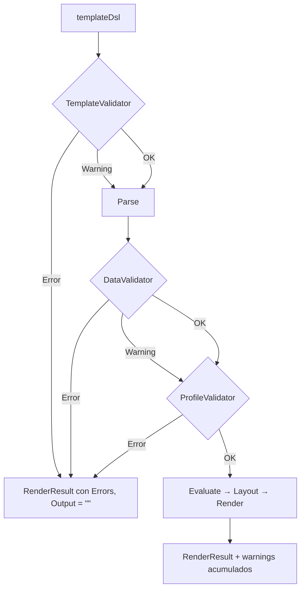

# 01 — Núcleo y pipeline

> **Propósito**: cómo el motor transforma una plantilla DSL en salida: las 4 etapas, los
> contratos que las definen, el orden de las validaciones y cómo se propagan errores y warnings.
> **Fuentes primarias**: `src/MotorDsl.Core/` (`Contracts/`, `Engine/`, `Evaluators/`, `Layout/`,
> `Validation/`, `Providers/`, `Printing/`), `src/MotorDsl.Parser/DslParser.cs`,
> `src/MotorDsl.Extensions/`.
> Los modelos del AST se documentan en [02_dsl-y-modelos](02_dsl-y-modelos.md); los renderers en
> [03_renderizado-base](03_renderizado-base.md).

---

## 1. Las 4 etapas

| # | Etapa | Contrato | Implementación | Entrada → Salida |
|---|---|---|---|---|
| 1 | Parse | `IDslParser` | `DslParser` (`MotorDsl.Parser`) | `string` JSON → `DocumentTemplate` (AST) |
| 2 | Evaluate | `IEvaluator` | `Evaluator` (`Core/Evaluators/`) | `DocumentNode` + datos → `EvaluatedDocument` |
| 3 | Layout | `ILayoutEngine` | `LayoutEngine` (`Core/Layout/`) | `EvaluatedDocument` + `DeviceProfile` → `LayoutedDocument` |
| 4 | Render | `IRenderer` | según `DeviceProfile.RenderTarget` | `LayoutedDocument` → `RenderResult` |

El orquestador es `DocumentEngine` (`src/MotorDsl.Core/Engine/DocumentEngine.cs`), que recibe por
constructor las cuatro piezas más tres validadores **opcionales** (`IDataValidator`,
`ITemplateValidator`, `IProfileValidator`; si son `null`, esa validación se omite).

---

## 2. Las 4 sobrecargas de `IDocumentEngine`

| Firma | Cuándo se usa | Etapas ejecutadas |
|---|---|---|
| `Render(string templateDsl, object data, DeviceProfile profile)` | Formato clásico desde JSON crudo | Validate → Parse → Validate → Evaluate → Layout → Render |
| `Render(DocumentTemplate template, object data, DeviceProfile profile)` | Plantilla ya parseada (reuso) | Validate → Evaluate → Layout → Render |
| `Render(string integratedJson, DeviceProfile profile)` | Formato `integrated` (datos pre-resueltos) | Validate → Parse → **Evaluate omitido** → Layout → Render |
| `RenderLayout(string templateDsl, object data, DeviceProfile profile)` | Vista previa en UI: devuelve el `LayoutedDocument` sin renderizar | Validate → Parse → Validate → Evaluate → Layout |

> **Trampa de resolución de sobrecarga**: `Render(json, profile)` y `Render(template, data, profile)`
> se distinguen por aridad. La sobrecarga de 2 argumentos **solo** acepta documentos con
> `"format": "integrated"`; si recibe otro formato devuelve un `RenderResult` con error explícito
> en lugar de renderizar (`DocumentEngine.cs`, guarda defensiva del paso 3).

---

## 3. Orden de validaciones y política de fallo



Reglas observadas en `DocumentEngine`:

- Un **Error** de cualquier validador **corta el pipeline**: devuelve `RenderResult` con
  `Output = ""` y los mensajes en `Errors`. Nunca lanza excepción en las sobrecargas `Render`.
- Un **Warning** no corta: se acumula y se agrega al `RenderResult` final, prefijado por el origen
  (`TemplateValidation:`, `DataValidation:`).
- Los warnings de la etapa de layout (`LayoutedDocument.Warnings`, p. ej. degradación de QR) se
  vuelcan también al `RenderResult`.
- Toda excepción no controlada se captura y se convierte en `Errors` (`"Parse failed: …"` /
  `"Render failed: …"`).
- **Excepción a la regla**: `RenderLayout` sí **lanza** `InvalidOperationException` cuando una
  validación falla, en lugar de devolver un resultado con errores.

### Los tres validadores

| Validador | Qué revisa | Fuente |
|---|---|---|
| `TemplateValidator` | Sintaxis JSON; campos raíz `id`, `version`, `root`; valor de `format`; `type` presente y conocido en cada nodo; propiedades obligatorias por tipo; en modo `integrated`, ausencia de `loop`/`conditional` y de `{{placeholders}}` sin resolver | `Core/Validation/TemplateValidator.cs` |
| `DataValidator` | Que cada binding `{{campo}}` de un `text` exista en los datos; que el `source` de un `loop` sea una colección; estructura de condicionales. Los alias de loop se excluyen (se validan a nivel del loop) | `Core/Validation/DataValidator.cs` |
| `ProfileValidator` | `Name` no vacío, `Width > 0`, `RenderTarget` no vacío | `Core/Validation/ProfileValidator.cs` |

Matiz de severidad en `DataValidator`: un campo **inexistente** es `Error`; un campo que **existe
pero vale null** es `Warning` (`FieldExistsButNull`). Esa distinción es la que permite imprimir
documentos con campos opcionales vacíos.

`ValidationResult.IsValid` es `true` mientras no haya ningún error de severidad `Error`
(los `Warning` no invalidan). Tipos de error en el enum `ValidationErrorType`: `MissingField`,
`TypeMismatch`, `InvalidStructure`, `InvalidSyntax`, `MissingRequiredField`, `UnknownNodeType`,
`UnsupportedInIntegratedFormat`, `UnresolvedPlaceholder`.

---

## 4. Etapa Parse — `DslParser`

Implementado sobre `System.Text.Json`. Requiere `id`, `version` y `root`; acepta `format`
(`template` | `integrated`, default `template`) y `metadata` opcional. Cada nodo se despacha por
su `type` a un parser específico (`ParseTextNode`, `ParseContainerNode`, `ParseConditionalNode`,
`ParseLoopNode`, `ParseTableNode`, `ParseImageNode`). Ante DSL inválido lanza `ArgumentException`
(que `DocumentEngine` captura y convierte en error del `RenderResult`).

Detalle de la gramática y de cada tipo de nodo: [02_dsl-y-modelos](02_dsl-y-modelos.md).

---

## 5. Etapa Evaluate — `Evaluator`

Resuelve el AST contra el contexto de datos. Responsabilidades:

| Operación | Método | Notas |
|---|---|---|
| Resolver variable por path | `ResolveVariable(data, path)` | Delega en `IDataResolver` |
| Evaluar condición | `EvaluateCondition(expression, data)` | Operadores `==`, `!=`, `>`, `<`, `>=`, `<=`, `&&`, `\|\|`. Parseo propio, respetando literales entre comillas |
| Expandir colección | `ResolveCollection(data, path)` | Devuelve enumerable vacío si el path no existe |
| Evaluar el árbol | `Evaluate(ast, data)` | Devuelve `EvaluatedDocument` con `Warnings` y `Errors` |

`DataResolver` (`Core/Models/DataResolver.cs`) es el resolvedor de paths: soporta campos simples,
paths anidados (`cliente.nombre`) e indexación de arrays (`items[0]`). Acepta como origen
`IDictionary<string,object>`, `IDictionary<string,object?>` y objetos POCO por reflexión. Está
escrito de forma **AOT-safe**: convierte enumerables no genéricos con un bucle en vez de `.Cast<>()`.

Un binding que no resuelve genera un **warning** de evaluación, no un fallo: la validación previa
ya decidió si era error.

---

## 6. Etapa Layout — `LayoutEngine`

Calcula, por nodo, un `LayoutInfo` (línea, columna, ancho, alto, alineación, texto con wrap,
truncado, `DeviceMetadata`) y lo indexa en `LayoutedDocument.NodeLayoutInfo`. Todo se dimensiona
en **caracteres**, contra `DeviceProfile.Width`.

Comportamientos relevantes:

- **Texto**: word-wrap a `Width`; alineación desde `style.align`; propaga `style.bold` al
  `DeviceMetadata` para que los renderers lo apliquen (corregido en v1.0.13 — antes solo se
  propagaba `align`, y los textos con `"bold": true` salían sin negrita).
- **Tablas**: calcula anchos de columna repartiendo `Width`, arma línea de encabezado, separador y
  filas ya formateadas.
- **Imágenes**: clasifica el nodo y deja instrucciones en `DeviceMetadata` para el renderer:

  | Caso | `DeviceMetadata` | `WrappedText` |
  |---|---|---|
  | `imageType: "qrcode"` | `is_qr`, `qr_data` | `[QR: …]` |
  | `imageType: "barcode"` | `is_barcode`, `barcode_data` | `[BARCODE: …]` |
  | `source` que empieza con `data:image/` | `is_bitmap`, `bitmap_source`, `bitmap_width`, y `image_role` si el nodo declara `role` | `[BITMAP: …]` (source truncado a 20 chars) |
  | Otro | — | `[IMG: …]` |

- **Degradación por capacidad (CU-23)**: si el `DeviceProfile` declara explícitamente
  `supports_qrcode`, `supports_barcode` o `supports_images` **en `false`**, el nodo se degrada a
  texto y se agrega un warning a `LayoutedDocument.Warnings`. La comprobación es
  `IsCapabilityExplicitlyFalse`: una capacidad **ausente** no degrada; solo el `false` explícito
  lo hace.

---

## 7. Etapa Render — selección del renderer

`DocumentEngine.GetRenderer(target)` consulta `IRendererRegistry` por
`DeviceProfile.RenderTarget`. Si no hay renderer para ese target, lanza
`InvalidOperationException` (capturada y devuelta como error del `RenderResult`).

`RendererRegistry` (`Core/Engine/RendererRegistry.cs`) es un diccionario `Target → IRenderer` con
`Register`, `GetRenderer` y `GetAvailableTargets`. Catálogo de targets y detalle de cada renderer:
[03_renderizado-base](03_renderizado-base.md) y [05_maui-ui-renderers](05_maui-ui-renderers.md).

---

## 8. Contratos del núcleo

Los 15 contratos de `src/MotorDsl.Core/Contracts/`:

| Contrato | Responsabilidad |
|---|---|
| `IDocumentEngine` | Orquestador del pipeline (4 sobrecargas, §2) |
| `IDslParser` | JSON → `DocumentTemplate` |
| `IEvaluator` | Resolución de variables, condiciones y loops |
| `IDataResolver` | Resolución de paths y colecciones sobre el contexto de datos |
| `ILayoutEngine` | Cálculo de layout según `DeviceProfile` |
| `IRenderer` | Render a un `Target` concreto |
| `IRendererRegistry` | Registro y búsqueda de renderers por target |
| `ITemplateValidator` | Validación de la plantilla DSL |
| `IDataValidator` | Validación de los datos contra el AST |
| `IProfileValidator` | Validación del `DeviceProfile` |
| `ITemplateProvider` | Origen de plantillas (solo lectura) |
| `IDataProvider` | Origen de datos (solo lectura) |
| `IDeviceProfileProvider` | Origen de perfiles de dispositivo (solo lectura) |
| `IPrintErrorHandler` | Decisión de reintentar/abortar ante error de impresión |
| `IBitmapRasterizer` | Rasterizado de imagen a bits imprimibles |

Los tres *providers* son **solo lectura por diseño**: el origen del dato (API, archivo, base) es
responsabilidad del consumidor. Las implementaciones incluidas
(`InMemoryTemplateProvider`, `InMemoryDataProvider`, `InMemoryDeviceProfileProvider`) son
diccionarios en memoria con un `Add()` de registro.

`DefaultPrintErrorHandler` reintenta ante `Connection`, `Timeout` y `Unknown`; **no** reintenta
ante `Hardware` ni `Protocol`. Todos sus métodos son `virtual`. Ver
[04_impresion-transports](04_impresion-transports.md).

---

## 9. Cableado por DI

```csharp
builder.Services.AddMotorDslEngine()      // parser, evaluator, layout, registry, 3 validadores, engine
    .AddTemplates(t => t.Add("id", jsonDsl))
    .AddProfiles(p => p.Add(new DeviceProfile("thermal_58mm", 32, "escpos-bitmap")))
    .AddMotorDslMaui();                   // renderers y servicios MAUI
builder.Services.AddBluetoothPrinterTransport();
```

`AddMotorDslEngine()` (`src/MotorDsl.Extensions/MotorDslServiceCollectionExtensions.cs`) registra
todo como **singleton** y devuelve un `MotorDslBuilder` para encadenar. El `IRendererRegistry` se
construye con una factory que registra primero `TextRenderer` y `EscPosRenderer` y después
**todos** los `IRenderer` resueltos del contenedor — por eso `AddRenderer<T>()` basta para sumar
un renderer propio.

Métodos del `MotorDslBuilder`: `AddTemplates`, `AddProfiles`, `AddRenderer<T>`.

---

## 10. Fuentes

| Tema | Archivo |
|---|---|
| Orquestación y validaciones | `src/MotorDsl.Core/Engine/DocumentEngine.cs` |
| Registro de renderers | `src/MotorDsl.Core/Engine/RendererRegistry.cs` |
| Evaluación | `src/MotorDsl.Core/Evaluators/Evaluator.cs`, `src/MotorDsl.Core/Models/DataResolver.cs` |
| Layout | `src/MotorDsl.Core/Layout/LayoutEngine.cs` |
| Validadores | `src/MotorDsl.Core/Validation/{TemplateValidator,DataValidator,ProfileValidator}.cs` |
| Providers | `src/MotorDsl.Core/Providers/InMemory*.cs` |
| Parser | `src/MotorDsl.Parser/DslParser.cs` |
| DI | `src/MotorDsl.Extensions/{MotorDslBuilder,MotorDslServiceCollectionExtensions}.cs` |
| Doc previa | `docs/05_arquitectura_tecnica/{contratos-del-motor_v1.0,flujo-ejecucion-motor_v1.0,modelo-logico-de-ejecucion_v1.0}.md` |
