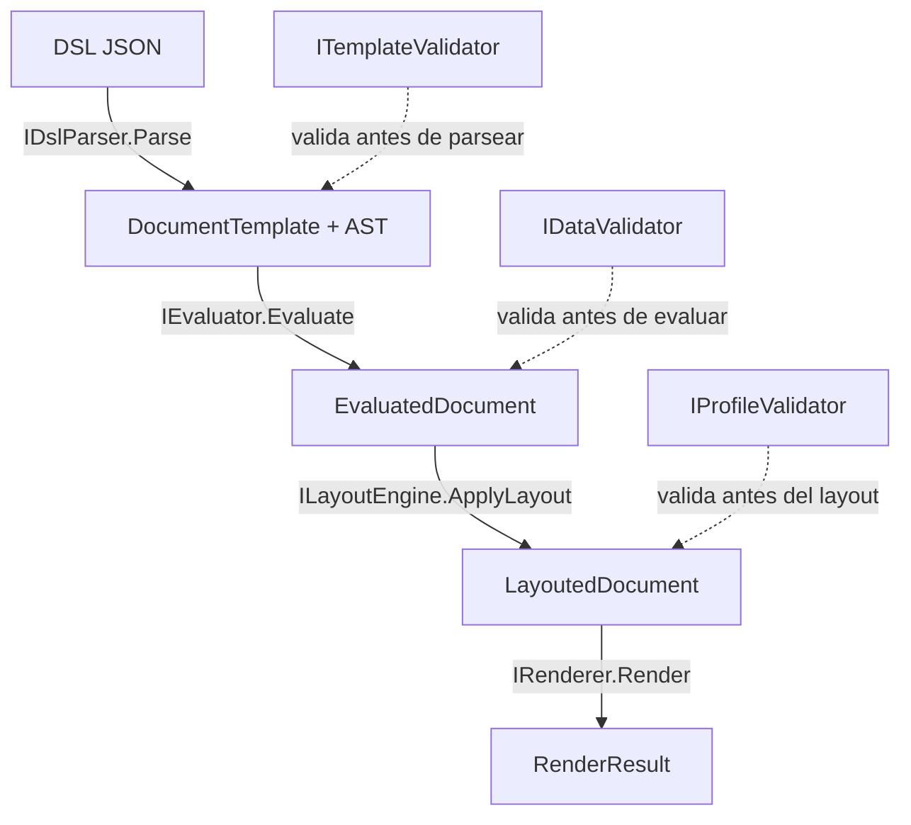

# 01 — Núcleo y pipeline de ejecución

> **Propósito**: explicar cómo el motor convierte una plantilla en una salida — las cuatro
> etapas del pipeline, los contratos que las sostienen, dónde se valida y cómo se arma todo
> por inyección de dependencias.
> **Fuentes primarias**: `src/MotorDsl.Core/` (`Contracts/`, `Engine/`, `Layout/`,
> `Validation/`, `Providers/`, `Printing/`) y `src/MotorDsl.Extensions/`.
>
> Los **modelos del AST y el evaluador** se documentan en [02](02_dsl-y-modelos.md); los
> **renderers concretos**, en [03](03_renderizado-base.md).

---

## 1. El pipeline



| Etapa | Contrato | Entrada → salida | Responsabilidad |
|---|---|---|---|
| 1. Parseo | `IDslParser` | `string` → `DocumentTemplate` | Convertir el JSON en AST tipado y rechazar lo malformado |
| 2. Evaluación | `IEvaluator` | `DocumentNode` + datos → `EvaluatedDocument` | Resolver `{{bindings}}`, expandir `loop`, decidir `conditional` |
| 3. Layout | `ILayoutEngine` | `EvaluatedDocument` + `DeviceProfile` → `LayoutedDocument` | Ajustar al ancho del papel: *wrap*, alineación, columnas de tabla, degradación por capacidad |
| 4. Renderizado | `IRenderer` | `LayoutedDocument` + `DeviceProfile` → `RenderResult` | Emitir la salida concreta del target |

---

## 2. `DocumentEngine` — el orquestador

`src/MotorDsl.Core/Engine/DocumentEngine.cs` implementa `IDocumentEngine` y expone cuatro
puntos de entrada:

| Sobrecarga | Cuándo se usa |
|---|---|
| `Render(string templateDsl, object data, DeviceProfile)` | Plantilla clásica: parsea, valida, evalúa contra `data`, maqueta y renderiza |
| `Render(DocumentTemplate template, object data, DeviceProfile)` | Igual, pero con la plantilla ya parseada |
| `Render(string integratedJson, DeviceProfile)` | Documento en formato `integrated`: **saltea la etapa de evaluación** porque el AST ya viene resuelto |
| `RenderLayout(string templateDsl, object data, DeviceProfile)` | Devuelve el `LayoutedDocument` sin renderizar; lo usan las vistas previas |

**Dos regímenes de error, deliberadamente distintos.** Las sobrecargas `Render` nunca lanzan:
capturan la excepción y devuelven un `RenderResult` con `Output = ""` y el mensaje en
`Errors`, para que la app pueda mostrar el problema en pantalla. `RenderLayout`, en cambio,
lanza `InvalidOperationException` cuando una validación falla.

**Guarda defensiva del formato integrado.** `Render(json, profile)` verifica que el
`Format` parseado sea `integrated` y, si no lo es, devuelve un error explícito que indica usar
la sobrecarga de tres argumentos. Evita que un `template` con `{{}}` sin resolver llegue a la
impresora con los placeholders impresos.

**Propagación de advertencias.** Los `Warnings` acumulados en las tres validaciones y en el
layout se copian al `RenderResult` final. Una advertencia no aborta el documento; un error sí.

---

## 3. Los quince contratos de `MotorDsl.Core/Contracts`

| Contrato | Miembros clave | Implementación por defecto |
|---|---|---|
| `IDocumentEngine` | las 4 sobrecargas de la §2 | `Engine/DocumentEngine.cs` |
| `IDslParser` | `Parse(string) → DocumentTemplate` | `MotorDsl.Parser/DslParser.cs` |
| `IEvaluator` | `Evaluate`, `ResolveVariable`, `EvaluateCondition`, `ResolveCollection` | `Evaluators/Evaluator.cs` |
| `IDataResolver` | `Resolve(data, path)`, `ResolveCollection` | `Models/DataResolver.cs` |
| `ILayoutEngine` | `ApplyLayout(EvaluatedDocument, DeviceProfile)` | `Layout/LayoutEngine.cs` |
| `IRenderer` | `Target { get; }`, `Render(...)` | `TextRenderer`, `EscPosRenderer`, y los tres de MAUI |
| `IRendererRegistry` | `Register`, `GetRenderer`, `GetAvailableTargets` | `Engine/RendererRegistry.cs` |
| `IBitmapRasterizer` | `Rasterize(source, widthPixels) → RasterizedImage` | `SkiaSharpRasterizer` (en `MotorDsl.Maui`) |
| `ITemplateValidator` | `ValidateTemplate(dslJson)` | `Validation/TemplateValidator.cs` |
| `IDataValidator` | `Validate(ast, data)` | `Validation/DataValidator.cs` |
| `IProfileValidator` | `ValidateProfile(profile)` | `Validation/ProfileValidator.cs` |
| `ITemplateProvider` | `GetTemplate(id)`, `GetAvailableTemplateIds()` | `Providers/InMemoryTemplateProvider.cs` |
| `IDataProvider` | `GetData(dataKey)` | `Providers/InMemoryDataProvider.cs` |
| `IDeviceProfileProvider` | `GetProfile(name)`, `GetAll()` | `Providers/InMemoryDeviceProfileProvider.cs` |
| `IPrintErrorHandler` | `HandleErrorAsync`, `OnRetryAttempt`, `OnPrintSuccess` | `Printing/DefaultPrintErrorHandler.cs` |

Los tres providers `InMemory*` son diccionarios: sirven para registrar plantillas, datos y
perfiles al arrancar la app. Un consumidor que necesite traerlos de una API implementa el
contrato y lo registra en su lugar.

---

## 4. `DeviceProfile` — el perfil del dispositivo de salida

`src/MotorDsl.Core/Models/DeviceProfile.cs` es el parámetro que atraviesa las etapas 3 y 4.

| Miembro | Tipo | Rol |
|---|---|---|
| `Name` | `string` (solo lectura) | Identificador del perfil |
| `Width` | `int` (solo lectura) | Ancho útil **en caracteres** — de esto depende el *wrap* y el ancho de columnas |
| `RenderTarget` | `string` (solo lectura) | **Elige el renderer**: `escpos`, `escpos-bitmap`, `pdf`, `raster-preview`, `text` |
| `CodePage` / `CodePageCommand` | `int?` / `byte[]?` | Página de códigos y el comando que la selecciona |
| `BaudRate` | `int?` | Informativo para el transport |
| `SupportedBarcodes` | `List<string>?` | Simbologías que el hardware acepta |
| `SetCapability` / `GetCapability` / `HasCapability` | diccionario interno | Capacidades arbitrarias por string |

Las capacidades son el mecanismo de **degradación** del layout: si el perfil declara
explícitamente `supports_qr = false`, `supports_barcode = false` o `supports_bitmap = false`,
el `LayoutEngine` degrada ese nodo a texto y deja una advertencia. Una capacidad **ausente** no
se interpreta como falsa: solo degrada lo declarado explícitamente en falso
(`IsCapabilityExplicitlyFalse`, `LayoutEngine.cs:178`).

> No confundir con `PrinterProfile` (`MotorDsl.Printing.Abstractions`), que gobierna las
> demoras del envío físico. Ver [04](04_impresion-transports.md).

---

## 5. `LayoutEngine`

`src/MotorDsl.Core/Layout/LayoutEngine.cs` (337 líneas) recorre el AST evaluado y produce un
`LayoutedDocument`: el mismo árbol más un diccionario `NodeLayoutInfo` con un `LayoutInfo` por
nodo.

`LayoutInfo` transporta línea y columna, ancho y alto, alineación, el texto ya envuelto
(`WrappedText`, `IsWrapped`), si hubo truncado, y un `DeviceMetadata` libre por el que viajan
al renderer los atributos de estilo — hoy `align` y `bold`.

Trabajo concreto que hace:

- **Texto**: envuelve al ancho del perfil (`WrapText`) y calcula la alineación.
- **Tablas**: reparte el ancho entre columnas (`CalculateColumnWidths`) y formatea cada fila
  (`FormatTableRow`).
- **Imágenes**: según el `Role` del nodo (`qr`, `barcode`, imagen común) consulta la capacidad
  correspondiente y, si está explícitamente negada, degrada y agrega la advertencia
  —`"QR degradado: dispositivo no soporta QR"` y equivalentes.

---

## 6. Las tres validaciones

| Validador | Qué mira | Momento |
|---|---|---|
| `TemplateValidator` | El JSON en crudo: campos raíz obligatorios, tipos de nodo válidos, formato declarado, y en `integrated` que **no** queden placeholders `{{}}` | Antes de parsear |
| `DataValidator` | El AST contra los datos: que cada binding resuelva, distinguiendo los alias introducidos por un `loop` | Antes de evaluar |
| `ProfileValidator` | El `DeviceProfile`: coherencia de nombre, ancho y target | Antes del layout |

Los tres devuelven un `ValidationResult` con una lista de `ValidationError`, cada uno con
`Field`, `Type` (`MissingField`, `TypeMismatch`, `InvalidStructure`, `InvalidSyntax`,
`MissingRequiredField`, `UnknownNodeType`, `UnsupportedInIntegratedFormat`,
`UnresolvedPlaceholder`), `Message`, `NodeType`, una `Severity` (`Error` | `Warning`) y una
`Location` opcional. `IsValid` es verdadero mientras no haya ningún error de severidad `Error`:
las advertencias no invalidan.

Los tres son **opcionales** en el constructor de `DocumentEngine`. Si no se registran, el motor
funciona sin validar. `AddMotorDslEngine()` los registra.

---

## 7. `RendererRegistry` y el fallback a texto

`Engine/RendererRegistry.cs` es un diccionario `Target → IRenderer`. Registrar dos renderers
con el mismo `Target` deja al último.

`GetRenderer(target)` tiene un **fallback silencioso a `"text"`** cuando el target pedido no
existe. Es lo que permite que un perfil apuntando a un target no registrado siga produciendo
algo legible en lugar de fallar; el costo es que un target mal escrito no se nota como error.
Si tampoco hay renderer `text`, devuelve `null` y `DocumentEngine` lanza
`InvalidOperationException("No renderer found for target: …")`.

---

## 8. Armado por inyección de dependencias

`src/MotorDsl.Extensions/` provee el punto de entrada `AddMotorDslEngine()`, que registra como
singletons: `DslParser`, `Evaluator`, `LayoutEngine`, los tres validadores, `DocumentEngine`, y
un `IRendererRegistry` que **prerregistra `TextRenderer` y `EscPosRenderer`** y luego suma
todos los `IRenderer` que haya en el contenedor.

Devuelve un `MotorDslBuilder` encadenable:

| Método | Efecto |
|---|---|
| `AddTemplates(cfg)` | Arma un `InMemoryTemplateProvider` y lo registra como `ITemplateProvider` |
| `AddProfiles(cfg)` | Arma un `InMemoryDeviceProfileProvider` y lo registra como `IDeviceProfileProvider` |
| `AddRenderer<T>()` | Registra `T` como `IRenderer`; el registry lo recoge |

```csharp
builder.Services.AddMotorDslEngine()
    .AddTemplates(t => t.Add("acta-infraccion", MultaDsl.Template))
    .AddProfiles(p =>
    {
        p.Add(new DeviceProfile("thermal_58mm", 32, "escpos-bitmap"));
        p.Add(new DeviceProfile("preview",      32, "raster-preview"));
        p.Add(new DeviceProfile("a4-pdf",       80, "pdf"));
    })
    .AddMotorDslMaui();          // renderers y controles MAUI — ver índice 05
```

**Orden importante**: `AddRenderer<T>()` debe llamarse *antes* de resolver el
`IRendererRegistry`, porque la factory del registry enumera los `IRenderer` una sola vez, al
construirse el singleton.

---

## 9. Manejo de errores de impresión

`Models/PrintError.cs` clasifica la falla en `PrintErrorType`: `Connection`, `Timeout`,
`Hardware`, `Protocol`, `Unknown`. `PrintError.FromException` mapea `PrinterHardwareException`
→ `Hardware`; `IOException` y `SocketException` → `Connection`; `TimeoutException` y
`TaskCanceledException` → `Timeout`; el resto → `Unknown`.

`DefaultPrintErrorHandler` (`Printing/DefaultPrintErrorHandler.cs`) decide reintentar ante
`Connection`, `Timeout` y `Unknown`, y **no** reintentar ante `Hardware` ni `Protocol` —una
tapa abierta o un comando rechazado no mejoran repitiendo. `OnRetryAttempt` y `OnPrintSuccess`
son *no-op* virtuales, pensados para que la capa de UI los sobrescriba: eso hace
`MauiPrintErrorHandler` (ver [05](05_maui-ui-renderers.md)).

`PrintRetryOptions` fija los valores por defecto: `MaxRetries = 3`, `InitialDelayMs = 500`. El
uso de todo esto en el envío real está en [04](04_impresion-transports.md).
