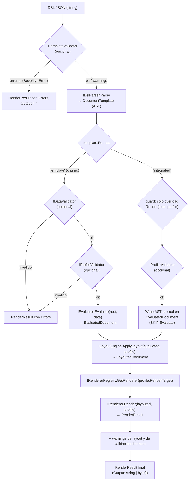

# 01 — Núcleo y pipeline del motor MotorDsl

> **Propósito**: índice destilado de la arquitectura del pipeline del motor (JSON → Parser → Evaluator → LayoutEngine → Renderer → RenderResult), sus contratos, providers y validadores.
> **Fuentes primarias**: `src/MotorDsl.Core/Engine/DocumentEngine.cs`, `src/MotorDsl.Core/Engine/RendererRegistry.cs`, `src/MotorDsl.Core/Contracts/*.cs`, `src/MotorDsl.Core/Providers/*.cs`, `src/MotorDsl.Core/Validation/*.cs`, `src/MotorDsl.Core/Printing/DefaultPrintErrorHandler.cs`.
> **Versión del origen citada**: `v1.0.13 @83677eb`.
> Modelos y DSL: ver [02_dsl-y-modelos.md](./02_dsl-y-modelos.md). Renderers y DI: ver [03_renderizado-base.md](./03_renderizado-base.md).

## 1. Vista general del pipeline

El motor es un pipeline de 4 etapas orquestado por `DocumentEngine` (`src/MotorDsl.Core/Engine/DocumentEngine.cs#L8-L11`): **Parse → Evaluate → Layout → Render**, con validaciones opcionales intercaladas (template, datos, perfil).

Trazabilidad del flujo: etapas y orden en `src/MotorDsl.Core/Engine/DocumentEngine.cs#L32-L137` (classic) y `#L139-L216` (integrated). El modo integrated salta Evaluate porque el AST llega pre-resuelto (`src/MotorDsl.Core/Engine/DocumentEngine.cs#L189-L195`).

## 2. `DocumentEngine` — orquestador

Clase: `src/MotorDsl.Core/Engine/DocumentEngine.cs`. Implementa `IDocumentEngine`. Dependencias por constructor (`#L21-L30`): `IDslParser`, `IEvaluator`, `ILayoutEngine`, `IRendererRegistry` (obligatorias) + `IDataValidator?`, `ITemplateValidator?`, `IProfileValidator?` (opcionales, default `null` = etapa de validación omitida).

### 2.1 Sobrecargas públicas

| Método | Entrada | Etapas ejecutadas | Fuente |
|---|---|---|---|
| `Render(string templateDsl, object data, DeviceProfile profile)` | DSL crudo (classic) | ValidateTemplate → Parse → delega en la sobrecarga de template | `DocumentEngine.cs#L32-L72` |
| `Render(DocumentTemplate template, object data, DeviceProfile profile)` | AST ya parseado | ValidateData → ValidateProfile → Evaluate → Layout → Render | `DocumentEngine.cs#L74-L137` |
| `Render(string integratedJson, DeviceProfile profile)` | JSON `"format":"integrated"` | ValidateTemplate → Parse → guard de formato → ValidateProfile → (skip Evaluate) → Layout → Render | `DocumentEngine.cs#L139-L216` |
| `RenderLayout(string templateDsl, object data, DeviceProfile profile)` | DSL crudo | Parse → Evaluate → Layout, **sin** Render; devuelve `LayoutedDocument` para preview de UI. Lanza `InvalidOperationException` si alguna validación falla (a diferencia de `Render`, que devuelve errores en el resultado) | `DocumentEngine.cs#L218-L250` |

Contrato: `src/MotorDsl.Core/Contracts/IDocumentEngine.cs#L11-L48`.

### 2.2 Política de errores y warnings

| Regla | Comportamiento | Fuente |
|---|---|---|
| Excepción en cualquier etapa de `Render(...)` | Capturada; devuelve `RenderResult` con `AddError("Parse failed: ..."` o `"Render failed: ...")` y `Output = ""` — nunca propaga la excepción | `DocumentEngine.cs#L65-L71`, `#L130-L136`, `#L209-L215` |
| Errores de validación (`Severity == Error`) | Cortan el pipeline; se vuelcan a `RenderResult.Errors` con prefijo `TemplateValidation:` / `Validation:` / `ProfileValidation:` | `DocumentEngine.cs#L38-L54`, `#L80-L94`, `#L96-L108` |
| Warnings de validación (`Severity == Warning`) | Se acumulan y se agregan al `RenderResult` final (`AddWarning`) | `DocumentEngine.cs#L59-L61`, `#L124-L126` |
| Warnings de layout (`LayoutedDocument.Warnings`, ej. degradación por capabilities) | Propagados al `RenderResult` (CU-23) | `DocumentEngine.cs#L120-L122` |
| Warnings del Evaluator (`EvaluatedDocument.Warnings`, ej. variables no resueltas) | **NO se propagan** al `RenderResult` (solo queda el marcador `{{UNRESOLVED:...}}` en el texto) | `DocumentEngine.cs#L110-L128` (ausencia de propagación) |
| Overload integrated con `Format != "integrated"` | Error explícito indicando usar `Render(json, data, profile)` | `DocumentEngine.cs#L164-L173` |
| Target sin renderer registrado ni fallback | `InvalidOperationException` "No renderer found for target" (capturada por el catch → error en resultado) | `DocumentEngine.cs#L252-L256` |

## 3. `RendererRegistry`

Archivo: `src/MotorDsl.Core/Engine/RendererRegistry.cs` (Sprint 04, TK-22).

- Diccionario `target → IRenderer`; `Register` sobrescribe si el target ya existe (`#L14-L17`).
- `GetRenderer(target)`: si no encuentra el target, hace **fallback silencioso al renderer `"text"`**; devuelve `null` solo si tampoco hay `"text"` (`#L19-L29`).
- `GetAvailableTargets()` devuelve las claves registradas (`#L31-L34`).
- Consecuencia: un `DeviceProfile.RenderTarget` mal escrito degrada a texto plano sin warning (observación, ver §7).

## 4. Contratos de `src/MotorDsl.Core/Contracts/`

Los 15 contratos del núcleo. "Implementaciones conocidas" = dentro de los 4 proyectos indexados, salvo indicación.

| Interfaz | Responsabilidad | Implementaciones conocidas | Archivo |
|---|---|---|---|
| `IDocumentEngine` | Orquestar el pipeline completo; 3 sobrecargas `Render` + `RenderLayout` | `DocumentEngine` | `src/MotorDsl.Core/Contracts/IDocumentEngine.cs` |
| `IDslParser` | Parsear DSL JSON → `DocumentTemplate` (AST); lanza `ArgumentException` si es inválido | `DslParser` (`src/MotorDsl.Parser/DslParser.cs`) | `src/MotorDsl.Core/Contracts/IDslParser.cs` |
| `IEvaluator` | Resolver AST contra datos: variables `{{...}}`, condiciones, loops; expone `ResolveVariable`, `EvaluateCondition`, `ResolveCollection` | `Evaluator` (`src/MotorDsl.Core/Evaluators/Evaluator.cs`) | `src/MotorDsl.Core/Contracts/IEvaluator.cs` |
| `ILayoutEngine` | Aplicar restricciones del `DeviceProfile` (ancho, wrap, align) → `LayoutedDocument` | `LayoutEngine` (`src/MotorDsl.Core/Layout/LayoutEngine.cs`) | `src/MotorDsl.Core/Contracts/ILayoutEngine.cs` |
| `IRenderer` | Renderizar `LayoutedDocument` a un formato target (`Target` string + `Render`) | `TextRenderer`, `EscPosRenderer` (ver [03](./03_renderizado-base.md)) | `src/MotorDsl.Core/Contracts/IRenderer.cs` |
| `IRendererRegistry` | Registro/lookup de renderers por target | `RendererRegistry` | `src/MotorDsl.Core/Contracts/IRendererRegistry.cs` |
| `IDataResolver` | Resolver paths de datos (`"cliente.nombre"`, `"items[0]"`) y colecciones | `DataResolver` (`src/MotorDsl.Core/Models/DataResolver.cs`) | `src/MotorDsl.Core/Contracts/IDataResolver.cs` |
| `IDataProvider` | Proveer diccionarios de datos por clave (solo lectura, CU-25 v2.0) | `InMemoryDataProvider` | `src/MotorDsl.Core/Contracts/IDataProvider.cs` |
| `ITemplateProvider` | Proveer DSL (string) por id de template (solo lectura, CU-24 v2.0) | `InMemoryTemplateProvider` | `src/MotorDsl.Core/Contracts/ITemplateProvider.cs` |
| `IDeviceProfileProvider` | Proveer `DeviceProfile` por nombre + listado (solo lectura, CU-21 v2.0) | `InMemoryDeviceProfileProvider` | `src/MotorDsl.Core/Contracts/IDeviceProfileProvider.cs` |
| `IDataValidator` | Validar datos contra el AST antes de evaluar (campos faltantes, tipos) — CU-19 | `DataValidator` (`src/MotorDsl.Core/Validation/DataValidator.cs`) | `src/MotorDsl.Core/Contracts/IDataValidator.cs` |
| `ITemplateValidator` | Validar el JSON del DSL (sintaxis, schema, tipos de nodo, props obligatorias) — CU-14 | `TemplateValidator` (`src/MotorDsl.Core/Validation/TemplateValidator.cs`) | `src/MotorDsl.Core/Contracts/ITemplateValidator.cs` |
| `IProfileValidator` | Validar `DeviceProfile` (Name, Width > 0, RenderTarget) — CU-22 | `ProfileValidator` (`src/MotorDsl.Core/Validation/ProfileValidator.cs`) | `src/MotorDsl.Core/Contracts/IProfileValidator.cs` |
| `IPrintErrorHandler` | Decidir retry/abort ante `PrintError`; hooks `OnRetryAttempt`, `OnPrintSuccess` — CU-32 | `DefaultPrintErrorHandler` (`src/MotorDsl.Core/Printing/DefaultPrintErrorHandler.cs`) | `src/MotorDsl.Core/Contracts/IPrintErrorHandler.cs` |
| `IBitmapRasterizer` | Rasterizar imagen (base64/path) → `RasterizedImage` para ESC/POS `GS v 0` (TK-61) | Ninguna en los 4 proyectos indexados; fuera de alcance existe `SkiaSharpRasterizer` (`src/MotorDsl.Maui/Renderers/SkiaSharpRasterizer.cs`) | `src/MotorDsl.Core/Contracts/IBitmapRasterizer.cs` |

## 5. Providers in-memory (`src/MotorDsl.Core/Providers/`)

Implementaciones triviales de los contratos de provisión, pensadas para registro vía el builder de DI (ver [03 §3](./03_renderizado-base.md)). Todas exponen `Add(...)` (no está en el contrato) para poblarlas.

| Clase | Almacena | API extra | Fuente |
|---|---|---|---|
| `InMemoryTemplateProvider` | `Dictionary<string, string>` (id → DSL JSON) | `Add(string templateId, string dslContent)` | `src/MotorDsl.Core/Providers/InMemoryTemplateProvider.cs#L10-L22` |
| `InMemoryDeviceProfileProvider` | `Dictionary<string, DeviceProfile>` (por `profile.Name`) | `Add(DeviceProfile profile)` | `src/MotorDsl.Core/Providers/InMemoryDeviceProfileProvider.cs#L11-L23` |
| `InMemoryDataProvider` | `Dictionary<string, IDictionary<string, object>>` | `Add(string dataKey, IDictionary<string, object> data)` | `src/MotorDsl.Core/Providers/InMemoryDataProvider.cs#L10-L19` |

Nota: `InMemoryDataProvider` no se registra en `AddMotorDslEngine` ni tiene método fluent en `MotorDslBuilder` (solo templates y profiles lo tienen) — ver [03 §3](./03_renderizado-base.md).

## 6. Validadores (`src/MotorDsl.Core/Validation/`)

Los tres son opcionales para `DocumentEngine` pero se registran siempre en DI (ver [03 §3.1](./03_renderizado-base.md)). Devuelven `ValidationResult` (modelo en [02 §5](./02_dsl-y-modelos.md)).

### 6.1 `TemplateValidator` (TK-50, CU-14)

`src/MotorDsl.Core/Validation/TemplateValidator.cs`. Valida el JSON crudo **antes** de parsear:

| Regla | ErrorType | Fuente |
|---|---|---|
| JSON sintácticamente inválido | `InvalidSyntax` | `#L33-L47` |
| Falta `id` / `version` / `root` | `MissingRequiredField` | `#L51-L86` |
| `format` distinto de `template`/`integrated` | `InvalidSyntax` | `#L55-L76` |
| Nodo sin `type` / tipo desconocido | `MissingRequiredField` / `UnknownNodeType` | `#L113-L137` |
| `loop` sin `source`/`itemAlias`/`body`; `conditional` sin `expression`; `image` sin `source` | `MissingRequiredField` | `#L154-L201` |
| En integrated: nodos `loop`/`conditional` | `UnsupportedInIntegratedFormat` | `#L139-L151` |
| En integrated: `{{placeholder}}` en `text.value` o `image.source` | `UnresolvedPlaceholder` | `#L184-L223` |

Cada error lleva `Location` con el path del nodo (ej. `root.children[2].body`).

### 6.2 `DataValidator` (TK-36/37, CU-19)

`src/MotorDsl.Core/Validation/DataValidator.cs`. Recorre el AST ya parseado extrayendo bindings `{{...}}` (regex `#L19`) y valida contra los datos usando `IDataResolver`:

- Binding no encontrado en datos → `MissingField` (Error) (`#L96-L98`).
- Campo existe pero es `null` → `MissingField` con `Severity = Warning` (no corta el pipeline) (`#L85-L93`).
- Loop sin body → `InvalidStructure`; source inexistente → `MissingField`; source no-colección (o string) → `TypeMismatch` (`#L129-L159`).
- Conditional sin ninguna rama → `InvalidStructure` (`#L161-L176`).
- Los bindings que referencian el alias de un loop (`item.x`) se excluyen de la validación de campo (`#L61-L80`).

### 6.3 `ProfileValidator` (TK-53, CU-22)

`src/MotorDsl.Core/Validation/ProfileValidator.cs#L13-L48`: `Name` no vacío (`MissingField`), `Width > 0` (`InvalidStructure`), `RenderTarget` no vacío (`MissingField`).

## 7. Manejo de errores de impresión (post-render)

Subsistema separado del pipeline de render (el pipeline nunca lanza; esto aplica al **envío** a impresora):

- `PrintError` clasifica excepciones en `Connection | Timeout | Hardware | Protocol | Unknown` vía `PrintError.FromException` (`src/MotorDsl.Core/Models/PrintError.cs#L40-L53`); `PrinterHardwareException` (fin de papel / tapa abierta) mapea a `Hardware` (`src/MotorDsl.Core/Models/PrinterHardwareException.cs#L3-L12`).
- `DefaultPrintErrorHandler`: reintenta `Connection`, `Timeout` y `Unknown`; aborta `Hardware` y `Protocol`; métodos `virtual` para override (`src/MotorDsl.Core/Printing/DefaultPrintErrorHandler.cs#L16-L38`).
- Política de reintentos configurable: `PrintRetryOptions` (`MaxRetries = 3`, `InitialDelayMs = 500`) (`src/MotorDsl.Core/Models/PrintError.cs#L60-L64`).
- Quién ejecuta el loop de retry no está en los 4 proyectos indexados — «No verificado» (presumiblemente el transporte, ej. MotorDsl.Bluetooth, fuera de alcance).

## 8. Observaciones de diseño (trazables)

| Observación | Fuente |
|---|---|
| `Evaluator.Evaluate` fija `Id = "evaluated-doc"`, `Version = "1.0"`: el Id/Version reales del template se pierden en el camino classic. Existe `EvaluateTemplate(DocumentTemplate, data)` que sí los preserva, pero no está en `IEvaluator` y `DocumentEngine` no lo usa. El camino integrated sí preserva Id/Version | `src/MotorDsl.Core/Evaluators/Evaluator.cs#L30-L53`, `#L58-L81`; `DocumentEngine.cs#L111`, `#L190-L195` |
| Warnings de evaluación (variables no resueltas) no llegan al `RenderResult` | `DocumentEngine.cs#L110-L128` |
| Fallback silencioso a `"text"` en `RendererRegistry` puede enmascarar un `RenderTarget` inválido | `RendererRegistry.cs#L19-L29` |
| El catch del overload classic string etiqueta cualquier excepción como `"Parse failed"`, incluso si viniera del validador | `DocumentEngine.cs#L65-L71` |

Comentarios `TK-nn` / `CU-nn` en el código referencian tickets de sprint y casos de uso de la documentación del proyecto (`contratos-del-motor_v1.0.md`, `arquitectura-solucion_v1.0.md`, citados en los XML-doc de los contratos).
