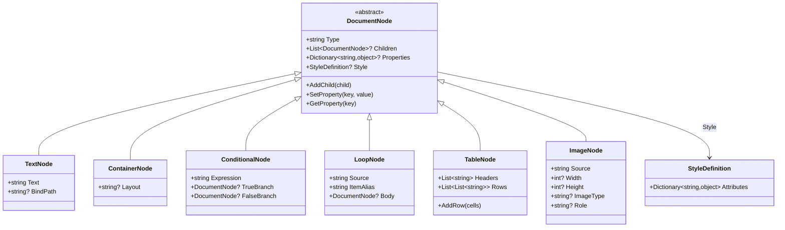

# 02 — El DSL JSON y el modelo de documento

> **Propósito**: índice destilado del lenguaje DSL (JSON) que consume el motor y de todos los modelos de datos que fluyen por el pipeline: nodos del AST, template, documentos intermedios, perfil de dispositivo y resultados.
> **Fuentes primarias**: `src/MotorDsl.Core/Models/*.cs`, `src/MotorDsl.Parser/DslParser.cs`, `src/MotorDsl.Core/Validation/TemplateValidator.cs`.
> **Versión del origen citada**: `v1.0.13 @83677eb`.
> Pipeline y contratos: ver [01_nucleo-pipeline.md](./01_nucleo-pipeline.md). Renderers: ver [03_renderizado-base.md](./03_renderizado-base.md).

## 1. Jerarquía de nodos del AST



| Clase | `type` JSON | Propiedades JSON que lee el parser | Semántica | Fuente modelo / parser |
|---|---|---|---|---|
| `DocumentNode` (abstracta) | — | `type` (obligatorio), `style` (objeto k/v, solo se parsea en `text`) | Base del AST: `Children`, `Properties` dinámicas, `Style` | `src/MotorDsl.Core/Models/DocumentNode.cs#L11-L85` / `src/MotorDsl.Parser/DslParser.cs#L113-L142` |
| `TextNode` | `text` | classic: `text`; integrated: `value`; opcional `bindPath`, `style` | Texto plano o con placeholders `{{path}}` | `src/MotorDsl.Core/Models/TextNode.cs#L9-L34` / `DslParser.cs#L144-L186` |
| `ContainerNode` | `container` | `layout` (`"vertical"`\|`"horizontal"`, default `"vertical"`), `children[]` | Agrupador estructural; el layout actual solo apila líneas | `src/MotorDsl.Core/Models/ContainerNode.cs#L9-L36` / `DslParser.cs#L188-L206` |
| `ConditionalNode` | `conditional` | `expression`, `trueBranch`, `falseBranch` (nodos) | Inclusión condicional en runtime; sin `falseBranch` y condición falsa → el nodo se excluye | `src/MotorDsl.Core/Models/ConditionalNode.cs#L9-L40` / `DslParser.cs#L208-L223` |
| `LoopNode` | `loop` | `source` (path a colección), `itemAlias`, `body` (nodo) | Repite `body` por cada ítem; el Evaluator lo expande a un `ContainerNode` vertical | `src/MotorDsl.Core/Models/LoopNode.cs#L9-L43` / `DslParser.cs#L225-L240` |
| `TableNode` | `table` | `headers[]` (strings), `rows[][]` (strings) | Tabla; el LayoutEngine genera header + separador `---` + filas con anchos calculados | `src/MotorDsl.Core/Models/TableNode.cs#L10-L41` / `DslParser.cs#L242-L271` |
| `ImageNode` | `image` | `source`, `width`, `height`, `imageType` (`"png"`\|`"jpeg"`\|`"qrcode"`\|`"barcode"`), `role` (`"logo"`\|`"signature"`) | Imagen, QR o código de barras; `role` rutea logo a recall NV vs inline (ver [03 §2](./03_renderizado-base.md)) | `src/MotorDsl.Core/Models/ImageNode.cs#L9-L54` / `DslParser.cs#L273-L297` |

Tipos soportados por el parser: exactamente `text, container, conditional, loop, table, image` (`DslParser.cs#L17-L25`); cualquier otro `type` lanza `ArgumentException` (`DslParser.cs#L125-L126`).

**Nota**: el parser solo materializa `style` para nodos `text` (`DslParser.cs#L168-L183`); `bold`/`align` en `table` los lee el LayoutEngine desde `Style` pero el parser no lo llena para tablas — un `style` en un nodo `table` del JSON no se parsea («No verificado» que exista otra vía de asignarlo salvo por código).

## 2. `DocumentTemplate` y los DOS formatos del DSL

`src/MotorDsl.Core/Models/DocumentTemplate.cs#L9-L60`: `Id`, `Version`, `Root` (AST), `Metadata` (dict opcional) y el discriminador `Format` con constantes:

- `FormatTemplate = "template"` (`#L12`) — **classic**, valor por defecto (backward compatible, `#L45`).
- `FormatIntegrated = "integrated"` (`#L15`) — AST pre-resuelto; el motor salta la etapa Evaluate.

### 2.1 Esquema raíz del JSON

| Campo raíz | Obligatorio | Notas | Fuente |
|---|---|---|---|
| `id` | sí | string no vacío | `DslParser.cs#L45-L51` |
| `version` | sí | string no vacío | `DslParser.cs#L53-L59` |
| `format` | no | `"template"` (default) o `"integrated"`; otro valor → `ArgumentException` | `DslParser.cs#L61-L74` |
| `root` | sí | nodo raíz del AST | `DslParser.cs#L76-L81` |
| `metadata` | no | objeto k/v (string/number/bool) | `DslParser.cs#L83-L99` |

### 2.2 Comparativa classic vs integrated

| Aspecto | Classic (`"format":"template"`) | Integrated (`"format":"integrated"`) |
|---|---|---|
| Datos | Externos: se pasan como `object data` en `Render(dsl, data, profile)`; pueden venir de un `IDataProvider` | Embebidos: los valores ya están resueltos dentro del JSON; overload `Render(json, profile)` sin datos |
| Texto | `"text"` con placeholders `{{path}}` | `"value"` con string final (el parser lee `value`, no `text`: `DslParser.cs#L146-L160`) |
| `loop` / `conditional` | Permitidos; el Evaluator los expande/resuelve | **Prohibidos**: parser lanza `ArgumentException` (`DslParser.cs#L128-L130`) y `TemplateValidator` emite `UnsupportedInIntegratedFormat` (`TemplateValidator.cs#L139-L151`) |
| Placeholders residuales | Se marcan como `{{UNRESOLVED:path}}` + warning (`Evaluator.cs#L150-L160`) | Prohibidos: `UnresolvedPlaceholder` en `text.value` e `image.source` (`TemplateValidator.cs#L184-L223`) |
| Etapa Evaluate | Se ejecuta | Se salta: el AST se envuelve tal cual en `EvaluatedDocument` (`DocumentEngine.cs#L189-L195`) |
| Id/Version en el resultado intermedio | Se pierden (ver [01 §8](./01_nucleo-pipeline.md)) | Se preservan (`DocumentEngine.cs#L190-L195`) |
| Productor típico | App con template estático + datos dinámicos | Backend que ya resolvió el documento completo |

### 2.3 Ejemplo mínimo REAL — classic

Procedencia: `src/MotorDsl.Tests/DocumentEngineTests.cs#L38-L47` (test BT-066, ejecutado contra el pipeline real):

```json
{
    "id": "test-001",
    "version": "1.0",
    "root": {
        "type": "text",
        "text": "Hola Motor DSL"
    }
}
```

Variante con binding y contenedor (`src/MotorDsl.Tests/DocumentEngineTests.cs#L91-L105`): children `{ "type": "text", "text": "Cliente: {{nombre}}" }` con `data = new { nombre = "María", total = "1500" }`.

### 2.4 Ejemplo mínimo REAL — integrated

Procedencia: `src/MotorDsl.Tests/IntegratedFormatEngineTests.cs#L40-L54`:

```json
{
    "id": "acta-001",
    "version": "1.0",
    "format": "integrated",
    "root": {
        "type": "container",
        "layout": "vertical",
        "children": [
            { "type": "text", "value": "MUNICIPALIDAD DE EJEMPLO" },
            { "type": "text", "value": "ACTA N° 2026-00123" }
        ]
    }
}
```

Se renderiza con `engine.Render(json, profile)` y el test `Render_IntegratedJson_DoesNotCallEvaluator` (`IntegratedFormatEngineTests.cs#L64-L82`) verifica que el Evaluator no se invoca.

## 3. Sintaxis de expresiones y paths (Evaluator/DataResolver)

| Elemento | Sintaxis | Soporte | Fuente |
|---|---|---|---|
| Placeholder | `{{path}}` dentro de `text` (y de `image.source`) | Regex `\{\{([^}]+)\}\}`; no resuelto → `{{UNRESOLVED:path}}` + warning (en imagen se conserva el placeholder) | `src/MotorDsl.Core/Evaluators/Evaluator.cs#L150-L160`, `#L170-L186` |
| Path de datos | `campo`, `a.b.c`, `items[0]`, `a.items[2].x` | Diccionarios (`IDictionary<string,object>`/`object?`) primero, luego reflexión sobre propiedades públicas; índice sobre `IList`/`IEnumerable` | `src/MotorDsl.Core/Models/DataResolver.cs#L19-L150` |
| Condición | `status == 'activo' && cantidad > 50` | Operadores: `==, !=, >=, <=, >, <, &&, \|\|`; literales string (`'x'`/`"x"`), numéricos, `true`/`false`; `===`/`!==` rechazados; sin paréntesis de agrupación (no aparece soporte en `EvaluateExpression`) | `Evaluator.cs#L88-L106`, `#L290-L338`, `#L399-L424` |
| Alias de loop | `itemAlias` inyectado en un `ExpandoObject` que copia las claves del contexto padre | El body ve `{{item.x}}` y también el contexto raíz | `Evaluator.cs#L210-L256` |

## 4. Modelos intermedios del pipeline

| Modelo | Rol en el pipeline | Miembros clave | Fuente |
|---|---|---|---|
| `EvaluatedDocument` | Salida del Evaluator (o wrapper directo en integrated) | `Id`, `Version`, `Root` (AST resuelto, puede ser null), `Warnings`, `Errors`, `EvaluatedAt`, `IsSuccessful` | `src/MotorDsl.Core/Models/EvaluatedDocument.cs#L12-L49` |
| `LayoutedDocument` | Salida del LayoutEngine; entrada de todo `IRenderer` | `Root`, `NodeLayoutInfo` (dict `node_N` → `LayoutInfo`), `TotalWidth`, `TotalHeight`, `DeviceProfile`, `LayoutMetadata`, `Warnings` | `src/MotorDsl.Core/Models/LayoutedDocument.cs#L7-L16` |
| `LayoutInfo` | Layout calculado por nodo | `LineNumber`, `ColumnNumber`, `Width`, `Height`, `Alignment` (default `"left"`), `IsWrapped`, `WrappedText`, `IsTruncated`, `DeviceMetadata` | `src/MotorDsl.Core/Models/LayoutInfo.cs#L7-L18` |
| `RasterizedImage` | Salida de `IBitmapRasterizer`: bits listos para `GS v 0` | `Bits` (byte[]), `WidthBytes`, `HeightDots` | `src/MotorDsl.Core/Models/RasterizedImage.cs#L8-L20` |

Los renderers **no recorren el AST**: iteran `NodeLayoutInfo` ordenado por `LineNumber`/`ColumnNumber` y usan `WrappedText` + `DeviceMetadata` (ver [03](./03_renderizado-base.md)).

### 4.1 Claves de `LayoutInfo.DeviceMetadata` producidas por `LayoutEngine`

| Clave | Cuándo se setea | Consumidor | Fuente |
|---|---|---|---|
| `bold` = true | `style.bold == "true"` en el nodo (texto o header de tabla) | `EscPosRenderer` (ESC ! 8) | `src/MotorDsl.Core/Layout/LayoutEngine.cs#L58-L64`, `#L195-L214` |
| `is_qr`, `qr_data` | `imageType == "qrcode"` y el perfil no niega `supports_qrcode` | `EscPosRenderer` (GS ( k) | `LayoutEngine.cs#L117-L130` |
| `is_barcode`, `barcode_data` | `imageType == "barcode"` y el perfil no niega `supports_barcode` | `EscPosRenderer` (GS k 2) | `LayoutEngine.cs#L131-L144` |
| `is_bitmap`, `bitmap_source`, `bitmap_width`, `image_role` | `source` empieza con `data:image/` y el perfil no niega `supports_images` | `EscPosRenderer` (GS v 0 / recall NV) | `LayoutEngine.cs#L145-L169` |

Degradaciones (capability en `false`): QR → texto plano del source; barcode/bitmap → placeholder `[BARCODE: ...]`/`[IMG-DEGRADED: ...]`, todas con warning en `LayoutedDocument.Warnings` (`LayoutEngine.cs#L119-L153`).

## 5. `DeviceProfile`

`src/MotorDsl.Core/Models/DeviceProfile.cs#L3-L31`. Inmutable en su núcleo (`Name`, `Width` en caracteres, `RenderTarget` — solo getters, vía constructor) + capabilities dinámicas `SetCapability/GetCapability/HasCapability` + propiedades opcionales `CodePage`, `CodePageCommand`, `BaudRate`, `SupportedBarcodes` (backward compatible, `#L8-L12`).

Capabilities conocidas usadas dentro de los 4 proyectos indexados:

| Capability (string key) | Consumidor | Efecto | Fuente |
|---|---|---|---|
| `supports_qrcode`, `supports_barcode`, `supports_images` | `LayoutEngine` | `false` explícito → degradación a texto + warning; ausente = soportado | `LayoutEngine.cs#L117-L182` |
| `codepage` (`"437"`/`"850"`) | `EscPosRenderer` | Encoding para datos de QR y barcode (no para texto, que va fijo en CP437) | `src/MotorDsl.Rendering/EscPosRenderer.cs#L136-L145` |
| `bitmap_max_width_px` (default 384) | `EscPosRenderer` | Ancho máximo pasado al rasterizador | `EscPosRenderer.cs#L204` |
| `nv_logo_keycode`, `nv_logo_kind` (`"fs"`/`"gsl"`) | `EscPosRenderer` | Si hay keycode y la imagen tiene `role="logo"` → recall NV en lugar de bitmap inline | `EscPosRenderer.cs#L76-L80`, `#L232-L243` |

Las propiedades `CodePage`, `CodePageCommand`, `BaudRate`, `SupportedBarcodes` **no son consumidas** por Core/Parser/Rendering/Extensions (uso esperado en transportes fuera de alcance — «No verificado»).

Ejemplo real de perfil en tests: `new DeviceProfile("thermal-58mm", 32, "text")` (`src/MotorDsl.Tests/DocumentEngineTests.cs#L31`).

## 6. Modelos de resultado y error

### 6.1 `RenderResult`

`src/MotorDsl.Core/Models/RenderResult.cs#L10-L95`: `Target`, `Output` (tipado por renderer: `string` para text, `byte[]` para escpos), `Warnings`, `Errors`, `IsSuccessful` (= sin errores), helpers `AddWarning/AddError`, `ToHexString()` y `ToBase64()` (solo si `Output is byte[]`, si no `null`).

### 6.2 `PrintError` y compañía

- `PrintErrorType`: `Connection | Timeout | Hardware | Protocol | Unknown` (`src/MotorDsl.Core/Models/PrintError.cs#L7-L14`).
- `PrintError` (inmutable): `Type`, `Message`, `InnerException`, `Attempt`, `MaxAttempts`; factory `FromException` clasifica: `PrinterHardwareException`→Hardware, `IOException`/`SocketException`→Connection, `TimeoutException`/`TaskCanceledException`→Timeout, resto→Unknown (`PrintError.cs#L20-L54`).
- `PrintRetryOptions`: `MaxRetries=3`, `InitialDelayMs=500` (`PrintError.cs#L60-L64`).
- `PrinterHardwareException`: fallo inequívoco por status (fin de papel, tapa abierta); el handler por defecto no reintenta (`src/MotorDsl.Core/Models/PrinterHardwareException.cs#L3-L12`).

### 6.3 `ValidationResult`

`src/MotorDsl.Core/Models/ValidationResult.cs`:

- `ValidationSeverity`: `Error` (corta pipeline) | `Warning` (continúa) (`#L7-L14`).
- `ValidationErrorType` (8 valores): `MissingField`, `TypeMismatch`, `InvalidStructure`, `InvalidSyntax`, `MissingRequiredField`, `UnknownNodeType`, `UnsupportedInIntegratedFormat`, `UnresolvedPlaceholder` (`#L20-L45`).
- `ValidationError`: `Field`, `Type`, `Message`, `NodeType` + `Severity` (init, default `Error`) y `Location` (init, path del nodo) (`#L52-L72`).
- `ValidationResult`: `IsValid` = no hay errores con `Severity == Error` (los warnings no invalidan); `Errors` es la lista completa incluidas advertencias (`#L79-L88`).

## 7. Observaciones (trazables)

| Observación | Fuente |
|---|---|
| El Evaluator recrea `TextNode`/`ImageNode`/`ContainerNode` sin copiar `Style` → en formato classic, `align`/`bold` definidos en el DSL se pierden antes del layout; en integrated (sin Evaluate) sí sobreviven | `src/MotorDsl.Core/Evaluators/Evaluator.cs#L162`, `#L185`, `#L277` |
| `TextNode.BindPath` se parsea y propaga pero ningún componente lo usa para resolver texto (solo se interpolan `{{...}}` de `Text`) | `TextNode.cs#L17-L23`; `Evaluator.cs#L142-L163` |
| `LoopNode.Body` no es hijo (`Children`): el `LayoutEngine` itera `loopNode.Children` — un LoopNode sin evaluar no layout-ea su body (en la práctica no ocurre: classic los expande, integrated los prohíbe) | `LayoutEngine.cs#L92-L102`; `LoopNode.cs#L28` |
| `LayoutInfo.IsTruncated` se declara pero nunca se setea a `true` en `LayoutEngine` (las celdas de tabla truncan sin marcarlo) | `LayoutInfo.cs#L16`; `LayoutEngine.cs#L275-L286` |
