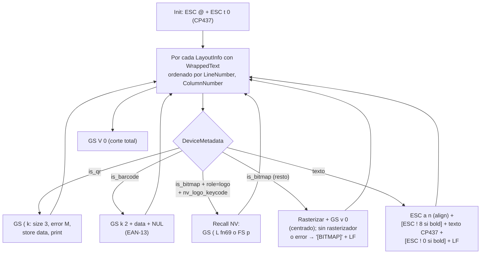

# 03 — Renderers base y registro DI (MotorDsl.Rendering + MotorDsl.Extensions)

> **Propósito**: índice destilado de los renderers base del motor (`TextRenderer`, `EscPosRenderer`, comandos `EscPosCommands`) y del API fluent de inyección de dependencias (`AddMotorDslEngine`, `MotorDslBuilder`).
> **Fuentes primarias**: `src/MotorDsl.Rendering/TextRenderer.cs`, `src/MotorDsl.Rendering/EscPosRenderer.cs`, `src/MotorDsl.Rendering/EscPosCommands.cs`, `src/MotorDsl.Extensions/MotorDslServiceCollectionExtensions.cs`, `src/MotorDsl.Extensions/MotorDslBuilder.cs`.
> **Versión del origen citada**: `v1.0.13 @83677eb`.
> Contrato `IRenderer` y registro por target: ver [01 §3-4](./01_nucleo-pipeline.md). `LayoutedDocument`/`DeviceMetadata` que consumen los renderers: ver [02 §4](./02_dsl-y-modelos.md).

## 1. `TextRenderer` — target `"text"`

`src/MotorDsl.Rendering/TextRenderer.cs#L12-L93`. Convierte `LayoutedDocument` a texto plano legible (`RenderResult.Output` es `string`).

Algoritmo (`#L16-L53`):
1. Si `document` o `document.Root` es null → `Output = ""` sin error.
2. Filtra entradas de `NodeLayoutInfo` con `WrappedText` no vacío, ordena por `LineNumber`, luego `ColumnNumber`.
3. Por cada entrada aplica alineación al ancho del perfil y agrega línea (`AppendLine`).
4. Excepción → `RenderResult` con error `"Text rendering failed: ..."` y `Output = ""`.

Alineación (`#L55-L92`): cada línea (split por `\n` del texto wrapeado) se ajusta al `profile.Width`:

| Alignment | Comportamiento | Fuente |
|---|---|---|
| `left` (default) | `PadRight(width)`; si excede, trunca a `width` | `#L74-L78` |
| `right` | `PadLeft(width)`; si excede, conserva los **últimos** `width` chars | `#L80-L84` |
| `center` | Padding repartido; si excede, trunca a `width` | `#L86-L92` |

Nota: toda línea sale con ancho exacto `profile.Width` (padded), no se recortan espacios finales.

## 2. `EscPosRenderer` — target `"escpos"`

`src/MotorDsl.Rendering/EscPosRenderer.cs#L13-L244`. Genera `byte[]` de comandos ESC/POS sin dependencias externas (no usa ESCPOS_NET). Constructor opcional: `EscPosRenderer(IBitmapRasterizer? rasterizer = null)` (`#L17-L20`) — sin rasterizador, los bitmaps degradan a placeholder textual.

### 2.1 Secuencia de emisión



Trazabilidad: init `#L31-L34`; loop y ramas `#L36-L104`; corte `#L106-L107`; error global → `RenderResult` con `"ESC/POS rendering failed: ..."` y `Output = byte[0]` (`#L112-L118`).

### 2.2 Encoding

- Texto: **siempre CP437** vía `CodePagesEncodingProvider` con fallback ASCII (`EncodeText`, `#L121-L127`), coherente con el `ESC t 0` del init.
- Datos de QR/barcode: capability `codepage` del perfil (`"850"` → CP850, `"437"` → CP437, otro → ASCII) (`GetEncoding`, `#L136-L145`).
- Incoherencia potencial: el texto ignora la capability `codepage` (observación, ver §4).

### 2.3 Ruteo de imágenes bitmap (Sprint 08, TK-64)

- `role == "logo"` **y** `profile.GetCapability("nv_logo_keycode") != null` → `EmitNvLogoRecall` (`#L76-L80`, `#L232-L243`): centra, emite `FS p` si `nv_logo_kind == "fs"`, si no `GS ( L` recall por keycode, LF, restaura align left. No rasteriza (pocos bytes).
- Cualquier otra imagen (firmas `role="signature"` incluidas) → `EmitBitmap` (`#L185-L224`): extrae base64 puro del data-URI, consulta `bitmap_max_width_px` (default 384), rasteriza vía `IBitmapRasterizer`, centra y emite `GS v 0` con `EscPosCommands.BuildRasterImageGsV0`. Fallback en error o sin rasterizador: bytes ASCII `"[BITMAP]"` + LF.

## 3. `EscPosCommands` — catálogo de comandos ESC/POS

`src/MotorDsl.Rendering/EscPosCommands.cs#L8-L96` (estático). Todos los comandos que el motor emite:

| Miembro | Bytes | Comando ESC/POS | Uso | Fuente |
|---|---|---|---|---|
| `Init` | `1B 40` | ESC @ — inicializar | inicio de cada render | `#L11` |
| `AlignLeft` / `AlignCenter` / `AlignRight` | `1B 61 00/01/02` | ESC a n — alineación | por línea de texto; imágenes centradas | `#L14-L20` |
| `StyleNormal` / `StyleBold` | `1B 21 00` / `1B 21 08` | ESC ! n — estilo | bold on/off por línea | `#L23-L26` |
| `CutFull` / `CutPartial` | `1D 56 00` / `1D 56 01` | GS V n — corte | `CutFull` al final; `CutPartial` sin uso en Rendering | `#L29-L32` |
| `LineFeed` | `0A` | LF | tras cada línea/imagen | `#L35` |
| `FeedLines(byte n)` | `1B 64 n` | ESC d n — alimentar n líneas | sin uso en Rendering («No verificado» uso externo) | `#L38` |
| `BarcodeEan13` | `1D 6B 02` | GS k 2 — EAN-13 (modo 2, NUL-terminado) | prefijo; el renderer agrega data + `00` | `#L43` |
| `QrSetSize3` | `1D 28 6B 03 00 31 43 03` | GS ( k — módulo tamaño 3 | secuencia QR | `#L51` |
| `QrSetErrorM` | `1D 28 6B 03 00 31 45 33` | GS ( k — corrección nivel M | secuencia QR | `#L54` |
| `QrStoreData` | `1D 28 6B 03 00 31 50 30` | GS ( k — store (header fijo) | el renderer construye el store con longitud real (`EscPosRenderer.cs#L159-L161`), esta constante no se usa en el flujo | `#L48` |
| `QrPrint` | `1D 28 6B 03 00 31 51 30` | GS ( k — imprimir QR | cierre de secuencia QR | `#L57` |
| `BuildRasterImageGsV0(bits, widthBytes, heightDots)` | `1D 76 30 00 xL xH yL yH` + bits | GS v 0 m=0 — raster bit image | bitmaps inline; mismo formato que acepta el transport para aprovisionar NV | `#L66-L76` |
| `RecallNvGraphicsGsL(keycode)` | `1D 28 4C 06 00 30 45 kc1 kc2 01 01` | GS ( L fn 69 — imprimir NV graphics por keycode, escala 1:1 | recall de logo (familia "gsl"); define/clear/query viven en el transport | `#L84-L89` |
| `RecallNvBitImageFsP(n, mode=0)` | `1C 70 n m` | FS p n m — NV bit image clásica | recall de logo (familia "fs") | `#L94-L95` |

## 4. Observaciones de renderers (trazables)

| Observación | Fuente |
|---|---|
| `EncodeText` fija CP437 e ignora la capability `codepage` y las propiedades `CodePage`/`CodePageCommand` de `DeviceProfile`; solo QR/barcode respetan `codepage` | `EscPosRenderer.cs#L33-L34`, `#L121-L127`, `#L136-L145` |
| El texto ESC/POS no se trunca ni padea al ancho: se confía en el wrap del LayoutEngine (a diferencia de `TextRenderer` que padea) | `EscPosRenderer.cs#L95`; contraste `TextRenderer.cs#L74-L78` |
| Barcode: solo EAN-13 (GS k 2), sin validación de dígitos ni uso de `DeviceProfile.SupportedBarcodes` | `EscPosRenderer.cs#L168-L178` |
| `QrStoreData` y `CutPartial`/`FeedLines` son constantes públicas sin consumidor en los 4 proyectos indexados | `EscPosCommands.cs#L29-L48` |

## 5. Fluent DI — `MotorDsl.Extensions`

Proyecto: referencia `MotorDsl.Core`, `MotorDsl.Parser`, `MotorDsl.Rendering` + `Microsoft.Extensions.DependencyInjection.Abstractions` 10.0.8 (`src/MotorDsl.Extensions/MotorDsl.Extensions.csproj`).

### 5.1 `AddMotorDslEngine` — registro del pipeline

`src/MotorDsl.Extensions/MotorDslServiceCollectionExtensions.cs#L12-L34`:

```csharp
public static MotorDslBuilder AddMotorDslEngine(this IServiceCollection services)
```

Registra el pipeline completo (todo **singleton**) y devuelve el builder para encadenar:

| Servicio | Implementación registrada | Nota | Fuente |
|---|---|---|---|
| `IDslParser` | `DslParser` | | `#L16` |
| `IEvaluator` | `Evaluator` | usa `DataResolver` interno por defecto (`src/MotorDsl.Core/Evaluators/Evaluator.cs#L22-L25`) | `#L17` |
| `ILayoutEngine` | `LayoutEngine` | | `#L18` |
| `IRendererRegistry` | factory: `RendererRegistry` con `TextRenderer` + `EscPosRenderer` pre-registrados, más todos los `IRenderer` del contenedor | los `IRenderer` DI pueden **sobrescribir** los base si comparten `Target` | `#L19-L27` |
| `IDataValidator` | `DataValidator` | | `#L28` |
| `ITemplateValidator` | `TemplateValidator` | | `#L29` |
| `IProfileValidator` | `ProfileValidator` | | `#L30` |
| `IDocumentEngine` | `DocumentEngine` | recibe los 3 validadores (registrados, no null) | `#L31` |

No registrados por defecto: `ITemplateProvider`, `IDeviceProfileProvider`, `IDataProvider`, `IPrintErrorHandler`, `IBitmapRasterizer` (los dos primeros se agregan con el builder; el resto queda a cargo del consumidor — el `EscPosRenderer` base se instancia **sin** rasterizador en la factory `#L23`).

### 5.2 `MotorDslBuilder` — API fluent

`src/MotorDsl.Extensions/MotorDslBuilder.cs#L11-L41` (Sprint 05, TK-30). Constructor `internal`; expone `Services` (`IServiceCollection`) para registros adicionales.

| Método público | Firma | Propósito | Fuente |
|---|---|---|---|
| `AddTemplates` | `MotorDslBuilder AddTemplates(Action<InMemoryTemplateProvider> configure)` | Crea un `InMemoryTemplateProvider`, lo puebla vía callback (`provider.Add(id, dsl)`) y lo registra singleton como `ITemplateProvider` | `#L20-L26` |
| `AddProfiles` | `MotorDslBuilder AddProfiles(Action<InMemoryDeviceProfileProvider> configure)` | Ídem con `InMemoryDeviceProfileProvider` como `IDeviceProfileProvider` (`provider.Add(deviceProfile)`) | `#L28-L34` |
| `AddRenderer<TRenderer>` | `MotorDslBuilder AddRenderer<TRenderer>() where TRenderer : class, IRenderer` | Registra un renderer custom singleton como `IRenderer`; la factory de `IRendererRegistry` lo incorpora (y reemplaza al base si su `Target` coincide) | `#L36-L40` |
| `Services` (propiedad) | `IServiceCollection Services { get; }` | Escape hatch para registros manuales (ej. `IBitmapRasterizer`, `IPrintErrorHandler`, `IDataProvider`) | `#L13` |

### 5.3 Patrón de uso (composición verificable)

Composición derivada de las firmas anteriores (los nombres de template/profile son ilustrativos):

```csharp
services.AddMotorDslEngine()                       // pipeline completo
    .AddTemplates(t => t.Add("ticket", dslJson))   // ITemplateProvider in-memory
    .AddProfiles(p => p.Add(new DeviceProfile("thermal-58mm", 32, "escpos")))
    .AddRenderer<MiRendererCustom>();              // IRenderer adicional
```

Uso real verificado en tests: `services.AddMotorDslEngine()` + `builder.AddRenderer<FakeRenderer>()` → el registry resuelve el target `"fake"` (`src/MotorDsl.Tests/Sprint08CoreTests.cs#L73-L85`, test TK-60-01). Luego el consumidor resuelve `IDocumentEngine` y combina: `GetTemplate(id)` → `Render(dsl, data, GetProfile(name))`.

### 5.4 Observaciones DI (trazables)

| Observación | Fuente |
|---|---|
| No hay método fluent `AddData(...)` para `IDataProvider` pese a existir `InMemoryDataProvider`; hay que registrarlo por `builder.Services` | `MotorDslBuilder.cs#L20-L40` (ausencia); `src/MotorDsl.Core/Providers/InMemoryDataProvider.cs` |
| El `EscPosRenderer` pre-registrado en la factory no recibe `IBitmapRasterizer` del contenedor: para bitmaps reales hay que registrar un `IRenderer` propio (p.ej. vía `AddRenderer<>`) que reemplace al base | `MotorDslServiceCollectionExtensions.cs#L23`; `EscPosRenderer.cs#L17-L20` |
| `AddTemplates`/`AddProfiles` registran una instancia nueva en cada llamada: llamadas repetidas dejan múltiples `ITemplateProvider` en el contenedor (la resolución simple toma el último) | `MotorDslBuilder.cs#L20-L34` |
