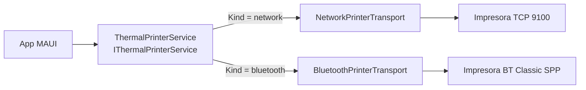

# 04 — Impresión: orquestador y transports

> **Propósito**: documentar cómo los bytes llegan a la impresora — el contrato de transport, el
> orquestador con retry y eventos, los dos transports implementados (red TCP y Bluetooth
> Classic SPP), la detección de capacidades y los logos NV.
> **Fuentes primarias**: `src/MotorDsl.Printing.Abstractions/`, `src/MotorDsl.Network/`,
> `src/MotorDsl.Bluetooth/`, `docs/00_contexto/compatibilidad-plataformas_v1.2.md`,
> `docs/10_developer_guide/transports-y-extensibilidad.md`.
>
> La **generación** de los bytes está en [03](03_renderizado-base.md); la clasificación de
> errores y el `IPrintErrorHandler`, en [01 §9](01_nucleo-pipeline.md).

---

## 1. El modelo



Un único servicio agnóstico orquesta; los transports implementan el medio. **Varios transports
pueden estar registrados a la vez**: el servicio elige por el `Kind` del `PrinterDevice`.

---

## 2. `IThermalPrinterTransport` — el contrato del medio

| Miembro | Rol |
|---|---|
| `Kind` | String que identifica el medio: `"bluetooth"`, `"network"` |
| `IsConnected`, `CurrentDevice` | Estado |
| `Capabilities` | `PrinterCapabilities?`; **por defecto `null`** (miembro con implementación por defecto) |
| `DiscoverAsync(ct)` | Enumera dispositivos disponibles |
| `ConnectAsync(deviceId, ct)` / `DisconnectAsync()` | Conexión |
| `WriteBytesAsync(data, profile, ct)` | El envío real, con el pacing del `PrinterProfile` |
| `ProvisionLogoAsync` / `IsLogoProvisionedAsync` / `ClearLogoAsync` | Logos NV; **tienen implementación por defecto** que responde «transport no soporta NV» |

Los miembros con implementación por defecto son lo que hace barato escribir un transport
nuevo: alcanza con las cinco operaciones básicas.

---

## 3. `ThermalPrinterService` — el orquestador

`src/MotorDsl.Printing.Abstractions/Services/ThermalPrinterService.cs` implementa
`IThermalPrinterService`, que extiende `INotifyPropertyChanged` para que la UI se enganche por
binding.

### Estado observable

`IsConnected`, `CurrentDevice`, `ConnectionState`, `LastError`, `CurrentCapabilities` (delegado
al transport activo) y `RecentFailures`. `PrinterConnectionState` recorre `Disconnected` →
`Scanning` → `Connecting` → `Connected` → `Reconnecting` → `Failed`.

### Eventos

`ErrorOccurred` (con el `PrintError`) y `DevicesDiscovered` (con la lista combinada).

### Descubrimiento

`DiscoverDevicesAsync(kind?)` recorre **todos** los transports —o solo los del `Kind` pedido—,
combina los resultados y dispara `DevicesDiscovered`. Si un transport falla, se registra el
error y **se sigue con los demás**: un Bluetooth apagado no impide listar las impresoras de
red. El estado de conexión previo se restaura al terminar.

### Conexión

`ConnectAsync(device)` busca el transport cuyo `Kind` coincida. Sin coincidencia deja
`LastError = "No transport registered for kind '…'"`, emite un `PrintError` de tipo `Protocol`
y devuelve `false` — no lanza.

### Envío con reintentos

`SendBytesAsync(data, profile?, retry?, ct)` usa `PrinterProfile.Thermal58mm` y
`new PrintRetryOptions()` como valores por defecto. Por cada intento:

1. delega en `_activeTransport.WriteBytesAsync`;
2. si funciona, llama a `OnPrintSuccess(attempt)` y termina;
3. si falla, arma el `PrintError`, emite `ErrorOccurred` y consulta al `IPrintErrorHandler`;
4. si el handler dice no reintentar **o** se agotaron los intentos, registra **una** entrada en
   el historial de fallos y lanza;
5. si reintenta: `OnRetryAttempt`, espera con **backoff exponencial**
   (`InitialDelayMs * 2^(intento-1)`) e intenta reconectar en silencio. Con los valores por
   defecto —3 intentos, 500 ms inicial— las esperas efectivas son 500 y 1000 ms: el tercer
   fallo lanza sin esperar.

Sin transport activo, lanza `InvalidOperationException("No hay un transport activo…")`.

### Historial de fallos

`RecentFailures` guarda hasta **20** `PrintFailureEntry` (constante `MAX_FAILURES`, acceso
protegido por lock). Cada entrada lleva timestamp, identificación del dispositivo, un snapshot
de las capacidades al momento del fallo, tipo y mensaje del error, cantidad de intentos, la
**longitud** de los bytes y el render target. El comentario del código es explícito:
`BytesLength` es *longitud, NUNCA el payload* — el historial no guarda el contenido impreso.
`ClearFailures()` lo vacía.

---

## 4. `PrinterProfile` — pacing del envío

`Models/PrinterProfile.cs` no describe *qué* se imprime sino *a qué ritmo* se entrega.

| Propiedad | Por defecto | Qué demora |
|---|---|---|
| `LineDelayMs` | 150 | entre líneas |
| `ByteDelayMs` | 5 | por bloque enviado (piso de 1 ms) |
| `InitDelayMs` | 100 | antes del primer bloque |
| `FinalDelayMs` | 500 | después del último |
| `QrDelayMs` | 300 | tras un QR |
| `ImageDelayMs` | 500 | tras una imagen |
| `CutDelayMs` | 500 | tras el corte |
| `InitCommandDelayMs` | 300 | tras el comando de init |

Dos perfiles predefinidos: `Thermal58mm` (genérico) y `Real58HB6` (calibrado para la
impresora 58HB6-6101). Los valores extra de `Real58HB6` salen de pruebas con hardware real;
ver `docs/10_developer_guide/perfiles-impresoras-reales.md`.

> No confundir con `DeviceProfile` (`MotorDsl.Core`), que gobierna el renderizado. Ver
> [01 §4](01_nucleo-pipeline.md).

---

## 5. `MotorDsl.Network` — transport TCP 9100

Paquete `net10.0` **puro**: usa `System.Net.Sockets`, que es BCL. Por eso se compila y
empaqueta en cualquier sistema operativo, se consume desde `net10.0-android` y `net10.0-ios`
por herencia de TFM, y `MotorDsl.Tests` puede referenciarlo directamente. Es **el camino para
imprimir desde iOS**.

`Kind = "network"`. `Capabilities` devuelve `null`: no hay detección de capacidades sobre TCP.

### Configuración

```csharp
builder.Services.AddNetworkPrinterTransport(o => o
    .AddPrinter("192.168.1.50"));      // puerto 9100 por defecto
```

| Opción de `NetworkPrinterOptions` | Por defecto |
|---|---|
| `KnownEndpoints` | vacía — `AddPrinter(endpoint)` agrega |
| `ConnectTimeout` | 5 s |
| `WriteTimeout` | 30 s |
| `ChunkSize` | `TransportChunking.DefaultChunkSize` (256) |

### Descubrimiento

No hay descubrimiento activo: `DiscoverAsync` devuelve los endpoints configurados, marcados
como `IsPaired: true`. El descubrimiento por mDNS/Bonjour figura como pendiente en el roadmap.

### Parseo de endpoints

`NetworkPrinterTransport.Endpoints.cs` acepta `host`, `host:puerto` y `[ipv6]:puerto`, con
`DefaultPort = 9100`. Una IPv6 sin corchetes se acepta solo si parsea como IP completa (los
dos puntos serían ambiguos como separador de puerto).

### Traducción de errores — deliberada

| Situación | Qué lanza | Por qué |
|---|---|---|
| Vence `ConnectTimeout` o `WriteTimeout` | `TimeoutException` | `PrintError.FromException` la clasifica como `Timeout`, que **sí** reintenta |
| `SocketException` / `IOException` | se relanzan **sin envolver** | Ya se clasifican como `Connection`; envolverlas en `Exception` las volvería `Unknown` y se perdería la precisión |

Ante socket roto se invalida la conexión antes de relanzar, para que la reconexión silenciosa
del servicio —que solo actúa si `IsConnected` quedó en `false`— tenga efecto en el próximo
intento. `DisconnectAsync` **nunca lanza**: el código de limpieza suele llamarla sin
try/catch.

### Envío

Parte el buffer con `TransportChunking.ChunkBuffer` y escribe bloque por bloque con un pacing
de respaldo de una demora por bloque. El comentario del código aclara que sobre TCP estos
delays son conservadores y no imprescindibles, a diferencia de SPP, que no tiene RTS/CTS.

---

## 6. `MotorDsl.Bluetooth` — transport BT Classic SPP

`Kind = "bluetooth"`. TFM `net10.0-android;net10.0-ios`, pero **el código real está bajo
`#if ANDROID`**: en iOS cada operación lanza
`PlatformNotSupportedException("iOS no soporta Bluetooth Classic SPP. Usar BLE o impresion por red.")`.
El motivo es de plataforma, no de implementación: Apple no expone el perfil SPP a apps de
terceros.

Conecta por el UUID estándar de SPP `00001101-0000-1000-8000-00805F9B34FB`.

### Archivos

| Archivo | Contenido | Bajo `#if ANDROID` |
|---|---|---|
| `BluetoothPrinterTransport.cs` | Discover, connect, disconnect, write | sí |
| `BluetoothPrinterTransport.Chunking.cs` | `ChunkBuffer` interno | **no** |
| `BluetoothPrinterTransport.Capabilities.cs` | Parseo de status y decisiones de pacing | **no** |
| `BluetoothPrinterTransport.Detection.cs` | Sondeo de capacidades y control de flujo | sí |
| `BluetoothPrinterTransport.Nv.cs` | Provisión y borrado de logos NV | sí |

Que `Chunking` y `Capabilities` vivan fuera de los bloques condicionales y sin dependencias de
plataforma es lo que permite a `MotorDsl.Tests` —un proyecto `net10.0`— probarlos: el `.csproj`
de tests los enlaza por `<Compile Include>` en vez de referenciar el paquete. Ver
[07](07_tests.md).

### Envío con control de flujo por status

Bloques de **256 bytes fijos**. El chunking es por tamaño y no por salto de línea a propósito:
la salida `escpos-bitmap` contiene bytes `0x0A` dentro de los datos de píxeles, así que partir
por LF corrompería la imagen.

Si la detección determinó que la impresora reporta status (`StatusFeedback == Supported`), el
transport consulta el estado antes de cada bloque y gatea la escritura. La documentación del
propio código declara el **límite honesto** de la técnica: `DLE EOT` informa liveness, papel y
error en tiempo real, **no** los bytes libres del buffer. No es control de flujo perfecto;
sirve para detectar caídas antes de escribir a ciegas y para fallar claro ante falta de papel
o tapa abierta.

Antes del primer bloque hay un *fast-fail* de hardware que lanza `PrinterHardwareException`
—clasificada como `Hardware`, que el handler **no** reintenta: una tapa abierta no se arregla
repitiendo.

### Degradación del pacing

`NextPacingDecision` implementa una máquina de estados de tres salidas:

| Status leído | Decisión |
|---|---|
| `Ready` | escribir ya, sin pacing fijo |
| `Busy` | escribir igual, con pacing de respaldo |
| `Unknown` | **degradar**: pacing fijo desde este bloque en adelante |

Una vez degradado no se vuelve a consultar el status en ese envío. El status se considera
legible solo si los bits fijos del byte coinciden con el patrón esperado
(`HasValidStatusFixedBits`: `(b & 0b1001_0011) == 0b0001_0010`); cualquier otra cosa —timeout,
basura, eco— es `Unknown`. **La degradación nunca aborta el envío.**

### Detección de capacidades

`BluetoothPrinterTransport.Detection.cs` sondea al conectar y llena `PrinterCapabilities`:

| Campo | Cómo se obtiene |
|---|---|
| `StatusFeedback` | `ProbeStatusFeedbackAsync` — clasifica la respuesta al pedido de status |
| `NvGraphics` | `ProbeNvGraphicsAsync` — prueba las familias de comando |
| `NvGraphicsKind` | `"gsl"`, `"fs"` o `null`, según qué familia respondió |
| `ModelId` | `ProbeModelIdAsync` — *best-effort* desde `GS I`, o `null` |

`CapabilitySupport` tiene tres valores: `Unknown`, `NotDetected`, `Supported`. La distinción
importa: `Unknown` significa que no se pudo averiguar, no que no esté.

`PrintStrategySelector.RecommendTarget(caps, docNeedsGraphics)` traduce eso a una
recomendación de render target: `"escpos"` si hay gráficos NV soportados, y `"escpos-bitmap"`
en caso contrario.

### Logos NV

`BluetoothPrinterTransport.Nv.cs` implementa la **definición** de logos en memoria no volátil,
que el renderer no puede hacer porque requiere diálogo con el dispositivo:
`BuildGslDefine` / `BuildGslDelete` (familia `GS ( L`), `BuildFsqDefine` (familia `FS q`) y
`IsKeycodeDefinedViaGslAsync` para consultar. `ParseGsV0` (en `Capabilities.cs`) desarma el
comando de imagen raster para extraer ancho, alto y bits, que es lo que la definición NV
necesita.

`ProvisionLogoAsync` devuelve un `NvLogoResult(Success, Kind, Message)`. El *recall* —el
comando corto que imprime el logo ya grabado— sí está del lado del renderer; ver
[03 §4](03_renderizado-base.md).

Flujo completo del caso: grabar el logo una vez con `ProvisionLogoAsync`, dejar
`nv_logo_keycode` (y opcionalmente `nv_logo_kind`) como capacidades del `DeviceProfile`, y a
partir de ahí cada ticket emite unos pocos bytes en lugar del bitmap entero.

---

## 7. `TransportChunking` — helper compartido

`src/MotorDsl.Printing.Abstractions/TransportChunking.cs` expone públicamente
`DefaultChunkSize = 256` y `ChunkBuffer(data, size)`, un iterador de `ArraySegment<byte>` sin
copias. Se extrajo del transport Bluetooth para que cualquier transport lo reutilice;
`MotorDsl.Network` lo usa.

---

## 8. Matriz de plataformas

| Paquete | Android | iOS | Escritorio |
|---|---|---|---|
| `MotorDsl.Network` | ✅ | ✅ | ✅ |
| `MotorDsl.Bluetooth` | ✅ | ❌ `PlatformNotSupportedException` | ❌ |

**Permisos que la app consumidora debe declarar:**

| Plataforma | Para | Clave |
|---|---|---|
| Android | Bluetooth | `BLUETOOTH_SCAN` (con `neverForLocation`), `BLUETOOTH_CONNECT`, `ACCESS_FINE_LOCATION` |
| Android | Red | `INTERNET`, `ACCESS_NETWORK_STATE` |
| iOS | Red local | `NSLocalNetworkUsageDescription` en `Info.plist` |

La clave de iOS es obligatoria desde iOS 14 y su ausencia es especialmente traicionera: **el
sistema termina la app sin un mensaje de error útil**. `MotorDsl.Bluetooth` no necesita ninguna
clave en iOS porque no funciona ahí.

Detalle completo por paquete en `docs/00_contexto/compatibilidad-plataformas_v1.2.md`.

---

## 9. Escribir un transport propio

1. Implementar `IThermalPrinterTransport` con un `Kind` nuevo. Las tres operaciones de NV
   pueden omitirse: tienen implementación por defecto.
2. Registrarlo como `IThermalPrinterTransport` en el contenedor —puede convivir con los otros.
3. Crear `PrinterDevice` con ese `Kind`; el servicio rutea solo.

Al traducir excepciones, respetar el criterio de `MotorDsl.Network` (§5): lanzar
`TimeoutException` para los vencimientos propios y **no envolver** `IOException` ni
`SocketException`, para no perder la clasificación que decide el reintento.
