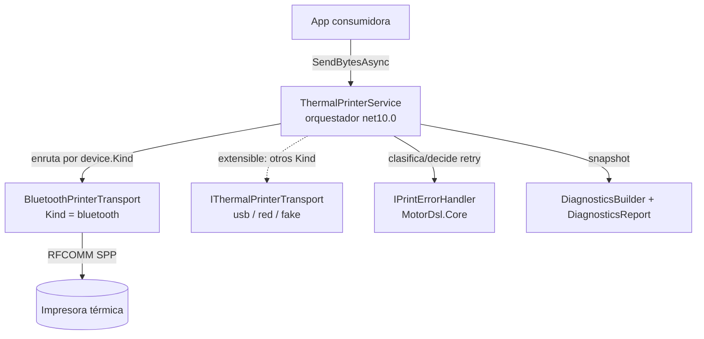
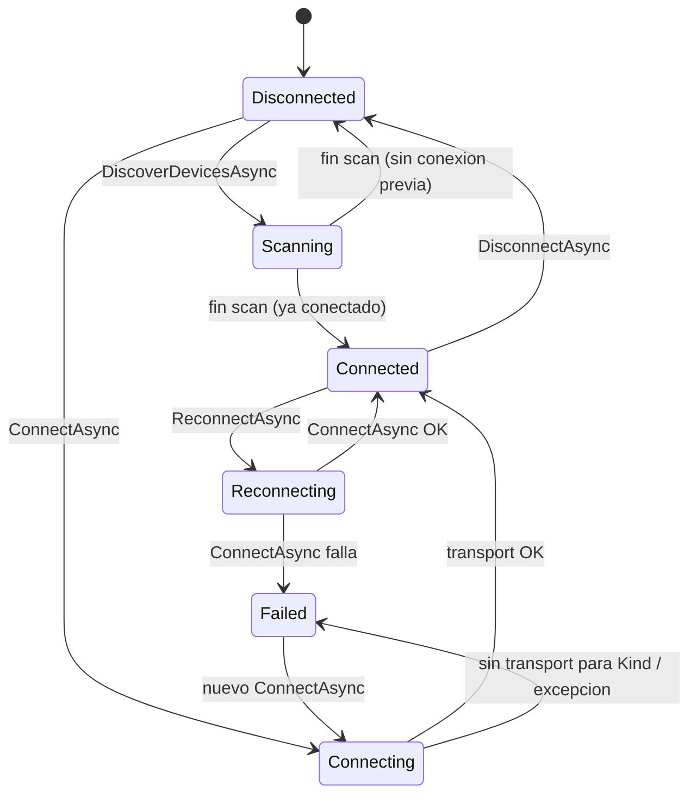
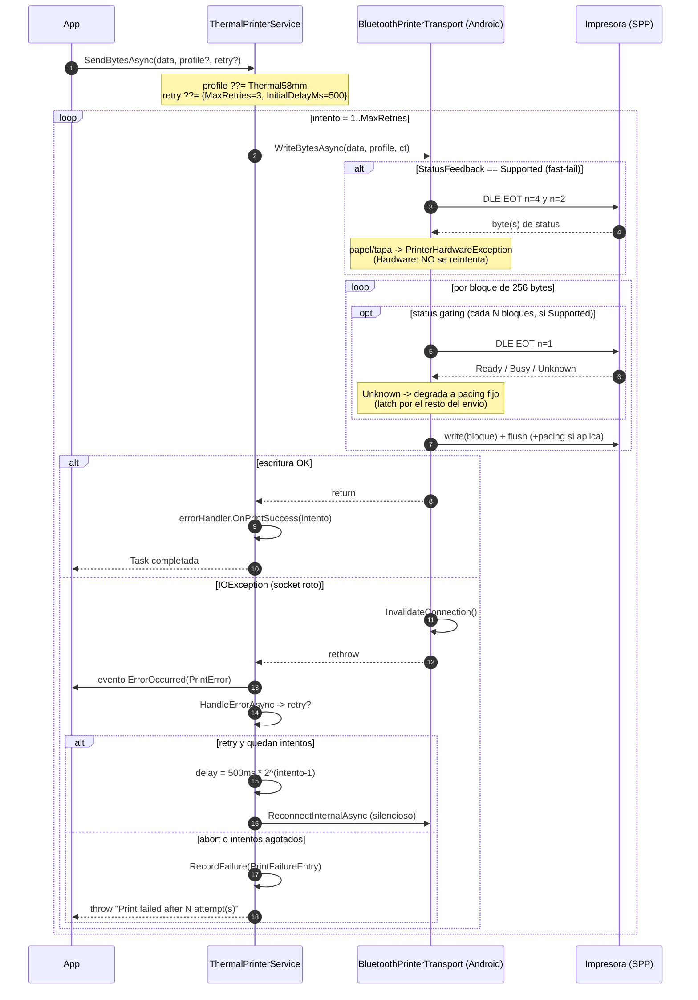

# 04 — Stack de impresión transport-agnostic (Abstractions + Bluetooth)

> **Propósito**: mapa destilado del stack de impresión térmica de MotorDsl: los contratos
> transport-agnostic (`MotorDsl.Printing.Abstractions`), el orquestador `ThermalPrinterService`
> (retry, estados, enrutamiento por `Kind`, historial de fallos, diagnóstico, NV logo) y el
> transport concreto Bluetooth Classic SPP para Android (`MotorDsl.Bluetooth`).
> **Fuentes primarias**: `src/MotorDsl.Printing.Abstractions/**` y `src/MotorDsl.Bluetooth/**`
> del repo `PrintThermal_Motor_Maui`. Versión de referencia: **v1.0.13 @83677eb**.
> Rutas relativas a `PrintThermal_Motor_Maui/src/`. La capa MAUI se cubre en
> `05_maui-ui-renderers.md` (no se duplica aquí).

---

## 1. Vista general del stack

- El orquestador vive en un proyecto **net10.0 puro** (sin MAUI ni plataforma):
  `MotorDsl.Printing.Abstractions/MotorDsl.Printing.Abstractions.csproj#L4`.
- El transport BT targetea **net10.0-android / net10.0-ios**:
  `MotorDsl.Bluetooth/MotorDsl.Bluetooth.csproj#L4`.
- Tipos compartidos que NO viven aquí (dependencia `MotorDsl.Core`, fuera de alcance de este
  índice): `PrintError`/`PrintErrorType`/`PrintRetryOptions` (`MotorDsl.Core/Models/PrintError.cs`),
  `PrinterHardwareException` (`MotorDsl.Core/Models/PrinterHardwareException.cs`),
  `IPrintErrorHandler` + `DefaultPrintErrorHandler` (`MotorDsl.Core/Printing/DefaultPrintErrorHandler.cs`).

---

## 2. Contratos (`MotorDsl.Printing.Abstractions/Contracts/`)

| Interfaz | Responsabilidad | Miembros clave | Archivo |
|---|---|---|---|
| `IThermalPrinterTransport` | Capa física de UN medio de transporte; solo mueve bytes y detecta capacidades. | `Kind` (string: `"bluetooth"`, `"usb"`, …), `IsConnected`, `CurrentDevice`, `Capabilities` (default `null`), `DiscoverAsync`, `ConnectAsync(deviceId)`, `DisconnectAsync`, `WriteBytesAsync(data, profile)`, `ProvisionLogoAsync(gsV0Bytes, keycode)` (default no-op → `NvLogoResult(false,…)`), `IsLogoProvisionedAsync` (default `false`), `ClearLogoAsync` (default no-op) | `MotorDsl.Printing.Abstractions/Contracts/IThermalPrinterTransport.cs#L5-L29` |
| `IThermalPrinterService` | Fachada/orquestador para la app: ciclo de vida de conexión, retry, eventos, historial de fallos. Implementa `INotifyPropertyChanged` (bindeable desde UI). | `IsConnected`, `CurrentDevice`, `ConnectionState`, `LastError`, `CurrentCapabilities`, `RecentFailures`, `ClearFailures()`, eventos `ErrorOccurred` / `DevicesDiscovered`, `DiscoverDevicesAsync(kind?)`, `ConnectAsync(device)`, `DisconnectAsync`, `ReconnectAsync`, `SendBytesAsync(data, profile?, retry?)`, `ProvisionLogoAsync` / `IsLogoProvisionedAsync` / `ClearLogoAsync` | `MotorDsl.Printing.Abstractions/Contracts/IThermalPrinterService.cs#L6-L37` |
| `IDiagnosticsReportProvider` | Captura y serializa el snapshot de diagnóstico (librería/app/dispositivo/impresora/permisos). | `Build(notes?, includePii=false)`, `ToJson(report)`, `ToPlainText(report)`, `ToDslJson(report, paperWidthChars=32)` (genera DSL "integrated" imprimible por `IDocumentEngine.Render`) | `MotorDsl.Printing.Abstractions/Contracts/IDiagnosticsReportProvider.cs#L7-L26` |

Notas de diseño trazables:
- Los defaults de interfaz en `IThermalPrinterTransport` existen para transports "no aplicables"
  (iOS, fakes): `Capabilities => null` y NV no-op (`IThermalPrinterTransport.cs#L11-L28`).
- El input de NV logo es **el mismo formato `GS v 0`** que la app ya produce para imágenes
  inline (`IThermalPrinterTransport.cs#L19-L22`).

---

## 3. `ThermalPrinterService` — el orquestador

Archivo: `MotorDsl.Printing.Abstractions/Services/ThermalPrinterService.cs` (282 líneas).

| Aspecto | Comportamiento | Fuente |
|---|---|---|
| Construcción | Recibe `IEnumerable<IThermalPrinterTransport>` + `IPrintErrorHandler`; lanza `InvalidOperationException` si no hay NINGÚN transport registrado. | `#L83-L91` |
| Descubrimiento | `DiscoverDevicesAsync(kind?)`: pone estado `Scanning`, itera TODOS los transports (filtro opcional por `Kind`, comparación OrdinalIgnoreCase), agrega resultados; el error de un transport no aborta a los demás (setea `LastError` + dispara `ErrorOccurred`); al final dispara `DevicesDiscovered` y restaura `Connected`/`Disconnected`. | `#L93-L131` |
| Enrutamiento por Kind | `ConnectAsync(device)`: busca el transport cuyo `Kind` coincide con `device.Kind`; si no existe → `ConnectionState.Failed` + `PrintError` de tipo `Protocol`. | `#L133-L145` |
| Conexión | `Connecting` → (`Connected` y guarda `_activeTransport`) o `Failed` (con `ErrorOccurred`). | `#L147-L172` |
| Reconexión | `ReconnectAsync`: estado `Reconnecting` y reusa `ConnectAsync(CurrentDevice)`. | `#L193-L199` |
| Envío + retry | `SendBytesAsync`: defaults `profile = PrinterProfile.Thermal58mm`, `retry = new PrintRetryOptions()` (MaxRetries=3, InitialDelayMs=500 — `MotorDsl.Core/Models/PrintError.cs#L60-L64`). Loop de intentos: por cada excepción emite `ErrorOccurred`, consulta `HandleErrorAsync` (Connection/Timeout/Unknown → retry; Hardware/Protocol → abort, `MotorDsl.Core/Printing/DefaultPrintErrorHandler.cs#L16-L28`); backoff exponencial `InitialDelayMs * 2^(attempt-1)`; reconexión silenciosa entre intentos (`ReconnectInternalAsync`, solo si el transport quedó `IsConnected==false`). | `#L201-L244` |
| Fallo definitivo | Al agotar intentos: registra **una** `PrintFailureEntry` (sin payload, solo longitud) y relanza `Exception("Print failed after N attempt(s)…")`. | `#L222-L228` |
| Historial de fallos | Ring buffer thread-safe (lock) de `MAX_FAILURES = 20`; no persiste a disco; `RecordFailure` es `internal` para test (`InternalsVisibleTo MotorDsl.Tests`, csproj `#L28`). | `#L24-L27`, `#L246-L256` |
| Capacidades | `CurrentCapabilities` delega en `_activeTransport?.Capabilities`. | `#L53` |
| NV logo | `ProvisionLogoAsync` delega en el transport activo; sin conexión → `NvLogoResult(false, null, "no conectado")`. | `#L65-L77` |
| Notificación | `SetProperty` + `PropertyChanged` (patrón MVVM estándar). | `#L275-L280` |

### 3.1 Estados de conexión

`PrinterConnectionState` (`Models/PrinterConnectionState.cs#L3-L11`):
`Disconnected → Scanning → Connecting → Connected → Reconnecting → Failed`.

### 3.2 Selección de estrategia y capacidades

| Tipo | Qué es | Fuente |
|---|---|---|
| `PrintStrategySelector` | Helper **puro** estático; la librería solo RECOMIENDA, la decisión final es de la app. `RecommendTarget(caps, docNeedsGraphics)` → `"escpos"` si `NvGraphics == Supported` (el logo puede salir por recall NV), si no `"escpos-bitmap"`. `docNeedsGraphics` hoy se ignora (reservado a heurísticas futuras). | `Models/PrintStrategySelector.cs#L7-L21` |
| `PrinterCapabilities` | Record inmutable detectado al conectar: `StatusFeedback`, `NvGraphics` (ambos `CapabilitySupport`), `NvGraphicsKind` (`"gsl"` \| `"fs"` \| null), `ModelId` (best-effort desde `GS I`). Factory `Unknown()` = todo Unknown/null. | `Models/PrinterCapabilities.cs#L7-L16` |
| `CapabilitySupport` | Tri-estado deliberado — NUNCA bool: `Unknown` (no se pudo sondear), `NotDetected` (se sondeó y no respondió: puede no soportarlo o estar ocupada), `Supported` (respondió confirmando). | `Models/CapabilitySupport.cs#L7-L17` |

### 3.3 Modelos de datos restantes

| Modelo | Contenido clave | Fuente |
|---|---|---|
| `PrinterDevice` | Record `(Id, Name, Kind, IsPaired=false)`; `ToString()` = `"Name (Id)"`. | `Models/PrinterDevice.cs#L3-L6` |
| `PrinterProfile` | Delays de pacing por operación: `LineDelayMs=150`, `ByteDelayMs=5`, `InitDelayMs=100`, `FinalDelayMs=500`, `QrDelayMs=300`, `ImageDelayMs=500`, `CutDelayMs=500`, `InitCommandDelayMs=300`. Presets: `Thermal58mm` y `Real58HB6` (impresora real 58HB6-6101, basado en self-test). | `Models/PrinterProfile.cs#L3-L37` |
| `PrintFailureEntry` | Record por fallo: `Timestamp, DeviceId, DeviceName, DeviceKind, Capabilities` (snapshot), `ErrorType, ErrorMessage, Attempts, BytesLength, RenderTarget?`. Guarda identidad CRUDA (el enmascarado se aplica al armar el reporte) y **NUNCA el payload**, solo su longitud. | `Models/PrintFailureEntry.cs#L8-L18` |
| `NvLogoResult` | Record `(Success, Kind, Message)`. Honestidad: el soporte FS se confirma recién al aprovisionar (no hay query limpia); `Success` con `Kind="fs"` lleva Message de advertencia. | `Models/NvLogoResult.cs#L3-L9` |
| `DiagnosticsReport` | Record raíz + sub-records `LibraryInfo`, `AppInfoSnapshot`, `DeviceInfoSnapshot`, `PrinterInfoSnapshot` (incluye dict de capabilities), `PermissionsSnapshot`; `Failures` opcional (null si no hay) para no romper llamadores. | `Models/DiagnosticsReport.cs#L7-L71` |
| `DiagnosticsBuilder` | Helpers PUROS (testeables sin MAUI; el provider de MotorDsl.Maui delega en ellos): `MaskMac(id)` (MAC → conserva 3 primeros octetos + `**:**:**`; otro id → 4 chars + `...`), `CapabilitiesToDictionary` (claves `supports_status_feedback`, `supports_nv_graphics`, `nv_graphics_kind`, `model_id`), `BuildPrinterSnapshot(service, includePii)`, `BuildFailures(service, includePii)`. | `Models/DiagnosticsBuilder.cs#L10-L105` |
| Eventos | `PrintErrorEventArgs` (envuelve `PrintError` de Core), `DevicesDiscoveredEventArgs` (lista de `PrinterDevice`). | `Events/PrintErrorEventArgs.cs#L5-L9`, `Events/DevicesDiscoveredEventArgs.cs#L3-L7` |

### 3.4 DI y csproj (Abstractions)

- `AddMotorDslPrinting()`: `TryAddSingleton<IPrintErrorHandler, DefaultPrintErrorHandler>` +
  `TryAddSingleton<IThermalPrinterService, ThermalPrinterService>` — TryAdd permite al consumer
  sobreescribir registrando antes. `MotorDslPrintingServiceCollectionExtensions.cs#L10-L15`.
- csproj: TFM `net10.0`; ProjectReference `MotorDsl.Core`; PackageReference
  `Microsoft.Extensions.DependencyInjection.Abstractions 10.0.8`; `InternalsVisibleTo MotorDsl.Tests`.
  `MotorDsl.Printing.Abstractions.csproj#L4,L22-L33`.

---

## 4. `MotorDsl.Bluetooth` — transport BT Classic SPP (Android)

`BluetoothPrinterTransport` es una **partial class en 5 archivos**; las partes puras viven fuera
de `#if` para poder testearse en net10.0 (el proyecto de tests las enlaza por fuente, ya que este
proyecto solo targetea android/ios — `BluetoothPrinterTransport.Chunking.cs#L3-L8`).

| Archivo parcial | Rol | Puntos clave | Fuente |
|---|---|---|---|
| `BluetoothPrinterTransport.cs` | Núcleo: discover/connect/disconnect/write (rama `#if ANDROID` / `#elif IOS`). | `Kind = "bluetooth"` (L35). Discover: solo dispositivos **emparejados** (`BondedDevices`); exige BT habilitado y permiso `BLUETOOTH_CONNECT` en API 31+; `Java.Lang.SecurityException` → lista vacía. Connect: RFCOMM al UUID SPP `00001101-0000-1000-8000-00805F9B34FB`; captura `InputStreamInvoker.BaseInputStream` (Java) para poder usar `Available()`. Detección de capacidades best-effort post-conexión: **nunca hace fallar la conexión** (catch → `Unknown()`). | `#L35`, `#L52-L96`, `#L98-L143` |
| — write | Escritura con chunking + flow control. | `CHUNK_SIZE = 256` de **tamaño fijo sobre todo el buffer, independiente del contenido** (el output escpos-bitmap contiene `0x0A` arbitrarios: no se puede partir por LF). Pacing fallback: `max(profile.ByteDelayMs, 1)` **una vez por bloque**. Status gating solo si `StatusFeedback == Supported`. `IOException` (System.IO o Java.IO) → `InvalidateConnection()` + rethrow SIN envolver (así `ReconnectInternalAsync` del servicio reconecta en el próximo intento). | `#L179-L257`, `#L259-L281` |
| `…Chunking.cs` | Parte pura: `ChunkBuffer(data, size)` → `ArraySegment<byte>` contiguos sin copiar; reensamblado reproduce el array original. | Testeable en net10.0. | `#L17-L27` |
| `…Detection.cs` (`#if ANDROID`) | Fase 2 (detección de capacidades) + fase 3 (flow control por status): I/O real de sondeos sobre el socket. | Constantes: `POLL_EVERY_N_CHUNKS=1`, `MAX_READY_POLLS=10`, `READY_POLL_DELAY_MS=50`, `STATUS_TIMEOUT_MS=350` (`#L18-L24`). `DetectCapabilitiesAsync`: (1) `DrainInput`, (2) sondeo feedback `DLE EOT n=1` ×3 con 400ms, (3) sondeo NV solo con la consulta NO intrusiva `GS ( L` fn=48 "remaining capacity" → `"gsl"`; la familia FS no se puede sondear sin ser intrusivo → queda `NotDetected` y se confirma recién al aprovisionar, (4) `ModelId` via `GS I 67` best-effort. NINGUNA lectura bloquea: todos los reads gateados por `Available()` (`ReadAvailableAsync`). | `#L34-L113`, `#L182-L259` |
| — flow control | `QueryStatusAsync` (write del comando NO se traga: IOException sube y dispara invalidate+reconexión; la lectura sí es best-effort), `WaitUntilReadyAsync` (Ready / Busy tras 10 polls → escribe igual, no deadlockea / Unknown → degrada), `CheckHardwareFastFailAsync` (una vez antes del envío: `DLE EOT n=4` paper-end bits 5,6 = `0x60`; `n=2` tapa abierta bit2 `0x04`, paper-end stop bit5 `0x20` → lanza `PrinterHardwareException`, que el handler clasifica como Hardware y NO reintenta). | `#L119-L175` |
| `…Capabilities.cs` | Parte pura de parseo/decisión (sin `#if`, testeable). | Enum interno `PrinterStatus` {Ready, Busy, Unknown} (`#L9-L14`). `HasValidStatusFixedBits`: máscara `0b1001_0011 == 0b0001_0010` (sanity check anti ruido/eco). `ClassifyStatusResponse` (null→NotDetected; bits válidos→Supported). `ParseStatusByte` (bit3 `0x08` offline → Busy). `NextPacingDecision`: latch de degradación — un `Unknown` degrada a pacing fijo por el resto del envío. `ParseGsV0`: parsea header `1D 76 30 m xL xH yL yH` → `(widthBytes, heightDots, bits)`. | `#L28-L101` |
| `…Nv.cs` (`#if ANDROID`) | Fase 4: aprovisionamiento de logo NV. | `ProvisionLogoAsync`: parsea el `GS v 0` de entrada y re-emite como DEFINE NV. Orden: (1) `GS ( L` fn=67 define por keycode + **verificación** por query fn=64 (lista de keycodes) → `NvLogoResult(true,"gsl",…)`; (2) fallback `FS q` (NV bit image clásico) **sin query limpia** → Success con confirmación LIMITADA (`"fs"`, verificar con impresión de prueba; el layout FS puede variar por impresora). Tras Success actualiza `Capabilities.NvGraphics/NvGraphicsKind`. `IsLogoProvisionedAsync`: solo consultable vía GS ( L; con kind `"fs"` → `false` best-effort. `ClearLogoAsync`: gsl → fn=66 delete; fs → redefine raster mínimo vacío. `WriteHeavyAsync`: mismo camino de chunking (256) + invalidate + rethrow, pacing fijo 1ms/bloque, sin status gating. | `#L23-L102`, `#L108-L188` |

### 4.1 iOS y otras plataformas

- **iOS**: `DiscoverAsync`, `ConnectAsync`, `DisconnectAsync` y `WriteBytesAsync` lanzan
  `PlatformNotSupportedException("iOS no soporta Bluetooth Classic SPP. Usar BLE o impresion por red.")`
  — `BluetoothPrinterTransport.cs#L92-L93,L136-L138,L171-L173,L251-L253`. `Capabilities` devuelve
  `null` fuera de Android (`#L41-L43`).
- Rama `#else` (ni Android ni iOS): `ConnectAsync` devuelve `false` y `WriteBytesAsync` es no-op
  (`#L139-L141,L254-L256`).

### 4.2 DI y csproj (Bluetooth)

- `AddBluetoothPrinterTransport()`: `AddSingleton<IThermalPrinterTransport, BluetoothPrinterTransport>`
  — usa `AddSingleton` (no TryAdd) a propósito: el servicio acepta VARIOS transports.
  `MotorDslBluetoothServiceCollectionExtensions.cs#L8-L12`.
- csproj: TFMs `net10.0-android` (min OS 24.0) y `net10.0-ios` (min 15.0); `AndroidLdFlags`
  `-Wl,-z,max-page-size=16384` (páginas de 16KB); ProjectReference a `MotorDsl.Printing.Abstractions`;
  PackageReference `Microsoft.Extensions.DependencyInjection.Abstractions 10.0.8`.
  `MotorDsl.Bluetooth.csproj#L4,L10-L11,L28-L30,L36-L42`.

---

## 5. Secuencia de envío de bytes (service → transport → impresora)

Fuentes del diagrama: `Services/ThermalPrinterService.cs#L201-L244`,
`MotorDsl.Bluetooth/BluetoothPrinterTransport.cs#L179-L257`,
`MotorDsl.Bluetooth/BluetoothPrinterTransport.Detection.cs#L119-L175`.

---

## 6. Reglas de oro del stack (destiladas, con fuente)

1. El transport **solo escribe bytes**; retry y orquestación son del servicio
   (`BluetoothPrinterTransport.cs#L12-L16`).
2. Las capacidades son **tri-estado, nunca bool**: un "no contestó" puede ser "no soporta" o
   "estaba ocupada" (`Models/CapabilitySupport.cs#L4-L6`).
3. `DLE EOT` da liveness/papel/error, **NO bytes libres del buffer**: el flow control gatea
   bloques, no es flow control perfecto; degrada a pacing fijo, no aborta
   (`BluetoothPrinterTransport.cs#L194-L199`).
4. La detección de capacidades es best-effort y **jamás hace fallar la conexión**
   (`BluetoothPrinterTransport.cs#L124-L127`).
5. El historial de fallos guarda longitud del payload, **nunca el payload**; el enmascarado de
   MAC se aplica al construir el reporte, no al registrar
   (`Models/PrintFailureEntry.cs#L4-L7`, `Models/DiagnosticsBuilder.cs#L83-L99`).
6. FS (NV clásico) no tiene query limpia: su Success es de confirmación limitada; GS ( L sí se
   verifica por query de keycodes (`BluetoothPrinterTransport.Nv.cs#L9-L18`).
7. Ante `IOException` el transport se invalida y relanza **sin envolver**, para que el retry del
   servicio reconecte (`BluetoothPrinterTransport.cs#L238-L249`).

---

## 7. Comandos ESC/POS que maneja el transport (referencia rápida)

Todos los builders/sondeos son privados del transport; **no** usan `EscPosCommands` de
`MotorDsl.Rendering` (`BluetoothPrinterTransport.Nv.cs#L129`).

| Comando | Bytes | Uso en el transport | Fuente |
|---|---|---|---|
| `DLE EOT n=1` | `10 04 01` | Sondeo de feedback (fase 2, ×3 con 400ms) y status por bloque (fase 3): online/offline. | `MotorDsl.Bluetooth/BluetoothPrinterTransport.Detection.cs#L55,L128` |
| `DLE EOT n=2` | `10 04 02` | Fast-fail hardware: causa offline — tapa abierta bit2 `0x04`, paper-end stop bit5 `0x20`. | `…Detection.cs#L166-L174` |
| `DLE EOT n=4` | `10 04 04` | Fast-fail hardware: sensor de papel — paper end bits 5,6 (`0x60`). | `…Detection.cs#L159-L164` |
| `GS ( L` fn=48 | `1D 28 4C 02 00 30 30` | Query NO intrusiva: capacidad restante del área NV graphics (sondeo NV, fase 2). Solo lectura, no define ni imprime. | `…Detection.cs#L76-L81` |
| `GS ( L` fn=64 | `1D 28 4C 02 00 30 40` | Query de keycodes NV definidos (verificación post-define y `IsLogoProvisionedAsync`). | `…Nv.cs#L108-L127` |
| `GS ( L` fn=67 | `1D 28 4C pL pH 30 43 30 kc1 kc2 01 xL xH yL yH 31 [bits]` | DEFINE NV graphics raster por keycode (`xL xH` = ancho en **dots**). | `…Nv.cs#L131-L159` |
| `GS ( L` fn=66 | `1D 28 4C 04 00 30 42 kc1 kc2` | DELETE del NV graphics del keycode. | `…Nv.cs#L161-L170` |
| `GS I 67` | `1D 49 43` | Transmit printer ID (model name) → `ModelId` best-effort. | `…Detection.cs#L98-L113` |
| `FS q` | `1C 71 01 xL xH yL yH [bits]` | Define NV bit image clásica #1 (fallback; `xL xH` = **bytes por fila**; layout específico de cada impresora, sin garantía). | `…Nv.cs#L172-L188` |
| `GS v 0` | `1D 76 30 m xL xH yL yH [bits]` | El transport NO lo emite: lo **parsea** como input de `ProvisionLogoAsync` (mismo formato inline que produce la app). | `…Capabilities.cs#L82-L101` |

Semántica del byte de status `DLE EOT n=1`: bits fijos `bit0=0, bit1=1, bit4=1, bit7=0`
(máscara `0b1001_0011 == 0b0001_0010`, sanity check anti-ruido); `bit3 (0x08)` = offline → Busy
(`…Capabilities.cs#L24-L60`).

## 8. Constantes operativas (valores en v1.0.13)

| Constante | Valor | Significado | Fuente |
|---|---|---|---|
| `CHUNK_SIZE` | 256 | Bytes por bloque de escritura (write normal y heavy NV). Comentario: "puede bajarse a 128 para impresoras más sensibles". | `MotorDsl.Bluetooth/BluetoothPrinterTransport.cs#L185-L188`, `…Nv.cs#L82` |
| `POLL_EVERY_N_CHUNKS` | 1 | Consultar status antes de CADA bloque (subirlo reduce latencia a costa de menos gating). | `…Detection.cs#L16-L18` |
| `MAX_READY_POLLS` | 10 | Reintentos de status esperando Ready antes de escribir igual (no deadlock). | `…Detection.cs#L19-L20` |
| `READY_POLL_DELAY_MS` | 50 | Delay entre polls mientras la impresora reporta Busy. | `…Detection.cs#L21-L22` |
| `STATUS_TIMEOUT_MS` | 350 | Timeout de cada consulta de status: el envío nunca cuelga por polling. | `…Detection.cs#L23-L24` |
| Pacing fallback | `max(profile.ByteDelayMs, 1)` ms | UNA vez por bloque (no por byte). | `…BluetoothPrinterTransport.cs#L190-L192` |
| Pacing heavy NV | 1 ms/bloque fijo | `WriteHeavyAsync`, sin status gating ni perfil. | `…Nv.cs#L79-L90` |
| `MAX_FAILURES` | 20 | Tamaño del ring buffer de fallos del servicio. | `MotorDsl.Printing.Abstractions/Services/ThermalPrinterService.cs#L25` |
| `PrintRetryOptions` | MaxRetries=3, InitialDelayMs=500 | Defaults del retry de `SendBytesAsync`. | `MotorDsl.Core/Models/PrintError.cs#L60-L64` |
| UUID SPP | `00001101-0000-1000-8000-00805F9B34FB` | Service record RFCOMM estándar de Serial Port Profile. | `…BluetoothPrinterTransport.cs#L110` |

## 9. Fases del transport (nomenclatura de los comentarios del código)

| Fase | Qué agrega | Dónde vive |
|---|---|---|
| Fase 1 | Chunking fijo + pacing por bloque + `InvalidateConnection` y rethrow ante `IOException` (reconexión a cargo del servicio). | `BluetoothPrinterTransport.cs#L179-L281`, `…Chunking.cs` |
| Fase 2 | Detección de capacidades al conectar: feedback (`DLE EOT`), NV (`GS ( L` fn=48), `ModelId` (`GS I`). | `…Detection.cs#L26-L113`, `…Capabilities.cs#L28-L44` |
| Fase 3 | Flow control por status: gating de bloques por Ready/Busy, fast-fail hardware, degradación con latch a pacing fijo. | `…Detection.cs#L115-L175`, `…Capabilities.cs#L46-L78` |
| Fase 4 | Aprovisionamiento NV: `GS ( L` verificado por query / `FS q` con confirmación limitada; actualiza `Capabilities`. | `…Nv.cs#L21-L102` |

## 10. Glosario mínimo del stack

| Término | Definición (1 línea) | Fuente |
|---|---|---|
| Kind | String que identifica el medio de transporte (`"bluetooth"`, `"usb"`, …); clave del enrutamiento del servicio. | `Contracts/IThermalPrinterTransport.cs#L7`, `Services/ThermalPrinterService.cs#L135-L136` |
| Transport | Implementación de `IThermalPrinterTransport`: solo mueve bytes y detecta capacidades; sin retry propio. | `MotorDsl.Bluetooth/BluetoothPrinterTransport.cs#L12-L16` |
| Status gating | Consultar `DLE EOT n=1` antes de escribir un bloque y gatear la escritura por Ready/Busy. | `…BluetoothPrinterTransport.cs#L194-L199` |
| Degradación (latch) | Tras un status ilegible (`Unknown`) se pasa a pacing fijo por el resto del envío, sin volver a consultar. | `…Capabilities.cs#L62-L78` |
| Pacing | Delay fijo por bloque como respaldo cuando no hay (o se degradó el) feedback de status. | `…BluetoothPrinterTransport.cs#L190-L192` |
| NV / keycode | Memoria no volátil de la impresora donde se define un logo direccionable por keycode (recall sin re-enviar bits). | `…Nv.cs#L6-L19` |
| GS v 0 | Comando raster inline ESC/POS; formato de entrada único del aprovisionamiento NV. | `Contracts/IThermalPrinterTransport.cs#L19-L22` |
| Ring buffer de fallos | Historial acotado (20) de `PrintFailureEntry` en memoria, sin payload ni persistencia. | `Services/ThermalPrinterService.cs#L24-L27` |
| PII masking | Enmascarado de MAC (`xx:xx:xx:**:**:**`) aplicado al construir reportes, no al registrar. | `Models/DiagnosticsBuilder.cs#L16-L28` |
