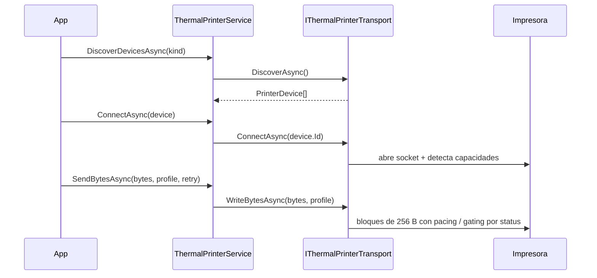

# 04 — Impresión y transports

> **Propósito**: cómo los bytes llegan a la impresora física: el orquestador
> `ThermalPrinterService`, el contrato de transport, los dos transports publicados
> (Bluetooth Classic SPP y red TCP), la detección de capacidades, el logo en memoria NV y el
> reporte de diagnóstico.
> **Fuentes primarias**: `src/MotorDsl.Printing.Abstractions/`, `src/MotorDsl.Bluetooth/`,
> `src/MotorDsl.Network/`,
> `docs/10_developer_guide/transports-y-extensibilidad.md`,
> `docs/10_developer_guide/diagnostics.md`.
> La generación de los bytes está en [03_renderizado-base](03_renderizado-base.md); la UI de
> selección de impresora en [05_maui-ui-renderers](05_maui-ui-renderers.md).

---

## 1. Reparto de responsabilidades

| Capa | Quién | Responsabilidad |
|---|---|---|
| Orquestación | `ThermalPrinterService` | Ciclo de vida de la conexión, ruteo por `Kind`, retry exponencial, eventos, historial de fallos |
| Transporte | `IThermalPrinterTransport` | **Solo** escribir bytes en el medio físico: descubrir, conectar, escribir, desconectar |
| Política de error | `IPrintErrorHandler` | Decidir reintentar o abortar según el tipo de error |

El transport **no** reintenta ni reconecta por su cuenta: eso vive en el servicio. Un transport
que falla al escribir invalida su conexión y deja subir la excepción.



---

## 2. `IThermalPrinterService` — el orquestador

Implementación: `ThermalPrinterService` (`Printing.Abstractions/Services/`). Implementa
`INotifyPropertyChanged`, por lo que los controles MAUI se enlazan directamente.

| Miembro | Comportamiento |
|---|---|
| `IsConnected`, `CurrentDevice`, `ConnectionState`, `LastError` | Propiedades notificadas |
| `CurrentCapabilities` | Delega en `_activeTransport.Capabilities`; `null` si no hay transport |
| `RecentFailures` / `ClearFailures()` | Ring buffer acotado y thread-safe de fallos; no persiste a disco |
| `ErrorOccurred`, `DevicesDiscovered` | Eventos |
| `DiscoverDevicesAsync(kind?, ct)` | Recorre **todos** los transports (filtrando por `Kind` si se indica) y combina resultados. Una excepción de un transport no aborta el barrido: se registra en `LastError` y se emite `ErrorOccurred` |
| `ConnectAsync(device, ct)` | Busca el transport cuyo `Kind` coincida con `device.Kind`. Si no hay ninguno: `LastError`, estado `Failed`, error de tipo `Protocol` y devuelve `false` |
| `DisconnectAsync()`, `ReconnectAsync(ct)` | `Reconnect` reconecta al `CurrentDevice`; `false` si no hay ninguno |
| `SendBytesAsync(data, profile?, retry?, ct)` | Envío con retry (§3) |
| `ProvisionLogoAsync` / `IsLogoProvisionedAsync` / `ClearLogoAsync` | Delegan en el transport activo (§6) |

`PrinterConnectionState`: `Disconnected`, `Scanning`, `Connecting`, `Connected`, `Reconnecting`,
`Failed`.

---

## 3. Envío con retry

`SendBytesAsync` aplica defaults `PrinterProfile.Thermal58mm` y `new PrintRetryOptions()`
(`MaxRetries = 3`, `InitialDelayMs = 500`). Lanza `InvalidOperationException` si no hay transport
activo.

Por cada intento:

1. `WriteBytesAsync` en el transport. Éxito → `OnPrintSuccess(attempt)` y retorno.
2. Excepción → se clasifica con `PrintError.FromException` y se emite `ErrorOccurred`.
3. Se consulta `IPrintErrorHandler.HandleErrorAsync`. Si dice no reintentar **o** se agotaron los
   intentos: se registra **una** entrada en el historial y se propaga envuelta en
   `Exception("Print failed after N attempt(s): …")`.
4. Si reintenta: `OnRetryAttempt`, espera **exponencial** (`InitialDelayMs × 2^(intento−1)`:
   500 ms, 1 s, 2 s) y un intento **silencioso** de reconexión.

### Clasificación de errores

| Excepción | `PrintErrorType` | ¿`DefaultPrintErrorHandler` reintenta? |
|---|---|---|
| `PrinterHardwareException` | `Hardware` | **No** — sin papel o tapa abierta no mejora reintentando |
| `IOException`, `SocketException` | `Connection` | Sí |
| `TimeoutException`, `TaskCanceledException` | `Timeout` | Sí |
| Otra | `Unknown` | Sí |
| (sin mapeo automático) | `Protocol` | No |

`DefaultPrintErrorHandler` tiene todos sus métodos `virtual`; `MauiPrintErrorHandler` lo hereda y
agrega logging y eventos para feedback en UI (ver [05_maui-ui-renderers](05_maui-ui-renderers.md)).

### Historial de fallos

`PrintFailureEntry` guarda timestamp, identidad **cruda** del dispositivo, snapshot de
capacidades, tipo y mensaje de error, intentos, **longitud** del payload y `RenderTarget`.
Nunca guarda el payload. El enmascarado de la identidad se aplica al construir el reporte de
diagnóstico, no al registrar.

---

## 4. `IThermalPrinterTransport` — el contrato

```csharp
public interface IThermalPrinterTransport
{
    string Kind { get; }                       // "bluetooth", "usb", "wifi", …
    bool IsConnected { get; }
    PrinterDevice? CurrentDevice { get; }
    PrinterCapabilities? Capabilities => null; // default: no aplica

    Task<IReadOnlyList<PrinterDevice>> DiscoverAsync(CancellationToken ct = default);
    Task<bool> ConnectAsync(string deviceId, CancellationToken ct = default);
    Task DisconnectAsync();
    Task WriteBytesAsync(byte[] data, PrinterProfile profile, CancellationToken ct = default);

    // Aprovisionamiento NV — implementaciones default no-op
    Task<NvLogoResult> ProvisionLogoAsync(byte[] gsV0Bytes, int keycode, CancellationToken ct = default);
    Task<bool> IsLogoProvisionedAsync(int keycode, CancellationToken ct = default);
    Task ClearLogoAsync(int keycode, CancellationToken ct = default);
}
```

Los miembros de NV y `Capabilities` tienen **implementación default en la interfaz**: un transport
nuevo (USB, BLE) solo implementa los cinco métodos base. Registro:

```csharp
services.AddSingleton<IThermalPrinterTransport, MiTransport>();
```

Varios transports pueden coexistir: el servicio rutea por `PrinterDevice.Kind`. El proyecto publica
**dos**:

| Paquete | `Kind` | Medio | Plataformas |
|---|---|---|---|
| `MotorDsl.Bluetooth` | `bluetooth` | Bluetooth Classic SPP | Solo Android (§5) |
| `MotorDsl.Network` | `network` | Socket TCP al puerto 9100 | Android, iOS y escritorio (§5-bis) |

Guía paso a paso para escribir uno propio en
`docs/10_developer_guide/transports-y-extensibilidad.md` §3–§6.

`PrinterProfile` (distinto de `DeviceProfile`, ver [02_dsl-y-modelos](02_dsl-y-modelos.md) §8)
define el **temporizado del envío**: `LineDelayMs` 150, `ByteDelayMs` 5, `InitDelayMs` 100,
`FinalDelayMs` 500, `QrDelayMs` 300, `ImageDelayMs` 500, `CutDelayMs` 500,
`InitCommandDelayMs` 300. Perfiles predefinidos: `PrinterProfile.Thermal58mm` y
`PrinterProfile.Real58HB6` (modelo 58HB6-6101, calibrado por self-test).

---

## 5. `BluetoothPrinterTransport` — Bluetooth Classic SPP

`Kind = "bluetooth"`. TFMs `net10.0-android;net10.0-ios`; **iOS lanza
`PlatformNotSupportedException`** (iOS no soporta Bluetooth Classic SPP). Está partido en
5 archivos `partial`:

| Archivo | Contenido | Plataforma |
|---|---|---|
| `BluetoothPrinterTransport.cs` | Ciclo de vida: `DiscoverAsync`, `ConnectAsync`, `WriteBytesAsync`, `DisconnectAsync`, `InvalidateConnection` | `#if ANDROID` |
| `.Detection.cs` | Sondeos e I/O de status sobre el socket (`DLE EOT`, `GS ( L`, `GS I`) | `#if ANDROID` |
| `.Nv.cs` | Aprovisionamiento del logo en memoria NV | `#if ANDROID` |
| `.Capabilities.cs` | Lógica **pura**: clasificación del byte de status y decisión de pacing | multiplataforma |
| `.Chunking.cs` | Lógica **pura**: partición del buffer en bloques | multiplataforma |

Los dos archivos puros viven fuera de todo `#if` y `MotorDsl.Tests` los **enlaza por fuente**
(`<Compile Include="..\MotorDsl.Bluetooth\…" Link="Linked\…" />`), porque el proyecto solo
targetea android/ios y no puede referenciarse desde `net10.0`. Ver [07_tests](07_tests.md).

### Escritura de bytes

- **Chunking de tamaño fijo** de 256 bytes sobre todo el buffer, **independiente del contenido**:
  la salida `escpos-bitmap` contiene `0x0A` arbitrarios en los datos de píxeles, así que **no se
  puede partir por LF**. `ChunkBuffer` devuelve `ArraySegment` (vista, sin copiar) y reensamblar
  los segmentos en orden reproduce el array original exacto.
- **Pacing de respaldo**: un delay por **bloque** (no por byte), `max(profile.ByteDelayMs, 1)`.
- **Gating por status**: solo si la detección reportó `StatusFeedback == Supported`. Cada N
  bloques consulta `DLE EOT n=1` y espera a que la impresora esté lista.
- **Fast-fail de hardware** antes del primer bloque: ante señal inequívoca de fin de papel o tapa
  abierta lanza `PrinterHardwareException` → el handler **no** reintenta.
- Ante `IOException` / `Java.IO.IOException` (p. ej. *broken pipe* por overrun) invalida la
  conexión y **relanza sin envolver**, para que el servicio reconecte en el próximo intento.

> **Límite honesto documentado en el código**: `DLE EOT` da liveness/papel/error en tiempo real,
> **no** una cuenta de bytes libres del buffer. No es flow control perfecto. Donde no hay feedback
> —o el status se vuelve ilegible— el transport **degrada** al pacing fijo sin abortar, y una vez
> degradado no vuelve a consultar el status en ese envío.

### Parseo del byte de status (lógica pura, testeada)

| Función | Regla |
|---|---|
| `HasValidStatusFixedBits(b)` | Máscara `0b1001_0011`, esperado `0b0001_0010`. Descarta ruido y eco de la línea |
| `ClassifyStatusResponse(byte?)` | `null` (timeout) → `NotDetected`; bits válidos → `Supported`; ruido → `NotDetected` |
| `ParseStatusByte(byte?)` | `null` o bits inválidos → `Unknown`; bit3 (`0x08`, offline) → `Busy`; si no → `Ready` |

---

## 5-bis. `NetworkPrinterTransport` — red TCP 9100

`Kind = "network"`. TFM **`net10.0` puro**, y esa es la propiedad central: al no llevar sufijo de
plataforma es consumible desde `net10.0-android`, `net10.0-ios` y escritorio por herencia de TFM.
Es el **único camino de impresión en iOS**, donde `MotorDsl.Bluetooth` lanza
`PlatformNotSupportedException` (§5). Decisión y alternativas descartadas en
`PrintThermal_Motor_Maui-docs/docs/04-decisions/ADR-0005-transport-red-net10-puro.md`.

| Archivo | Contenido |
|---|---|
| `NetworkPrinterTransport.cs` | Ciclo de vida: `DiscoverAsync`, `ConnectAsync`, `WriteBytesAsync`, `DisconnectAsync`, `InvalidateConnection` |
| `NetworkPrinterTransport.Endpoints.cs` | Lógica **pura**: `TryParseEndpoint` / `FormatEndpoint` |
| `NetworkPrinterOptions.cs` | Endpoints conocidos, timeouts y tamaño de bloque |
| `MotorDslNetworkServiceCollectionExtensions.cs` | `AddNetworkPrinterTransport(configure?)` |

Sin `#if` en ningún archivo: `System.Net.Sockets` es BCL. Por eso `MotorDsl.Tests` lo referencia
por `<ProjectReference>` y no por el enlace de fuente que necesita el transport Bluetooth
(ver [07_tests](07_tests.md)).

### Identificación del dispositivo

`deviceId` es un endpoint: `192.168.1.50` (puerto 9100 por defecto), `192.168.1.50:9101` o
`[fe80::1]:9100`. También admite nombres de host — la resolución la hace el socket, no el parser.
`FormatEndpoint` produce la forma canónica y es la inversa exacta de `TryParseEndpoint`.

### Escritura de bytes

Replica el patrón de §5 para que un mismo documento salga igual por cualquier medio: `InitDelayMs`
antes del primer bloque, **chunking de tamaño fijo** de 256 bytes vía `TransportChunking.ChunkBuffer`
(helper público en `Printing.Abstractions`, compartido), un retardo de pacing por bloque con piso de
1 ms, y `FinalDelayMs` al cerrar.

> Sobre TCP el pacing es **conservador, no imprescindible**: el control de flujo real lo aporta el
> protocolo. En SPP hace falta porque el perfil emula el canal de datos pero no las líneas RTS/CTS.

### Errores

`IOException` y `SocketException` se relanzan **sin envolver** y con `IsConnected = false`. No es
estilo: `PrintError.FromException` mapea ambas a `Connection` —que reintenta— y envolverlas en
`Exception` las degradaría a `Unknown`; y `ReconnectInternalAsync` del servicio solo reconecta si
`IsConnected` quedó en false. El vencimiento de los timeouts propios se traduce a
`TimeoutException`. `DisconnectAsync` **nunca lanza**.

### Descubrimiento y capacidades

`DiscoverAsync` devuelve los endpoints declarados en `NetworkPrinterOptions`, descartando en
silencio los inválidos; no barre la subred. `Capabilities` devuelve `null` y los métodos NV usan
los defaults del contrato: no hay sondeo `DLE EOT` en esta versión, así que el envío siempre usa
pacing fijo. mDNS y detección de capacidades quedan como extensión.

---

## 6. Capacidades tri-estado y logo NV

`PrinterCapabilities` es un `record` inmutable con `StatusFeedback`, `NvGraphics`,
`NvGraphicsKind` (`"gsl"` | `"fs"` | `null`) y `ModelId` (best-effort desde `GS I`).
`PrinterCapabilities.Unknown()` es el estado inicial.

`CapabilitySupport` es **tri-estado por decisión de diseño** (ADR-0004): un «no contestó» puede
ser «no lo soporta» o «estaba ocupada», así que **nunca** se modela como `bool`.

| Valor | Significado |
|---|---|
| `Unknown` | No se pudo determinar (excepción al sondear, o aún no sondeado) |
| `NotDetected` | Se sondeó y no respondió: puede no soportarlo o estar ocupada |
| `Supported` | Respondió confirmando la capacidad |

La detección se hace **una vez al conectar**, acotada en tiempo: vaciar el buffer de entrada →
sondear feedback (`DLE EOT n=1`, hasta 3 intentos de ~400 ms) → sondear NV (`GS ( L`, consulta no
intrusiva) → `ModelId` best-effort (`GS I`). Todo está defendido: **ningún sondeo hace fallar la
conexión** y **ninguna lectura bloquea** — los reads se gatean por `Available()` y solo se lee
cuando hay datos disponibles.

### Aprovisionamiento del logo

`ProvisionLogoAsync(gsV0Bytes, keycode, ct)` recibe el **mismo formato `GS v 0`** que la app ya
produce para imágenes inline y devuelve `NvLogoResult(Success, Kind, Message)`.

> **Honestidad declarada en el código**: el soporte real de la familia `FS` se confirma recién al
> aprovisionar (no hay query limpia); por eso un `Success` con `Kind = "fs"` incluye un `Message`
> advirtiendo que esa confirmación es limitada. Si ninguna familia acepta el *define*,
> `Success = false`.

Circuito completo del logo: la app aprovisiona el logo en NV → setea `nv_logo_keycode` y
`nv_logo_kind` como capacidades del `DeviceProfile` → el `EscPosRenderer` ve un `ImageNode` con
`role: "logo"` y emite el *recall* (pocos bytes) en vez de rasterizar el bitmap completo. Las
firmas (`role: "signature"`) van **siempre inline**.

`PrintStrategySelector.RecommendTarget(caps, docNeedsGraphics)` es un helper **puro** que solo
**recomienda**: `NvGraphics == Supported` → `"escpos"`; si no → `"escpos-bitmap"`. La decisión
final es de la app. El parámetro `docNeedsGraphics` está reservado para heurísticas futuras.

---

## 7. Diagnóstico

`IDiagnosticsReportProvider` construye un `DiagnosticsReport` y lo serializa en tres formatos:

| Método | Salida | Uso |
|---|---|---|
| `Build(notes?, includePii = false)` | `DiagnosticsReport` | Snapshot actual |
| `ToJson(report)` | JSON estructurado | Email, share, log |
| `ToPlainText(report)` | Texto formateado | Portapapeles |
| `ToDslJson(report, paperWidthChars = 32)` | DSL `integrated` | Se imprime como ticket con `IDocumentEngine.Render` |

`DiagnosticsReport` (record) agrupa: `Libraries` (`LibraryInfo`), `App` (`AppInfoSnapshot`),
`Device` (`DeviceInfoSnapshot`), `Printer` (`PrinterInfoSnapshot`, opcional), `Permissions`
(`PermissionsSnapshot`, solo Android), `CapturedAt`, `Notes` y `Failures` (historial acotado,
opcional).

`includePii = false` por defecto: la MAC completa solo se incluye si se pide explícitamente.

Implementación MAUI (`MauiDiagnosticsReportProvider`) y el patrón de UI de tres botones
(ver / imprimir / compartir): [05_maui-ui-renderers](05_maui-ui-renderers.md) y
`docs/10_developer_guide/diagnostics.md`.

---

## 8. Fuentes

| Tema | Archivo |
|---|---|
| Contratos | `src/MotorDsl.Printing.Abstractions/Contracts/*.cs` |
| Orquestador | `src/MotorDsl.Printing.Abstractions/Services/ThermalPrinterService.cs` |
| Modelos de impresión | `src/MotorDsl.Printing.Abstractions/Models/*.cs` |
| Transport Bluetooth | `src/MotorDsl.Bluetooth/BluetoothPrinterTransport*.cs` |
| Transport de red | `src/MotorDsl.Network/NetworkPrinterTransport*.cs` |
| Handler por defecto | `src/MotorDsl.Core/Printing/DefaultPrintErrorHandler.cs` |
| Guía de transports custom | `docs/10_developer_guide/transports-y-extensibilidad.md` |
| Guía de diagnóstico | `docs/10_developer_guide/diagnostics.md` |
| Perfiles reales | `docs/10_developer_guide/perfiles-impresoras-reales.md` |
| Tests | `src/MotorDsl.Tests/{CapabilityDetectionTests,CU23CapabilityTests,ChunkBufferTests,StatusFlowControlTests,Phase4NvLogoTests,PrintErrorHandlerTests,PrintFailureLogTests,DiagnosticsBuilderTests}.cs` |
| Tests del transport de red | `src/MotorDsl.Tests/{NetworkTransportTests,NetworkEndpointTests,NetworkTransportDiTests,TransportChunkingTests}.cs` |
| Decisión de diseño | `PrintThermal_Motor_Maui-docs/docs/04-decisions/ADR-0005-transport-red-net10-puro.md` |
