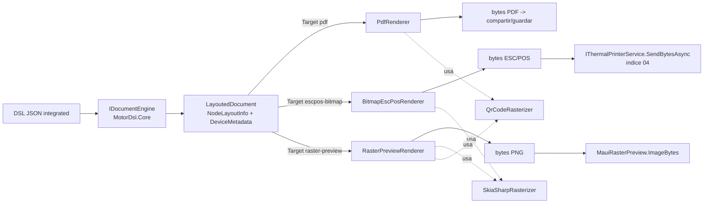
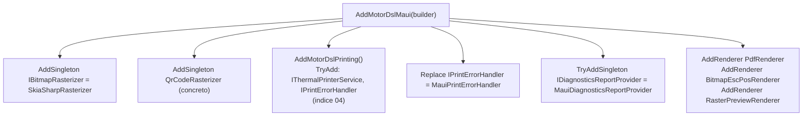

# 05 — Capa MAUI: controles, renderers y diagnóstico (`MotorDsl.Maui`)

> **Propósito**: mapa destilado de la capa .NET MAUI de MotorDsl: controles de UI listos para
> usar (badge de estado, picker de impresoras, previews, vista de diagnóstico), los renderers
> registrables por `Target` (`pdf`, `escpos-bitmap`, `raster-preview`), los rasterizadores
> (SkiaSharp, QR), el error handler MAUI, el provider de diagnóstico y el punto de entrada DI
> `AddMotorDslMaui`.
> **Fuentes primarias**: `src/MotorDsl.Maui/**` del repo `PrintThermal_Motor_Maui`.
> Versión de referencia: **v1.0.13 @83677eb**. Rutas relativas a `PrintThermal_Motor_Maui/src/`.
> El orquestador de impresión y el transport BT se cubren en `04_impresion-transports.md`
> (no se duplican aquí).

---

## 1. Vista general del proyecto

```
MotorDsl.Maui/
├── Controls/                      # 6 controles MAUI (ContentView/ContentPage, sin XAML)
│   ├── PrinterStatusBadge.cs
│   ├── PrinterPickerView.cs
│   ├── PrinterPickerPage.cs
│   ├── MauiRasterPreview.cs
│   ├── MauiDocumentPreview.cs
│   └── MauiDiagnosticsView.cs
├── Renderers/                     # IRenderer por Target + rasterizadores
│   ├── PdfRenderer.cs             #   Target "pdf" (+ MotorDslFontResolver)
│   ├── BitmapEscPosRenderer.cs    #   Target "escpos-bitmap"
│   ├── RasterPreviewRenderer.cs   #   Target "raster-preview"
│   ├── SkiaSharpRasterizer.cs     #   IBitmapRasterizer (base64 -> raster 1-bit)
│   └── QrCodeRasterizer.cs        #   QR -> SKBitmap (QRCoder + SkiaSharp)
├── Printing/MauiPrintErrorHandler.cs
├── Diagnostics/MauiDiagnosticsReportProvider.cs
├── Resources/Fonts/DroidSans-Regular.ttf   # EmbeddedResource (csproj#L45)
└── MotorDslMauiServiceCollectionExtensions.cs  # AddMotorDslMaui
```

Todos los controles se construyen por código (sin XAML) y usan `BindableProperty` para poder
bindearse desde XAML del consumer.

---

## 2. Controles (`MotorDsl.Maui/Controls/`)

| Control | Propósito | Propiedades / bindables clave | Archivo |
|---|---|---|---|
| `PrinterStatusBadge` (ContentView) | Badge de estado de un `IThermalPrinterService`: color + texto por `ConnectionState`; se auto-actualiza vía `PropertyChanged` (marshalled a main thread) y se desuscribe en `Unloaded`. | Bindable `Service` (`IThermalPrinterService`). Colores: gris `#9E9E9E` Desconectado, azul `#1976D2` Buscando, naranja `#F57C00` Conectando/Reconectando, verde `#388E3C` Conectado (+nombre device), rojo `#D32F2F` Error (+`LastError`). | `MotorDsl.Maui/Controls/PrinterStatusBadge.cs#L13-L138` (colores `#L96-L137`) |
| `PrinterPickerView` (ContentView) | Descubre dispositivos vía `IThermalPrinterService.DiscoverDevicesAsync(FilterKind)` y conecta al seleccionar. Si descubre exactamente uno y `AutoConnectIfSingle`, conecta solo. Si la conexión falla no notifica: el servicio emite `ErrorOccurred` y el badge refleja el estado. | Bindables `Service`, `FilterKind` (string, ej. `"bluetooth"`), `AutoConnectIfSingle` (bool, default `true`). Eventos `DeviceSelected(PrinterDevice)`, `ScanError(Exception)`. Métodos públicos `ScanAsync()`, `ConnectAsync(device)`. | `MotorDsl.Maui/Controls/PrinterPickerView.cs#L10-L211` |
| `PrinterPickerPage` (ContentPage) | Página **modal** que envuelve `PrinterPickerView` + botón Cancelar; hace `PopModalAsync` al conectar o cancelar. | Ctor `(IThermalPrinterService service, string? filterKind = null)`; título "Seleccionar impresora". | `MotorDsl.Maui/Controls/PrinterPickerPage.cs#L9-L47` |
| `MauiRasterPreview` (ContentView) | Muestra el PNG producido por `RasterPreviewRenderer` con zoom para simular vista pixelada; scroll en ambos ejes; placeholder "(sin vista previa)". Mide el tamaño nativo del PNG con `SKBitmap.Decode` para fijar `WidthRequest = ancho * zoom`. | Bindables `ImageBytes` (`byte[]`), `ZoomFactor` (double, default `2.0`). | `MotorDsl.Maui/Controls/MauiRasterPreview.cs#L9-L124` |
| `MauiDocumentPreview` (ContentView) | Preview textual de un `LayoutedDocument`: labels monoespaciadas (Consolas) ordenadas por `LineNumber`/`ColumnNumber`; bold desde metadata `bold`; QR/barcode en azul itálica, bitmap en verde itálica. Origen: reutilizado de SampleApp (Sprint 08, TK-66). | Bindable `Document` (`LayoutedDocument`, de MotorDsl.Core). | `MotorDsl.Maui/Controls/MauiDocumentPreview.cs#L9-L102` |
| `MauiDiagnosticsView` (ContentView) | Vista de detalle de un `DiagnosticsReport` en secciones con borde: Librería, Aplicación, Dispositivo, Impresora (opcional), Permisos (opcional), Notas (opcional) + footer "Capturado: fecha". | Bindable `Report` (`DiagnosticsReport`). | `MotorDsl.Maui/Controls/MauiDiagnosticsView.cs#L12-L200` |

---

## 3. Renderers (`MotorDsl.Maui/Renderers/`)

Implementan `IRenderer` (`MotorDsl.Core/Contracts/IRenderer.cs`) y se registran en el registry
del motor vía `MotorDslBuilder.AddRenderer<T>()` (`MotorDsl.Extensions/MotorDslBuilder.cs#L36`).
La app elige renderer por su string `Target` (recomendación automática en
`PrintStrategySelector.RecommendTarget`, ver índice 04).

| Renderer | `Target` | Qué produce | Dependencias | Archivo |
|---|---|---|---|---|
| `PdfRenderer` | `"pdf"` | PDF A4 multipágina: texto con word-wrap por medición real (`XGraphics.MeasureString`) y page-break automático; QR como imagen (vía `QrCodeRasterizer` → PNG → `XImage`); bitmap base64 embebido escalado (máx. 400pt); barcode como texto fallback `[Código: data]`. Estado encapsulado en `PdfRenderState` (página/gfx/cursor Y). | PdfSharpCore, SkiaSharp, QRCoder (indirecta). Fuente: `MotorDslFontResolver` resuelve SIEMPRE a `DroidSans` embebida (`GetFont` lee el EmbeddedResource; lanza si falta). | `MotorDsl.Maui/Renderers/PdfRenderer.cs#L48-L123` (resolver `#L15-L42`, estado `#L129-L302`) |
| `BitmapEscPosRenderer` | `"escpos-bitmap"` | Bytes ESC/POS: Init + nodos ordenados + CutFull. Nodos `is_bitmap` → `IBitmapRasterizer.Rasterize` → `GS v 0` (`1D 76 30 00 xL xH yL yH data`, `#L133-L144`); `is_qr` → comandos `GS ( k` (tamaño 3, ECC M); `is_barcode` → EAN13; texto con alineación/bold ASCII. Ancho de imagen acotado por capability `bitmap_max_width_px` del profile (default 384). Fail-loud con contexto: si una imagen no rasteriza, aborta el ticket con error preciso (`Image rasterization failed (source='…')`); imagen decodificada pero toda en blanco → warning, no aborta. | `MotorDsl.Rendering` (`EscPosCommands`), `IBitmapRasterizer`. | `MotorDsl.Maui/Renderers/BitmapEscPosRenderer.cs#L14-L177` |
| `RasterPreviewRenderer` | `"raster-preview"` | PNG que simula el raster térmico (texto mono 1-bit sin antialias, bitmaps, QR, barcode-fallback) para preview sin hardware. Dos pases: (1) precalcula alto total pre-rasterizando QR/bitmaps, (2) dibuja sobre `SKBitmap`. Ancho de canvas = capability `bitmap_max_width_px` (default 384); `fontSize = anchoChar/0.6` (ratio monospace); tipografía DroidSans embebida con fallback `monospace`. | SkiaSharp, `IBitmapRasterizer`, `QrCodeRasterizer`. | `MotorDsl.Maui/Renderers/RasterPreviewRenderer.cs#L14-L252` |

Rasterizadores auxiliares (no son `IRenderer`):

| Clase | Rol | Detalles clave | Archivo |
|---|---|---|---|
| `SkiaSharpRasterizer` | Implementa `IBitmapRasterizer` (MotorDsl.Core): base64 (`data:image/...;base64,` o crudo) → `RasterizedImage` 1-bit apto para `GS v 0`. | Limpia el base64 (prefijo data:, saltos de línea, espacios); escala al ancho pedido manteniendo aspecto; umbral: gris (luma 299/587/114) `< 128` **y** alpha `> 128` → bit encendido; `widthBytes = ceil(px/8)`. Decodifica con `SKImage.FromEncodedData` (no `SKBitmap.Decode`) — ver hallazgo H2. | `MotorDsl.Maui/Renderers/SkiaSharpRasterizer.cs#L13-L91` |
| `QrCodeRasterizer` | QR string → `SKBitmap` 1-bit sin antialias, replicando el aspecto de impresora térmica. Reutilizado por `PdfRenderer` y `RasterPreviewRenderer`. | `Rasterize(data, moduleSize=4, ecc=M)` vía QRCoder `PngByteQRCode` + `SKBitmap.Decode`; `Measure` devuelve tamaño en px. Se registra como singleton concreto (sin interfaz). | `MotorDsl.Maui/Renderers/QrCodeRasterizer.cs#L11-L46` |

### 3.1 Pipeline de render (dónde encaja cada Target)



Los renderers leen los nodos desde `document.NodeLayoutInfo` ordenados por
`LineNumber`/`ColumnNumber` y discriminan por metadata: `is_qr`+`qr_data`,
`is_bitmap`+`bitmap_source`(+`bitmap_width`), `is_barcode`+`barcode_data`, `bold`
(`BitmapEscPosRenderer.cs#L37-L113`, `PdfRenderer.cs#L69-L112`,
`RasterPreviewRenderer.cs#L160-L194`).

---

## 4. Error handling y diagnóstico MAUI

| Clase | Rol | Detalles | Archivo |
|---|---|---|---|
| `MauiPrintErrorHandler` | `IPrintErrorHandler` para MAUI: hereda la política retry/abort de `DefaultPrintErrorHandler` (Connection/Timeout → retry; Hardware/Protocol → abort) y agrega observabilidad. **No bloquea el retry loop con dialogs.** | Eventos públicos `RetryAttempted(PrintError)` y `Succeeded(int totalAttempts)` para snackbar/toast; `LogRetries` (default `true`) → `Debug.WriteLine("[Print] Attempt i/N: Type - Message")`. | `MotorDsl.Maui/Printing/MauiPrintErrorHandler.cs#L12-L36` |
| `MauiDiagnosticsReportProvider` | Implementación MAUI de `IDiagnosticsReportProvider` (contrato en índice 04). Usa `AppInfo`/`DeviceInfo` de Maui Essentials; recibe `IThermalPrinterService?` opcional por DI para snapshotear la impresora. | `Build(notes, includePii)`: librerías = assemblies cargados con prefijo `MotorDsl.` (nombre + Version + InformationalVersion, dedup y orden); snapshot de impresora y fallos delegados en el `DiagnosticsBuilder` puro de Abstractions (enmascarado de MAC según `includePii`); permisos SOLO en Android (`#if ANDROID`): sondea `Permissions.Bluetooth` y `LocationWhenInUse`. `ToJson`: JSON indentado, ignora nulls. `ToPlainText`: secciones `[LIBRERIA] [APLICACION] [DISPOSITIVO] [IMPRESORA] [PERMISOS] [FALLOS RECIENTES] [NOTAS]`. `ToDslJson(paperWidthChars=32)`: documento DSL `"integrated"` (root container vertical con nodos text/image) imprimible por el motor, con QR de payload compacto `ver=…\|app=…\|dev=…\|os=…\|t=unix`. | `MotorDsl.Maui/Diagnostics/MauiDiagnosticsReportProvider.cs#L18-L48` (librerías `#L50-L87`, permisos `#L135-L168`, DSL `#L265-L405`) |

---

## 5. DI — `AddMotorDslMaui`

Extensión sobre `MotorDslBuilder` (de `MotorDsl.Extensions`), archivo
`MotorDsl.Maui/MotorDslMauiServiceCollectionExtensions.cs#L22-L33`:



Semántica de registro (deliberada, documentada en el docstring `#L14-L21`):
- `Replace` para `IPrintErrorHandler`: **pisa** el default de `AddMotorDslPrinting` (y cualquier
  registro previo) con `MauiPrintErrorHandler`.
- `TryAddSingleton` para `IDiagnosticsReportProvider`: el consumer puede registrar su propio
  provider ANTES de llamar `AddMotorDslMaui` y prevalece.
- El transport NO se registra aquí: la app debe llamar además `AddBluetoothPrinterTransport()`
  (índice 04) u otro transport, o `ThermalPrinterService` lanzará al construirse.

---

## 6. TFMs y dependencias (`MotorDsl.Maui.csproj`)

| Aspecto | Valor | Fuente |
|---|---|---|
| TFMs | `net10.0-android` ; `net10.0-ios` | `MotorDsl.Maui/MotorDsl.Maui.csproj#L4` |
| Min OS | iOS 15.0 ; Android 25.0 (ver hallazgo H3) | `#L11-L12` |
| MAUI | `UseMaui=true`, `ImplicitUsings`, `Nullable` | `#L7-L9` |
| Android nativo | `AndroidLdFlags -Wl,-z,max-page-size=16384` (páginas 16KB) | `#L33-L35` |
| ProjectReferences | `MotorDsl.Core`, `MotorDsl.Rendering`, `MotorDsl.Extensions`, `MotorDsl.Printing.Abstractions` | `#L37-L42` |
| NuGet | `SkiaSharp.Views.Maui.Controls 3.119.2` ; `PdfSharpCore 1.3.67` ; `QRCoder 1.8.0` | `#L48-L52` |
| Recursos | `Resources/Fonts/DroidSans-Regular.ttf` como EmbeddedResource (la consumen `MotorDslFontResolver` y `RasterPreviewRenderer.LoadEmbeddedTypeface`) | `#L44-L46` |
| Paquete | `PackageId MotorDsl.Maui`, MIT, repo `Aplicada-Streaming/PrintThermal_Motor_Maui` | `#L14-L20` |

---

## 7. Hallazgos y matices (con fuente)

- **H1 — `_baseRenderer` declarado pero no usado**: `BitmapEscPosRenderer` declara
  `private readonly EscPosRenderer _baseRenderer = new();` y su docstring dice "para el resto,
  delega al EscPosRenderer base", pero `Render` emite por sí mismo texto/QR/barcode y nunca
  referencia `_baseRenderer` (`MotorDsl.Maui/Renderers/BitmapEscPosRenderer.cs#L10-L17` vs
  `#L26-L127`). Comentario y código divergen.
- **H2 — Workaround SkiaSharp 3.x**: `SKBitmap.Decode(byte[])` devuelve null para PNGs
  perfectamente válidos (reproducido con PNG 1x1); por eso `SkiaSharpRasterizer.DecodeSource`
  usa la ruta robusta `SKImage.FromEncodedData` → `SKBitmap.FromImage`
  (`MotorDsl.Maui/Renderers/SkiaSharpRasterizer.cs#L82-L89`).
- **H3 — Min Android inconsistente entre proyectos**: `MotorDsl.Maui` exige Android 25.0
  (`MotorDsl.Maui.csproj#L12`) mientras `MotorDsl.Bluetooth` exige 24.0
  (`MotorDsl.Bluetooth.csproj#L11`). El piso efectivo de una app que use ambos es 25.0.
- **H4 — Sync-over-async en permisos**: `SnapshotPermissions` (Android) resuelve
  `Permissions.CheckStatusAsync<T>()` con `.GetAwaiter().GetResult()` dentro de `Build`
  (`MotorDsl.Maui/Diagnostics/MauiDiagnosticsReportProvider.cs#L144-L153`); cada probe está
  defendido con catch → `"Error: <tipo>"`.
- **H5 — Threading en el badge**: `PrinterStatusBadge` re-renderiza vía
  `MainThread.BeginInvokeOnMainThread` porque `PropertyChanged` del servicio puede llegar de un
  hilo de fondo (`MotorDsl.Maui/Controls/PrinterStatusBadge.cs#L76-L85`).
- **H6 — Fallo de conexión silencioso en el picker**: `PrinterPickerView.ConnectAsync` no expone
  el fallo; el contrato es que el servicio emite `ErrorOccurred` y el badge lo refleja
  (`MotorDsl.Maui/Controls/PrinterPickerView.cs#L201-L210`).
- **H7 — PDF siempre con una sola fuente**: `MotorDslFontResolver.ResolveTypeface` resuelve
  cualquier familia/estilo a `DroidSans` regular embebida; el bold del PDF sale de `XFontStyle.Bold`
  sobre esa misma cara (`MotorDsl.Maui/Renderers/PdfRenderer.cs#L38-L41`, `#L150-L151`).

---

## 8. Contrato de metadata (`DeviceMetadata`) consumida por los renderers

Claves que los tres renderers leen de `LayoutInfo.DeviceMetadata` del `LayoutedDocument`
(las produce el motor/layout de MotorDsl.Core, fuera de alcance de este índice):

| Clave | Tipo esperado | Semántica | Consumidores (archivo#línea) |
|---|---|---|---|
| `is_qr` | `bool` (true) | El nodo es un QR. | `PdfRenderer.cs#L76`, `BitmapEscPosRenderer.cs#L87`, `RasterPreviewRenderer.cs#L162` |
| `qr_data` | `string` no vacío | Payload del QR. | `PdfRenderer.cs#L77-L78`, `BitmapEscPosRenderer.cs#L89`, `RasterPreviewRenderer.cs#L163` |
| `is_bitmap` | `bool` (true) | El nodo es una imagen. | `PdfRenderer.cs#L85`, `BitmapEscPosRenderer.cs#L47`, `RasterPreviewRenderer.cs#L174` |
| `bitmap_source` | `string` base64 (con o sin prefijo `data:image/...;base64,`) | Fuente de la imagen. | `PdfRenderer.cs#L86-L87`, `BitmapEscPosRenderer.cs#L49-L51`, `RasterPreviewRenderer.cs#L175` |
| `bitmap_width` | numérico | Ancho deseado: en PDF se toma en puntos (máx 400); en escpos-bitmap se multiplica ×8 px y se acota por `bitmap_max_width_px`. | `PdfRenderer.cs#L89-L93`, `BitmapEscPosRenderer.cs#L53-L55` |
| `is_barcode` | `bool` (true) | El nodo es un código de barras. | `PdfRenderer.cs#L99`, `BitmapEscPosRenderer.cs#L95`, `RasterPreviewRenderer.cs#L186` |
| `barcode_data` | `string` | Payload del barcode (EAN13 en escpos-bitmap; texto fallback en pdf/preview). | `BitmapEscPosRenderer.cs#L97`, `PdfRenderer.cs#L100-L103`, `RasterPreviewRenderer.cs#L187` |
| `bold` | `bool` (true) | Negrita del texto. | `PdfRenderer.cs#L109`, `BitmapEscPosRenderer.cs#L105`, `RasterPreviewRenderer.cs#L126` |

Del `DeviceProfile` los renderers leen: capability `bitmap_max_width_px` (default 384 px de
ancho de cabezal — `BitmapEscPosRenderer.cs#L52`, `RasterPreviewRenderer.cs#L32`) y
`profile.Width` en chars (default 32 — `RasterPreviewRenderer.cs#L33`). El orden de dibujo es
siempre `LineNumber` → `ColumnNumber`; en pdf/escpos-bitmap solo se procesan nodos con
`WrappedText` no vacío (`BitmapEscPosRenderer.cs#L37-L40`, `PdfRenderer.cs#L69-L71`).

## 9. Semántica de errores por renderer (`RenderResult`)

| Renderer | Aborta (AddError, Output vacío) | Degrada (warning o fallback, sigue) | Fuente |
|---|---|---|---|
| `PdfRenderer` | Catch global → `"PDF error: {msg}"` (Output queda null). | QR que falla → texto `[QR: data] (error: …)`; bitmap que falla → texto `[Imagen]`. | `PdfRenderer.cs#L118-L121`, `#L207-L210`, `#L233-L236` |
| `BitmapEscPosRenderer` | Imagen que NO rasteriza → error PRECISO `Image rasterization failed (source='…')` + `Output = []` (aborta el ticket, fail-loud con contexto); catch global → `"BitmapEscPos rendering failed"`. | Imagen decodificada pero toda en blanco (placeholder transparente típico) → `AddWarning`, el ticket se imprime igual. | `BitmapEscPosRenderer.cs#L60-L79`, `#L120-L126` |
| `RasterPreviewRenderer` | Catch global → `"RasterPreview error: {msg}"` + `Output = []`. | Bitmap que no rasteriza → `AddWarning` y reserva una línea de alto; sigue dibujando. | `RasterPreviewRenderer.cs#L68-L72`, `#L152-L156` |

## 10. Constantes visuales y de layout (valores en v1.0.13)

| Ámbito | Constante | Valor | Fuente |
|---|---|---|---|
| PDF (`PdfRenderState`) | Margen de página | 40 pt | `PdfRenderer.cs#L131` |
| PDF | Gap entre líneas | 4 pt | `PdfRenderer.cs#L132` |
| PDF | Tamaño de página | A4 (page-break automático via `EnsureSpace`) | `PdfRenderer.cs#L148,L160-L170` |
| PDF | Fuente | DroidSans 12 (regular y bold) | `PdfRenderer.cs#L150-L151` |
| PDF | QR | 150×150 pt, `moduleSize=6` | `PdfRenderer.cs#L186-L191` |
| PDF | Bitmap | ancho default 150 pt, máx 400 pt / ancho útil de página | `PdfRenderer.cs#L89-L92,L221` |
| Raster preview | Padding vertical | 16 px | `RasterPreviewRenderer.cs#L38` |
| Raster preview | Alto de línea | `fontSize * 1.4`; `fontSize = max(10, anchoCharPx/0.6)` | `RasterPreviewRenderer.cs#L34-L37` |
| Raster preview | Gap tras QR/bitmap | 8 px; margen X lateral 8 px | `RasterPreviewRenderer.cs#L57,L66,L196-L201` |
| Raster preview | QR | `moduleSize=4` | `RasterPreviewRenderer.cs#L55` |
| ESC/POS bitmap | QR | tamaño 3, ECC M (`QrSetSize3`/`QrSetErrorM`), `GS ( k` | `BitmapEscPosRenderer.cs#L146-L160` |
| ESC/POS bitmap | Barcode | EAN13 + terminador `0x00`; texto en ASCII | `BitmapEscPosRenderer.cs#L162-L169,L108` |
| Rasterizador 1-bit | Umbral | negro si luma (299/587/114) `< 128` **y** alpha `> 128` | `SkiaSharpRasterizer.cs#L38-L48` |
| Badge | Colores por estado | ver tabla de controles (sección 2) | `PrinterStatusBadge.cs#L96-L137` |

## 11. Receta de integración (bootstrap DI verificado)

`AddMotorDslEngine()` (de `MotorDsl.Extensions`) crea el `MotorDslBuilder` y registra el motor;
el registry incluye de fábrica `TextRenderer` y `EscPosRenderer` (targets base de
`MotorDsl.Rendering`) más todos los `IRenderer` registrados en DI
(`MotorDsl.Extensions/MotorDslServiceCollectionExtensions.cs#L14-L33`).

```csharp
// MauiProgram.cs (firmas reales de la librería)
builder.Services
    .AddMotorDslEngine()        // motor + registry (MotorDsl.Extensions)
    .AddMotorDslMaui();         // renderers pdf/escpos-bitmap/raster-preview,
                                // SkiaSharpRasterizer, QrCodeRasterizer,
                                // ThermalPrinterService, MauiPrintErrorHandler,
                                // MauiDiagnosticsReportProvider
builder.Services.AddBluetoothPrinterTransport();  // MotorDsl.Bluetooth (ver indice 04)
```

Sin un transport registrado, `ThermalPrinterService` lanza `InvalidOperationException` al
construirse (ver índice 04, `ThermalPrinterService.cs#L86-L88`).

## 12. Glosario mínimo de la capa MAUI

| Término | Definición (1 línea) | Fuente |
|---|---|---|
| Target | String que identifica a un `IRenderer` en el registry; la app (o `PrintStrategySelector`) elige por él. | `MotorDsl.Core/Contracts/IRenderer.cs`, `Renderers/*.cs` (propiedad `Target`) |
| Renderer | Transforma un `LayoutedDocument` + `DeviceProfile` en bytes de salida (`RenderResult.Output`). | `MotorDsl.Maui/Renderers/BitmapEscPosRenderer.cs#L26` |
| Rasterizer | Convierte una fuente de imagen (base64 o payload QR) en raster 1-bit / `SKBitmap`; no es un renderer. | `Renderers/SkiaSharpRasterizer.cs#L13`, `Renderers/QrCodeRasterizer.cs#L11` |
| `RasterizedImage` | Struct/record de MotorDsl.Core: `Bits` empaquetados + `WidthBytes` + `HeightDots`, formato de `GS v 0`. | `MotorDsl.Core/Contracts/IBitmapRasterizer.cs` |
| DSL "integrated" | Formato JSON del motor (root container + children text/image) renderizable por `IDocumentEngine.Render` sin etapa Evaluate. | `Diagnostics/MauiDiagnosticsReportProvider.cs#L265-L273` |
| EmbeddedResource font | `DroidSans-Regular.ttf` embebida en el assembly; única fuente del PDF y del raster preview. | `MotorDsl.Maui.csproj#L44-L46` |
| Fail-loud | Política del renderer escpos-bitmap: ante imagen irrecuperable aborta el ticket con error preciso en vez de imprimir incompleto. | `Renderers/BitmapEscPosRenderer.cs#L60-L73` |
