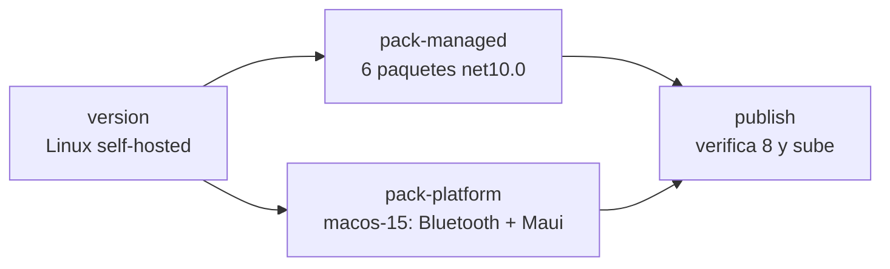

# 08 — Build, CI/CD y publicación

> **Propósito**: explicar cómo se compila, prueba, versiona y publica el proyecto, y por qué el
> pipeline tiene la forma que tiene.
> **Fuentes primarias**: `.github/workflows/` (6 archivos), `scripts/` (`local/`, `mobile/`,
> `nuget/`), `.devcontainer/`, `PrintThermalDriver.slnx`, `NuGet.config`,
> `docs/09_devops/`, `CHANGELOG.md`.

---

## 1. La restricción que explica todo

`dotnet pack` de un proyecto multi-TFM **exige compilar todos sus TFM**. `MotorDsl.Bluetooth` y
`MotorDsl.Maui` declaran `net10.0-android;net10.0-ios`, y el workload `ios` **no existe para
Linux**: `dotnet workload install ios` responde *«Workload ID ios isn't supported on this
platform»* y el build corta con `NETSDK1178`.

De ahí se derivan tres consecuencias que aparecen en todo el pipeline:

1. Los seis paquetes `net10.0` se empaquetan en el runner self-hosted Linux; los dos multi-TFM,
   en `macos-15`. **Es una restricción estructural, no una preferencia.**
2. El script de publicación local es un `.bat` y no se portó a `.sh`: un port a Linux solo
   podría empaquetar 6 de 8.
3. El devcontainer cubre únicamente los TFM `net10.0`.

---

## 2. Los seis workflows

| Workflow | Dispara | Runner | Qué hace |
|---|---|---|---|
| `ci.yml` | push a `main` (ignorando `**.md` y `docs/**`) y todo pull request a `main` | self-hosted `i7infra-dev` | Restore, build y `dotnet test` de `MotorDsl.Tests`. Sube los `.trx` (7 días) y comenta el PR si falla |
| `cd-nuget.yml` | tags `v*`, push a `main`, `workflow_dispatch` | Linux + `macos-15` | Publica los 8 paquetes. Ver §3 |
| `cd-android.yml` | push a `main`, tags `v*`, `workflow_dispatch` | self-hosted `i7infra-dev` | APK de `SampleApp` y `MultaApp` (matriz de 2), subidos como artefacto |
| `cd-ios-sampleapp.yml` | push, `workflow_call` | `macos-15` | Build de `MotorDsl.SampleApp` para simulador iOS |
| `cd-ios-multaapp.yml` | push, `workflow_call` | `macos-15` | Ídem para `MotorDsl.MultaApp` |
| `cd-ios-multaapp.nuget.yml` | push, `workflow_call` | `macos-15` | Ídem para la variante que consume NuGet |

SDK fijado en todos: **`10.0.102`** (variable `DOTNET_VERSION`).

Los tres workflows de iOS son largos porque además de compilar **instalan el entorno**:
descargan Xcode desde Google Drive con `gdown`, lo descomprimen e instalan, verifican
simuladores, purgan versiones de .NET que no se usan e instalan los workloads. Antes del build
validan los manifests de iOS y versionan el bundle desde la versión de la app.

---

## 3. `cd-nuget.yml` — publicación en cuatro jobs



**`version`** — resuelve un único número para los 8:

| Origen del disparo | Versión |
|---|---|
| tag `v*` | el nombre del tag sin la `v` |
| `workflow_dispatch` | el input `version` |
| push a `main` | `0.0.0-preview.<run_number>` |

Se propaga por `outputs`. Un número compartido evita `NU1605` (downgrade de dependencia) en
apps que mezclen varios paquetes.

**`pack-managed`** (Linux self-hosted) — restore, build Release, **`dotnet test`** y `pack` de
`Core`, `Parser`, `Rendering`, `Extensions`, `Printing.Abstractions` y `Network`, con
`-p:PackageVersion=$VERSION`.

**`pack-platform`** (`macos-15`) — instala los workloads `ios android maui-android` y empaqueta
`Bluetooth` y `Maui`. macOS es la única plataforma donde conviven los tres workloads.

**`publish`** — junta los artefactos de ambos jobs y **verifica que sean exactamente 8**:

```bash
if [ "$COUNT" -ne 8 ]; then
  echo "::error::Se esperaban 8 paquetes y hay $COUNT. No se publica un conjunto incompleto."
  exit 1
fi
```

Después empuja a nuget.org **en orden de dependencias** —`Printing.Abstractions` primero, los
consumidores después— con `--skip-duplicate`. El push real solo ocurre si el disparo fue un tag
`v*` o un `workflow_dispatch`: los push a `main` empaquetan y verifican, pero no publican.

---

## 4. Versionado

Esquema **SemVer** `MAJOR.MINOR.PATCH`; los builds automáticos de `main` usan
`0.0.0-preview.<n>` y no llegan al feed.

**La versión no vive en los `.csproj`.** Ninguno de los 8 proyectos empaquetables declara
`<Version>`: se inyecta en build/pack con `-p:PackageVersion`, `/p:Version` y
`-p:MotorDslVersion`. Documento completo: `docs/09_devops/estrategia-versionado_v1.0.md`.

Las versiones publicadas son **inmutables**: no se puede republicar un número ya usado. Por eso
`tag-next-version.sh` verifica que el tag no exista antes de crearlo.

---

## 5. Scripts

### `scripts/nuget/`

| Script | Dónde corre | Qué hace |
|---|---|---|
| `tag-next-version.sh` | **cualquier Linux, sin SDK** | Consulta nuget.org, calcula la versión unificada, verifica que el tag no exista, lo crea y lo pushea → dispara `cd-nuget.yml`. Solo necesita `curl`, `python3` y `git`. Acepta `--dry-run` o una versión explícita |
| `publish-motordsl-nuget.bat` | **solo Windows o macOS** | Publicación completa sin pasar por CI: resuelve la API key, calcula `max(next(patch))` de los 8 paquetes, build y push |
| `build-motordsl-nuget.bat` | solo Windows o macOS | Solo empaqueta |
| `get-next-version.ps1` | Windows | Cálculo de la próxima versión |

`tag-next-version.sh` existe para cubrir exactamente el hueco que `cd-nuget.yml` no llena:
**elegir el número de versión**. El workflow lo toma del tag.

### `scripts/local/` y `scripts/mobile/`

Atajos `.bat` para correr los samples por ADB y publicar APK firmados. Ver
[06 §6](06_samples.md).

---

## 6. Devcontainer — desarrollar en Linux

`.devcontainer/` permite trabajar sin instalar el SDK en la máquina anfitriona.

| Aspecto | Decisión |
|---|---|
| Imagen base | `mcr.microsoft.com/dotnet/sdk:10.0` (GA) |
| Por qué no la de devcontainers | `mcr.microsoft.com/devcontainers/dotnet:1-10.0` entrega hoy el SDK `10.0.100-rc.2`, y tanto el CI como el runner trabajan sobre versiones GA |
| Usuario | `vscode` no privilegiado, creado con el UID del host para que los archivos generados no queden como root |
| `postCreateCommand` | `dotnet restore src/MotorDsl.Tests/MotorDsl.Tests.csproj` — arrastra por `ProjectReference` los seis proyectos `net10.0` |
| Extensiones | `ms-dotnettools.csdevkit`, `ms-dotnettools.csharp`; solución por defecto `PrintThermalDriver.slnx` |

**Alcance declarado**: cubre solo los TFM `net10.0` — `Core`, `Parser`, `Rendering`,
`Extensions`, `Printing.Abstractions`, `Network` y `Tests`. `net10.0-android` necesita JDK y
Android SDK (~4 GB) y se valida en el runner self-hosted; `net10.0-ios` es imposible en Linux.

---

## 7. Solución y configuración

`PrintThermalDriver.slnx` es una solución en **formato XML nuevo** (`.slnx`, no `.sln`), con
tres carpetas: `/github.workflow/` (los 6 YAML), `/samples/` (los 5 proyectos, cuatro con
`<Deploy Solution="Debug|*">`) y `/src/` (los 9 proyectos).

`NuGet.config` en la raíz define las fuentes de paquetes. `nupkg/` recibe los `.nupkg`
generados y está en `.gitignore`.

---

## 8. Correcciones recientes del pipeline

Registradas en el `CHANGELOG.md` y en los mensajes de commit, útiles para no reintroducirlas:

- **`cd-android.yml` fallaba desde junio** —en `v1.0.11`, `v1.0.12`, `v1.0.13` y en cada push a
  `main`— por dos causas independientes:
  - **`NETSDK1178`**: `-f net10.0-android` filtra el *build* pero no el *restore*, que evalúa
    todos los TFM. Se resolvió declarando el TFM de iOS de forma condicional al SO en los cinco
    samples. **Ese patrón vale para las apps, no para las librerías**: aplicarlo a
    `MotorDsl.Bluetooth` o `MotorDsl.Maui` haría que empaquetar en Linux produjera en silencio
    un `.nupkg` sin el asset de iOS. Forzar `-p:TargetFrameworks=` por línea de comandos
    tampoco sirve: la propiedad se propaga a los proyectos referenciados y los `net10.0` fallan
    con `NETSDK1005`.
  - **`NU1102`**: los samples declaran `<RuntimeIdentifiers>` en plural; sin elegir uno, el
    publish resuelve el RID del host y busca `Microsoft.NETCore.App.Runtime.Mono.linux-x64`,
    que no tiene versión 10.x publicada. Se fija `-p:RuntimeIdentifier=android-arm64`.
- **`cd-nuget.yml` pasó de publicar 4 paquetes a los 8**, repartiendo el `pack` entre dos
  runners. Antes, tres de ellos dependían de un script local de Windows.
- **`ci.yml` dejó de declarar un número fijo de tests** en el nombre del job y en el comentario
  de PR: decía 185 cuando la suite ya corría 259.

---

## 9. Documentación de DevOps

`docs/09_devops/` contiene los cuatro documentos formales: `estrategia-versionado_v1.0.md`,
`guia-publicacion-nuget_v1.0.md`, `pipeline-ci-cd_v1.0.md` y `entornos-deploy_v1.0.md`. Ver
[09](09_docs-existentes.md).
